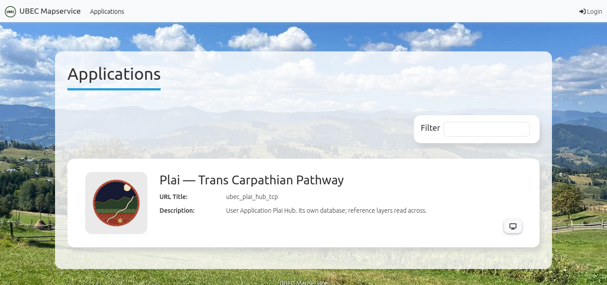
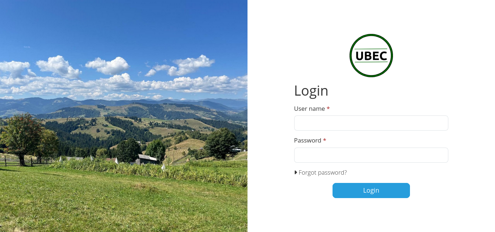
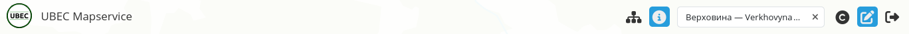
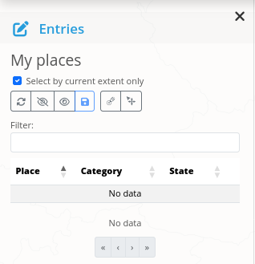
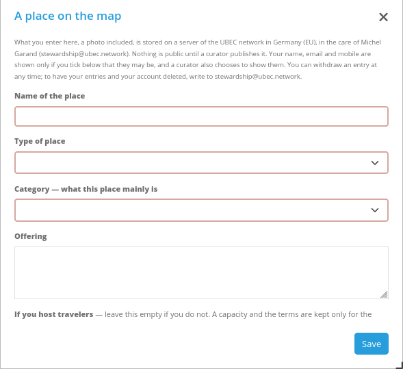
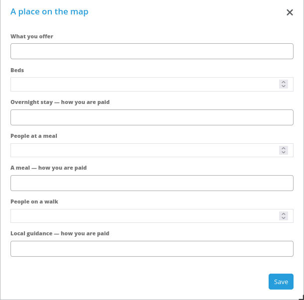
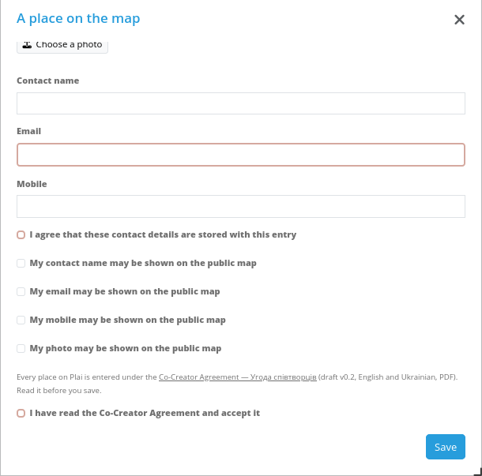

# Плай — посібник користувача

*Як позначати місця на карпатській мапі та оприлюднювати їх*

Жовтень 2026 · UBEC / Ініціатива Карпатського хабу

## Для кого цей посібник

Плай (Plai) — карпатська мапа UBEC Mapservice. Проєкт «Транскарпатські стежки» використовує її, щоб знаходити людей, які бережуть гірське життя: господарів, що пропонують нічліг, їжу, супровід чи майстер-клас, а також місця, до яких варто дійти.

Посібник призначений для двох груп людей:

| Ви | Ви використовуєте Плай, щоб |
| --- | --- |
| **Автор записів** — господар, доглядач стежки, будь-хто з обліковим записом | Позначати на мапі власні місця й оновлювати їх |
| **Куратор** | Переглядати надіслане й вирішувати, що бачитиме публіка |

Розділи 1–6 — для всіх, хто вносить місця. Розділ 7 — для кураторів.

Екрани Плаю поки що англійською. У посібнику кожну кнопку й кожне поле названо саме так, як на екрані, а поруч подано переклад.

## 1. Обліковий запис

**Як отримати обліковий запис.** Облікові записи створює адміністратор, Мішель Ґаран. Напишіть на stewardship@ubec.network, вкажіть ім'я, з яким хочете входити, та адресу електронної пошти. Для кожного облікового запису потрібна окрема адреса. Ви отримаєте ім'я користувача й пароль.

**Вхід.**

1. Відкрийте **mapservice.ubec.network**. На сторінці — перелік мап під заголовком "Applications" (застосунки).
2. Відкрийте мапу Плаю з її картки: клацніть на назву або на зображення.
3. На панелі інструментів угорі праворуч клацніть значок входу — стрілку, що входить у двері ("Log in to add places", увійти, щоб додавати місця).
4. Введіть "User name" (ім'я користувача) і "Password" (пароль) та натисніть "Login".
5. Ви повернетеся до переліку мап. Відкрийте мапу Плаю ще раз. Тепер на панелі інструментів з'явиться значок олівця — це ваш вхід до записів.

<figure class="shot"><figcaption>Рисунок 1. Перелік мап на mapservice.ubec.network із карткою Плаю.</figcaption></figure>

<figure class="shot"><figcaption>Рисунок 2. Сторінка входу.</figcaption></figure>

**Вихід.** Клацніть значок виходу в правому кінці панелі — стрілку, що виходить із дверей.

**Сеанс триває одну годину.** Через годину Плай попросить увійти знову, і все незбережене буде втрачено. Зберігайте, перш ніж відійти.

**Забули пароль.** На сторінці входу є посилання "Forgot password?", але сервіс поки що не надсилає листів. Натомість напишіть на stewardship@ubec.network, і адміністратор встановить вам новий пароль.

## 2. Сторінка мапи

Панель інструментів угорі містить, зліва направо:

<figure class="shot"><figcaption>Рисунок 3. Панель інструментів після входу: дерево шарів, інформація, пошук, джерела, олівець, вихід.</figcaption></figure>

| Значок | Що робить |
| --- | --- |
| Дерево шарів | Відкриває ліворуч перелік шарів мапи; позначте чи зніміть позначку, щоб показати або сховати шар |
| Інформація (i) | Клацніть на точку на мапі, щоб прочитати, що вона містить |
| "Place, peak or river" | Пошук міста, села, вершини чи річки з переходом до неї |
| C | Джерела: чиї дані та чий стиль мапи ви бачите |
| Олівець | Відкриває "Entries" (записи), де ви вносите й редагуєте свої місця. З'являється лише після входу |
| Стрілка й двері | Вхід або вихід |

Кнопки масштабу — на правому краї мапи. Мапу пересувають перетягуванням; масштаб змінюють коліщатком миші або двома пальцями.

## 3. Як внести місце

1. Клацніть **олівець**. Ліворуч відкриється панель "Entries" зі списком "My places" (мої місця) — усім, що ви внесли.
2. Наблизьте мапу так, щоб точно бачити, де розташоване місце. Точку буде оприлюднено там, де ви її поставите, тож будьте уважні.
3. На панелі натисніть **"Draw point"** (поставити точку), а потім клацніть один раз на мапі в потрібному місці.
4. Відкриється форма "A place on the map" (місце на мапі). Заповніть її (розділ 4).
5. Унизу форми виберіть **"State"** (стан, розділ 5) і натисніть **"Save"** (зберегти).

<figure class="shot narrow"><figcaption>Рисунок 4. Панель "Entries" зі списком "My places". Дві кнопки праворуч — "Draw point" (поставити точку) і "Move" (пересунути).</figcaption></figure>

Місце з'явиться у списку "My places" і залишиться на мапі як точка.

**"Select by current extent only"** (лише в поточній області мапи). Коли цю позначку поставлено — а так є, щойно панель відкривається, — у списку "My places" лише місця в тій частині мапи, яку ви бачите. Зніміть позначку, щоб побачити всі.

**Щоб змінити місце**, клацніть на нього у списку "My places" або на його точку на мапі. Форма відкриється знову; змініть потрібне й натисніть "Save".

**Щоб пересунути точку**, натисніть на панелі "Move" (пересунути), перетягніть точку туди, де їй місце, і збережіть. Точку поза межами території, яку охоплює Плай, буде відхилено.

**Лише точки.** Плай записує кожне місце як одну точку. Ліній чи ділянок він не пропонує.

## 4. Форма, поле за полем

Обов'язкові поля на екрані обведено червоним, доки їх не заповнено; без них форма не збережеться. У таблицях нижче вони позначені зірочкою.

<figure class="shot half"><figcaption>Рисунок 5. Початок форми: що це за місце.</figcaption></figure>

### Що це за місце

| Поле | Що вписати |
| --- | --- |
| "Name of the place" \* (назва місця) | Назву, за якою його знають: «Іванова гражда», «Джерело над Криворівнею» |
| "Type of place" \* (тип місця) | Що це за місце: господарство, садиба для гостей, колиба, джерело, оглядова точка тощо |
| "Category — what this place mainly is" \* (категорія — чим насамперед є це місце) | Для чого переважно це місце: їжа й продукти, нічліг, ремесла, супровід і прогулянки тощо. Виберіть одне |
| "Offering" (пропозиція) | Своїми словами — що ви пропонуєте або що тут є. Чесно й конкретно |

Тип каже, що це за місце; категорія — для чого воно переважно. Господарство (тип) може насамперед давати їжу й продукти (категорія) і водночас пропонувати мандрівникам нічліг — про це нижче.

### Якщо ви приймаєте мандрівників

Залиште цю частину порожньою, якщо нікого не приймаєте.

<figure class="shot half"><figcaption>Рисунок 6. Якщо ви приймаєте мандрівників: пропозиції, скільки людей і як вам платять.</figcaption></figure>

| Поле | Що вписати |
| --- | --- |
| "What you offer" (що ви пропонуєте) | Будь-що з: Overnight stay (нічліг), A meal (їжа), Local guidance (місцевий супровід), A workshop (майстер-клас) |
| "Beds" (ліжка) | Скільки людей ви можете прийняти на ніч |
| "People at a meal", "People on a walk", "People at a workshop" | Скільки людей ви можете прийняти водночас — на трапезу, на прогулянку, на майстер-клас |
| "… — how you are paid" (як вам платять) | Для кожної пропозиції — форми оплати, які ви приймаєте: Fixed contribution (фіксований внесок), Suggested contribution (рекомендований внесок), Exchange of work (обмін працею), ubec-pay or a community currency (ubec-pay або громадська валюта). Необов'язково: якщо залишити порожнім, умови повідомить Куратор |
| "Months you are open" (місяці, коли ви приймаєте) | Місяці, коли ви можете приймати людей. Залиште порожнім, якщо волієте, щоб мандрівники питали Куратора |
| "Languages you speak" (мови, якими ви розмовляєте) | Усі мови, якими ви можете прийняти гостей |
| "How to reach this place" (як дістатися) | On foot only (лише пішки), By car (автомобілем), With a pram (з дитячим візком), With a wheelchair (на інвалідному візку). "On foot only" і "By car" разом вибрати не можна |

Місткість — ціле число від 1 до 99. Місткість чи форму оплати для пропозиції, яку ви не позначили, не буде збережено: спершу позначте пропозицію.

Щоб вибрати кілька пунктів у списку, клацніть у полі й вибирайте їх по одному. Щоб прибрати пункт, клацніть маленький × поруч із ним.

Жодних сум на мапі не показано. Якщо ви берете фіксований чи рекомендований внесок, суму знає Куратор.

### Фото

"Photo — JPEG, PNG or WebP". Натисніть "Choose a photo" (вибрати фото) і виберіть одне зображення місця, до 10 МБ. Перш ніж його збережуть, із нього видаляють дані про розташування, камеру й дату та зменшують до 1600 пікселів щонайбільше. Файли інших типів відкидаються.

Фото стає публічним, лише якщо ви позначите "My photo may be shown on the public map" **і** куратор вирішить його показати. Подумайте, перш ніж надсилати фото свого дому.

### Контакти й згода

| Поле | Що вписати |
| --- | --- |
| "Contact name" (контактне ім'я) | Ім'я, яке мандрівники мають питати |
| "Email" \* | Адресу, за якою Куратор зможе зв'язатися з вами щодо цього місця |
| "Mobile" (мобільний) | Номер телефону, якщо хочете його показати |
| "I agree that these contact details are stored with this entry" \* | Ваша згода на те, що Плай зберігає ці дані. Обов'язково |
| "My contact name may be shown on the public map" | Позначте, лише якщо погоджуєтеся показати ім'я |
| "My email may be shown on the public map" | Позначте, лише якщо погоджуєтеся показати пошту |
| "My mobile may be shown on the public map" | Позначте, лише якщо погоджуєтеся показати телефон |
| "My photo may be shown on the public map" | Позначте, лише якщо погоджуєтеся показати фото |

Кожна позначка — ваш дозвіл, а не обіцянка оприлюднення: вирішує куратор. Зніміть позначку будь-коли — і ці дані зникнуть із публічної мапи.

### Угода співтворців

Просто над полем "State" форма містить посилання на **Co-Creator Agreement — Угода співтворців** — угоду, якої дотримується кожен співтворець Транскарпатських стежок, англійською та українською. Відкрийте її, прочитайте й позначте "I have read the Co-Creator Agreement and accept it" (я прочитав(-ла) угоду співтворців і приймаю її). Без цієї позначки форма не збережеться, і зняти її під час наступного збереження не можна: щоб відійти, відкличте свої місця (розділ 5) або напишіть на stewardship@ubec.network. Плай записує, яку версію угоди ви прийняли і коли.

<figure class="shot half"><figcaption>Рисунок 7. Кінець форми: фото, контакти, позначки згоди й Угода співтворців. Нижче — "State" і "Save".</figcaption></figure>

## 5. Що відбувається з місцем

Кожне місце має **стан**. Ви вибираєте його в списку "State" унизу форми.

| Ви вибираєте | Що це означає |
| --- | --- |
| "Send to the curator for publication" (надіслати куратору для оприлюднення) | Місце чекає на куратора. Публіка його ще не бачить |
| "Keep as a draft — only you see it" (залишити чернеткою — бачите лише ви) | Ніхто інший його не бачить, навіть куратор. Допишете пізніше |
| "Withdraw — take it off the map" (відкликати — прибрати з мапи) | Місце зникає з усіх публічних мап і всіх експортів. Нічого не видаляється; згодом його можна надіслати знову |

Коли куратор оприлюднює місце, його стан стає **Published** (оприлюднено), і публіка його бачить.

**Зміна оприлюдненого місця.** Якщо ви змінюєте будь-що в оприлюдненому місці — назву, пропозиції, точку, — воно повертається до куратора й зникає з публічної мапи, доки його не оприлюднять знову. Зміна лише позначки згоди цього не робить: зняття позначки просто прибирає ці дані з мапи.

**Якщо ви йдете з Плаю.** Щоб видалити всі ваші місця й обліковий запис, напишіть на stewardship@ubec.network.

## 6. Що бачить публіка

Кожен, хто відкриває мапу Плаю без входу, бачить лише оприлюднені місця:

- **Точку** — саме там, де її поставили. Господаря, тобто місце з принаймні однією пропозицією, позначено вохрою, інші місця — червоним.
- **Клацання на точку** інструментом інформації показує назву, тип, категорію, пропозицію, пропозиції для мандрівників, місяці, мови, як дістатися, місткість і форми оплати.
- **Контактне ім'я, пошта, телефон і фото** з'являються, лише якщо автор поставив позначку **і** куратор вирішив їх показати.

Чернетки, місця, що чекають на куратора, і відкликані місця ніколи не бувають публічними.

## 7. Для кураторів

Куратор переглядає надіслане й вирішує, що оприлюднити. Куратор ніколи не змінює відповідей автора: якщо спробувати, база даних поверне їх назад.

### Черга

Увійдіть і клацніть олівець. Якщо ваш обліковий запис може також вносити місця, угорі панелі "Entries" є список, що перемикає між "My places" і **"Curation"** (курування). Виберіть "Curation".

У списку — усі місця, що чекають ("Submitted", надіслано) або оприлюднені ("Published"), з назвою місця та тим, хто його вніс ("Entered by"). Чернетки й відкликані місця тут не з'являються: це справа самого автора.

### Перегляд місця

Клацніть на місце у списку або на його точку на мапі. Форма "Curation" показує все, що дав автор, лише для читання. Поля про прийом гостей показано короткими кодами:

| Поле | Коди |
| --- | --- |
| Offers (пропозиції) | lodging (нічліг), meal (їжа), guiding (супровід), workshop (майстер-клас) |
| Terms (умови) | fixed (фіксований внесок), suggested (рекомендований), work (обмін працею), ubec (ubec-pay або громадська валюта) |
| Months open (місяці) | jan, feb, mar, … dec — від січня до грудня |
| Languages (мови) | uk, en, de, fr, pl, ro, sk, hu, cs, rue (русинська), rom (ромська), ru |
| Reach (як дістатися) | foot (лише пішки), car (автомобілем), pram (з візком), wheelchair (на інвалідному візку) |

### Оприлюднення

1. Перегляньте місце. Чи пропозиція чесна й конкретна? Чи стоїть точка там, де місце?
2. У частині "What the public sees" (що бачить публіка) позначте, що можна показати: "Show the contact name", "Show the email", "Show the mobile", "Show the photo". Поле можна показати лише там, де автор погодився, — про це каже позначка над кожним. Позначку "Show" без згоди автора буде відхилено під час збереження.
3. Установіть "State" на **"Published"** і натисніть "Save".

Щоб на якийсь час прибрати місце з публічної мапи, поверніть йому стан **"Submitted"**. Відкликати місце може лише автор.

**Перш ніж дім господаря стане публічним**, пам'ятайте: оприлюднена точка під час війни, та ще й з іменем, — це адреса. Де поставити точку, вирішує автор; оприлюднювати її чи ні — ви.

### Як вносити місця самому

Куратор, чий обліковий запис водночас є записом автора, може вносити місця — за господаря, який не може зробити цього сам, і місця на шляху, як-от оглядову точку чи джерело.

- Те, що ви вносите, — **ваш** запис, під вашим іменем. Господар не може його змінити чи відкликати; це робите ви за нього.
- Зберігайте згоду господаря на папері. Позначки згоди у формі тоді ставите ви від його імені.
- Позначка угоди у формі — теж ваша. Господар приймає угоду в аркуші, який підписує з вами (її частина III).
- Місце, яке ніхто не приймає, однаково потребує категорії й пошти: виберіть "Something else" (щось інше) і вкажіть власну пошту.

## 8. Якщо щось пішло не так

| Ви бачите | Що це означає |
| --- | --- |
| Форма не зберігається, поле виділено | Обов'язкове поле порожнє або число поза межами від 1 до 99 |
| Збереження відхилено з помилкою | Найчастіше: вибрано водночас "On foot only" і "By car", або точка лежить поза територією, яку охоплює Плай. Для куратора: позначка "Show" там, де автор не погодився |
| "Your session has expired" (сеанс завершився) | Увійдіть знову; незбережене втрачено. Якщо повідомлення з'являється одразу після входу, ця дія вашому обліковому запису не дозволена: напишіть адміністраторові, що ви робили |
| На панелі немає олівця | Ви не ввійшли, або ваш обліковий запис ще не додано до групи авторів: напишіть адміністраторові |
| Вашого місця немає на публічній мапі | Це чернетка, воно чекає на куратора, його змінили після оприлюднення або відкликали |

**Допомога.** Пишіть Мішелеві Ґарану: stewardship@ubec.network.

*Плай — частина UBEC Mapservice, яку UBEC (Ubuntu Bioregional Economic Commons) розгорнув на власному сервері в Німеччині, під юрисдикцією ЄС. Посібник поширюється за ліцензією CC BY-SA 4.0.*
