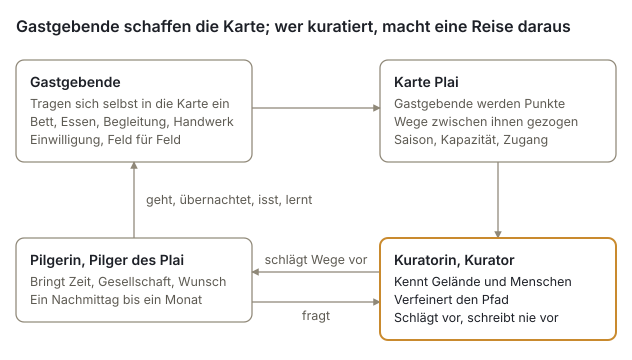
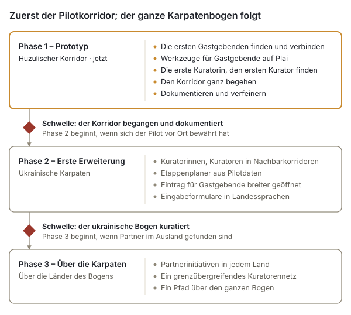

# Trans-Carpathian Pathways

*Ein lebendiges Netzwerk aus Ort, Menschen und Weg – Projektzusammenfassung und Projektvorschlag*

Oktober 2026 · UBEC / Karpaten-Hub-Initiative · Entwurf v0.8

## Zusammenfassung

Trans-Carpathian Pathways verbindet die Menschen, die das Leben in den Karpatenbergen noch lebendig halten, mit den Pilgerinnen und Pilgern des Plai: Menschen, die ihnen begegnen wollen, langsam und zu Fuß. Es ist ein lebendiges Netzwerk aus Gastgeberinnen und Gastgebern, aus einem Weg, der von dort aus wächst, wo diese Gastgebenden sind, aus Wegepatinnen und Wegepaten, die jeweils einen Abschnitt davon pflegen, und aus Kuratorinnen und Kuratoren vor Ort, die das Ganze zusammenhalten.

Der erste Korridor liegt im huzulischen Hochland im Westen der Ukraine, zwischen Worochta, Werchowyna und Kossiw. Das Projekt läuft auf Plai, dem Karpaten-Hub von UBEC Mapservice: einem selbst betriebenen Kartendienst in der EU, der bereits eine Grundkarte des gesamten Karpatengebirges enthält und eine durch Einwilligung gesteuerte Möglichkeit, mit der Menschen sich selbst darauf eintragen können.

| | |
| --- | --- |
| Was | Eine Pilgerinfrastruktur aus Gastgeberinnen und Gastgebern, Wegen sowie Kuratorinnen und Kuratoren |
| Wo zuerst | Worochta, Werchowyna und Kossiw, Region Iwano-Frankiwsk, Ukraine |
| Wo danach | Die ukrainischen Karpaten, dann die übrigen Länder des Karpatenbogens |
| Grundlage | Plai – der Karpaten-Hub von UBEC Mapservice |
| Initiiert von | UBEC (Ubuntu Bioregional Economic Commons), geleitet von Michel Garand, Zhyva Khata, geleitet von Vasyl Yuskiv, und Tepla Gora, geleitet von Andriy Grushetsky |
| Stand | Prototyp: technische Grundlage vorhanden, erste Gastgeberinnen und Gastgeber sowie eine erste Kuratorin oder ein erster Kurator werden gesucht |

Wir suchen Menschen, die mitmachen: Gastgeberinnen und Gastgeber, Wegepatinnen und Wegepaten sowie Kuratorinnen und Kuratoren im Korridor, Partnerinnen und Partner entlang des Karpatenbogens, technische Mitwirkende sowie Förderinnen und Förderer für die Pilotphase.

## Der Bedarf

Zwei Probleme treffen in den Karpaten aufeinander, und sie haben eine gemeinsame Antwort: die echte Begegnung zwischen Reisenden und einem Ort.

**Reisen wird immer häufiger extraktiv.** Reisende ziehen durch Orte, ohne sie zu berühren, und der größte Teil des Geldes, das sie dort lassen, geht an Menschen, die nicht dort leben. Die Begegnung zwischen einem Menschen und einem Ort, um derentwillen man einst reiste, wird immer häufiger zur Transaktion.

**Die Berggemeinschaften dünnen aus.** Überall im Karpatenbogen sind Dörfer von Abwanderung, vom Verlust traditionellen Wissens und von wirtschaftlicher Marginalisierung betroffen. Eine Lebensweise, die über Jahrhunderte gewachsen ist, verschwindet leise. Im huzulischen Hochland werden seit Langem Gäste empfangen – auf Höfen, auf den Polonynas (Hochweiden), in Werkstätten –, und das Projekt beginnt nicht bei null. Doch viele derer, die die alte Lebensweise bewahren, stehen auf keiner touristischen Karte, und sie werben nicht für sich.

Wer als Pilgerin oder Pilger unter dem Dach eines anderen Menschen schläft, an dessen Tisch isst und lernt, wie etwas hergestellt wird, lässt Geld und Aufmerksamkeit dort, wo sie gebraucht werden. Gastgebende, die teilen, was sie tatsächlich haben, ohne es vorzuführen, gewinnen einen Grund und ein Mittel, es zu bewahren.

## Die Antwort

Trans-Carpathian Pathways baut drei ineinandergreifende Dinge auf: ein Netzwerk von Gastgebenden, einen lebendigen Weg zwischen ihnen und die Menschen, die ihn tragen – Wegepatinnen und Wegepaten für jeden Abschnitt, eine Kuratorin oder einen Kurator für das Ganze.

Gastgebende tragen sich selbst in die Karte ein; der Weg wächst von dort aus, wo sie sind; die Kuratorin oder der Kurator macht aus dieser Karte für jede Pilgerin und jeden Pilger eine Reise.

**Ein Netzwerk von Gastgebenden.** Menschen im ganzen Karpatenbogen, die sich entscheiden, etwas Echtes zu teilen. Eine Gastgeberin oder ein Gastgeber bietet eines oder mehreres davon an:

| Angebot | Was es bedeutet |
| --- | --- |
| Übernachtung | Unterkunft: ein Zimmer, eine Scheune, ein Bett |
| Eine Mahlzeit | Essen von diesem Ort, gemeinsam eingenommen oder zubereitet |
| Ortskundige Führung | Kenntnis des Landes, des Weges und seiner Geschichten |
| Ein Workshop | Ein örtliches Handwerk, hier ausgeübt und hier gelehrt |

Gastgebende sind keine Dienstleistenden. Das Angebot ist ehrlich und konkret, ohne Inszenierung und ohne Übertreibung. Aussichtspunkte, Quellen und andere Orte, an denen es sich anzukommen lohnt, werden als Orte entlang des Weges kartiert.

**Ein lebendiger Weg.** Die Route wird nicht von oben entworfen. Sie entsteht, während Gastgebende hinzukommen: Jede Gastgeberin und jeder Gastgeber wird zu einem Punkt auf der Karte, die Wege zwischen ihnen werden über das Netz der Bergwanderwege gelegt, und die Kuratorin oder der Kurator passt das Ergebnis an Gelände, Jahreszeit, Aufnahmekapazität der Gastgebenden und die menschliche Logik einer Reise an. Die Route wächst, wenn das Netzwerk wächst, und schrumpft, wenn Gastgebende nicht da sind.

**Die Kuratorin oder der Kurator des Weges.** Das Gedächtnis des Weges, meist ein Mensch aus der Gegend, der Landwirtschaft betreibt, unterrichtet oder wandert. Die Kuratorin oder der Kurator kennt einen Abschnitt des Weges und seine Gastgebenden, hört sich an, wie viel Zeit jede Pilgerin und jeder Pilger hat, mit wem sie unterwegs sind und was sie sich wünschen, schlägt eine Route vor, statt sie vorzuschreiben, und behält im Blick, wer wen wann aufnehmen kann. Die Kuratorin oder der Kurator ist kein Reisebüro, sondern Wegweiser zum Ganzen – und keine Kontrollinstanz, die den Zugang bewacht: Pilgernde können eine veröffentlichte Gastgeberin oder einen veröffentlichten Gastgeber auch selbst auf der Karte finden und direkt hingehen. Neben der Kuratorin oder dem Kurator pflegt eine **Wegepatin oder ein Wegepate** einen Abschnitt: geht ihn ab, kennt seine Gastgebenden und Orte, kann für Gastgebende, die es selbst nicht können, einen Ort eintragen und Orte entlang des Weges hinzufügen und überlässt das Veröffentlichen der Kuratorin oder dem Kurator.

## Für wen es da ist

Der Weg bietet allen Raum, die bereit sind, langsamer zu werden, für einen Nachmittag oder einen Monat. Wer kommt, ist eine **Pilgerin oder ein Pilger des Plai**. Der Plai ist der alte Karpatenweg über die Hochweiden, und die Karte ist nach ihm benannt. Die Pilgerreise gilt dem Berg und den Menschen, die ihn lebendig halten, nicht einem Heiligtum, und wer pilgert, kommt als Gast an. Dauer und Intensität wählen die Pilgernden selbst; die Kuratorin oder der Kurator gestaltet die Route um sie herum.

| Wer kommt | Eine typische Reise |
| --- | --- |
| Familie mit kleinen Kindern | Ein paar Stunden: eine Gastgeberin oder ein Gastgeber, eine Mahlzeit, ein Ausblick |
| Pilgerin oder Pilger, allein unterwegs | Tage oder Wochen tiefen Eintauchens |
| Paar | Langsames Reisen in selbst gewählter Tiefe |
| Gruppe von Freundinnen und Freunden | Gemeinsame oder getrennte Erlebnisse entlang eines Abschnitts |
| Jemand in einer Zeit des Übergangs | Die Pilgerreise als persönliche Schwelle |

**Gastgebende** erhalten eine faire, direkte Verbindung zu Pilgernden, die wegen dessen kommen, was sie tatsächlich anbieten, ohne sich selbst vermarkten zu müssen.

**Gemeinschaften** können Einkommen gewinnen, das vor Ort bleibt, und einen Grund für jüngere Menschen, den Wert von Wissen zu erkennen, das sonst verloren geht.

**Wegepatinnen und Wegepaten sowie Kuratorinnen und Kuratoren**, meist Menschen aus der Gegend, erhalten eine anerkannte Rolle als Hüterinnen und Hüter ihres Wegabschnitts und des Ganzen.

## Der Pilotkorridor

Der Prototyp verläuft durch das huzulische Hochland im Westen der Ukraine, einen der kulturell reichsten Abschnitte des Karpatenbogens, wo Wiesen noch gemäht und beweidet werden. Drei Orte verankern ihn:

| Ort | Was er birgt |
| --- | --- |
| Worochta | Tor zu den Bergen: Wald, der Pruth, der Weg hinauf zur Tschornohora |
| Werchowyna | Land der Hochweiden: Polonynas, Viehhüten und Käse |
| Kossiw | Zentrum des huzulischen Handwerks: der Samstagsmarkt, Keramik, Weberei und Holzschnitzerei |

Die Orte liegen jeweils etwa 25 km Luftlinie voneinander entfernt, insgesamt rund 50 km, sodass der Korridor eine Wanderung von mehreren Tagen ist. Die genaue Route, ihre Etappen und die Dörfer dazwischen werden von den Gastgebenden bestimmt, die sich anschließen, und durch das Begehen bestätigt, nicht im Voraus gezeichnet.

Arbeit im Korridor während der Pilotphase:

1. Die ersten Gastgeberinnen und Gastgeber finden und vernetzen: Menschen, die ein Bett, eine Mahlzeit, Führung oder ein Handwerk anbieten.
2. Ihnen helfen, sich selbst auf Plai einzutragen, jede und jeder mit einem eigenen Konto – oder, bei Gastgebenden, die es selbst nicht können, den Ort mit ihrem Einverständnis von der Kuratorin oder dem Kurator oder von einer Wegepatin oder einem Wegepaten für sie eintragen lassen –, mit ihrer Einwilligung und zu ihren Bedingungen.
3. Die erste Kuratorin oder den ersten Kurator und die ersten Wegepatinnen und Wegepaten gewinnen: Menschen aus der Gegend, die den Weg tragen.
4. Den Korridor von Anfang bis Ende so gehen, wie Pilgernde es tun würden.
5. Festhalten, was funktioniert hat, was gefehlt hat und was der nächste Korridor braucht.

## Technische Grundlage

Das Projekt beginnt nicht bei null: Seine Kartenplattform besteht bereits. Plai ist der Karpaten-Hub von UBEC Mapservice, einem Open-Source-Kartendienst, den UBEC auf einem eigenen Server in Deutschland betreibt, aufgebaut auf PostgreSQL/PostGIS, MapServer und Mapbender.

**Heute vorhanden**

- Eine Grundkarte des gesamten Karpatengebirges aus OpenStreetMap: rund 32 Millionen kartierte Objekte (Wege, Dörfer, Hütten, Quellen, Gebäude), darüber eingezeichnet die Wanderrouten.
- Eine Eingabeoberfläche, auf der eine Person einen Punkt genau dort setzt, wo sie ihn meint, und ihn beschreibt: ein Name, eine Art von Ort, eine Kategorie des Angebots, was angeboten wird, und Kontaktdaten.
- Einwilligung, in die Datenbank eingebaut: Wer einträgt, stimmt Feld für Feld zu, was gezeigt werden darf; eine Kuratorin oder ein Kurator entscheidet, was veröffentlicht wird; zurückgezogene Einträge verschwinden aus jeder Karte und jedem Export.
- Ein Foto pro Ort, vor dem Speichern von Standort- und Kameradaten bereinigt und nur dort gezeigt, wo die eintragende Person zugestimmt und eine Kuratorin oder ein Kurator entschieden hat, es zu zeigen.
- Angaben der Gastgebenden: ein Ort mit einer Liste von Angeboten, Öffnungsmonaten, Kapazität, Sprachen, wie der Ort zu erreichen ist, und den Zahlungsformen, die die Gastgeberin oder der Gastgeber annimmt, im Oktober 2026 gebaut und getestet; dazu bei jedem Eintrag ein Häkchen, dass die Person, die ihn angelegt hat, die Mitgestaltungsvereinbarung gelesen hat.
- Schutzvorkehrungen, die getroffen sind, bevor etwas öffentlich wird: Jede Instanz des Kartendienstes, Plai eingeschlossen, hat ihre eigene Datenbank, Datenlizenzen werden von der Datenbank durchgesetzt, und jeder öffentliche Endpunkt wird auf Datenlecks getestet.
- Vollständiger Export jederzeit, sodass keine Gemeinschaft auf UBEC angewiesen ist, um ihre eigenen Daten zu behalten.
- Die Oberflächen von Plai sind vorerst auf Englisch; bis sie übersetzt sind, helfen die Kuratorin oder der Kurator oder eine Wegepatin oder ein Wegepate Gastgebenden, die kein Englisch lesen – an ihrer Seite oder indem sie den Ort mit ihrem Einverständnis für sie eintragen.

**Für Pathways zu bauen**

| Baustein | Was er leistet |
| --- | --- |
| Lokale Sprachen | Eingabeformulare zuerst auf Ukrainisch, dann auf Polnisch, Slowakisch, Rumänisch und in weiteren Sprachen |
| Etappenplaner | Ein Werkzeug für Kuratorinnen und Kuratoren, das Tagesetappen zwischen Gastgeberinnen und Gastgebern nach Gehzeit und Aufstieg vorschlägt |

Der Etappenplaner ist ein Werkzeug für die Kuratorin oder den Kurator, niemals ein Ersatz. Er schlägt vor; die Kuratorin oder der Kurator entscheidet. Er gibt Begegnungen unterwegs den Vorzug vor Geschwindigkeit.

## Grundsätze

Diese Grundsätze sind für die Praxis verbindlich, keine bloßen Absichtserklärungen: Sie bestimmen jede Entscheidung über Gestaltung und Partnerschaften.

- **Ehrliches Angebot.** Gastgebende bieten nur an, was sie tatsächlich haben, und beschreiben es so, wie es ist.
- **Keine Inszenierung.** Die Begegnung ist echt, oder sie ist nichts.
- **Organisches Wachstum.** Das Netzwerk wächst von innen heraus, mit jeder Gastgeberin und jedem Gastgeber, nicht nach einem Plan, der von oben darübergelegt wird.
- **Die Kuratorin oder der Kurator als Gedächtnis.** Menschen tragen, was kein Werkzeug tragen kann; ein Werkzeug schlägt vor, ein Mensch entscheidet.
- **Wer pilgert, kommt an.** Die Reise wird durchlebt, nicht konsumiert.
- **Abseits ausgetretener Pfade.** Wo Menschen leben, nicht wohin Touristinnen und Touristen geschickt werden.
- **Ein Weg der Beziehungen.** Von Mensch zu Mensch, vom Menschen zum Land.
- **Niemand spricht für eine Gemeinschaft.** Gastgebende sprechen für ihren eigenen Ort, die Kuratorin oder der Kurator für das, was sie oder er veröffentlicht, das Projekt für sich selbst.
- **Keine Wildnis.** Mensch und Land sind ein und dasselbe; was Schutz braucht, ist die Beziehung.
- **Die Daten bleiben bei den Menschen.** Jede Person entscheidet, was über sie gezeigt wird, kann es zurücknehmen und kann es mitnehmen.
- **Kein Kalender.** Verfügbarkeit über die Saison hinaus ist ein Gespräch mit der Kuratorin oder dem Kurator, niemals ein Buchungsraster.
- **Keine Bewertungen.** Gastgebende werden ohne ihre Einwilligung nicht öffentlich benotet, in Ranglisten eingeordnet oder rezensiert.
- **Sicherheit zuerst.** Im Krieg und in den Bergen geht die Sicherheit jeder Reise vor; was Menschen schützt, liegt bei der Kuratorin oder dem Kurator, außerhalb der Plattform.
- **Ein Ort wird dort gezeigt, wo seine Gastgeberin oder sein Gastgeber ihn setzt.** Die Gastgeberin oder der Gastgeber setzt den Punkt; die Kuratorin oder der Kurator veröffentlicht den Eintrag oder hält ihn zurück.

Dieselbe Liste steht in der Mitgestaltungsvereinbarung und im Begründungsdokument, das für jeden Grundsatz die Begründung gibt.

**Was dies nicht ist:** keine Tourismusplattform, kein Buchungsdienst mit einem Kalender, der gefüllt werden soll, keine Inszenierung von Tradition und kein fertiges Produkt. Es ist eine Infrastruktur, die lebendig bleibt, während sich das Netzwerk verändert.

## Sicherheit, Einwilligung und Arbeit in Kriegszeiten

Die Pilotphase beginnt in der Ukraine während des Krieges, und das Projekt ist um diese Tatsache herum gestaltet, nicht ihr zum Trotz.

- **Die Gastgeberin oder der Gastgeber setzt den Punkt.** Ein Ort, auch ein Wohnhaus, wird dort gezeigt, wo seine Gastgeberin oder sein Gastgeber ihn auf der Karte setzt – oder wo die Kuratorin oder der Kurator oder eine Wegepatin oder ein Wegepate ihn mit dem Einverständnis der Gastgebenden gesetzt hat –, und erst, wenn die Kuratorin oder der Kurator ihn veröffentlicht hat. Gastgebende können den Punkt auch an einem nahe gelegenen Treffpunkt statt am Haus setzen und sagen das dann in den Angaben zum Ort. Gastgebende können ihn jederzeit zurückziehen; ein einmal veröffentlichter Punkt kann kopiert worden sein, und das Zurückziehen entfernt ihn von Plai, nicht aus Kopien.
- **Kontaktdaten sind zugangsgeschützt.** Ein Name, eine E-Mail-Adresse, eine Telefonnummer oder ein Foto wird nur veröffentlicht, wo die Gastgebenden zugestimmt haben und die Kuratorin oder der Kurator entschieden hat, es zu zeigen.
- **Das Sicherheitswissen liegt bei der Kuratorin oder dem Kurator, außerhalb der Plattform.** Der nächstgelegene Schutzraum bei Luftalarm und der aktuelle Zustand jeder Etappe werden bei der Kuratorin oder dem Kurator verwahrt, niemals auf Plai und niemals veröffentlicht; die Regeln für das Grenzgebiet an der rumänischen Grenze sind öffentliches Recht: Die Kuratorin oder der Kurator gibt sie allen Pilgernden, die über sie oder ihn kommen, schriftlich mit, und das Projekt veröffentlicht sie für alle, die direkt kommen.
- **Pilgernde sind für ihre eigene Vorbereitung verantwortlich.** Wer aus dem Ausland pilgert, informiert sich im eigenen Land über Reisehinweise, Versicherung, Kriegsrecht, Bargeld und die Genehmigungen, die das Grenzgebiet verlangt; das Projekt sagt, was es weiß, und verspricht nicht mehr.
- **Niemand bezahlt das Projekt.** Niemand von Trans-Carpathian Pathways – weder die Projektleitung noch eine Kuratorin oder ein Kurator noch eine Wegepatin oder ein Wegepate – verlangt Geld im Voraus, eine Anzahlung, ein Passwort, einen Reisepass oder eine Kopie davon. Pilgernde bezahlen die Gastgebenden so, wie sie es vereinbart haben. Das Projekt schreibt nur von stewardship@ubec.network; wer sonst behauptet, für das Projekt zu sprechen, ist nicht das Projekt.
- **Die Daten werden in der EU gespeichert,** auf dem eigenen Server von UBEC, getrennt von den Daten jedes anderen Projekts.

Was die Pilotphase unter diesen Bedingungen lernt, soll den Korridoren dienen, die folgen.

## Fahrplan

Das Projekt wächst in drei Phasen, und jede beginnt erst, wenn sich die vorherige vor Ort bewährt hat.

Phase 1 läuft jetzt im huzulischen Korridor. Phase 2 erweitert das Projekt entlang der ukrainischen Karpaten und nutzt, was die Pilotphase gelehrt hat. Phase 3 überschreitet Grenzen – nach Polen, in die Slowakei, nach Rumänien und in die übrigen Länder des Karpatenbogens –, mit Partnerinitiativen in jedem dieser Länder. Keine Phase ist an ein Datum gebunden: Eine Schwelle öffnet sich, wenn ihre Arbeit getan ist.

## Finanzierung

Eine Förderung der Pilotphase ginge zuerst an Menschen vor Ort und erst danach an Software. Die Kartenplattform besteht bereits, daher entfällt der größte Teil der Kosten auf menschliche Arbeit im Korridor.

| Bereich | Was er umfasst |
| --- | --- |
| Ansprache von Gastgeberinnen und Gastgebern | Gastgeberinnen und Gastgeber finden und besuchen, das Projekt erklären, bei ihnen sitzen, während sie ihre Angaben eintragen |
| Kuratorin oder Kurator, Wegepatinnen und Wegepaten | Bezahlte Rollen für die erste Kuratorin oder den ersten Kurator und die ersten Wegepatinnen und Wegepaten während der Pilotphase, mit schriftlichen Vereinbarungen, sobald ein Finanzierungsplan gesichert ist |
| Begehung des Korridors | Testreisen, Dokumentation, Sicherheitsbewertung jeder Etappe |
| Entwicklung | Formulare in den lokalen Sprachen, der Etappenplaner, falls nötig, weitere Änderungen an Plai |
| Übersetzung | Oberfläche und Projektmaterialien auf Ukrainisch und später in weiteren Sprachen der Karpatenregion |
| Hosting und Sicherheit | Server, Datensicherungen und die Schutzvorkehrungen, die die Daten der Gastgeberinnen und Gastgeber vertraulich halten |
| Recht | Die beiden rechtlichen Prüfungen – Datenschutz in Deutschland, Tourismus- und Steuerrecht in der Ukraine – und die Gründung des Kerngremiums |

Wie Gastgebende bezahlt werden, ist geklärt: Jede Gastgeberin und jeder Gastgeber wählt für jedes Angebot zwischen einem festen Beitrag, einem empfohlenen Beitrag, Arbeit gegen Kost und Logis sowie ubec-pay oder einer Gemeinschaftswährung; und die Zahlung geht direkt von den Pilgernden an die Gastgebenden – das Projekt, seine Kuratorinnen und Kuratoren und seine Wegepatinnen und Wegepaten verwahren kein Geld für Aufenthalte und nehmen keinen Anteil (die Zahlungsformen entschieden am 7. Oktober, wie die Zahlung läuft am 9. Oktober 2026). Die Mitgestaltungsvereinbarung sagt, was jede dieser Formen bedeutet. Rechtlich ist eine Zahlung für ein Bett oder eine Mahlzeit Einkommen, wie immer sie genannt wird: Jede Gastgeberin und jeder Gastgeber gibt es steuerlich an und führt ein Gästeregister nach der Kabinettsverordnung 297, und wie die Tourismusabgabe anzuwenden ist, wird vor der ersten Pilgerin oder dem ersten Pilger mit der Hromada (Gemeinde) geklärt.

**Ein Budget, als Empfehlung.** Die folgenden Zahlen sind eine Empfehlung, noch keine Entscheidung: eine Pilotphase von achtzehn Monaten ab den ersten Gastgebenden, damit der Korridor in zwei Saisons begangen wird, mit rund 25.700 €.

| Bereich | Achtzehn Monate | Anmerkung |
| --- | --- | --- |
| Kuratorin oder Kurator | 8.100 € | Teilzeit, rund 450 € im Monat |
| Zwei Wegepatinnen oder Wegepaten | 2.400 € | eine Aufwandsentschädigung von je rund 100 € im Monat für ein Jahr |
| Ansprache von Gastgeberinnen und Gastgebern | 1.500 € | Besuche, Fahrten, Druck, die Anmeldebögen |
| Begehung des Korridors | 2.000 € | zwei Saisons, Dokumentation, das Etappenverzeichnis |
| Entwicklung | 3.000 € | Änderungen an Plai, die Website, der Planer nur, falls nötig |
| Übersetzung und Materialien | 1.500 € | |
| Hosting und Sicherheit | 900 € | Server, Datensicherungen, Domain |
| Recht | 4.000 € | die beiden Prüfungen; Gründung des Kerngremiums |
| Reserve | 2.300 € | rund zehn Prozent |
| **Gesamt** | **rund 25.700 €** | |

Die Vergütungsbeträge gehen von den örtlichen Sätzen im Korridor aus und sollten an ihnen überprüft werden; die Rechtskosten gehen von zwei kurzen schriftlichen Gutachten aus. Nichts ist budgetiert für Einkommen der Gastgebenden, Software für Pilgernde oder einen zweiten Korridor, der nach den Belastungstests warten sollte, bis der erste Korridor begangen und seine Dokumentation veröffentlicht ist.

## Wie man sich beteiligen kann

Es gibt fünf Zugänge, und jeder davon prägt das Projekt von hier an mit.

| Sie sind | Sie können |
| --- | --- |
| Gastgeberin oder Gastgeber im Korridor | Ein Bett, eine Mahlzeit, Führung oder ein Handwerk anbieten, zu Ihren eigenen Bedingungen |
| Wanderin oder Wanderer, Bäuerin oder Bauer, Lehrerin oder Lehrer aus der Gegend | Wegepatin oder Wegepate werden und einen Abschnitt des Weges pflegen, oder Kuratorin oder Kurator werden und das Ganze zusammenhalten |
| Eine Initiative anderswo im Karpatenbogen | Partnerschaft für einen Korridor in Polen, der Slowakei, Rumänien oder darüber hinaus eingehen |
| Entwicklerin oder Entwickler, Kartiererin oder Kartierer, Übersetzerin oder Übersetzer | Beim Aufbau der Werkzeuge für Gastgebende in Plai, des Etappenplaners oder der Formulare in lokalen Sprachen helfen |
| Förderin, Förderer oder Stiftung | Den Pilotkorridor, seine erste Kuratorin oder seinen ersten Kurator und seine ersten Wegepatinnen und Wegepaten unterstützen |

Initiiert von UBEC (Ubuntu Bioregional Economic Commons), geleitet von Michel Garand, Zhyva Khata, geleitet von Vasyl Yuskiv, und Tepla Gora, geleitet von Andriy Grushetsky.

Kontakt: Michel Garand – stewardship@ubec.network

Die weiteren Dokumente des Projekts: das Weißbuch, das diesen Projektvorschlag den Belegen gegenüberstellt; die Mitgestaltungsvereinbarung, die sagt, was jede Rolle verspricht; und das Benutzerhandbuch für Plai. Alle liegen auf Englisch und Ukrainisch vor, unter CC BY-SA 4.0.

*Dies ist ein lebendiges Dokument. Es wird weiter verfeinert, während das Netzwerk wächst.*
