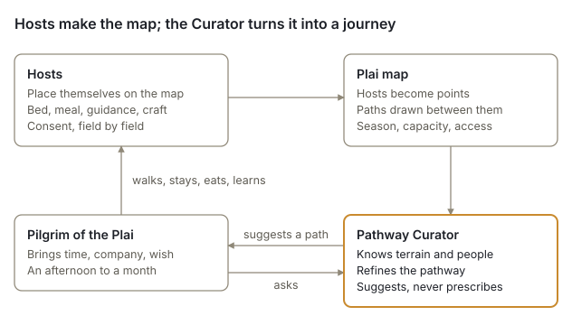
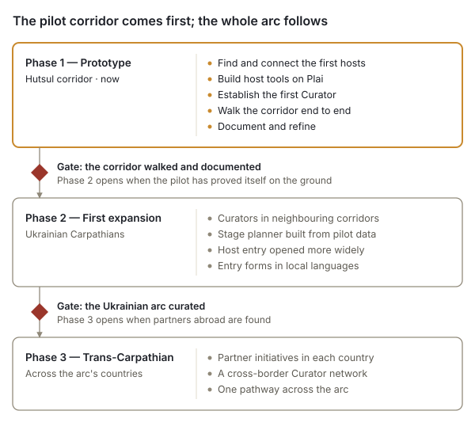

# Trans-Carpathian Pathways

*A living network of place, people and path — project summary and proposal*

October 2026 · UBEC / Carpathian Hub Initiative

## Summary

Trans-Carpathian Pathways connects the people who still keep Carpathian mountain life alive with travelers who want to meet them, slowly and on foot. It is a living network of hosts, a pathway that grows from where those hosts are, pathway stewards who care for each stretch of it, and local Curators who hold the whole.

The first corridor is in the Hutsul highlands of western Ukraine, between Vorokhta, Verkhovyna and Kosiv. The project runs on Plai, the Carpathian hub of UBEC Mapservice: a self-hosted map service in the EU that already carries a base map of the whole Carpathian range and a consent-controlled way for people to place themselves on it.

| | |
| --- | --- |
| What | A pilgrimage infrastructure of hosts, paths and Curators |
| Where first | Vorokhta, Verkhovyna and Kosiv, Ivano-Frankivsk region, Ukraine |
| Where next | The Ukrainian Carpathians, then across the arc's other countries |
| Built on | Plai — the Carpathian hub of UBEC Mapservice |
| Initiated by | UBEC (Ubuntu Bioregional Economic Commons) |
| Stage | Prototype: technical base in place, first hosts and Curator being sought |

We are looking for people to take part: hosts, stewards and Curators in the corridor, partners along the arc, technical contributors, and funders for the pilot.

## The need

Two problems meet in the Carpathians, and they share one answer: genuine encounter between a traveler and a place.

**Travel has become extraction.** Travelers move through places without touching them. Hosts perform hospitality instead of sharing it. The meeting between a person and a place, which is what travel was once for, has become a transaction.

**Mountain communities are thinning out.** Across the Carpathian arc, villages face depopulation, the loss of traditional knowledge and economic marginalisation. A way of life that took centuries to build is disappearing quietly. The people who still keep it are rarely on any tourist map, and they do not advertise.

A traveler who sleeps under someone's roof, eats at their table and learns how something is made leaves money and attention where they are needed. A host who shares what they actually have, without performing it, gains a reason and a means to keep it.

## The response

Trans-Carpathian Pathways builds three interlocking things: a network of hosts, a living pathway between them, and the people who hold it — stewards for each stretch, a Curator for the whole.

Hosts place themselves on the map; the pathway grows from where they are; the Curator turns that map into a journey for each traveler.

**A network of hosts.** People across the arc who choose to share something real. A host offers one or more of:

| Offer | What it means |
| --- | --- |
| Overnight stay | Shelter: a room, a barn, a bed |
| A meal | Food from this place, shared or prepared |
| Local guidance | Knowledge of the land, the path and its stories |
| A workshop | A local craft, made here and taught here |

Hosts are not service providers. The offer is honest and specific, with no performance and no inflation. Viewpoints, springs and other places worth arriving at are mapped as places along the way.

**A living pathway.** The route is not designed from above. It emerges as hosts join: each host becomes a point on the map, the paths between them are traced over the mountain trail network, and the Curator adjusts the result for terrain, season, host capacity and the human logic of a journey. It grows as the network grows and contracts when hosts are away.

**The Pathway Curator.** The memory of the path, usually a local farmer, teacher or walker. The Curator knows a stretch of the pathway and its hosts, listens to each traveler's time, company and wish, suggests a route rather than prescribing one, and keeps track of who can receive whom, and when. The Curator is not a travel agent but a guide to the whole — and not a gatekeeper: a traveler may also find a published host on the map and go directly. Beside the Curator, a **pathway steward** cares for one stretch: walks it, knows its hosts and places, may enter a place for a host who cannot and add places along the way, and leaves publishing to the Curator.

## Who it serves

The pathway holds anyone ready to slow down, for an afternoon or a month. Length and intensity are the traveler's choice; the Curator shapes the route around them.

| Traveler | A typical journey |
| --- | --- |
| Family with small children | A few hours: one host, one meal, one view |
| Solo traveler | Days or weeks of deep immersion |
| Couple | Slow travel at a chosen depth |
| Group of friends | Shared or split experiences along one stretch |
| Someone in transition | The pilgrimage as a personal threshold |

**Hosts** gain a fair, direct connection to travelers who come for what they actually offer, without needing to market themselves.

**Communities** gain income that stays local, and a reason for younger people to see value in knowledge that is otherwise being lost.

**Stewards and Curators**, usually local people, gain a recognised role as keepers of their stretch of the path and of the whole.

## The pilot corridor

The prototype runs through the Hutsul highlands of western Ukraine, one of the most culturally dense and naturally intact stretches of the Carpathian arc. Three towns anchor it:

| Place | What it holds |
| --- | --- |
| Vorokhta | Mountain gateway: forest, river, a traditional Hutsul settlement |
| Verkhovyna | High-pasture country and the first known hosts |
| Kosiv | Centre of Hutsul craft: the market, weavers and woodcarvers |

The three are roughly 25 km apart as the crow flies, so the corridor is a walk of several days. The exact route, its stages and its intermediate villages will be set by the hosts who join and confirmed by walking it, not drawn in advance.

Work in the corridor during the pilot:

1. Find and connect the first hosts: people who offer a bed, a meal, guidance or a craft.
2. Help them place themselves on Plai, each with their own account — or, for a host who cannot, have the Curator or a steward enter the place for them with their agreement — with their consent and on their terms.
3. Establish the first Curator and the first stewards: local people who hold the path.
4. Walk the corridor end to end as a traveler would.
5. Record what worked, what was missing and what the next corridor needs.

## Technical foundation

The project does not start from zero: its map platform already exists. Plai is the Carpathian hub of UBEC Mapservice, an open-source map service that UBEC runs on its own server in Germany, under EU jurisdiction, built on PostgreSQL/PostGIS, MapServer and Mapbender.

**In place today**

- A base map of the whole Carpathian range from OpenStreetMap: about 32 million mapped features (paths, villages, huts, springs, buildings), with hiking routes drawn on top.
- An entry surface where a person places a point exactly where they mean it and describes it: a name, a type of place, a category of offering, what is offered, and contact details.
- Consent built into the database: the entrant agrees, field by field, to what may be shown; a curator decides what is published; withdrawn entries leave every map and export.
- One photo per place, cleaned of location and camera data before it is stored, and shown only where the entrant has agreed and a curator has chosen to show it.
- Safeguards set before anything goes public: each project gets its own database, data licences are enforced by the database, and every public endpoint is tested for leaks.
- Full export at any time, so no community depends on UBEC to keep its own data.

**To be built for Pathways**

| Piece | What it does |
| --- | --- |
| Host details | More than one offer per host, season, capacity, languages spoken, accessibility, how the host is paid |
| Local languages | Entry forms in Ukrainian first, then Polish, Slovak, Romanian and others |
| Stage planner | A tool for the Curator that proposes daily stages between hosts by walking time and ascent |

The stage planner is a tool for the Curator, never a replacement. It proposes; the Curator decides. It favours encounters along the way over speed.

## Principles

These principles are operational, not aspirational: they decide every design and partnership choice.

- **Honest offer.** Hosts offer only what they actually have, and describe it as it is.
- **No performance.** The encounter is real or it is nothing.
- **Organic growth.** The network grows from the inside, host by host, not from a plan drawn above it.
- **The Curator as memory.** People hold what no tool can; a tool proposes, a person decides.
- **The traveler arrives.** The journey is undergone, not consumed.
- **Off the beaten path.** Where people live, not where tourists are sent.
- **A pathway of relationships.** Person to person, person to land.
- **No one speaks for a community.** A host speaks for their own place, a Curator for what they publish, the project for itself.
- **Not wilderness.** People and land are one and the same; what needs protecting is the relationship.
- **Data stays with the people.** Each person decides what is shown about them, can take it back, and can take it with them.
- **No calendar.** Availability beyond the season is a conversation with the Curator, never a booking grid.
- **No ratings.** Hosts are not scored, ranked or reviewed in public.
- **Safety first.** In wartime and in the mountains, safety comes before any journey; what keeps people safe is held by the Curator, off the platform.
- **A place is shown where its host puts it.** The host places the point; the Curator publishes or holds the entry.

The same list stands in the co-creator agreement and in the reasoning document, which gives each principle's reason.

**What this is not:** not a tourism platform, not a booking service with a calendar to fill, not a performance of tradition, and not a finished product. It is an infrastructure that stays alive as the network changes.

## Safety, consent and working in wartime

The pilot begins in Ukraine during the war, and the project is designed around that fact rather than despite it.

- **The host places the point.** A place, a home included, is shown where its host puts it on the map — or where the Curator or a steward put it with the host's agreement — and only once the Curator has published it. A host may place the point at a nearby meeting place instead of the house, and then says so in the place's information. The host can withdraw it at any time; a point once published may have been copied, and withdrawal removes it from Plai, not from copies.
- **Contact details are gated.** A name, email, phone number or photo is published only where the host has agreed and the Curator has chosen to show it.
- **The Curator holds safety knowledge, off the platform.** The nearest shelter during air-raid alerts and the current state of each stage are kept with the Curator, never on Plai and never published; the rules of the border zone near the Romanian border are public law and are told to every traveler in writing.
- **Travelers are responsible for their own preparation.** A traveler from abroad informs themselves, in their own country, about travel advisories, insurance, martial law, cash and the permits the border zone requires; the project tells them what it knows and promises no more.
- **Data is held in the EU,** on UBEC's own server, separate from any other project's data.

A pilot that works under these conditions will work anywhere on the arc.

## Roadmap

The project grows in three phases, and each opens only when the one before has proved itself on the ground.

Phase 1 runs now in the Hutsul corridor. Phase 2 extends along the Ukrainian Carpathians, using what the pilot taught. Phase 3 crosses borders into Poland, Slovakia, Romania and the arc's other countries, with partner initiatives in each. No phase is tied to a date: a gate opens when its work is done.

## Funding

Support for the pilot would go to people on the ground first and software second. The map platform already exists, so most of the cost is human work in the corridor.

| Area | What it covers |
| --- | --- |
| Host outreach | Finding and visiting hosts, explaining the project, sitting with them while they enter their details |
| Curator and stewards | Paid roles for the first Curator and the first stewards during the pilot, under written arrangements once a financing plan is secured |
| Walking the corridor | Test journeys, documentation, safety assessment of each stage |
| Development | Host details, local-language forms, stage planner |
| Translation | Interface and project materials in Ukrainian and later other Carpathian languages |
| Hosting and security | Server, backups and the safeguards that keep host data private |
| Legal | The two legal reads — data protection in Germany, tourism and tax law in Ukraine — and the forming of the core body |

How a host is paid is settled: each host chooses, for each offer, among a fixed contribution, a suggested contribution, exchange of work, and ubec-pay or a community currency; and payment passes directly from traveler to host — the project, its Curators and its stewards hold no money for stays and take no share (decided October 9, 2026). The co-creator agreement says what each of these means.

**A budget, recommended.** The figures below are Claude's recommendation for Michel's word, not yet a decision: a pilot of eighteen months from the first hosts, so that the corridor is walked in two seasons, at about €25,700.

| Area | Eighteen months | Note |
| --- | --- | --- |
| Curator | €8,100 | part-time, about €450 a month |
| Two pathway stewards | €2,400 | a stipend of about €100 a month each for a year |
| Host outreach | €1,500 | visits, travel, printing, the sign-on sheets |
| Walking the corridor | €2,000 | two seasons, documentation, the stage register |
| Development | €3,000 | Plai changes, the site, the planner only if needed |
| Translation and materials | €1,500 | |
| Hosting and security | €900 | server, backups, domain |
| Legal | €4,000 | the two reads; forming the core body |
| Contingency | €2,300 | ten per cent |
| **Total** | **about €25,700** | |

The pay figures assume local rates in the corridor and should be checked against them; the legal figures assume two short written opinions. Nothing is budgeted for hosts' income, software for travelers, or a second corridor, which the stress tests say should wait until the first corridor has been walked and its record published.

## How to take part

There are five ways in, and each one shapes the project from here.

| You are | You can |
| --- | --- |
| A host in the corridor | Offer a bed, a meal, guidance or a craft, on your own terms |
| A local walker, farmer or teacher | Become a pathway steward and care for a stretch of the path, or a Curator and hold the whole |
| An initiative elsewhere on the arc | Partner on a corridor in Poland, Slovakia, Romania or beyond |
| A developer, mapper or translator | Help build Plai's host tools, the stage planner or local-language forms |
| A funder or foundation | Support the pilot corridor, its first Curator and its first stewards |

The project is initiated by UBEC, the Ubuntu Bioregional Economic Commons, and led by Michel Garand from the Verkhovyna area.

Contact: Michel Garand — stewardship@ubec.network

The project's other documents: the white paper, which sets this proposal against the evidence; the co-creator agreement, which says what each role promises; and the user manual for Plai. All are in English and Ukrainian, under CC BY-SA 4.0.

*This is a living document. It will be refined as the network grows.*
