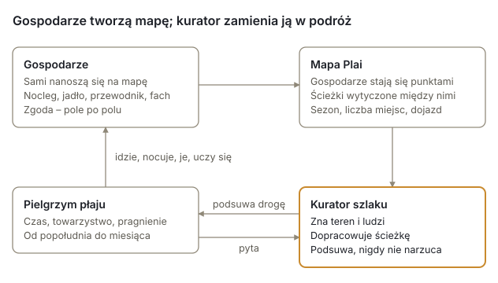
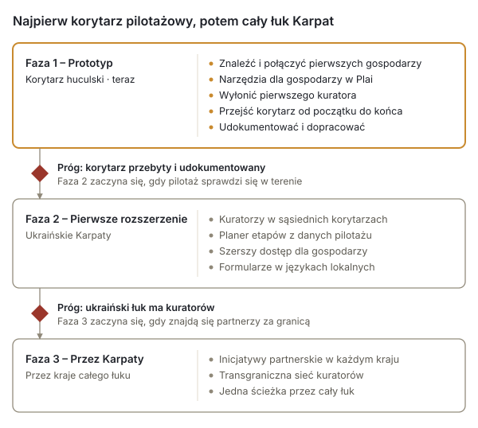

# Trans-Carpathian Pathways

*Żywa sieć miejsc, ludzi i ścieżek – streszczenie i propozycja projektu*

Październik 2026 · UBEC / Inicjatywa Karpackiego Hubu · wersja robocza v0.9

## Streszczenie

Trans-Carpathian Pathways łączy ludzi, którzy wciąż podtrzymują życie w Karpatach, z pielgrzymami płaju: ludźmi, którzy chcą ich poznać – powoli i pieszo. To żywa sieć gospodarzy, szlak, który wyrasta z miejsc, gdzie ci gospodarze są, opiekunowie szlaku, którzy dbają o każdy jego odcinek, oraz miejscowi kuratorzy, którzy czuwają nad całością.

Pierwszy korytarz leży na Huculszczyźnie, w zachodniej Ukrainie, między Worochtą, Werchowyną a Kosowem. Projekt działa na Plai, karpackim hubie UBEC Mapservice: samodzielnie utrzymywanym serwisie mapowym w UE, który ma już mapę bazową całego pasma Karpat oraz oparty na zgodzie sposób, w jaki ludzie mogą sami się na niej umieścić.

| | |
| --- | --- |
| Co | Infrastruktura pielgrzymkowia złożona z gospodarzy, ścieżek i kuratorów |
| Gdzie najpierw | Worochta, Werchowyna i Kosów, obwód iwanofrankiwski, Ukraina |
| Gdzie dalej | Ukraińskie Karpaty, potem pozostałe kraje łuku Karpat |
| Podstawa | Plai – karpacki hub UBEC Mapservice |
| Inicjatorzy | UBEC (Ubuntu Bioregional Economic Commons), kierowany przez Michela Garanda, Zhyva Khata, kierowana przez Vasyla Yuskiva, oraz Tepla Gora, kierowana przez Andriya Grushetsky'ego |
| Etap | Prototyp: podstawa techniczna gotowa, trwają poszukiwania pierwszych gospodarzy; pierwszym kuratorem jest na razie kierownik projektu |

Szukamy ludzi, którzy zechcą wziąć udział: gospodarzy, opiekunów szlaku i kuratorów w korytarzu, partnerów wzdłuż łuku Karpat, współpracowników technicznych oraz darczyńców dla pilotażu.

## Potrzeba

W Karpatach spotykają się dwa problemy, a odpowiedź na oba jest jedna: prawdziwe spotkanie podróżnego z miejscem.

**Podróżowanie coraz częściej staje się eksploatacją.** Podróżni przemieszczają się przez miejsca, nie dotykając ich, a większość pieniędzy, które zostawiają, trafia do ludzi, którzy tam nie mieszkają. Spotkanie człowieka z miejscem – to, czemu kiedyś służyła podróż – coraz częściej zamienia się w transakcję.

**Górskie społeczności się kurczą.** Na całym łuku Karpat wsie zmagają się z wyludnieniem, utratą tradycyjnej wiedzy i marginalizacją ekonomiczną. Sposób życia, którego budowa trwała stulecia, po cichu znika. Na Huculszczyźnie od dawna przyjmuje się gości – w gospodarstwach, na połoninach, w warsztatach – i projekt nie zaczyna od zera. Jednak wielu z tych, którzy podtrzymują dawny sposób życia, nie ma na żadnej mapie turystycznej i nie reklamują się.

Pielgrzym, który śpi pod czyimś dachem, je przy czyimś stole i uczy się, jak coś się robi, zostawia pieniądze i uwagę tam, gdzie są potrzebne. Gospodarz, który dzieli się tym, co naprawdę ma, nie odgrywając tego na pokaz, zyskuje powód i środki, by to zachować.

## Odpowiedź

Trans-Carpathian Pathways buduje trzy powiązane ze sobą elementy: sieć gospodarzy, żywy szlak między nimi oraz ludzi, którzy go podtrzymują – opiekunów dla każdego odcinka i kuratora dla całości.

Gospodarze umieszczają się na mapie; szlak wyrasta z miejsc, w których są; kurator zamienia tę mapę w podróż dla każdego pielgrzyma.

**Sieć gospodarzy.** Ludzie z całego łuku Karpat, którzy postanawiają podzielić się czymś prawdziwym. Gospodarz oferuje jedną lub więcej z poniższych rzeczy:

| Oferta | Co oznacza |
| --- | --- |
| Nocleg | Schronienie: pokój, stodoła, łóżko |
| Posiłek | Jedzenie z tego miejsca, spożywane wspólnie lub przygotowane |
| Lokalne przewodnictwo | Znajomość ziemi, ścieżki i jej opowieści |
| Warsztat | Miejscowe rzemiosło, wykonywane i nauczane na miejscu |

Gospodarze nie są usługodawcami. Oferta jest uczciwa i konkretna – nic na pokaz i nic na wyrost. Punkty widokowe, źródła i inne miejsca, do których warto dotrzeć, są nanoszone na mapę jako miejsca po drodze.

**Żywy szlak.** Trasa nie jest projektowana odgórnie. Wyłania się w miarę, jak dołączają gospodarze: każdy gospodarz staje się punktem na mapie, ścieżki między nimi są wytyczane po sieci górskich szlaków, a kurator dostosowuje wynik do terenu, pory roku, możliwości gospodarzy i ludzkiej logiki podróży. Szlak rośnie wraz z siecią i kurczy się, gdy gospodarzy nie ma na miejscu.

**Kurator szlaku.** Pamięć ścieżki, zwykle miejscowy rolnik, nauczyciel lub wędrowiec. Kurator zna szlak i jego gospodarzy, wsłuchuje się w to, ile czasu ma każdy pielgrzym, z kim idzie i czego pragnie, proponuje trasę, zamiast ją narzucać, i pamięta, kto może przyjąć kogo i kiedy. Kurator nie jest agentem turystycznym, lecz przewodnikiem po całości – i nie jest strażnikiem dostępu: pielgrzym może też znaleźć opublikowanego gospodarza na mapie i pójść do niego bezpośrednio. Obok kuratora **opiekun szlaku** dba o jeden odcinek: przemierza go, zna jego gospodarzy i miejsca, może wprowadzić miejsce za gospodarza, który nie może zrobić tego sam, i dodawać miejsca po drodze, a publikację pozostawia kuratorowi.

## Komu służy

Szlak pomieści każdego, kto jest gotów zwolnić – na jedno popołudnie albo na miesiąc. Każdy, kto przychodzi, jest **pielgrzymem płaju**. Płaj to dawna karpacka ścieżka przez wysokie pastwiska i od niego nazwę wzięła mapa. Pielgrzymka prowadzi do gór i do ludzi, którzy utrzymują je przy życiu, a nie do sanktuarium, a pielgrzym przybywa jako gość. Długość i intensywność wybiera pielgrzym; kurator kształtuje trasę wokół niego.

| Kto przychodzi | Typowa podróż |
| --- | --- |
| Rodzina z małymi dziećmi | Kilka godzin: jeden gospodarz, jeden posiłek, jeden widok |
| Pielgrzym w pojedynkę | Dni lub tygodnie głębokiego zanurzenia |
| Para | Powolna podróż o wybranej głębi |
| Grupa przyjaciół | Wspólne lub osobne doświadczenia na jednym odcinku |
| Ktoś w okresie przemiany | Pielgrzymka jako osobisty próg |

**Gospodarze** zyskują uczciwy, bezpośredni kontakt z pielgrzymami, którzy przychodzą po to, co gospodarze naprawdę oferują, i nie muszą się reklamować.

**Społeczności** mogą zyskać dochód, który zostaje na miejscu, oraz powód, by młodsi ludzie dostrzegli wartość wiedzy, która w przeciwnym razie ginie.

**Opiekunowie szlaku i kuratorzy**, zwykle miejscowi, zyskują uznaną rolę stróżów swojego odcinka ścieżki i całości.

## Korytarz pilotażowy

Prototyp przebiega przez Huculszczyznę w zachodniej Ukrainie, jeden z najbogatszych kulturowo odcinków łuku Karpat, gdzie łąki wciąż się kosi i wypasa. Jego punktami oparcia są trzy miejscowości:

| Miejsce | Co w sobie kryje |
| --- | --- |
| Worochta | Brama w góry: las, Prut, droga na Czarnohorę |
| Werchowyna | Kraina wysokich pastwisk: połoniny, pasterstwo i ser |
| Kosów | Ośrodek huculskiego rzemiosła: sobotni targ, ceramika, tkactwo i snycerstwo |

Każda z tych miejscowości leży około 25 km od następnej w linii prostej, łącznie około 50 km, więc korytarz to wędrówka na kilka dni. Dokładną trasę, jej etapy i wsie pośrednie wyznaczą gospodarze, którzy dołączą, a potwierdzi ją przejście pieszo; nie zostanie ona wyrysowana z góry.

Prace w korytarzu w czasie pilotażu:

1. Znaleźć i połączyć pierwszych gospodarzy: ludzi, którzy oferują nocleg, posiłek, przewodnictwo lub rzemiosło.
2. Pomóc im umieścić się na Plai, każdemu z własnym kontem – albo, w przypadku gospodarza, który nie może zrobić tego sam, poprosić kuratora lub opiekuna szlaku, by za jego przyzwoleniem wprowadził miejsce za niego – za ich zgodą i na ich warunkach.
3. Ustanowić pierwszego kuratora i pierwszych opiekunów szlaku: miejscowych ludzi, którzy podtrzymują ścieżkę.
4. Przejść korytarz od początku do końca tak, jak przeszedłby go pielgrzym.
5. Zapisać, co zadziałało, czego brakowało i czego potrzebuje następny korytarz.

## Podstawa techniczna

Projekt nie zaczyna od zera: jego platforma mapowa już istnieje. Plai to karpacki hub UBEC Mapservice – serwisu mapowego o otwartym kodzie źródłowym, który UBEC utrzymuje na własnym serwerze w Niemczech, zbudowanego na PostgreSQL/PostGIS, MapServer i Mapbender.

**Co jest gotowe już dziś**

- Mapa bazowa całego pasma Karpat z OpenStreetMap: około 32 milionów naniesionych obiektów (ścieżki, wsie, schroniska, źródła, budynki), z wyrysowanymi na niej szlakami turystycznymi.
- Interfejs wprowadzania danych, w którym osoba umieszcza punkt dokładnie tam, gdzie zamierza, i opisuje go, podając nazwę, rodzaj miejsca, kategorię oferty, to, co oferuje, oraz dane kontaktowe.
- Zgoda wbudowana w bazę danych: osoba wprowadzająca dane zgadza się, pole po polu, na to, co może zostać pokazane; kurator decyduje, co zostaje opublikowane; wycofane wpisy znikają z każdej mapy i każdego eksportu.
- Jedno zdjęcie na miejsce, oczyszczone z danych o lokalizacji i aparacie przed zapisaniem i pokazywane tylko tam, gdzie zgodziła się osoba wprowadzająca dane, a kurator zdecydował się je pokazać.
- Dane gospodarza: jedno miejsce z listą ofert, miesiącami, w których jest otwarte, liczbą miejsc, językami, sposobem dotarcia i formami płatności akceptowanymi przez gospodarza – zbudowane i przetestowane w październiku 2026; a przy każdym wpisie znacznik, że jego autor przeczytał porozumienie współtwórców.
- Planer szlaku: każdy planuje w Plai drogę od początku do końca, najpierw ścieżkami; opiekun szlaku lub kurator zachowuje ją jako odcinek, poprawia na mapie i łączy odcinki w korytarz; publikuje tylko kurator (październik 2026).
- Zabezpieczenia ustalone, zanim cokolwiek zostanie upublicznione: każda instancja serwisu mapowego, w tym Plai, ma własną bazę danych, licencje danych egzekwuje baza danych, a każdy publiczny punkt dostępu jest testowany pod kątem wycieków.
- Pełny eksport w dowolnym momencie, tak aby żadna społeczność nie była zależna od UBEC w przechowywaniu własnych danych.
- Ekrany Plai są na razie po angielsku; dopóki nie zostaną przetłumaczone, gospodarzowi, który nie czyta po angielsku, pomaga kurator lub opiekun szlaku – siedząc obok niego albo wprowadzając miejsce za niego, za jego przyzwoleniem.

**Do zbudowania dla Pathways**

| Element | Do czego służy |
| --- | --- |
| Języki lokalne | Formularze wprowadzania danych najpierw po ukraińsku, potem po polsku, słowacku, rumuńsku i w innych językach |
| Edytor szlaku w Plai | Punkty pośrednie i punkty omijane, własna linia, przebyty ślad, sprawdzenie luk i dróg dla opiekunów – drugi krok planera |

Planer proponuje; decyduje człowiek. Przedkłada spotkania po drodze nad szybkość, a droga staje się drogą projektu dopiero wtedy, gdy kurator ją opublikuje.

## Zasady

Te zasady są operacyjne, a nie życzeniowe: rozstrzygają o każdym wyborze dotyczącym projektowania i partnerstw.

- **Uczciwa oferta.** Gospodarze oferują tylko to, co naprawdę mają, i opisują to takim, jakie jest.
- **Nic na pokaz.** Spotkanie jest prawdziwe albo nie ma go wcale.
- **Organiczny wzrost.** Sieć rośnie od środka, gospodarz po gospodarzu, a nie według planu narysowanego ponad nią.
- **Kurator jako pamięć.** Ludzie przechowują to, czego nie zdoła żadne narzędzie; narzędzie proponuje, człowiek decyduje.
- **Pielgrzym przybywa.** Podróż się przeżywa, a nie konsumuje.
- **Z dala od utartych szlaków.** Tam, gdzie ludzie żyją, a nie tam, dokąd wysyła się turystów.
- **Szlak relacji.** Człowiek z człowiekiem, człowiek z ziemią.
- **Nikt nie mówi w imieniu społeczności.** Gospodarz mówi za swoje miejsce, kurator za to, co publikuje, projekt za siebie.
- **To nie dzicz.** Ludzie i ziemia to jedno i to samo; ochrony potrzebuje relacja.
- **Dane zostają przy ludziach.** Każdy decyduje, co jest o nim pokazywane, może to wycofać i może zabrać to ze sobą.
- **Bez kalendarza.** Dostępność poza sezonem to rozmowa z kuratorem, nigdy siatka rezerwacji.
- **Bez ocen.** Gospodarze nie są publicznie oceniani, klasyfikowani ani recenzowani bez ich zgody.
- **Bezpieczeństwo przede wszystkim.** W czasie wojny i w górach bezpieczeństwo jest ważniejsze niż jakakolwiek podróż; to, co chroni ludzi, przechowuje kurator, poza platformą.
- **Miejsce jest pokazywane tam, gdzie umieści je gospodarz.** Gospodarz umieszcza punkt; kurator publikuje wpis albo go wstrzymuje.

Ta sama lista widnieje w porozumieniu współtwórców i w dokumencie uzasadnień, który dla każdej zasady podaje jej powód.

**Czym to nie jest:** nie platformą turystyczną, nie serwisem rezerwacyjnym z kalendarzem do zapełnienia, nie odgrywaniem tradycji na pokaz i nie gotowym produktem. To infrastruktura, która pozostaje żywa, gdy sieć się zmienia.

## Bezpieczeństwo, zgoda i praca w czasie wojny

Pilotaż zaczyna się w Ukrainie w czasie wojny, a projekt jest zaprojektowany wokół tego faktu, a nie wbrew niemu.

- **Punkt umieszcza gospodarz.** Miejsce, w tym dom, jest pokazywane tam, gdzie gospodarz umieści je na mapie – albo tam, gdzie umieścił je kurator lub opiekun szlaku za przyzwoleniem gospodarza – i dopiero wtedy, gdy kurator je opublikuje. Gospodarz może zamiast domu umieścić punkt w pobliskim miejscu spotkań i wtedy zaznacza to w informacjach o miejscu. Gospodarz może je wycofać w każdej chwili; raz opublikowany punkt mógł zostać skopiowany, a wycofanie usuwa go z Plai, nie z kopii.
- **Dane kontaktowe są chronione.** Imię i nazwisko, adres e-mail, numer telefonu lub zdjęcie są publikowane tylko wtedy, gdy gospodarz się zgodził, a kurator zdecydował się je pokazać.
- **Wiedzę o bezpieczeństwie przechowuje kurator, poza platformą.** Najbliższe schronienie na czas alarmów przeciwlotniczych i bieżący stan każdego etapu pozostają u kuratora, nigdy na Plai, i nigdy nie są publikowane; zasady strefy przygranicznej przy granicy z Rumunią są prawem publicznym: kurator przekazuje je na piśmie każdemu pielgrzymowi, który przychodzi przez kuratora, a projekt publikuje je dla każdego, kto przychodzi bezpośrednio.
- **Pielgrzymi sami odpowiadają za swoje przygotowanie.** Pielgrzym z zagranicy sam, we własnym kraju, zasięga informacji o ostrzeżeniach dla podróżujących, ubezpieczeniu, stanie wojennym, gotówce i zezwoleniach wymaganych w strefie przygranicznej; projekt mówi mu, co wie, i nie obiecuje nic więcej.
- **Nikt nie płaci projektowi.** Nikt z Trans-Carpathian Pathways – ani kierownik projektu, ani kurator, ani opiekun szlaku – nie prosi o pieniądze z góry, zaliczkę, hasło, paszport ani jego kopię. Pielgrzym płaci gospodarzowi tak, jak się umówili. Projekt pisze wyłącznie z adresu stewardship@ubec.network; nikt inny, kto twierdzi, że mówi w jego imieniu, nie jest projektem.
- **Dane są przechowywane w UE,** na własnym serwerze UBEC, oddzielnie od danych jakiegokolwiek innego projektu.

To, czego pilotaż nauczy się w tych warunkach, ma służyć kolejnym korytarzom.

## Plan działania

Projekt rozwija się w trzech fazach, a każda z nich otwiera się dopiero wtedy, gdy poprzednia sprawdzi się w terenie.

Faza 1 trwa teraz w korytarzu huculskim. Faza 2 rozciąga się wzdłuż ukraińskich Karpat, korzystając z tego, czego nauczył pilotaż. Faza 3 przekracza granice – do Polski, Słowacji, Rumunii i pozostałych krajów łuku Karpat – z inicjatywami partnerskimi w każdym z nich. Żadna faza nie jest powiązana z datą: próg otwiera się, gdy wykonana jest praca, która do niego prowadzi.

## Finansowanie

Wsparcie dla pilotażu trafiłoby najpierw do ludzi w terenie, a dopiero potem na oprogramowanie. Platforma mapowa już istnieje, więc większość kosztów to praca ludzi w korytarzu.

| Obszar | Co obejmuje |
| --- | --- |
| Docieranie do gospodarzy | Szukanie i odwiedzanie gospodarzy, wyjaśnianie projektu, towarzyszenie im przy wprowadzaniu danych |
| Kurator i opiekunowie szlaku | Płatne role dla pierwszego kuratora i pierwszych opiekunów szlaku w czasie pilotażu, na podstawie pisemnych ustaleń, gdy tylko zostanie zapewniony plan finansowania |
| Przejście korytarza | Podróże testowe, dokumentacja, ocena bezpieczeństwa każdego etapu |
| Prace programistyczne | Formularze w językach lokalnych, edytor szlaku, inne zmiany w Plai |
| Tłumaczenie | Interfejs i materiały projektu po ukraińsku, a później w innych językach karpackich |
| Hosting i bezpieczeństwo | Serwer, kopie zapasowe i zabezpieczenia, dzięki którym dane gospodarzy pozostają prywatne |
| Kwestie prawne | Dwie analizy prawne – ochrona danych w Niemczech, prawo turystyczne i podatkowe w Ukrainie – oraz utworzenie zespołu głównego |

Sposób wynagradzania gospodarzy jest ustalony: każdy gospodarz wybiera dla każdej oferty spośród stałego wkładu, sugerowanego wkładu, pracy w zamian za nocleg i wyżywienie oraz ubec-pay lub waluty społecznościowej; płatność przechodzi bezpośrednio od pielgrzyma do gospodarza – projekt, jego kuratorzy i jego opiekunowie szlaku nie przechowują pieniędzy za pobyty i nie pobierają żadnej części (formy ustalono 7 października, sposób przekazywania płatności 9 października 2026). Porozumienie współtwórców wyjaśnia, co oznacza każda z tych form. Zgodnie z prawem zapłata za nocleg lub posiłek jest dochodem, niezależnie od tego, jak się ją nazywa: każdy gospodarz go deklaruje i prowadzi księgę gości zgodnie z procedurą Gabinetu Ministrów nr 297, a to, jak stosuje się opłatę turystyczną, trzeba potwierdzić w hromadzie (gminie) przed przyjazdem pierwszego pielgrzyma.

**Rekomendowany budżet.** Poniższe kwoty są rekomendacją, a jeszcze nie decyzją: pilotaż trwający osiemnaście miesięcy od pierwszych gospodarzy, tak aby korytarz można było przejść w dwóch sezonach, o koszcie około 25 700 €.

| Obszar | Osiemnaście miesięcy | Uwagi |
| --- | --- | --- |
| Kurator | 8 100 € | niepełny etat, około 450 € miesięcznie |
| Dwóch opiekunów szlaku | 2 400 € | ryczałt około 100 € miesięcznie dla każdego przez rok |
| Docieranie do gospodarzy | 1 500 € | wizyty, przejazdy, druk, formularze przystąpienia |
| Przejście korytarza | 2 000 € | dwa sezony, dokumentacja, rejestr etapów |
| Prace programistyczne | 3 000 € | zmiany w Plai, strona internetowa, edytor szlaku |
| Tłumaczenie i materiały | 1 500 € | |
| Hosting i bezpieczeństwo | 900 € | serwer, kopie zapasowe, domena |
| Kwestie prawne | 4 000 € | dwie analizy; utworzenie zespołu głównego |
| Rezerwa | 2 300 € | około dziesięciu procent |
| **Razem** | **około 25 700 €** | |

Kwoty wynagrodzeń zakładają lokalne stawki w korytarzu i należy je z nimi porównać; kwoty na kwestie prawne zakładają dwie krótkie opinie pisemne. Budżet nie przewiduje niczego na dochody gospodarzy, oprogramowanie dla pielgrzymów ani drugi korytarz, który – jak wskazują testy obciążeniowe – powinien poczekać, aż pierwszy korytarz zostanie przebyty, a zapis z niego opublikowany.

## Jak wziąć udział

Jest pięć sposobów, by się włączyć, a każdy z nich od tej chwili kształtuje projekt.

| Jesteś | Możesz |
| --- | --- |
| Gospodarzem w korytarzu | Zaoferować nocleg, posiłek, przewodnictwo lub rzemiosło – na własnych warunkach |
| Miejscowym wędrowcem, rolnikiem lub nauczycielem | Zostać opiekunem szlaku i dbać o odcinek ścieżki albo kuratorem i czuwać nad całością |
| Inicjatywą z innego miejsca łuku Karpat | Współtworzyć jako partner korytarz w Polsce, na Słowacji, w Rumunii lub dalej |
| Programistą, maperem lub tłumaczem | Pomóc zbudować narzędzia Plai – formularze w językach lokalnych, edytor szlaku – albo poprawić ścieżki w OpenStreetMap |
| Darczyńcą lub fundacją | Wesprzeć korytarz pilotażowy, jego pierwszego kuratora i pierwszych opiekunów szlaku |

Inicjatorzy: UBEC (Ubuntu Bioregional Economic Commons), kierowany przez Michela Garanda, Zhyva Khata, kierowana przez Vasyla Yuskiva, oraz Tepla Gora, kierowana przez Andriya Grushetsky'ego.

Kontakt: Michel Garand – stewardship@ubec.network

Pozostałe dokumenty projektu: biała księga, która konfrontuje tę propozycję z dowodami; porozumienie współtwórców, które określa, co obiecuje każda rola; przegląd projektu; oraz podręcznik użytkownika Plai. Wszystkie są dostępne po angielsku i ukraińsku, a przegląd, ta propozycja i biała księga także po niemiecku i polsku, na licencji CC BY-SA 4.0, na stronie projektu tcp.ubec.network i w jego publicznym zapisie.

*To żywy dokument. Będzie dopracowywany w miarę rozwoju sieci.*
