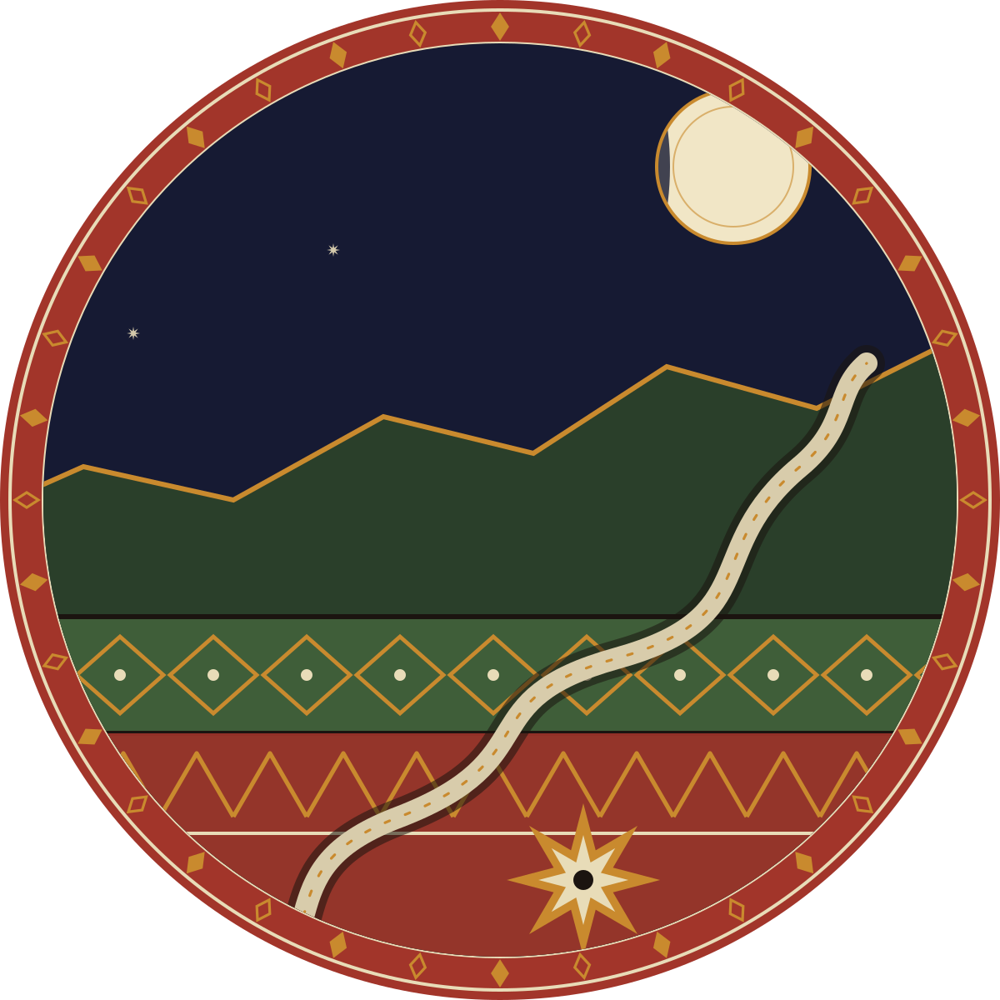
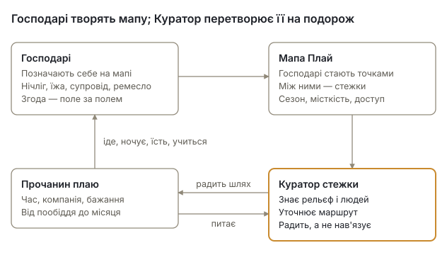
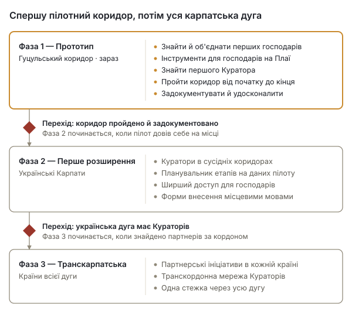

# Транскарпатські стежки

*Trans-Carpathian Pathways · Жива мережа місць, людей і стежок — опис проєкту та пропозиція*

Жовтень 2026 · UBEC / Ініціатива Карпатського хабу

## Коротко

Транскарпатські стежки поєднують людей, які досі бережуть живе гірське життя Карпат, із прочанами плаю — тими, хто хоче їх зустріти повільно й пішки. Це жива мережа господарів, стежка, що виростає з тих місць, де вони живуть, доглядачі стежки, які опікуються кожною її ділянкою, і місцеві Куратори, які дбають про всю стежку.

Перший коридор пролягає Гуцульщиною на заході України — між Ворохтою, Верховиною та Косовом. Проєкт працює на Плаї (Plai) — карпатському хабі UBEC Mapservice: власному картографічному сервісі в ЄС, який уже містить базову мапу всього Карпатського хребта і дає людям змогу за власною згодою позначити себе на ній.

| | |
| --- | --- |
| Що | Інфраструктура паломництва: господарі, стежки й Куратори |
| Де спершу | Ворохта, Верховина й Косів, Івано-Франківська область, Україна |
| Де далі | Українські Карпати, а згодом — інші країни карпатської дуги |
| Основа | Плай — карпатський хаб UBEC Mapservice |
| Ініціатори | UBEC (Ubuntu Bioregional Economic Commons) під керівництвом Мішеля Ґарана, «Жива хата» (Zhyva Khata) під керівництвом Василя Юськіва та «Тепла Гора» (Tepla Gora) під керівництвом Андрія Грушецького |
| Стадія | Прототип: технічна основа готова, шукаємо перших господарів; першим Куратором поки є керівник проєкту |

Ми шукаємо людей, які долучаться: господарів, доглядачів і Кураторів у коридорі, партнерів уздовж карпатської дуги, технічних помічників і тих, хто профінансує пілот.

## Потреба

У Карпатах зустрічаються дві проблеми, і відповідь на обидві одна: справжня зустріч мандрівника з місцем.

**Подорожі дедалі частіше стають видобутком.** Мандрівники проходять крізь місця, не торкаючись їх, а більшість грошей, які вони лишають, іде тим, хто тут не живе. Зустріч людини з місцем — те, заради чого колись і подорожували, — дедалі частіше стає просто угодою.

**Гірські громади порожніють.** По всій карпатській дузі села потерпають від знелюднення, втрати традиційних знань і економічної маргіналізації. Спосіб життя, що складався століттями, тихо зникає. На Гуцульщині давно приймають гостей — у садибах, на полонинах, у майстернях, — і проєкт не починає з порожнього місця. Але багатьох із тих, хто береже давній спосіб життя, немає на жодній туристичній мапі, і вони себе не рекламують.

Прочанин, який ночує під чиїмось дахом, їсть за чиїмось столом і вчиться, як щось роблять, залишає гроші й увагу там, де вони потрібні. Господар, який ділиться тим, що справді має, без вистави, отримує причину й можливість це зберегти.

## Відповідь

Транскарпатські стежки будують три взаємопов'язані речі: мережу господарів, живу стежку між ними й людей, які її тримають, — доглядачів для кожної ділянки і Куратора для цілого.

Господарі позначають себе на мапі; стежка виростає з місць, де вони є; Куратор перетворює мапу на подорож для кожного прочанина.

**Мережа господарів.** Люди по всій карпатській дузі, які вирішили поділитися чимось справжнім. Господар пропонує одне чи кілька з такого:

| Пропозиція | Що це означає |
| --- | --- |
| Нічліг | Прихисток: кімната, стодола, ліжко |
| Їжа | Страви цього місця — спільна трапеза або приготовлена їжа |
| Місцевий супровід | Знання землі, стежки та її історій |
| Майстер-клас | Місцеве ремесло: зроблене тут і передане тут |

Господарі — не постачальники послуг. Пропозиція чесна й конкретна, без вистави й перебільшень. Оглядові точки, джерела та інші місця, до яких варто дійти, позначаються на мапі як місця на шляху.

**Жива стежка.** Маршрут не проєктують згори. Він постає, коли долучаються господарі: кожен господар стає точкою на мапі, шляхи між ними прокладаються мережею гірських стежок, а Куратор коригує результат з огляду на рельєф, сезон, можливості господарів і людську логіку подорожі. Стежка росте разом із мережею і скорочується, коли господарів немає вдома.

**Куратор стежки.** Пам'ять стежки — зазвичай місцевий фермер, учитель чи знавець гірських стежок. Куратор знає стежку та її господарів, вислуховує кожного прочанина — скільки в нього часу, з ким він іде і чого прагне, — радить маршрут, а не нав'язує його, і знає, хто кого і коли може прийняти. Куратор — не турагент, а провідник цілого — і не посередник: прочанин може також сам знайти оприлюдненого господаря на мапі й піти напряму. Поруч із Куратором **доглядач стежки** опікується однією ділянкою: проходить її, знає її господарів і місця, може внести місце за господаря, який не може сам, і додати місця на шляху, а оприлюднення залишає Кураторові.

## Для кого це

Стежка відкрита для кожного, хто готовий сповільнитися — на пообіддя чи на місяць. Хто б не прийшов — це **прочанин плаю**. Плай — давня карпатська стежка через полонини; від нього й назва мапи. Проща — до гір і людей, які бережуть у них життя, а не до святині, і прочанин приходить як гість. Тривалість і насиченість обирає прочанин; Куратор підлаштовує маршрут під нього.

| Хто приходить | Типова подорож |
| --- | --- |
| Родина з малими дітьми | Кілька годин: один господар, одна трапеза, один краєвид |
| Прочанин наодинці | Дні чи тижні глибокого занурення |
| Пара | Повільна подорож обраної глибини |
| Гурт друзів | Спільні або окремі враження на одній ділянці |
| Людина на переломі життя | Паломництво як особистий поріг |

**Господарі** отримують чесний, прямий зв'язок із прочанами, які приходять саме по те, що вони пропонують, — без потреби себе рекламувати.

**Громади** можуть отримати дохід, що залишається на місці, і причину для молоді цінувати знання, які інакше зникають.

**Доглядачі й Куратори**, зазвичай місцеві люди, отримують визнану роль охоронців своєї ділянки стежки й усієї стежки.

## Пілотний коридор

Прототип пролягає Гуцульщиною на заході України — однією з найбагатших культурно ділянок карпатської дуги, де луки й досі косять і випасають. Його опорні точки — три містечка:

| Місце | Що тут є |
| --- | --- |
| Ворохта | Брама в гори: ліс, Прут, вихід на Чорногору |
| Верховина | Край полонин: вівчарство й бриндзя |
| Косів | Осередок гуцульського ремесла: суботній базар, кераміка, ліжники, різьба |

Кожне містечко — приблизно за 25 км від наступного навпростець, разом близько 50 км, тож коридор — це кілька днів пішки. Точний маршрут, його етапи й проміжні села визначать господарі, які долучаться, а підтвердить сам похід — заздалегідь їх не креслять.

Робота в коридорі під час пілоту:

1. Знайти й об'єднати перших господарів — людей, які пропонують ліжко, їжу, супровід чи ремесло.
2. Допомогти їм позначити себе на Плаї — кожному з власним обліковим записом, а для господаря, який не може сам, Куратор чи доглядач вносить місце за нього за його згодою, — за їхньою згодою і на їхніх умовах.
3. Знайти першого Куратора й перших доглядачів — місцевих людей, які триматимуть стежку.
4. Пройти коридор від початку до кінця так, як пройшов би прочанин.
5. Записати, що спрацювало, чого бракувало і що знадобиться наступному коридору.

## Технічна основа

Проєкт не починається з нуля: його картографічна платформа вже існує. Плай — карпатський хаб UBEC Mapservice, картографічного сервісу з відкритим кодом, який UBEC розгорнув на власному сервері в Німеччині, на основі PostgreSQL/PostGIS, MapServer і Mapbender.

**Що вже є**

- Базова мапа всього Карпатського хребта з OpenStreetMap: близько 32 мільйонів об'єктів (стежки, села, колиби, джерела, будівлі) з нанесеними туристичними маршрутами.
- Форма внесення, де людина ставить точку саме там, де має на увазі, і описує її: назва, тип місця, категорія пропозиції, що саме пропонується, і контакти.
- Згода, закладена в саму базу даних: автор запису поле за полем погоджує, що можна показувати; куратор вирішує, що оприлюднити; відкликані записи зникають з усіх мап і експортів.
- Одне фото на місце, очищене від даних про розташування й камеру перед збереженням; його показують лише тоді, коли автор запису погодився, а куратор вирішив його показати.
- Дані господаря: одне місце зі списком пропозицій, місяцями прийому, місткістю, мовами, тим, як дістатися, і способами оплати, які приймає господар, — збудовано й перевірено в жовтні 2026 року; і позначка на кожному записі, що його автор прочитав угоду співтворців.
- Планувальник стежок: будь-хто прокладає на Плаї дорогу від початку до кінця, спершу стежками; доглядач чи Куратор зберігає її як ділянку, виправляє на мапі й складає ділянки в коридор; оприлюднює лише Куратор (жовтень 2026).
- Запобіжники, встановлені до будь-якої публікації: кожна інстанція сервісу, зокрема Плай, має власну базу даних, ліцензії даних дотримуються на рівні бази, а кожну публічну точку доступу перевіряють на витоки.
- Повний експорт у будь-який момент, тож жодна громада не залежить від UBEC у зберіганні власних даних.
- Екрани Плаю поки що англійською. Доки їх не перекладено, господареві, який не читає англійською, допомагає Куратор чи доглядач стежки — сидить поруч або вносить місце за нього за його згодою.

**Що треба збудувати для Стежок**

| Складова | Що вона робить |
| --- | --- |
| Місцеві мови | Форми внесення спершу українською, потім польською, словацькою, румунською та іншими |
| Редактор стежок на Плаї | Проміжні точки й точки оминання, власна лінія, пройдений трек, перевірка розривів і доріг для доглядачів — другий крок планувальника |

Планувальник пропонує; вирішує людина. Перевагу він надає зустрічам на шляху, а не швидкості, і дорога стає проєктовою лише тоді, коли Куратор її оприлюднить.

## Принципи

Ці принципи — робочі, а не декларативні: вони визначають кожне рішення щодо дизайну та партнерства.

- **Чесна пропозиція.** Господарі пропонують лише те, що справді мають, і описують це таким, яким воно є.
- **Без вистави.** Зустріч справжня — або її немає.
- **Органічне зростання.** Мережа росте зсередини, господар за господарем, а не за планом, накресленим згори.
- **Куратор як пам'ять.** Люди тримають те, чого не втримає жоден інструмент; інструмент пропонує, людина вирішує.
- **Прочанин приходить, а не проїжджає.** Дорогу проживають, а не споживають.
- **Подалі від протоптаних шляхів.** Туди, де живуть люди, а не туди, куди посилають туристів.
- **Стежка стосунків.** Від людини до людини, від людини до землі.
- **Ніхто не говорить від імені громади.** Господар говорить за своє місце, Куратор — за те, що оприлюднює, проєкт — за себе.
- **Не дика природа.** Люди й земля — одне ціле; берегти треба стосунок.
- **Дані залишаються з людьми.** Кожен вирішує, що показувати про нього, може це забрати й узяти з собою.
- **Без календаря.** Чи приймає господар поза своїм сезоном, з'ясовують у розмові з Куратором, а не в таблиці бронювань.
- **Без рейтингів.** Господарів не оцінюють, не ранжують і не обговорюють у публічних відгуках без їхньої згоди.
- **Безпека понад усе.** Під час війни й у горах безпека важливіша за будь-яку подорож; те, що береже людей, тримає Куратор — поза платформою.
- **Місце показують там, де його поставив господар.** Господар ставить точку; Куратор оприлюднює запис або притримує його.

Той самий перелік стоїть в угоді співтворців і в документі про підстави, який пояснює причину кожного принципу.

**Чим це не є:** не туристична платформа, не сервіс бронювання з календарем, який треба заповнити, не вистава традицій і не готовий продукт. Це інфраструктура, що залишається живою, поки змінюється мережа.

## Безпека, згода й робота під час війни

Пілот починається в Україні під час війни, і проєкт побудований з урахуванням цього, а не всупереч цьому.

- **Точку ставить господар.** Місце — зокрема й дім — показано там, де господар позначив його на мапі — або де його за згодою господаря поставив Куратор чи доглядач, — і лише після того, як Куратор його оприлюднив. Господар може натомість поставити точку в сусідньому місці зустрічі й тоді каже про це в даних місця. Господар може будь-коли відкликати його; оприлюднену точку хтось міг скопіювати, і відкликання прибирає її з Плаю, а не з копій.
- **Контакти захищені.** Ім'я, електронна пошта, номер телефону чи фото оприлюднюються лише тоді, коли господар погодився, а Куратор вирішив їх показати.
- **Знання про безпеку тримає Куратор — поза платформою.** Найближче укриття під час повітряної тривоги й поточний стан кожного етапу залишаються в Куратора, ніколи не на Плаї і ніколи не публікуються; правила прикордонної смуги біля кордону з Румунією — оприлюднені правила, які може прочитати кожен: Куратор письмово дає їх кожному прочанинові, що приходить через Куратора, а проєкт оприлюднює їх для кожного, хто приходить напряму.
- **Прочани самі відповідають за свою підготовку.** Прочанин з-за кордону дізнається у своїй країні про рекомендації щодо подорожей, страхування, воєнний стан, готівку й дозволи, яких вимагає прикордонна смуга; проєкт каже йому те, що знає, і не обіцяє більшого.
- **Проєктові ніхто не платить.** Ніхто від Транскарпатських стежок — ні керівник, ні Куратор, ні доглядач — не просить грошей наперед, завдатку, пароля, паспорта чи його копії. Прочанин платить господареві, як домовилися. Проєкт пише лише з stewardship@ubec.network; хто ще каже, що говорить від імені проєкту, — не проєкт.
- **Дані зберігаються в ЄС** — на власному сервері UBEC, окремо від даних будь-якого іншого проєкту.

Те, чого пілот навчиться в таких умовах, має прислужитися коридорам, що прийдуть після нього.

## Дорожня карта

Проєкт розвивається у три фази, і кожна починається лише тоді, коли попередня довела себе на місці.

Фаза 1 триває зараз у гуцульському коридорі. Фаза 2 поширюється на українські Карпати з урахуванням уроків пілоту. Фаза 3 перетинає кордони — до Польщі, Словаччини, Румунії та інших країн карпатської дуги, з партнерськими ініціативами в кожній. Жодна фаза не прив'язана до дати: перехід відкривається, коли роботу завершено.

## Фінансування

Підтримка пілоту піде насамперед людям на місці, а вже потім — на програмне забезпечення. Картографічна платформа вже існує, тож основні витрати — це людська праця в коридорі.

| Напрям | Що охоплює |
| --- | --- |
| Пошук господарів | Пошук і відвідування господарів, пояснення проєкту, допомога поруч, поки вони вносять свої дані |
| Куратор і доглядачі | Оплачувані ролі першого Куратора й перших доглядачів на час пілоту, за письмовими домовленостями, щойно забезпечено план фінансування |
| Проходження коридору | Тестові подорожі, документування, оцінка безпеки кожного етапу |
| Розробка | Форми місцевими мовами, редактор стежок, інші зміни на Плаї |
| Переклад | Інтерфейс і матеріали проєкту українською, згодом іншими карпатськими мовами |
| Хостинг і безпека | Сервер, резервні копії та запобіжники, що захищають дані господарів |
| Правове | Два правові прочитання — захист даних у Німеччині, туристичне й податкове право в Україні — і створення основного об'єднання |

Як господар отримує оплату, вирішено: кожен господар для кожної пропозиції обирає між фіксованим внеском, рекомендованим внеском, обміном працею та ubec-pay чи спільнотною (місцевою) валютою; оплата йде напряму від прочанина до господаря — проєкт, його Куратори й доглядачі не тримають грошей за прийом і не беруть частки (способи вирішено 7 жовтня, а як іде оплата — 9 жовтня 2026 року). Що означає кожне з цього, каже угода співтворців. За законом плата за нічліг чи їжу — це дохід, як би її не називали: господар сам декларує його й веде книгу обліку гостей за Порядком № 297, а як сплачується туристичний збір, проєкт уточнить у громаді до першого прочанина.

**Бюджет — рекомендація.** Цифри нижче — рекомендація, ще не рішення: пілот тривалістю вісімнадцять місяців від перших господарів, щоб коридор пройшли за два сезони, приблизно на €25 700.

| Напрям | Вісімнадцять місяців | Примітка |
| --- | --- | --- |
| Куратор | €8 100 | неповна зайнятість, близько €450 на місяць |
| Два доглядачі стежки | €2 400 | стипендія близько €100 на місяць кожному протягом року |
| Пошук господарів | €1 500 | відвідини, дорога, друк, аркуші приєднання |
| Проходження коридору | €2 000 | два сезони, документування, реєстр етапів |
| Розробка | €3 000 | зміни на Плаї, сайт, редактор стежок |
| Переклад і матеріали | €1 500 | |
| Хостинг і безпека | €900 | сервер, резервні копії, домен |
| Правове | €4 000 | два прочитання; створення основного об'єднання |
| Резерв | €2 300 | близько десяти відсотків |
| **Разом** | **близько €25 700** | |

Суми оплати виходять із місцевих ставок у коридорі й потребують звірки з ними; правові суми передбачають два короткі письмові висновки. Нічого не закладено на дохід господарів, програмне забезпечення для прочан чи другий коридор — стрес-тести кажуть, що це має почекати, доки перший коридор пройдено і його записи оприлюднено.

## Як долучитися

Є п'ять способів долучитися, і кожен уже зараз формує проєкт.

| Ви | Ви можете |
| --- | --- |
| Господар чи господиня в коридорі | Запропонувати ліжко, їжу, супровід чи ремесло — на власних умовах |
| Місцевий знавець гірських стежок, фермер чи вчитель | Стати доглядачем стежки й опікуватися її ділянкою — або Куратором і дбати про всю стежку |
| Ініціатива деінде на карпатській дузі | Стати партнером у коридорі в Польщі, Словаччині, Румунії чи далі |
| Розробник, картограф чи перекладач | Допомогти створити інструменти Плаю — форми місцевими мовами, редактор стежок — або виправити стежки в OpenStreetMap |
| Фонд або донор | Підтримати пілотний коридор, його першого Куратора й перших доглядачів |

Ініціатори — UBEC (Ubuntu Bioregional Economic Commons) під керівництвом Мішеля Ґарана (Michel Garand), «Жива хата» (Zhyva Khata) під керівництвом Василя Юськіва (Vasyl Yuskiv) та «Тепла Гора» (Tepla Gora) під керівництвом Андрія Грушецького (Andriy Grushetsky).

Контакт: Мішель Ґаран — stewardship@ubec.network

Інші документи проєкту: біла книга, що зіставляє цю пропозицію зі свідченнями; угода співтворців, яка каже, що обіцяє кожна роль; огляд проєкту; і посібник користувача Плаю. Усі — англійською та українською, а огляд, ця пропозиція та біла книга ще й німецькою та польською, за CC BY-SA 4.0, на сайті проєкту tcp.ubec.network та в його публічному записі.

*Це живий документ. Він уточнюватиметься в міру зростання мережі.*
