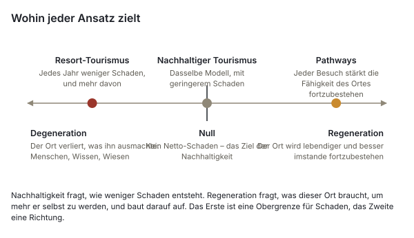
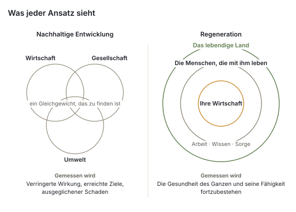
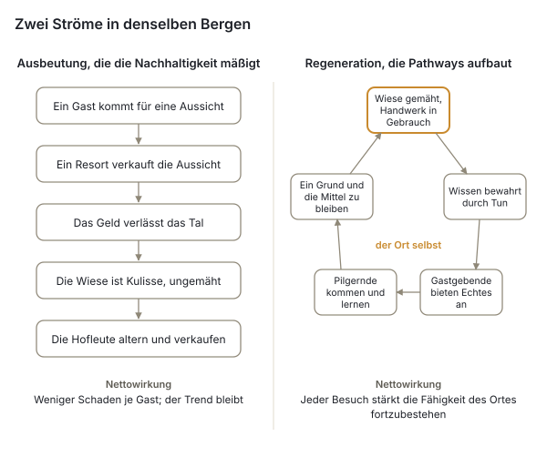

# Trans-Carpathian Pathways

*Ein lebendiges Netz aus Gastgebenden, Wegen sowie Kuratorinnen und Kuratoren über den Karpatenbogen hinweg – das Anliegen, die Belege und der Entwurf*

Oktober 2026 · UBEC / Karpaten-Hub-Initiative · Weißbuch, Entwurf v0.9

## Wie dieses Weißbuch zu lesen ist

Trans-Carpathian Pathways hat einen Projektvorschlag, der sagt, was es ist, einen Start-Prompt, der festhält, was entschieden wurde, eine Mitgestaltungsvereinbarung, die sagt, was jede beteiligte Person verspricht, und ein Begründungsdokument, das sagt, warum. Dieses Weißbuch führt sie für Leserinnen und Leser außerhalb des Projekts zusammen – Förderinnen und Förderer, Partnerinitiativen entlang des Karpatenbogens, Berggemeinschaften und ihre Räte sowie die Institutionen, die jetzt die Zukunft der Karpaten planen – und stellt sie den Belegen gegenüber: was mit den Karpaten geschieht, was vergleichbare Projekte anderswo gelernt haben, was das Recht erlaubt und was die Forschung über Begegnung, Authentizität und die Obhut über bewohnte Landschaften sagt.

Hier erscheinen drei Arten von Aussagen, und sie werden auseinandergehalten. **Entscheidungen** sind die des Projekts, datiert festgehalten in seinem Projektarchiv; sie werden als solche zitiert. **Belege** stammen aus den Quellen, die in eckigen Klammern nummeriert und am Ende aufgeführt sind; wo eine Zahl nicht aus einer Primärquelle bestätigt werden konnte, sagt der Text das. **Vorschläge** sind als Vorschläge gekennzeichnet; nichts in diesem Weißbuch ist dadurch entschieden, dass es hier geschrieben steht. Das Projekt ist klein und steht am Anfang, und dieses Weißbuch gibt nichts anderes vor: §11 sagt klar, was es gibt und was nicht.

## Zusammenfassung

Die Karpaten werden von außen schneller neu bewertet als von innen. Ferienimmobilien in Bukowel werden inzwischen pro Quadratmeter teurer verkauft als Neubauwohnungen in Kyjiw [1]; die Einnahmen aus der Tourismusabgabe in der Oblast Iwano-Frankiwsk sind in vier Jahren auf das Viereinhalbfache gestiegen [5]; auf Hochweiden, die nie Industrie getragen haben, sind Windparks und ein Mega-Resort geplant [12][13]; und im September 2026 berief die Ukraine in Bukowel den ersten Karpatengipfel ein, um die Zukunft der Region grenzüberschreitend zu planen – mit Energie und Verkehr als Schlagzeilen und einem erklärten Bekenntnis zu „Kulturlandschaften“ und zur „traditionellen Lebensweise der Berggemeinschaften“, für das es bislang kein Instrument gibt [17][18]. Der Weg der Ukraine in die Europäische Union wird ihr Land mit der Zeit für Käuferinnen und Käufer aus der ganzen Union öffnen; Polen und Rumänien zeigen, was das mit den Preisen für Land und Ferienorte gemacht hat [22][23][24]. Unterdessen werden die Menschen, die die alte Lebensweise tragen, älter, der Rinderbestand der privaten Haushalte in der Oblast ist zwischen 2021 und 2024 um fast ein Drittel gesunken [8], und das Wissen, das die Wiesen geschaffen hat, geht mit ihnen.

Die Berge nehmen auch Menschen auf. Rund siebzehntausend Menschen, die der Krieg aus ihren Häusern vertrieben hat, waren bis März 2025 in den Hromadas (Gemeinden) Kossiw, Jaremtsche und Worochta registriert – Registrierungen, nicht Einwohnerinnen und Einwohner, und eine Not, die die Hromadas mit ihnen tragen, nicht die Wahl einer Lebensweise [7]. Und die Berge werden wieder besiedelt: In Kossiw überlebt eine Handwerkswirtschaft von mehr als hundert Werkstätten, deren bemalte Keramik auf der UNESCO-Liste des immateriellen Kulturerbes steht [28][29]; Hirtinnen und Hirten haben die ersten geografischen Angaben der Ukraine für Käse von den Polonynas (Hochweiden) erwirkt [31]; und Familien und Alleinstehende verlassen die Städte, um die huzulische Lebensweise zu lernen und zu leben, statt sie zu betrachten. Viele von ihnen sind die Menschen, deren Stimme nicht gefragt wurde, als die Zukunft der Berge geplant wurde.

Trans-Carpathian Pathways steht an der Seite dieser zweiten Bewegung. Es ist ein Netz von Gastgeberinnen und Gastgebern, die von dort aus, wo sie leben, anbieten, was sie tatsächlich haben – ein Bett, eine Mahlzeit, eine Führung, ein Handwerk –; ein Weg, der aus den Orten dieser Gastgebenden entsteht, statt über sie hinweg gezogen zu werden; und örtliche Kuratorinnen und Kuratoren, die jeweils einen Abschnitt davon halten und jeder Pilgerin und jedem Pilger des Plai – so nennt das Projekt alle, die kommen (§4.3) – eine Reise vorschlagen, niemals verkaufen. Es läuft auf Plai, einer einwilligungsgesteuerten Karte des gesamten Karpatengebirges, die UBEC bereits auf einem eigenen Server in der Europäischen Union betreibt. Es gibt keinen Buchungskalender; der Vereinbarungsentwurf fügt keine Bewertung und keine Provision hinzu; die Bezahlung legen die Gastgebenden selbst fest, in Formen, die sie selbst wählen, und sie geht direkt von den Pilgernden an die Gastgebenden; alle Gastgebenden besitzen ihren eigenen Eintrag oder lassen ihn, wo eine Kuratorin, ein Kurator, eine Wegepatin oder ein Wegepate ihn für sie angelegt hat, jederzeit auf Wunsch ändern oder zurückziehen. Der erste Korridor führt von Worochta über Werchowyna nach Kossiw im huzulischen Hochland der Westukraine.

Das Argument dieses Weißbuchs in Kürze: Karpatische Natur und karpatische Kultur sind ein einziges Erbe, geschaffen und bewahrt von Menschen, die mit dem Land leben, und die Belege aus der Grünlandökologie sind eindeutig darin, dass die Wiesen vom Mähen und Beweiden abhängen, das sie geschaffen hat [33][34][35][36]. Zu schützen ist die Beziehung, nicht eine Landschaft, aus der die Menschen verschwunden sind, die sie geschaffen haben. Reisen, die dafür bezahlen, dass diese Beziehung fortbesteht – Begegnung statt Ausbeutung –, sind die einzige Form von Tourismus, die eine Lebensweise erhält, statt sie auszustellen, und sie funktionieren nur, wenn die Begegnung echt ist. Das ist der Unterschied zwischen Erhalten und Regenerieren (§5): Nachhaltigkeit verlangt von einem Ferienort weniger Schaden pro Gast, und der Ferienort hat dafür inzwischen ein Büro; Regeneration fragt, was ein Ort braucht, um mehr er selbst zu werden, und in Bergen, deren Wiesen verkommen, wenn man sie sich selbst überlässt, ist weniger Schaden keine Antwort. Vergleichbare Projekte zeigen, dass solche Netze mit Budgets für den Unterhalt stehen und fallen, mit namentlich benannter Verantwortung für jeden Abschnitt, mit ehrlichem Zählen und mit einer Trägerschaft, die entworfen ist, bevor das Geld eintrifft [37][39][41][45]. Pathways ist nach diesen Lehren gebaut. Mit der Zeit werden die Orte, die seine Gastgebenden teilen, Korridore nachzeichnen, in denen kulturelles, natürliches und landschaftliches Erbe als ein Ganzes in Obhut genommen werden muss – keine Wildnis und keine Ausweisung von oben, sondern eine Karte, mit der eine Gemeinschaft sagen kann, was ihr Land wert ist, bevor andere es für sie entscheiden.

Das Projekt bittet um Unterstützung zuerst für Menschen vor Ort und erst danach für Software; um Partnerinitiativen in jedem Land des Karpatenbogens; und um einen Platz in der Arbeit der Karpaten-Acht und der Karpatenkonvention zur Unterstützung von Gemeinschaften und zu Kulturlandschaften, als eine konkrete Form, die diese Unterstützung annehmen kann.

## 1. Die Karpaten an einem Wendepunkt

### 1.1 Tourismus und Immobilien

Die ukrainischen Karpaten sind zur einzigen Region der Ukraine geworden, in der der Krieg den Immobilienmarkt angeheizt statt eingefroren hat. Hochwertige Anlagen in Bukowel beginnen bei etwa 2.500 US-Dollar pro Quadratmeter mit Innenausbau, und manche Aparthotel-Formate erreichen 6.000 US-Dollar, gegenüber einem Median von etwa 1.400 US-Dollar ohne Innenausbau für Neubauten in Kyjiw im Mai 2026 [1]. Der Druck beschränkt sich nicht mehr auf den Ferienort. Ein durchschnittliches Haus in Werchowyna wurde im Oktober 2025 für etwa 1,8 Millionen Hrywnja angeboten und in Kossiw für 1,9 Millionen, gegenüber 7,1 Millionen in Jabluniza, 8,3 Millionen in Mykulytschyn und 11,7 Millionen in Poljanyzja, der Hromada, in der Bukowel liegt [2] – ein Gefälle von sechseinhalb zu eins vom Ferienort bis zum mittleren Ort des ersten Korridors, die Lücke, die Käuferinnen und Käufer nun nach Werchowyna zieht, und das Maß für den Druck, der noch kommt. Werchowyna erscheint bereits unter den teuersten Orten für einen Hauskauf in den ukrainischen Karpaten, mit Preisanstiegen von 10–15 % zwischen Frühjahr und Sommer 2025 [3].

Mit ihm ist der Besucherdruck gewachsen. Die Tourismusabteilung der Oblast schätzt seit 2023 2,5 Millionen Besucherinnen und Besucher pro Jahr, gegenüber 2,0–2,3 Millionen vor der großangelegten Invasion, und ihre Einnahmen aus der Tourismusabgabe stiegen von 10,4 Millionen Hrywnja im Jahr 2021 auf 46,2 Millionen im Jahr 2025 [5]. Über den Jahreswechsel 2024–25 lag die Auslastung der Hotels in Bukowel bei 77–84 %, und die Besuche in der Gegend von Jaremtsche lagen 30–40 % über dem Vorjahr; Bauträger hatten für 2024–26 45 Hotel-Apartment-Komplexe und 108 Cottage-Siedlungen in Planung [6]. Der Ferienort ist der Grund, warum die Hromada Poljanyzja eine Arbeitslosenquote von 2,4 % und Rekordeinnahmen aus der Tourismusabgabe verzeichnet [4], und sein Erfolg setzt das Land um ihn herum unter Druck: Im März 2026 hob ein Gericht die Katastereintragung von zwanzig Waldparzellen mit hundertjährigen Buchen und Tannen nahe Bukowel auf, die auf Grundlage gefälschter staatlicher Urkunden für Cottages und Hotels eingetragen worden waren; die Staatsanwaltschaft berief sich auf die Karpatenkonvention [11].

Der Schaden reicht bis ins Hochgebirge. 2026 verkaufen Geländewagenkolonnen von dreißig bis fünfzig Fahrzeugen zweistündige Touren über die Kämme für 3.000–4.500 Hrywnja; Fahrzeuge sind in den Heraschaska-See am Swydowez und Bachbetten hinauf gefahren worden, und es gab einen Versuch, die Schranke zu durchbrechen, die den Abschnitt Petros–Howerla des Karpaten-Biosphärenreservats schützt; die Geldbuße für eine Privatperson beträgt 153–408 Hrywnja [10]. Auf dem Drahobrat-Plateau drängten sich nach der Zählung von Texty.org.ua um 2017 mehr als fünfzig Cottages und Hotels auf dem Kamm, mit Parzellen, die innerhalb des Biosphärenreservats verpachtet waren, und rund 190 Hektar Kahlschlag unterhalb [9].

### 1.2 Energie und Industrie auf den Hochweiden

Zwei größere Projekte würden das Gebirge selbst verändern. Das Resort Swydowez, das laut dem Bericht des Bruno Manser Fonds von 2019 von den Eigentümern von Bukowel geplant wurde, würde auf 1.430 Hektar in einem der am besten erhaltenen Massive der ukrainischen Karpaten 230 Kilometer Pisten, 60 Hotels, 390 Ferienhäuser und bis zu 22.000 Gäste pro Tag in eine Landschaft aus nacheiszeitlichen Seen, Urwald und zwei Gebieten des Smaragd-Netzwerks bringen [12]. Im Oktober 2024 bestätigte der Oberste Gerichtshof die Aufhebung seiner Detailpläne, und eine Umweltverträglichkeitsprüfung wurde nicht eingereicht; das Verfahren ist vor dem Ständigen Ausschuss der Berner Konvention weiterhin offen [14]. Windparks sind die neuere Front. Auf der Polonyna Runa begann nach Angaben von CEE Bankwatch der Bau von 30 Turbinen mit 156 MW vor jeder Umweltverträglichkeitsprüfung; die Prüfung fiel im Februar 2026 positiv aus, ein Berufungsgericht erklärte im Juli 2026 die Rodung von Urwald für die Zufahrtsstraße für rechtswidrig, und mehr als vierzig Hektar waren bereits für eine Stromleitung gerodet worden [13]. Wind Parks of Ukraine schlagen rund 1,5 Gigawatt auf den Kämmen Transkarpatiens vor, darunter am Swydowez [13]; derselbe 1,5-Gigawatt-„Karpaten-Windenergiecluster“ wurde im September auf dem Gipfel der Karpaten-Acht beworben [19]. Umweltgruppen warnen, die Pläne würden bis zur Hälfte der Hochlagen Transkarpatiens in ein Industriegebiet verwandeln, und die Aufsicht sei unter dem Kriegsrecht schwächer geworden [15][16].

Nichts davon ist ein Argument gegen Energie oder gegen Arbeit in den Bergen. Es ist ein Argument dafür, dass über die Zukunft der Berge von Menschen entschieden wird, die nicht in ihnen leben werden, in einem Tempo, das denen, die dort leben, keine Zeit lässt zu sagen, was sie wollen – und dass all diese Projekte eines gemeinsam haben: Sie behandeln die Hochweiden als leer.

### 1.3 Der Karpatenbogen als politische Region

Die Karpatenkonvention, 2003 in Kyjiw angenommen und seit 2006 in Kraft, verpflichtet sieben Länder – Tschechien, Ungarn, Polen, Rumänien, Serbien, die Slowakei und die Ukraine –, das Gebirge gemeinsam zu schützen und zu entwickeln [25]. Ihr Protokoll über nachhaltigen Tourismus trat 2013 in Kraft [26]; ein Protokoll zum Kulturerbe wurde 2014 entworfen und nie angenommen [27]. Ihre achte Vertragsstaatenkonferenz ist für Ende 2026 angesetzt; danach hat die Ukraine für ein Jahr den Vorsitz inne [25].

Vom 18. bis 20. September 2026 rief die Ukraine in Bukowel die Karpaten-Acht ins Leben: die Ukraine, Polen, Rumänien, die Slowakei, Tschechien, Österreich, Ungarn und Serbien, mit der Europäischen Union als Ganzer. Auf der Tagesordnung standen Sicherheit, Energie, Logistik, grenzüberschreitender Handel und „Unterstützung für unsere Gemeinschaften“; fünfzig Vereinbarungen im Wert von über einer Milliarde Euro wurden unterzeichnet, mehr als die Hälfte zu Solar- und Windkraft [17][19]. Die Erklärung wurde von sechs Staaten unterzeichnet – Österreich, Polen, Rumänien, Serbien, der Slowakei und der Ukraine [18]. Ungarn, von Kyjiw zu den acht gezählt, entsandte nur seinen amtierenden Geschäftsträger, unterzeichnete nicht und erklärt, kein Mitglied der Initiative zu sein; Tschechien nahm teil, unterzeichnete aber nicht [20]. Ihr Text ist für dieses Projekt von Belang. Er baut auf der Karpatenkonvention auf und verpflichtet die Unterzeichnenden zur „Bewahrung der Kulturlandschaften, der traditionellen Lebensweise der Berggemeinschaften“, einschließlich des immateriellen Erbes, zur „Entwicklung gemeinsamer Kultur- und Tourismusrouten“, zum örtlichen Handwerk und zum Schutz der Biodiversität im Rahmen der Konvention; er zieht eine makroregionale EU-Strategie für die Karpaten und jährliche Gipfel in Betracht [18]. Die offizielle Projektliste umfasst jedoch 90 Projekte im Wert von 10,7 Milliarden US-Dollar, davon 7,28 Milliarden US-Dollar für Energie und 1,05 Milliarden US-Dollar für Verkehr [19]. Kulturlandschaften und die traditionelle Lebensweise haben einen Satz; ein Instrument haben sie noch nicht.

Einen Monat zuvor traf der Präsident die Leiterinnen und Leiter aller Berg-Hromadas in den vier Karpaten-Oblasten. Auf der Tagesordnung standen Straßen, geländegängige Busse, Forstwirtschaft und Regeln zur Tourismusabgabe, Hochwasserschutz sowie Veteraninnen und Veteranen; Entvölkerung, Land und Kulturerbe standen nicht darauf [21].

### 1.4 Land und die Europäische Union

Die Ukraine öffnete ihren Markt für landwirtschaftliche Flächen im Juli 2021 für Staatsangehörige und im Januar 2024 für Unternehmen in ukrainischem Besitz; Ausländerinnen und Ausländer sowie Unternehmen in ausländischem Besitz bleiben bis zu einem landesweiten Referendum ausgeschlossen, das unter Kriegsrecht nicht abgehalten werden kann [22]. Bis Mitte 2025 hatten rund 636.000 Hektar den Besitzer gewechselt, bei Preisen, die von etwa 45.000 Hrywnja je Hektar Anfang 2024 auf über 60.000 bis Juni 2025 stiegen [23]. Innerhalb von Ortschaften dürfen Ausländerinnen und Ausländer bereits Häuser und nichtlandwirtschaftliche Grundstücke kaufen; das Gartengrundstück eines Dorfhauses ist landwirtschaftliche Fläche und kann nicht an sie übergehen [56].

Der Beitritt wird das ändern. Der freie Kapitalverkehr gehört zum Besitzstand der Union, und jedes zuletzt beigetretene Land hat eine Übergangsfrist ausgehandelt, keine Ausnahme. Polen bat um achtzehn Jahre und erhielt zwölf, bis 2016; in diesem Zeitraum stiegen die Preise für privates Ackerland um rund 690 %, und selbst in der gebirgigen Woiwodschaft Kleinpolen (Małopolskie), wo sie am wenigsten stiegen, zwischen 2005 und 2016 um 253 % [24]. In Zakopane, dem Ferienort der polnischen Tatra, erreichten Grundstücke etwa 5.000 Złoty pro Quadratmeter und Ferienwohnungen 20.000, überwiegend als Kapitalanlage zur Vermietung gekauft, gegenüber unter 11.000 für eine Warschauer Wohnung [24]. Rumäniens siebenjährige Beschränkung endete 2014; der Preisschub erreichte in manchen Gegenden das Doppelte des regionalen Durchschnitts, und in den sächsischen Dörfern Siebenbürgens – deren sächsische Bevölkerung nach der Zahl eines Journalisten von fast einer Million vor dem Krieg auf rund zwanzigtausend im Jahr 2002 sank – wurden Kulturerbe-Häuser schneller mit PVC und Blech „modernisiert“, als irgendeine Vorschrift durchgesetzt werden konnte [22][24]. Die Beitrittscluster der Ukraine wurden im März 2026 informell für eröffnet erklärt und der erste im Juni formell eröffnet; das Veto eines einzelnen Mitgliedstaats blockiert noch zwei weitere [59]. Die Frage ist nicht, ob sich das Land der Karpaten öffnen wird, sondern wie viele Jahre den Berggemeinschaften bleiben, um zu entscheiden, wofür ihr Land da ist, bevor der Markt es tut.

### 1.5 Die Menschen, die es bewahren

Die Ukraine hatte seit 2001 keine Volkszählung, und Bevölkerungszahlen für Rajone werden seit 2022 nicht veröffentlicht; die Demografie des Korridors ist daher nur in Umrissen bekannt [7]. Der Rajon Kossiw schrumpfte zwischen Januar 2020 und 2022, vor dem großangelegten Krieg, von 86.615 auf 83.700 Menschen; im Rajon Werchowyna leben etwa 30.000 Menschen auf 1.254 Quadratkilometern [7]. Studien zur Karpatenregion stellen fest, dass viele Bergdörfer sich zwischen 1989 und 2020 nicht wie die Ebenen entvölkerten – Erholung, Wald und das Gesetz über Bergsiedlungen hielten sie –, dass aber die Berggebiete der Oblaste Iwano-Frankiwsk und Tscherniwzi Menschen an die Städte verlieren und dass „Entvölkerung und Alterung ländlicher Gebiete“ die Hauptbedrohung der Region ist [7].

Das Land selbst verzeichnet den Wandel. Der Rinderbestand in der Oblast Iwano-Frankiwsk erreichte 2003 mit 294.300 Tieren seinen Höchststand; in privaten Haushalten fiel er von 109.500 im Jahr 2021 auf 76.000 im Jahr 2024, 15,5 % unter dem Vorjahr [8]. Der Bestand an Schafen und Ziegen in ukrainischen Haushalten fiel von über zwei Millionen um 2009 auf unter 1,4 Millionen bis 2019; Verbände der Hirtinnen und Hirten nennen die Gründe: Ein Mutterschaf gibt 120 Tage lang Milch und muss das ganze Jahr gehalten werden, Polonyna-Käse wird ohne geschützte Bezeichnung für 100–120 Hrywnja pro Kilogramm verkauft, und die Arbeit ist hart und wird zu wenig geschätzt [8]. Das Alter derer, die noch Schafe halten und die Wiesen mähen, ist nirgends erfasst, soweit diese Recherche es finden konnte; dass diejenigen, die das Land halten, älter werden und ihr Land innerhalb einer Generation in andere Hände übergehen wird, ist die eigene Beobachtung des Projekts in der Region, und §12 führt es unter den Dingen auf, die die ersten Besuche klären müssen.

## 2. Was die Berge sind: eine fortbestehende Landschaft, keine Wildnis

### 2.1 Die Wiesen sind menschengemacht

Die meisten Polonynas – die Hochweiden, die das Markenzeichen der Karpaten sind – sind nicht natürlich. Sie wurden von Hirten gerodet, namentlich während der walachischen Kolonisation ab dem vierzehnten und fünfzehnten Jahrhundert, „innerhalb der Wälder bis zur Baumgrenze und zum Krummholz“ [34]; natürliche Wiesen liegen nur oberhalb der oberen Baumgrenze. Ihre Biodiversität ist ein Ergebnis ihrer Nutzung. Eine grenzüberschreitende Studie von 48 Parzellen in acht Dörfern der Maramuresch und der Bukowina, beiderseits der ukrainisch-rumänischen Grenze, ergab, dass 78 % der ukrainischen und 83 % der rumänischen Parzellen noch traditionell bewirtschaftet wurden; die Bewirtschaftung erklärte den Pflanzenreichtum besser als Topografie oder Boden; regelmäßiges Mähen erhöhte den Artenreichtum der Gefäßpflanzen und Beweidung den der Moose; und Entvölkerung sowie sinkende Viehbestände wurden als Treiber des Wandels ermittelt [33]. In den subalpinen Wiesen Siebenbürgens wurden über die Stadien der Nutzungsaufgabe hinweg 626 Arten erfasst, wobei die Gefäßpflanzen in den gemähten Wiesen ihr Maximum erreichten und jedes Sukzessionsstadium für irgendeine Gruppe das Maximum hielt – sodass die reichste Landschaft eine ist, die zugleich in mehreren Nutzungsstadien gehalten wird [35]. Wo die Beweidung aufhört, dringt die Grünerle in die Polonyna ein, und die Artenzusammensetzung, die Jahrhunderte der Nutzung aufgebaut haben, beginnt zu verschwinden [34]. Fischer, Hartel und Kuemmerle formulieren die politische Schlussfolgerung unumwunden: „Der Naturschutzwert traditioneller bäuerlicher Landschaften ist oft außergewöhnlich“, Unrentabilität führt auf der einen Seite zur Aufgabe und auf der anderen zur Intensivierung, und was es braucht, ist eine Transformationsstrategie, die „gemeinschaftsgetragene Bemühungen unterstützen will, neue, direkte Verbindungen zur Natur zu schaffen“ [36].

Deshalb lehnt das Projekt das Wort *Wildnis* für die Wiesen und Dörfer der Karpaten ab. Der Rahmen ist dort empirisch falsch, selbst wo er für die alten Buchenwälder zutrifft. Eine geschützte Landschaft, die das Mähen und Beweiden verbietet, das sie geschaffen hat, oder in der sich nur Wohlhabende das Wohnen leisten können, ist an ihrem eigenen Maßstab gescheitert.

### 2.2 Zwei Begriffswelten, die die Welt bereits verwendet

Die Vision hat einen Halt in Kategorien, die Regierungen sowie Förderinnen und Förderer anerkennen. Die Kategorie V der IUCN, die *geschützte Landschaft*, ist definiert als ein Gebiet, „in dem das Zusammenwirken von Mensch und Natur im Laufe der Zeit ein Gebiet von eigenem Charakter mit bedeutendem ökologischem, biologischem, kulturellem und landschaftlichem Wert hervorgebracht hat und in dem die Wahrung der Unversehrtheit dieses Zusammenwirkens für den Schutz und Erhalt des Gebiets entscheidend ist“ [60]. Sie umfasst mehr als die Hälfte der Schutzgebietsfläche Europas; ihre Kritikerinnen und Kritiker sagen zu Recht, dass sie keinen automatischen Biodiversitätswert mit sich bringt und an ihren Ergebnissen statt an ihrer Ausweisung gemessen werden sollte [60] – eine Mahnung, die dieses Projekt annimmt; die Bedingungen in §9 und die Zeichen für Erfolg und Scheitern in §12 sagen, wie ihr begegnet würde. Der Welterbe-Rahmen der UNESCO kennt die *fortbestehende Landschaft*: eine, die „eine aktive soziale Rolle in der heutigen Gesellschaft bewahrt, eng verbunden mit der traditionellen Lebensweise, und in der der Entwicklungsprozess noch im Gange ist“ [61]. Die huzulische Polonyna-Wirtschaft ist ein Lehrbuchfall. Hinter beiden steht das Konzept der *biokulturellen Vielfalt*, „der Vielfalt des Lebens in all seinen Erscheinungsformen – biologisch, kulturell und sprachlich –, die innerhalb eines komplexen sozial-ökologischen adaptiven Systems miteinander verknüpft sind“ [62]. Die Karpatenkonvention behandelt Natur und Kultur in ihrem Text bereits gemeinsam [25]; was gefehlt hat, ist ein Instrument im Maßstab eines Dorfes und eines Weges.

### 2.3 Wissen geht, wenn die Praxis endet

Traditionelles ökologisches Wissen ist „ein kumulativer Bestand an Wissen, Praxis und Glauben, der sich durch adaptive Prozesse entwickelt und durch kulturelle Weitergabe über Generationen überliefert wird“; es wird mündlich und in der Lehre weitergegeben, und es reißt ab, wenn die Praxis aufhört [71]. Das ist der Mechanismus hinter der Aussage des Projekts, dass Begegnung eine Lebensweise am Leben hält, wo ein Museum es nicht kann: Das Wissen um eine Wiese, einen Käse oder einen Webstuhl bewahrt nur, wer die Arbeit an der Seite von jemandem tut, der sie kennt. Pilgernde, die lernen, sind weitere Lernende. Am meisten zählt, wer bleibt und das Wissen übernimmt – ein Enkelkind von Gastgebenden, eine Nachbarin oder ein Nachbar oder eine Familie, die in die Berge gezogen ist, um dort zu leben.

## 3. Die Menschen, die die Berge lebendig halten

### 3.1 Die Gebliebenen und die Gekommenen

Die huzulische Handwerkswirtschaft ist lebendig und konzentriert. Kossiw zählt mehr als hundert private Werkstätten, zehn Museen, das Kossiwer Institut für angewandte und dekorative Kunst und den Samstagsbasar, den größten Handwerksmarkt der Ukraine; der sowjetische Kunstbetrieb „Huzulschtschyna“ beschäftigte einst rund dreitausend Menschen [28]. Die Tradition der bemalten Keramik aus Kossiw wurde im Dezember 2019 in die Repräsentative Liste des immateriellen Kulturerbes der Menschheit der UNESCO aufgenommen [29]. In Jaworiw unterhält die Familie Kischtschuk ein Museum mit Werkstatt für Lischnyk-Weberei und die seltenen langhaarigen Schafe, die die Wolle dafür liefern [30]. Auf den Polonynas hat ein Verband der Erzeugerinnen und Erzeuger traditioneller Hochgebirgskäse, 2018 mit Unterstützung von Slow Food gegen Nachahmungen aus dem Tiefland gegründet, die ersten geografischen Angaben der Ukraine erwirkt: „Huzulische Kuh-Bryndza“ wurde im September 2020 eingetragen, betreut von der Vereinigung der Karpaten-Watahy in Werchowyna, und im ersten Jahr wurden sechs Polonynas zertifiziert – Krynta, Skupowa, Lukowyzja, Bybratkiwka, Sgarda und Schtschiwnyk [31]. Ein Programm in Kossiw zur Wiederbelebung der Schafhaltung, 2022 angekündigt mit dem Ziel von 16.000 Schafen und 500 Arbeitsplätzen in vier Jahren, beruht auf der Beobachtung, dass fünfzig Schafe es einer Bäuerin oder einem Bauern erlauben zu bleiben, statt im Ausland zu arbeiten; seine Ergebnisse sind noch nicht veröffentlicht [8].

Der Krieg hat nicht nur Druck gebracht, sondern auch Menschen. Die Oblast Iwano-Frankiwsk hatte bis März 2025 92.624 Binnenvertriebene registriert, gegenüber 3.829 im Januar 2021; allein die Hromada Kossiw hatte 5.702, Jaremtsche 5.605 und Worochta 5.384 – Letzteres auf dem Papier ungefähr so viele wie die eigene Bevölkerung der Hromada Worochta. Registrierungen überzeichnen die tatsächliche Anwesenheit; in einer Stadt waren 1.474 registriert und 322 wurden angetroffen [7]. Manche sind geblieben, um zu arbeiten: Ein 2022 aus dem besetzten Kachowka nach Kossiw verlagertes Atelier beschäftigt heute fünfzig Frauen aus der Stadt und ihren Dörfern, von denen mehrere zuvor Saisonarbeit in Polen geleistet hatten [32]. Über die Vertriebenen hinaus verlassen Familien und Alleinstehende die Städte, um die huzulische Lebensweise zu lernen und zu leben – die Beobachtung, auf der die Hoffnung des Projekts ruht und für die diese Recherche nur Anekdotisches fand. Sie zu zählen und zu fragen, warum sie gekommen sind, ist Arbeit für den ersten Korridor.

Die Literatur über Zugezogene in den Bergen ist eindeutig darin, was den Unterschied macht. Studien zu den Alpen und Pyrenäen stellen fest, dass „neue Bergbewohner“ alte Gewerbe wiederbeleben und einen „verantwortungsvollen, geteilten Tourismus zwischen Gastgebern und Gästen“ eröffnen, aber auch, dass städtische Käuferinnen und Käufer die Preise treiben und die Jungen verdrängen, dass tiefe Freundschaft über diese Linie hinweg selten ist („man bleibt immer der Eingewanderte“) und dass Wiederansiedlung „organisiert, begleitet, wenn nicht gar gefördert werden muss“ [70]. Zugezogene integrieren sich, statt zu gentrifizieren, wenn sie landgebundene Arbeit und gemeinschaftliche Arbeit aufnehmen, wenn Wohnraum nicht zur Ware gemacht wird und wenn sie in die bestehenden Institutionen eintreten – die Heuernte, das Fest, die Kirche –, statt parallele aufzubauen. Dieselbe Linie trennt Gastgebende von Darstellenden: die Beziehung zum Ort.

### 3.2 Wer für eine Gemeinschaft spricht

Wenn es heißt, ein Ferienort oder ein Windpark habe örtliche Unterstützung, lautet die erste Frage: Wer hat das gesagt, und wer wurde nicht gefragt? Ein Bericht von 2025 aus den Gemeinden Jassinja und Ust-Tschorna sagt, ihre Leitungen sowie Bewohnerinnen und Bewohner hofften weiterhin auf das Resort Swydowez, wegen der Steuereinnahmen, die es brächte – ohne zu sagen, welche Bewohnerinnen und Bewohner gefragt wurden –, und stellt seinerseits die Gegnerinnen und Gegner des Resorts so dar, als dienten sie Holzeinschlagsinteressen [16]. Jede Seite sagt, die Gemeinschaftsstimme der anderen sei ein Deckmantel für Interessen. Das Muster ist universell. Die Übersicht der Weltbank über partizipative Entwicklung stellte fest, dass induzierte Beteiligung „oft von Eliten dominiert“ wird, sofern es kein ansprechbares Zentrum und kein langfristiges Engagement gibt [72]; Platteau nennt Elitenvereinnahmung „ein ernstes Problem“ für gemeinschaftsgetragene Entwicklung und findet kein Gegenmittel, das nicht die schrittweise Freigabe von Mitteln und Kontrolle einschließt [73]. Partizipatives Kartieren hat seine eigene Ethik: die Gefahr, „Menschen durch die Informationen, die man zeigt, in Gefahr zu bringen“, die von Daten, die Außenstehende „dann ausbeuten würden“, und die, „Genauigkeit zu verlangen, wo Unschärfe angemessener sein könnte“ [74].

Pathways stellt diese Frage in jede Richtung, auch an die eigenen Unterstützerinnen und Unterstützer. Es beansprucht nicht, für irgendein Dorf zu sprechen, und es ist so gebaut, dass das niemand muss: Alle Gastgebenden haben ein eigenes Konto und einen eigenen Eintrag, willigen Feld für Feld ein und ziehen ihn nach Belieben zurück – oder lassen den Ort, wo eine Kuratorin, ein Kurator, eine Wegepatin oder ein Wegepate ihn für sie eingetragen hat, jederzeit auf Wunsch ändern oder zurückziehen; Kuratorinnen und Kuratoren sprechen für das, was sie veröffentlichen; das Projekt spricht für sich selbst. In den ganzen Karpaten finden die Menschen, deren Stimme übergangen wurde, zueinander und zu Initiativen, die zuhören, und die Spannung zwischen ihnen und denen, die in ihrem Namen sprechen, wächst. Ein Netz einzelner Stimmen, deren jede ihre eigenen Worte besitzt, ist die Antwort des Projekts auf diese Spannung.

## 4. Warum Begegnung

### 4.1 Die Diagnose

Zwei Probleme treffen sich in den Karpaten und haben eine gemeinsame Antwort. Reisen ist immer häufiger Ausbeutung: Reisende bewegen sich durch Orte, ohne sie zu berühren, Gastfreundschaft wird immer häufiger inszeniert, und was die Reisenden mitnehmen, ist ein Ausblick, während eine Gebühr zurückbleibt, die größtenteils an jemanden geht, der nicht dort lebt. Das Leben in den Bergen dünnt aus: Dörfer verlieren Menschen, Wissen wird nicht weitergegeben, und die Wirtschaft, die eine Lebensweise trug, ist anderswohin gezogen. Begegnung antwortet auf beides, weil Wissen von Mensch zu Mensch weitergeht, indem man etwas an der Seite von jemandem tut, und weil Pilgernde, die unter einem Dach schlafen, an einem Tisch essen und lernen, wie etwas gemacht wird, Geld und Aufmerksamkeit in den Händen derer lassen, die das Wissen tragen. Gastgebende, die teilen, was sie tatsächlich haben, gewinnen einen Grund, es zu bewahren, und die Mittel dazu.

Die Bedingung ist, dass die Begegnung echt ist. Vor einem halben Jahrhundert beschrieb MacCannell touristische Schauplätze als „eine inszenierte Hinterbühne, eine Art lebendiges Museum“, errichtet, weil „das touristische Bewusstsein von seinem Verlangen nach authentischen Erfahrungen angetrieben wird“ [63]. Sobald Gastgebende sich inszenieren, wird für die Inszenierung bezahlt, und die Lebensweise geht trotzdem verloren – langsamer und gewinnbringender. Wangs Unterscheidung bietet einen Ausweg: *Existenzielle* Authentizität ist eine Eigenschaft der Tätigkeit, nicht des Gegenstands, zu finden in gemeinsamer Arbeit, im Gehen und Essen statt in Darbietungen [64]. Ein Netz, das auf Betten, Mahlzeiten, Führungen und Workshops im wirklichen Gebrauch beruht, ohne Bühne, ist der Versuch, auf dieser Seite der Linie zu bleiben.

### 4.2 Was der gemeinschaftsbasierte Tourismus mühsam gelernt hat

Die Bilanz des gemeinschaftsbasierten Tourismus ist ernüchternd, und das Projekt liest sie als Checkliste. Von 116 Initiativen, die Fachleute als erfolgreich bezeichnet hatten, antworteten 28 der 133 befragten, 15 erfüllten die Definition und nur sechs waren wirtschaftlich tragfähig; eine Übersicht über 200 Gemeinschaftstourismus-Projekte auf dem amerikanischen Kontinent fand viele Unterkünfte mit einer Auslastung von etwa 5 %; neun der fünfzehn waren noch von Gebern abhängig, und die Autoren empfehlen, sich zu vergewissern, dass es Reisende gibt, bevor man Betten baut, und Geberabhängigkeit nach fünf Jahren als Warnzeichen zu werten [45]. Blackstocks Kritik benennt drei Mängel: Die Literatur behandelt die Gastgebergemeinschaft „als homogenen Block“, verfolgt einen „funktionalen Ansatz“ der Beteiligung und „vernachlässigt die strukturellen Hindernisse für lokale Kontrolle“ [65]. Zum Abfluss der Einnahmen stellt das Overseas Development Institute fest, dass im besten Fall ein Fünftel bis ein Drittel des touristischen Umsatzes am Reiseziel die Armen erreicht und dass die Lebensmittelversorgungskette – nicht das Bett – der größte Kanal ist, in seinem Fallbeispiel Luang Prabang etwa die Hälfte der touristischen Einkünfte armer Menschen [46]. Die Lehre für ein Netz von Gastgebenden ist, dass Mahlzeiten und Workshops ebenso zählen wie Unterkunft und dass ein Projekt, das keine Reisenden vorweisen kann, Gastgebenden kein Einkommen versprechen sollte.

Regenerativer Tourismus, die gegenwärtig vorderste Front des Fachgebiets, verlangt, dass Reisen „Menschen, Orten und Natur einen netto positiven Nutzen bringen“, stellt fest, dass Zertifizierung „wenig beiträgt“, und warnt, dass Tourismus ohne Einwilligung und gesellschaftliche Akzeptanz „Gefahr läuft, zu einem schmutzigen Sektor zu werden“ [66]. Das Projekt versteht das so, dass Regeneration kein Etikett ist, sondern eine Beziehung, und dass die Beziehung im Entwurf sichtbar sein muss: wem die Daten gehören, wer den Weg hält, wer das Geld nimmt. §5 stellt Regeneration dem Rahmen der nachhaltigen Entwicklung gegenüber, den sie ablöst, und sagt, warum die Karpaten den stärkeren brauchen.

### 4.3 Eine Pilgerschaft wohin

Der Projektvorschlag nennt den Weg eine „Pilgerinfrastruktur“, und die huzulische Region hat echte Orte religiöser Wallfahrt. Das Wort wird hier in dem Sinn gebraucht, den ihm die Anthropologie der Pilgerschaft gibt – Liminalität, die überschrittene Schwelle, die *communitas* von Menschen, die gemeinsam unterwegs sind – und im Sinne von Turners Mahnung: „Ein Tourist ist ein halber Pilger, wenn ein Pilger ein halber Tourist ist“ [67]. Am Ende des Weges steht kein Heiligtum. Pilgernde gehen in eine Beziehung zwischen Menschen und Land hinein, die seit Jahrhunderten besteht, werden für eine Nacht oder einen Monat in sie aufgenommen und gehen wieder, nachdem sie an ihr teilgenommen haben, statt sie zu betrachten. Die Pilgerschaft gilt der Beziehung selbst. Das Wort wird beibehalten und gibt dem Projekt seinen Namen für die Person, die kommt: die **Pilgerin oder der Pilger des Plai**, ukrainisch *прочанин плаю* (Michels Entscheidung, 10. Oktober 2026). *Plai* ist das huzulische und rumänische Wort für den alten Weg über die Hochweiden, auf dem die Herden den Berg hinauf- und hinabgetrieben wurden; die Karte, auf der das Projekt läuft, ist nach ihm benannt (§6.2). *Прочанин* kommt von *проща*, der Wallfahrt, die in der Region noch gegangen und dort als innere Arbeit vom Tourismus unterschieden wird; das Wort ist verwandt mit *прощати*, vergeben, und trägt daher Versöhnung ebenso in sich wie Suche. Die Pilgerschaft gilt dem Plai und den Menschen, die ihn bewahren, nicht einem Heiligtum. Ob das Projekt ausdrücklich sagt, dass es niemandes Glauben entlehnt, bleibt unter den offenen Fragen in §12.

## 5. Vom Erhalten zum Regenerieren

Bisher hat das Projekt gesagt, was es ablehnt und warum. Dieser Abschnitt sagt, wofür es steht, in den Begriffen, die das Fachgebiet heute verwendet, und warum es sich für Regeneration entschieden hat statt für den Rahmen, der die Entwicklung seit vierzig Jahren bestimmt.

### 5.1 Was nachhaltige Entwicklung versprach und wo sie steht

Nachhaltige Entwicklung wurde 1987 definiert als „Entwicklung, die die Bedürfnisse der Gegenwart befriedigt, ohne zu riskieren, dass künftige Generationen ihre eigenen Bedürfnisse nicht befriedigen können“ [82]. Sie wurde zum Rahmen der Rio-Konventionen, der siebzehn Ziele für nachhaltige Entwicklung und ihrer 169 Zielvorgaben, die 2015 verabschiedet wurden, und eines Vokabulars, das heute jedes Ministerium, jede Bank und jeder Ferienort gebraucht. Im Tourismus nahm sie die Form an, die ihr die UN-Organisationen 2005 gaben: „Tourismus, der seine gegenwärtigen und künftigen wirtschaftlichen, sozialen und ökologischen Auswirkungen voll berücksichtigt und den Bedürfnissen der Besucherinnen und Besucher, der Branche, der Umwelt und der Gastgebergemeinschaften Rechnung trägt“ [84].

An dieser Definition sind zwei Dinge zu bemerken, bevor irgendetwas gegen sie gesagt wird. Sie ist ein Ausgleich zwischen vier Anspruchsberechtigten, und die Branche ist einer davon. Und ihre Verben lauten berücksichtigen, Rechnung tragen, minimieren, aufrechterhalten. Sie fragt, wie eine Tätigkeit mit weniger Schaden weitergehen kann. Sie fragt nicht, ob die Tätigkeit das ist, was der Ort braucht.

Wo der Rahmen steht, ist dokumentiert. Der eigene Bericht der Vereinten Nationen von 2025 stellt fest, dass nur 35 Prozent der Zielvorgaben mit Trenddaten auf Kurs sind oder mäßige Fortschritte machen, knapp die Hälfte zu langsam oder nur geringfügig vorankommt und 18 Prozent sich zurückentwickelt haben [83]. Die Bilanz in den Karpaten steht in §1, und sie hat eine genaue örtliche Form. Bukowel betreibt ein Büro für nachhaltige Entwicklung: kostenlose stündliche Busse, 0,6 Megawatt Solarleistung auf Hoteldächern, sieben Ladepunkte, elf Hotels mit Green-Key-Zertifizierung, eine Partnerschaft für CO₂-armen Verkehr [85]. Die Eigentümer desselben Ferienorts planten das Mega-Resort Swydowez [12]. Davon getrennt wurden 2026 zwanzig Waldparzellen nahe dem Ferienort, eingetragen auf Grundlage staatlicher Urkunden, die das Gericht für gefälscht befand, an den Staat zurückgegeben [11]; dieses Weißbuch erhebt keine Behauptung darüber, wer sie eingetragen hat. Das ist kein Vorwurf der Böswilligkeit. Es ist das, was der Rahmen tut: Er verlangt vom Ferienort weniger Schaden pro Gast und ist zufrieden, wenn der Ferienort das leistet. Dazu, ob ein Tal voller Aparthotels zu 6.000 US-Dollar pro Quadratmeter das ist, was aus dem Tal werden sollte, hat er nichts zu sagen, weil „die Branche“ eine der Parteien ist, deren Bedürfnisse auszugleichen er da ist.

In diesem Sinn ist nachhaltige Entwicklung gerade in den Bereichen vernachlässigt worden, in denen sie wehtun würde. Sie wurde angewandt, wo es bequem war – Energie, Abfall, Beleuchtung, eine Zertifizierung –, und beiseitegelassen, wo sie etwas gekostet hätte: Land, wer entscheidet, wofür ein Ort da ist, ob eine Lebensweise fortbesteht. Und sie wurde vereinnahmt: Ein Wort, das jedem Akteur mit einem Marketingbudget zur Verfügung steht, ist ein Wort, das bald nichts mehr bedeutet. Kritikerinnen und Kritiker innerhalb des Fachgebiets sagen dasselbe; die eigene Literatur des regenerativen Tourismus stellt fest, dass Nachhaltigkeitszertifizierung „wenig beiträgt“ [66].

### 5.2 Was Regeneration stattdessen fragt

Regeneratives Gestalten hat eine Vorgeschichte, die älter ist als die Ziele – Lyles *Regenerative Design for Sustainable Development* von 1994 [86] – und eine klare Formulierung in Reeds Argument von 2007: „Nachhaltigkeit, wie sie derzeit in der gebauten Umwelt praktiziert wird, ist in erster Linie eine Übung in Effizienz.“ Er entwarf eine Abfolge von Ansätzen, jeder eingebettet in den umfassenderen: den Schaden begrenzen; dann *neutral*, wo grünes und nachhaltiges Gestalten angesiedelt sind, „ein verallgemeinertes Ideal, keinen Schaden anzurichten“; dann das örtliche lebendige System wieder gesund machen; dann regenerieren, „die Evolution des ganzen Systems, dessen Teil wir sind“. Regeneration, schrieb er, ist „der einzige Weg, Nachhaltigkeit zu erhalten“. Und sie ist ortsbezogen: Die Arbeit „beginnt mit dem Versuch zu verstehen, wie die Systeme des Lebens an jedem einzigartigen Ort funktionieren“, und die Rolle der Beteiligten „besteht darin, ein ganzes System wechselseitig nützlicher Beziehungen zu schaffen“ [87]. Spätere Arbeiten machen daraus eine Methode: Gestalten vom Ort her, mit der Gemeinschaft, dem Einzugsgebiet oder der Bioregion als dem Bereich, in dem Menschen mitwirken können [88]; und ein Forschungsprogramm, regenerative Nachhaltigkeit als „gedeihende lebendige Systeme, in denen Gesundheit und Wohlergehen des ganzen Systems stetig zunehmen“, mit Indikatoren, die für jeden Ort eigens und in gemeinsamer Gestaltung entwickelt werden, und – für das Fachgebiet ungewöhnlich – mit der Einbeziehung von Spiritualität als einer ihrer Bedingungen [89]. Im Tourismus ist derselbe Schritt der regenerative Tourismus, der verlangt, dass Reisen „Menschen, Orten und Natur einen netto positiven Nutzen bringen“ statt eines verringerten negativen [66].

Der Unterschied liegt nicht im Ehrgeiz, sondern in Frage, Einheit und Maßstab.

| | Nachhaltige Entwicklung | Regeneration |
| --- | --- | --- |
| Die Frage | Wie kann diese Tätigkeit mit weniger Schaden weitergehen? | Was braucht dieser Ort, um mehr er selbst zu werden? |
| Die Einheit | Drei Säulen, die auszugleichen sind – Wirtschaft, Gesellschaft, Umwelt | Ein lebendiger Ort, die Menschen eingeschlossen, eingebettet in einen größeren |
| Der Maßstab | Verringerte Auswirkungen, erreichte Zielvorgaben, ausgeglichener Schaden | Die Gesundheit des Ganzen und seine Fähigkeit weiterzubestehen |
| Die Menschen | Eine Interessengruppe, deren Bedürfnissen Rechnung getragen wird | Teilnehmende am Leben des Ortes und diejenigen, die ihn kennen |
| Der Ort | Ein Standort, an dem allgemeine Standards angewandt werden | Die Quelle des Entwurfs, jeder anders |
| Wer Erfolg bestimmt | Der Standard, die Zertifizierungsstelle, das globale Ziel | Der Ort und seine Menschen, die die Indikatoren gemeinsam gestalten |
| Das Ziel | Neutral: kein Nettoschaden | Netto positiv: lebendiger als zuvor |

Regeneration verwirft die Untergrenze der Nachhaltigkeit nicht; keinen Schaden anzurichten bleibt eine Bedingung. Sie weigert sich, die Untergrenze als Ziel zu behandeln.

### 5.3 Warum Regeneration der Weg nach vorn für die Karpaten ist

**Weil neutral nicht genügt, wo das Land menschengemacht ist.** §2 hat gezeigt, dass die Karpatenwiesen vom Mähen und Beweiden abhängen und verkommen, wenn man sie sich selbst überlässt. Ein Rahmen, dessen Ziel null Eingriff und kein Nettoschaden ist, kann eine Landschaft nicht erhalten, die Eingriffe braucht, um zu bestehen. Für eine fortbestehende Landschaft heißt Erhalten Stillhalten, und Stillhalten heißt Verlieren. Das erste Diagramm stellt die drei Ansätze auf eine Linie: den Ferienorttourismus, der jedes Jahr weniger Schaden anrichtet und mehr davon; den nachhaltigen Tourismus, dasselbe Modell mit verringertem Schaden, das auf null zielt; und Pathways, dessen Ziel ist, dass jeder Besuch zur Fähigkeit des Ortes beiträgt, weiterzubestehen.

**Weil der Druck bereits die Sprache der Nachhaltigkeit spricht.** Der auf dem Gipfel der Karpaten-Acht beworbene Windcluster ist erneuerbare Energie. Der Ferienort hat ein Nachhaltigkeitsbüro. Der Beitritt ist Entwicklung. Jede der Kräfte in §1 kann sich als nachhaltig beschreiben, ohne zu lügen, weil der Rahmen ihre Bedürfnisse gegen die der Berge abwägt und das Gleichgewicht zum Ziel erklärt. Ein Projekt, das im Weniger-Schaden-Anrichten konkurriert, hat diese Auseinandersetzung bereits verloren; die Ferienorte werden immer mehr Schaden zu verringern haben. Das zweite Diagramm zeigt, was jeder Ansatz sieht: drei Säulen, die gegeneinander auszugleichen sind, mit dem Land als einer Säule von dreien; oder einen lebendigen Ort, in dem das Land die Menschen trägt und die Menschen ihre Wirtschaft tragen und in dem zwischen ihnen Arbeit, Wissen und Sorge fließen.

**Weil die Menschen, die die Berge lebendig halten, es bereits tun.** Die Einheit der Regeneration ist der lebendige Ort, die Menschen eingeschlossen; ihre Methode ist die gemeinsame Gestaltung durch diejenigen, die den Ort kennen; ihre Indikatoren sind die des Ortes selbst. Das ist eine Beschreibung der zweiten Kraft in §3: die Hirtinnen und Hirten, die ihre Polonynas zertifizieren lassen, die Weberinnen und Weber, die die langhaarigen Schafe halten, die Zugezogenen, die mähen lernen. Das dritte Diagramm stellt die beiden Ströme nebeneinander. Links die Linie, die Nachhaltigkeit abmildert: Ein Gast kommt wegen der Aussicht, ein Ferienort verkauft sie, die Gebühr verlässt das Tal, die Wiese ist Kulisse und bleibt ungemäht, wer sie hält, wird alt und verkauft. Rechts der Kreislauf, den Pathways aufbaut: Eine gemähte Wiese und ein ausgeübtes Handwerk halten Wissen durch das Tun lebendig; Gastgebende bieten an, was echt ist; Pilgernde kommen an und lernen; die Gastgebenden gewinnen einen Grund und die Mittel zu bleiben; die Wiese wird wieder gemäht. Die Nettowirkung des Ersten ist, im besten nachhaltigen Fall, weniger Schaden pro Gast bei unverändertem Trend. Die Nettowirkung des Zweiten ist, dass jeder Besuch zur Fähigkeit des Ortes beiträgt, weiterzubestehen.

**Weil der Entwurf in seinen Teilen bereits regenerativ ist.** Ortsbezogen: ein Korridor nach dem anderen, sein Verlauf entsteht aus den Orten seiner Gastgebenden, niemals nach Schablone. Gemeinsam gestaltet: Einwilligung Feld für Feld, die Kuratorin oder der Kurator ein Mensch des Ortes, die Steuerung soll an den Korridor übergehen. Am ganzen System gemessen: Erfolg nicht in Pilgernden gezählt, sondern in Gastgebenden, die weiterhin Gäste aufnehmen, in einem jungen Menschen, der die Arbeit einer Wiese lernt, in Geld, das in den Dörfern bleibt (§12). Gegründet auf Beziehung und, in den Worten von §9, auf Spiritualität – die Bedingung, die Gibbons nennt und die das Fachgebiet meist meidet. Was dieser Abschnitt hinzufügt, ist der Name für das Ganze und ein Prüfstein, an dem sich das Projekt messen lassen kann.

**Zwei Vorbehalte, damit das Wort nicht billig entlehnt wird.** Regeneration kann vereinnahmt werden, wie Nachhaltigkeit vereinnahmt wurde; im Tourismus ist sie bereits ein Werbeadjektiv, und die eigenen Belastungstests des Projekts, festgehalten in seinen Reviews, zeigen, wie leicht seine Sprache übernommen wird. Der Schutz dagegen ist nicht das Wort, sondern der Maßstab: Ein Ort ist entweder lebendiger und besser imstande weiterzubestehen als vor dem Weg, oder er ist es nicht, und die Zeichen für Erfolg und Scheitern in §12 sind der Weg des Projekts, sich ertappen zu lassen, wenn er es nicht ist. Und Regeneration ist eine Richtung, kein Nachweis: Niemand zertifiziert sie, was ihre Stärke gegen Vereinnahmung und ihre Schwäche gegenüber Förderinnen und Förderern ist, die ein Etikett wollen. Das Projekt bietet stattdessen den Maßstab an.

## 6. Das Modell

### 6.1 Drei ineinandergreifende Dinge

Trans-Carpathian Pathways baut ein Netz von Gastgebenden, einen lebendigen Weg zwischen ihnen und die Menschen, die ihn halten.

**Gastgeberinnen und Gastgeber** sind Menschen, die sich entscheiden, etwas Echtes von dort aus zu teilen, wo sie leben. Gastgebende bieten eines oder mehreres an – eine Übernachtung, eine Mahlzeit, eine örtliche Führung, einen Workshop – und beschreiben es so, wie es ist: das ehrliche Angebot. Gastgebende sind keine Dienstleister. Eine Gastgeberin oder ein Gastgeber ist ein Ort auf der Karte, mit einer Liste von Angeboten und daneben den Monaten, in denen geöffnet ist, der Kapazität in kleinen ganzen Zahlen, den Sprachen, die gesprochen werden, und der Angabe, wie der Ort zu erreichen ist – nur zu Fuß, mit dem Auto, mit dem Kinderwagen, mit dem Rollstuhl (entschieden am 7. Oktober 2026).

**Der Weg** wird nicht von oben entworfen. Er entsteht, während Gastgebende hinzukommen: Jede und jeder wird zu einem Punkt, die Wege zwischen ihnen werden über das bestehende Wegenetz nachgezeichnet, und die Kuratorin oder der Kurator passt das Ergebnis an Gelände, Jahreszeit, Kapazität und die menschliche Logik einer Reise an. Aussichtspunkte, Quellen und andere Orte, bei denen es sich anzukommen lohnt, werden als Orte am Weg kartiert, nicht als Angebote.

**Die Kuratorin oder der Kurator** ist das Gedächtnis des Weges, meist eine örtliche Bäuerin oder ein Bauer, eine Lehrerin oder ein Lehrer, jemand, der viel wandert: jemand, der einen Abschnitt und seine Gastgebenden kennt, auf die Zeit, die Begleitung und den Wunsch jeder pilgernden Person hört, eine Route vorschlägt statt sie vorzuschreiben und den Überblick behält, wer wen wann aufnehmen kann. Die Kuratorin oder der Kurator veröffentlicht, was Gastgebende eintragen, oder hält es zurück; hütet das Sicherheitswissen, das nie veröffentlicht wird; und nimmt, wie der Vereinbarungsentwurf vorschlägt, von Gastgebenden nichts dafür, dass sie ihnen Pilgernde schickt. Neben der Kuratorin oder dem Kurator steht die **Wegepatin oder der Wegepate**, eine am 8. Oktober 2026 hinzugefügte Rolle: jemand, der sich um einen Wegabschnitt kümmert, seine Gastgebenden und Orte kennt, für Gastgebende, die es nicht selbst können, einen Ort eintragen und Orte am Weg hinzufügen darf und das Veröffentlichen der Kuratorin oder dem Kurator überlässt.

| Rolle | Tut | Auf Plai |
| --- | --- | --- |
| Gastgeberin, Gastgeber | Trägt den eigenen Ort ein oder lässt ihn mit ihrer oder seiner Zustimmung eintragen | Ein Konto zum Eintragen oder keines |
| Wegepatin, Wegepate | Kümmert sich um einen Abschnitt; trägt für Gastgebende ein; fügt Orte am Weg hinzu | Ein Konto für Wegepatinnen und Wegepaten |
| Kuratorin, Kurator | Veröffentlicht oder hält zurück; schlägt Reisen vor; hütet Sicherheitswissen; trägt auch ein | Ein Konto zum Kuratieren und eines zum Eintragen |
| Pilgerin oder Pilger des Plai | Geht einen Abschnitt, für einen Nachmittag oder einen Monat, und kommt als Gast an | Kein Konto |

### 6.2 Plai: eine Karte, die es schon gibt

Das Projekt beginnt nicht bei null. Plai ist der Karpaten-Hub von UBEC Mapservice, einem quelloffenen Kartendienst, den UBEC auf einem eigenen Server in Deutschland betreibt, auf PostgreSQL/PostGIS, MapServer und Mapbender. Heute vorhanden sind: eine Basiskarte des gesamten Karpatengebirges aus OpenStreetMap, rund 32 Millionen Objekte, mit darübergelegten Wanderrouten; eine Eingabeoberfläche, auf der eine Person einen Punkt genau dort setzt, wo sie ihn meint, und ihn beschreibt; Einwilligung, Feld für Feld in die Datenbank eingebaut, sodass eine Kuratorin oder ein Kurator entscheidet, was veröffentlicht wird, und zurückgezogene Einträge aus jeder Karte und jedem Export verschwinden; ein Foto pro Ort, vor dem Speichern von Standort- und Kameradaten bereinigt; die oben beschriebenen Felder für Gastgebende, gebaut und am 7.–8. Oktober 2026 in einem Browser erprobt; ein Häkchen bei jedem Eintrag, dass die Person die Mitgestaltungsvereinbarung gelesen hat und annimmt, mit festgehaltener Version und Uhrzeit; und jederzeit ein vollständiger Export. Pathways ist eine Ansicht der Einträge von Plai, kein eigenes System (entschieden am 7. Oktober 2026): ein Ort, an dem Gastgebende eintragen, ein Einwilligungsmodell, eine Warteschlange für die Kuratierung. Der Name Plai selbst trägt die Idee (vorgeschlagen; noch nicht entschieden): In der Sprache dieser Berge ist ein *Plai* ein Bergpfad, die Art Pfad, die einem Kamm von einer Weide zur nächsten folgt. Der Name hat ein Vorbild in der eigenen Geschichte dieser Berge: Die ukrainische Gesellschaft für Landeskunde und Tourismus *Plai*, 1924 in Lwiw gegründet, vereinte in einem Verband die Erforschung des Landes, den Schutz von Natur- und archäologischen Denkmälern, die Markierung von Wegen und den Bau von Schutzhütten, und sie baute 1933–35 auf der Wiese Plisce in den Gorgany, was als erste ukrainische Berghütte für Touristinnen und Touristen beschrieben wird [90]. Das Projekt übernimmt den Namen im selben Geist und beansprucht keine Abstammung von der Gesellschaft.

### 6.3 Was es ablehnt

**Kein Kalender.** Verfügbarkeit über die Saison hinaus ist ein Gespräch mit der Kuratorin oder dem Kurator, niemals ein Buchungsraster, denn ein Kalender ist der erste Schritt zu einem Buchungsdienst, und ein Buchungsdienst macht aus Gastgebenden Zulieferer mit Zeitfenstern, die zu füllen sind.

**Keine Bewertungen** (entschieden am 11. Oktober 2026). Gastgebende werden nicht öffentlich benotet, gereiht oder rezensiert, es sei denn, sie willigen ein, denn eine Note bringt Gastgebenden bei, sich für die Note zu inszenieren.

**Keine Provision** (Vereinbarung §8; entschieden am 9. Oktober 2026). Das Projekt, seine Kuratorinnen und Kuratoren und seine Wegepatinnen und Wegepaten nehmen keine Zahlungen für Übernachtungen, Mahlzeiten, Führungen oder Workshops entgegen und nehmen keinen Anteil; eine Kuratorin oder ein Kurator nimmt von Gastgebenden nichts dafür, dass sie ihnen Pilgernde schickt. Gastgebende wählen für jedes Angebot zwischen einem festen Beitrag, einem empfohlenen Beitrag, Arbeit gegen Kost und Logis sowie ubec-pay oder einer Gemeinschaftswährung (entschieden am 7. Oktober 2026); die Form der Bezahlung wird auf der Karte gezeigt, während der Betrag der Kuratorin oder dem Kurator mitgeteilt und nie gezeigt wird, und die Kuratorin oder der Kurator verwahrt nie das Geld. Die Bezahlung geht direkt von den Pilgernden an die Gastgebenden (entschieden am 9. Oktober 2026; A-3 geschlossen); warum das Geschenk nicht unter den Formen ist, bleibt offen (§12).

**Keine Inszenierung.** Die Begegnung ist echt, oder sie ist nichts. Niemand inszeniert Tradition für Besucherinnen und Besucher.

**Kein Algorithmus, der entscheidet.** Ein Etappenplaner, falls je einer gebaut wird, schlägt der Kuratorin oder dem Kurator Tagesetappen nach Gehzeit und Anstieg vor; er antwortet nie einer pilgernden Person. Bei fünf Gastgebenden plant die Kuratorin oder der Kurator auf Papier.

**Niemand spricht für eine Gemeinschaft.** Gastgebende sprechen für ihren eigenen Ort, Kuratorinnen und Kuratoren für das, was sie veröffentlichen, das Projekt für sich selbst.

**Keine Wildnis.** Menschen und Land sind ein und dasselbe. Zu schützen ist die Beziehung.

### 6.4 Die Daten bleiben bei den Menschen

Jede Person entscheidet Feld für Feld, was über sie gezeigt wird; das Entfernen eines Einwilligungshäkchens nimmt diese Angabe sofort von der öffentlichen Karte; das Zurückziehen eines Ortes entfernt ihn aus jeder Karte und jedem Export; alle können eine Kopie von allem verlangen, was über sie gespeichert ist, oder dessen Löschung. Das Projekt verkauft oder verleiht nie Daten, zeigt keine Werbung, verfolgt keine Besucherinnen und Besucher und gibt Daten an niemanden heraus, auch nicht an eine Behörde, es sei denn, das Gesetz zwingt dazu. Nach dem Entwurf (offen: A-2) werden Einträge und Fotos nicht unter einer offenen Lizenz freigegeben: Die Begründung des Projekt-Reviews lautet, dass eine offene Lizenz nicht widerrufen werden kann, sodass das Zuhause von Gastgebenden, wenn es unter einer solchen freigegeben wäre, für immer weiterkopiert werden könnte, nachdem die Gastgebenden es zurückgezogen haben – in Kriegszeiten. Wer einträgt, behält alle Rechte; UBEC hält eine Erlaubnis, zu speichern, so zu zeigen, wie eingewilligt wurde, zu sichern und zurückzugeben, die mit dem Zurückziehen endet. Dies ist die Übertragung der CARE-Prinzipien für Data Governance durch das Projekt – kollektiver Nutzen, Kontrollbefugnis, Verantwortung, Ethik –, die „den bestehenden datenzentrierten Ansatz ergänzen“ um einen, der „an Menschen und Zwecken orientiert“ ist [75], und des Prinzips der Plattformgenossenschaften, dass die Menschen, denen eine Plattform dient, und nicht ihr Betreiber die Daten und die Regeln besitzen [76].

## 7. Was andere gelernt haben

Nichts an diesem Entwurf ist anderswo unerprobt, und die Bilanz vergleichbarer Projekte ist die nützlichste Lehrmeisterin des Projekts. Acht Fälle und die Lehre, die jeder trägt.

**Via Transilvanica (Rumänien).** Rund 1.400 Kilometer von Putna bis Drobeta-Turnu Severin, 2018–2022 von einer einzigen NGO, Tășuleasa Social, gebaut, mit mehr als zehntausend Freiwilligen und tausend handbehauenen Meilensteinen aus Andesit; eingeweiht im Oktober 2022; 2023 Preis von Europa Nostra für bürgerschaftliches Engagement [37]. Der Bau kostete etwa 1,8 Millionen € aus Spenden, bewusst ohne staatliches Geld; das jährliche Betriebsbudget liegt heute bei über 2,5 Millionen € von rund 1.200 Spenderinnen und Spendern und aus einem Mitgliedschaftsmodell, und 300–400 Kilometer Markierung müssen jedes Jahr erneuert werden [38]. Die Besucherzahlen schwanken – etwa 30.000 im Jahr 2024 nach einer Schätzung, 37.000 nach einer anderen und 120.000, die für 2025 angegeben werden –, und die Quellen sagen nicht, wie gezählt wurde [38]. Die Ebene der Gastgebenden blieb informell: private Pensionen auf einer App-Karte, ohne veröffentlichte Auswahl oder Standards, bis der Verein 2026 begann, eigene Tiny-House-Module auf dem Land ausgewählter Familien zu bauen [38]. Die dokumentierten Ergebnisse sind stark, aber anekdotisch: ein Gastgeber mit 600 % mehr Gästen, „aber die Zahlen sind noch klein“; ein Dorf, das von 18 auf 28 Einwohnerinnen und Einwohner wuchs, mit der ersten Geburt seit vierzig Jahren [38]. Steigende Immobilienpreise, Kommerzialisierung und ungleich verteilter Nutzen zwischen Dörfern an der Route und abseits davon sind die Risiken, die jeder solche Weg mit sich bringt, und dieses Weißbuch benennt sie für Pathways in §12. *Lehre:* Eine einzige engagierte Trägerorganisation mit einer Mitgliederbasis und Freiwilligen, die Abschnitte übernehmen, kann einen langen Weg ohne den Staat halten – aber der Unterhalt ist der wiederkehrende Kostenfaktor, das Zählen muss bei jemandem liegen, und eine informell belassene Ebene der Gastgebenden lässt offen, wer die Gastgebenden sind und was sie gewinnen.

**Via Dinarica (die Dinarischen Alpen).** Ab 2010 mit Gebermitteln aufgebaut, mit USAID und UNDP, dann mit der italienischen Entwicklungszusammenarbeit: über tausend Kilometer markiert, Dutzende Hütten und Pensionen wiederaufgebaut, Zuschüsse an Anbieter, Arbeitsplätze meist saisonal; als erklärtes Ziel der zweiten Phase ein „Tourismusprodukt im Eigentum und Betrieb der Gemeinschaften“ [39]. Nach rund 7 Millionen US-Dollar und zwölf Jahren ist es noch immer auf ein gebergefördertes Unterstützungszentrum angewiesen, und UNDP selbst stellt fest, dass die Gemeinschaften „die wirtschaftlichen Möglichkeiten noch nicht voll ausgeschöpft hatten“ [39]. *Lehre:* Die Trägerschaft vor der Förderung entwerfen, nicht danach; „im Eigentum der Gemeinschaften“ war ein Ziel, kein Ergebnis.

**Die Wandervereine Mitteleuropas.** Der tschechische Verein KČT hält etwa 43.000 Kilometer markiert, über regionale Kommissionen, in denen jede ehrenamtliche Markiererin und jeder ehrenamtliche Markierer einen Abschnitt zugewiesen bekommt und bei Vernachlässigung gerügt wird, mit einem kleinen öffentlichen Zuschuss, ohne den er „nicht auskommen könnte“ [40]. Der slowakische KST hat etwa 350 ehrenamtliche Markiererinnen und Markierer und eine Erneuerungsnorm von drei Jahren, rund 5.500 Kilometer pro Jahr; 2025 erneuerte er mangels Geld 1.200, und ein Gesetz zur Regelung der Wegepflege wurde verschoben [40]. In der Ukraine hat der Transkarpatische Wanderweg – 398 Kilometer, 2010 von einem schweizerisch-ukrainischen Forstprojekt nach tschechischen Standards markiert – keine bekannte Trägerorganisation für den Unterhalt, und der Ostkarpatische Wanderweg in den Gorgany wurde von einem einzigen ehrenamtlichen Bergretter neu markiert [41]. *Lehre:* Ein Jahrhundert an Belegen dafür, dass namentlich benannte Verantwortung pro Abschnitt plus ein kleiner, stetiger Zuschuss einen Weg am Leben hält und dass dort, wo eines von beiden fehlt, die Markierung innerhalb weniger Saisons verfällt. Die Wegepatin und der Wegepate sind die Fassung des Projekts für die Abschnittspatenschaft.

**Bergsteigerdörfer (die Alpen).** Seit 2008 haben die Alpenvereine Österreichs, Deutschlands, Italiens, Sloweniens und der Schweiz 43 „Bergsteigerdörfer“ ausgezeichnet, die die Alpenkonvention umsetzen: kein Dorf mit über 2.500 Einwohnerinnen und Einwohnern, kein Betrieb mit über fünfzig Beschäftigten, keine talverbindende Skierschließung, mit verbindlichen Kriterien zu alpiner Kompetenz, Landschaft und Mobilität, einer jährlichen Tagung und dem Ausschluss eines Dorfes, das sie unterschreitet [42]. Eine Evaluation von 2012 fand noch keinen messbaren Anstieg der Übernachtungen, eine hohe Bekanntheit unter Vereinsmitgliedern und Ergebnisse, die davon abhingen, ob eine Gemeinde oder Ehrenamtliche die Arbeit vorantrieben [42]. *Lehre:* Ein Label ist nur glaubwürdig, wenn es ausschließen kann; und es gewinnt Bekanntheit lange bevor es Einkommen bringt.

**Fundația ADEPT (Târnava Mare, Rumänien).** Seit 2004 arbeitet ADEPT mit rund 1.500 Bäuerinnen und Bauern in den sächsischen Dörfern; sie half, Rumäniens Zahlung für Grünland mit hohem Naturwert zu gestalten, die etwa 1.400 Familien rund 1,5 Millionen € pro Jahr und dem Gebiet über 2 Millionen € pro Jahr einbrachte, mit 24.505 Hektar Grünland unter Förderung; ihre Tourismusarbeit – Feste, Märkte, ein Wildtierzentrum – ist beschrieben, aber nicht beziffert [43]. Im Gegensatz dazu fand eine Vergleichsstudie zu Rumäniens LEADER-Aktionsgruppen keinen signifikanten Unterschied bei nichtlandwirtschaftlichem Umsatz oder Beschäftigung zwischen teilnehmenden und nicht teilnehmenden Gemeinden [44]. *Lehre:* Die dauerhaften Ergebnisse kamen aus einem an die Landnutzung gebundenen Zahlungsstrom, nicht aus Tourismusmarketing oder Förderprogrammen allein.

**Donativo-Gastfreundschaft auf dem Jakobsweg.** Die Pilgerherbergen, die auf Beiträgen statt auf Preisen beruhen, überleben dank dreier Dinge: ehrenamtlicher Hospitaleros, eines Gebäudes im Besitz einer Pfarrei oder eines Vereins und Spenden ehemaliger Pilgerinnen und Pilger. Die empfohlene Spende liegt bei 5–12 € für Bett, Abendessen und Frühstück; „knausrige Pilger schicken die Herberge in eine Abwärtsspirale“, manche privaten Betreiber nennen feste 12 € „Donativo“, und nach der Pandemie braucht eine Herberge, die früher die Spenden von zwanzig Pilgernden pro Nacht brauchte, die von zwölf [47]. Die Gastfreundschaftsnetzwerke Servas (seit 1949, Gastgebende verlangen nie Geld, Bewerberinnen und Bewerber werden von einem nationalen Komitee befragt), Warm Showers und BeWelcome beruhen auf Mitgliedschaft und ehrenamtlicher Steuerung [48]. *Lehre:* Eine beitragsbasierte Bezahlung braucht neben der Gabe der Gäste noch einen anderen Kostenträger und eine Bestimmung des Unterschieds zwischen einem Beitrag und einem Preis, die Gastgebende wie Pilgernde wiedererkennen.

**Plattformgenossenschaften.** Fairbnb, die italienische genossenschaftliche Alternative zu Airbnb, sammelte 2021 eine Million Euro ein, behielt eine Provision von 15 %, von der die Hälfte an örtliche Projekte ging, wurde von einer Studie von 2025 als gefährdet eingeschätzt, „mehr vom Gleichen“ zu werden, und ging 2024 in die freiwillige Liquidation, bevor ihre Marke 2025 gekauft wurde [49]. Die föderierte Lieferplattform CoopCycle funktionierte dort, wo es örtliches Vertrauen gab, und scheiterte dort, wo eine ausländische Lizenz Reibung verursachte [49]. Mapeo, das mit Gemeinschaften im Amazonasgebiet gebaute Offline-first-Kartierungswerkzeug, zeigt, dass Kartendaten im Eigentum von Gemeinschaften von Telefon zu Telefon betrieblich möglich sind [50]. In Neuseeland entschied eine Arbeitsbehörde 2018, dass „Freiwillige“, die vierzig Stunden pro Woche für Kost und Logis und eine kleine Zahlung arbeiteten, Beschäftigte mit Lohnanspruch waren [51]. *Lehre:* Eine Genossenschaft, die den etablierten Anbieter nachahmt, erbt dessen Ökonomie; Daten im Eigentum der Gastgebenden sind machbar; und Arbeit bei Gastgebenden muss als Gastfreundschaft gefasst werden, niemals als Arbeitsleistung gegen Unterkunft und Verpflegung.

**Der Appalachian Trail (Vereinigte Staaten).** Benton MacKaye schlug ihn 1921 nicht als Fußweg vor, sondern als ein Projekt der Regionalplanung: ein Weg entlang der Kammlinie der Appalachen; Schutzlager etwa eine Tagesetappe voneinander entfernt; Gemeinschaftslager in seiner Nähe auf gemeinschaftlich gehaltenem Land, ohne Verkauf von Parzellen und ohne Gewinnabsicht betrieben; und mit der Zeit genossenschaftliche Farm- und Forstlager, die sie versorgen – ein Weg zurück zum Land, zur Arbeit und zur Gesundheit, von Freiwilligen gebaut, jeder Abschnitt von einer örtlichen Gruppe unter einem Dachverband gehalten [91]. Der Weg wurde gebaut; die Gemeinschafts- und Farmlager nicht. Heute halten ihn rund dreißig ehrenamtliche Vereine, jeder mit seinem eigenen Abschnitt – von 2,2 Meilen bis zu mehr als 280, viele in den 1920er- und 1930er-Jahren zugewiesen –, koordiniert von der Appalachian Trail Conservancy, wobei der National Park Service die Gesamtverantwortung trägt und mit jedem der vierzehn Bundesstaaten eine Vereinbarung besteht [92]. Um ihn zu schützen, sahen der National Trails System Act von 1968 und seine Änderungen von 1978 den Erwerb eines Korridors vor. Der Zwangsankauf stieß auf harten Widerstand der Grundeigentümerinnen und Grundeigentümer; das Gesetz von 1978 machte ihn zum letzten Mittel hinter Verhandlung und Dienstbarkeiten, und wo eine Eigentümerin oder ein Eigentümer ablehnte, wurde die Route zu einem bereitwilligen Nachbarn verlegt [93]. Er ist zudem ein Weg für Erholung in der Wildnis auf großenteils öffentlichem Land – der Rahmen, den dieses Weißbuch für die Karpaten ablehnt; seine Lehren liegen in seiner Struktur und seiner Geschichte, nicht in seinem Bild von Natur. *Lehre:* Der Wanderteil einer Vision findet Freiwillige und Geld, und der lebendige Teil fällt weg, wenn er nicht von Anfang an gehalten wird; ein Dachverband von Abschnittsbetreuenden kann einen Weg ein Jahrhundert lang halten; und ein Korridor, der von oben gekauft oder auferlegt wird, bringt die Menschen innerhalb der Linie gegen sich auf – ein Korridor muss aus ihrer Einwilligung hervorgehen.

| Lehre | Von | Was Pathways tut |
| --- | --- | --- |
| Zuerst den Unterhalt budgetieren | Via Transilvanica | Der Weg wird von Wegepatinnen und Wegepaten und der Kuratorin oder dem Kurator gehalten; es wird keine Infrastruktur gebaut, für deren Pflege niemand benannt ist |
| Eine Person pro Abschnitt benennen | KČT, KST, die Gorgany | Die Wegepatin, der Wegepate |
| Die Trägerschaft vor der Förderung entwerfen | Via Dinarica | Kuratorin oder Kurator und Wegepatinnen und Wegepaten sind die erste Arbeit der Pilotphase; Fördermittel gehen an Menschen vor Software |
| Sich vergewissern, dass es Reisende gibt, bevor man Betten baut | Goodwin & Santilli | Gastgebende bieten an, was sie bereits haben; für Pilgernde wird nichts gebaut |
| Mahlzeiten und Workshops tragen das Dorfeinkommen | ODI | Vier Angebote, nicht nur Unterkunft |
| Ein Beitrag braucht einen Kostenträger | Camino-Donativo | Ein Beitrag ist in der Vereinbarung (§8) bestimmt, als vorgeschlagener Wortlaut; wer seine Kosten nach einer Förderung trägt, ist offen (§12) |
| Ein Label muss ausschließen können | Bergsteigerdörfer | Die Kuratorin oder der Kurator hält zurück oder verzichtet auf Vorschläge; die Vereinbarung erlaubt, ein Konto wegen Schadens zu schließen |
| Ehrlich zählen | Via Transilvanica | Schwelle 4 hält gegangene Strecke, Zeit und Fehlendes fest; Erfolg wird nicht in Pilgernden gezählt (§12) |
| Arbeit bei Gastgebenden als Gastfreundschaft fassen | NZ ERA 2018 | Arbeit gegen Kost und Logis ist eine Form der Bezahlung, die Gastgebende annehmen können; die Vereinbarung muss sagen, was sie nicht ist (§10) |
| Den etablierten Anbieter nicht nachahmen | Fairbnb | Kein Kalender, keine Bewertungen, keine Provision, keine App für Pilgernde |
| Daten im Eigentum der Gastgebenden sind machbar | Mapeo, CARE | Einwilligung als Spalten, Zurückziehen, Export; keine offene Lizenz für Wohnorte (nach dem Entwurf, A-2) |
| Den lebendigen Teil der Vision bewahren, nicht nur den Weg | Appalachian Trail, 1921 | Die Gastgebenden und die Wiesen sind das Projekt; der Weg ist das, was sie verbindet (§5, §9) |
| Ein Dachverband von Abschnittsbetreuenden kann einen Weg ein Jahrhundert lang halten | Appalachian Trail | Eine Wegepatin oder ein Wegepate pro Abschnitt; die Mitgestaltenden des ersten Korridors entscheiden ab Phase 2, wie er gesteuert wird (Vereinbarung §4) |
| Ein von oben auferlegter Korridor bringt die Menschen darin gegen sich auf | Appalachian Trail, 1978 | Korridore als unscharfe Bänder, aus Einwilligung gezogen, niemals Parzellen (§9) |

## 8. Grundlagen

### 8.1 Ubuntu, ehrlich

UBEC ist das Ubuntu Bioregional Economic Commons. *Ubuntu* wird gewöhnlich mit Mbitis „Ich bin, weil wir sind; und da wir sind, bin ich“ wiedergegeben [68]: Ein Mensch wird durch andere Menschen zum Menschen, und in der Formulierung von Metz ist „eine Handlung richtig, insofern sie harmonische Beziehungen achtet, solche, in denen Menschen sich miteinander identifizieren und einander Solidarität zeigen“ [68]. Wissenschaftlerinnen und Wissenschaftler aus dem südlichen Afrika haben es über den Begriff *ukama* der Shona, Verbundenheit, auf das Mehr-als-Menschliche ausgeweitet; er ist die Brücke zwischen „Ich bin, weil wir sind“ und dem Satz dieses Projekts „Menschen und Land sind ein und dasselbe“ [68]. Das Projekt gebraucht das Wort mit Sorgfalt. Seine eigenen Fürsprechenden bestreiten seine Reichweite: Manche nennen seine Förderung nach der Apartheid ein Elitenprojekt, dessen metaphysische Voraussetzungen – kleine, verwandtschaftlich geprägte Gemeinschaften – nicht mehr gegeben sind, und andere warnen davor, eine einzige „afrikanische Umweltethik“ über viele Sprachen hinweg zu verallgemeinern [68]. Pathways nennt Ubuntu als benannte Inspiration und als übersetztes Prinzip, nicht als Anspruch auf Gleichwertigkeit, und stellt ihm die eigene Volkssprache der Nachbarschaftlichkeit in den Karpaten zur Seite – die *Toloka* (gemeinschaftliche Nachbarschaftsarbeit), die unbezahlte gemeinsame Arbeit von Nachbarinnen und Nachbarn, die in der ganzen Ukraine Häuser baute und das Heu einbrachte, ist das nächste örtliche Gegenstück zu dem, was dieses Weißbuch Arbeit gegen Kost und Logis nennt; ein Geldbeitrag eines Gastes ist keine Toloka [69].

### 8.2 Die Bioregion

Eine Bioregion „bezeichnet sowohl ein geografisches Terrain als auch ein Terrain des Bewusstseins – einen Ort und die Vorstellungen, die sich darüber entwickelt haben, wie man an diesem Ort lebt“, und Wiederbewohnung „bedeutet zu lernen, an einem Ort zu leben, der durch frühere Ausbeutung gestört und verletzt wurde“ [77]. Auch die Kritik ist dokumentiert: dass bioregionales Schreiben die Natur die gesellschaftlichen Ordnungen diktieren lässt und vergisst, dass die Kultur die Linien zieht [77]. Pathways vermeidet diesen Determinismus, indem es seine Region über die Orte bestimmt, die Menschen tatsächlich teilen – die Wege, Polonynas, Märkte und Pfarreien –, statt allein über Einzugsgebiete. Der Karpatenbogen ist eine lebendige Region über die Grenzen von sieben oder mehr Ländern hinweg, und das Projekt ist bioregional, bevor es national ist: Es beginnt in einem Korridor in der Ukraine und soll jede Grenze am Karpatenbogen überschreiten, wobei eine Partnerinitiative in jedem Land ihren eigenen Korridor unter denselben Zusagen zu Daten, Einwilligung, Sicherheit und Geld eröffnet.

### 8.3 Die Commons

Ostroms acht Gestaltungsprinzipien für dauerhafte Commons – klar definierte Grenzen; Regeln, die den örtlichen Bedingungen entsprechen; Arrangements für kollektive Entscheidungen; Überwachung, die den Nutzenden rechenschaftspflichtig ist; abgestufte Sanktionen; kostengünstige Konfliktlösung; anerkanntes Recht auf Selbstorganisation; verschachtelte Strukturen – haben sich über einundneunzig Fälle hinweg bewährt [78]. Auf ein Gastfreundschaftsnetz übertragen, lassen sie sich direkt zuordnen. Die Grenze ist, wer als Gastgeberin oder Gastgeber, als Wegepatin oder Wegepate, als Kuratorin oder Kurator gilt und was geteilt wird: Wege, Gästestrom, Daten, der gute Name des Netzes. Die Überwachung besteht darin, dass die Kuratorin oder der Kurator jeden Ort vor der Veröffentlichung liest und die Wegepatin oder der Wegepate den Abschnitt abgeht. Die Sanktionen sind abgestuft – zurückhalten, auf Vorschläge verzichten und nur bei schwerem Schaden ein Konto schließen, nachdem die Person angehört wurde. Die Konfliktlösung verläuft zuerst über das Gespräch, dann über die Kuratorin oder den Kurator, dann über die Projektleitung, dann über eine Mediation. Die Verschachtelung lautet Dorf, Korridor, Karpatenbogen. Kollektive Entscheidung ist das eine Prinzip, das die Pilotphase aufschiebt: In Phase 1 entscheidet die Projektleitung Schwelle für Schwelle, nachdem sie die Betroffenen angehört hat, und die Vereinbarung verspricht, dass vor dem Beginn von Phase 2 die Gastgebenden, die Wegepatinnen und Wegepaten sowie die Kuratorinnen und Kuratoren des ersten Korridors gefragt werden, wie das Projekt von da an gesteuert werden soll (Vereinbarung §4). §12 benennt diesen Aufschub als Spannung.

### 8.4 Gastfreundschaft, Gabe, Beitrag, Preis

Derrida unterschied das unbedingte Gesetz der Gastfreundschaft – willkommen heißen, bevor man nach einem Namen fragt – von den bedingten Gesetzen, die sie lebbar machen, und nannte die Gastfreundschaft „die Kultur selbst und nicht bloß eine Ethik unter anderen“ [79]. Mauss fand in der Gabe drei Verpflichtungen: zu geben, anzunehmen und zu erwidern; Hyde fügt hinzu, dass „die Gabe immer in Bewegung bleiben muss“, und sie bindet auf eine Weise, wie es keine Ware kann [80]. Zwischen Gabe und Preis liegt der *Beitrag*: das *Donativo* des Jakobswegs, eine Zahlung, die Kosten anerkennt, ohne dem Willkommen einen Wert beizumessen. Die vier Formen der Bezahlung des Projekts bewegen sich auf diesem Mittelgrund, und seine eine Ablehnung – das Geschenk, im ersten Entwurf genannt und dann gestrichen – wartet auf ihre schriftliche Begründung (§12). Illichs Wort für das Ganze ist *Konvivialität*: „autonomer und schöpferischer Umgang der Menschen miteinander und Umgang der Menschen mit ihrer Umwelt“ [81].

## 9. Von Orten zu Korridoren

Alle Gastgebenden sprechen für ihren eigenen Ort. Nebeneinandergelegt beginnen diese Orte und die Wege zwischen ihnen etwas zu sagen, was keiner allein sagt: wo eine lebendige Kultur, eine Landschaft und ihre Natur noch zusammenhalten und wo sie am stärksten gefährdet sind. Mit der Zeit wird der Weg Korridore nachzeichnen – Abschnitte des Karpatenbogens, in denen kulturelles, natürliches und landschaftliches Erbe als ein Ganzes in Obhut genommen werden muss, und sensible Gebiete, die umfassende Obhut brauchen.

Dies sind keine Wildnisgebiete (§2). Die Obhut, die sie verlangen, gründet in Spiritualität, in Verbundenheit und in den Beziehungen der Menschen zueinander und zum Land, im Verständnis, dass Menschen und Land ein und dasselbe sind. Ein Korridor wird nicht vom Projekt gezogen. Er entsteht aus den Orten, die Menschen zu teilen beschlossen haben, und spricht nur für sie. Wo er einer Gemeinschaft die Mittel gibt zu sagen, was ihr Land wert ist, bevor andere es für sie entscheiden – bevor ein Windpark, ein Ferienort oder ein vom Beitritt getriebener Bodenmarkt es tut –, hat er seine Arbeit getan.

Drei Bedingungen sind daran geknüpft, und das Projekt nennt sie jetzt statt später. Erstens die Einwilligung: Gastgebende haben eingewilligt, auf einer Karte gezeigt zu werden, nicht, zu Beweismaterial in einem Schutzverfahren zu werden; die Vereinbarung sagt, dass Daten gespeichert werden, um das Netz auf die Karte zu bringen, um der Kuratorin oder dem Kurator das Vorschlagen von Reisen zu ermöglichen und um Pilgernden das Finden von Gastgebenden zu ermöglichen, „für nichts anderes“, und dass eine Änderung der Nutzung erneut die Einwilligung jeder einzelnen Person braucht (Vereinbarung §5, §13). Kein Korridor greift auf den Ort von Gastgebenden zurück ohne eine eigene, gesonderte Einwilligung, die die Gastgebenden verweigern können, während sie auf der Karte bleiben, und jederzeit zurückziehen können; und ein Korridor wird als breites Band gezeigt, niemals als Parzellen und niemals mit einer Zahl von Einwilligungen, die den Menschen gegenübergestellt wird, die darin leben (entschieden am 9. Oktober 2026; die Einwilligung ist in der Vereinbarung v0.6 entworfen). Zweitens die Menschen innerhalb der Linie: Ein aus dem Netz nachgezeichneter Korridor durchquert Land, auf dem Menschen leben, die sich ihm nie angeschlossen haben, und „spricht nur für sie“ muss auch dann wahr bleiben, wenn der Korridor einem Ministerium, der Karpaten-Acht oder Förderinnen und Förderern vorgelegt wird. Drittens Schutz als Druck: Eine Ausweisung kann selbst die Bodenpreise steigen lassen und das Mähen und Beweiden verbieten, das die Wiesen geschaffen hat; eine geschützte Landschaft, in der sich nur Wohlhabende das Wohnen leisten können, ist gescheitert.

Das Vokabular gibt es bereits – die Kulturlandschaften der Konvention, die Kategorie V der IUCN, die fortbestehende Landschaft der UNESCO, die eigenen Worte der C8-Erklärung [18][25][60][61]. Was ein von unten gezogener Korridor hinzufügt, ist das eine, was eine Ausweisung von oben nicht kann: die Einwilligung, Ort für Ort, der Menschen, denen das Land gehört.

## 10. Arbeiten im Krieg und im Rahmen des Rechts

Die Pilotphase beginnt in der Ukraine während des Krieges, und das Projekt ist um diese Tatsache herum entworfen, nicht ihr zum Trotz. Dieser Abschnitt gibt wieder, was Recht und amtliche Hinweise sagen; er ist keine Rechtsberatung, und die Vereinbarung nennt bereits die beiden rechtlichen Prüfungen, die dem ersten echten Konto und den ersten Pilgernden vorausgehen müssen.

### 10.1 Einreise, Reisewarnungen und Versicherung

Der Luftraum der Ukraine ist geschlossen; Ausländerinnen und Ausländer reisen auf dem Landweg ein. Staatsangehörige der EU, des Vereinigten Königreichs, der USA, Kanadas und anderer visumfreier Staaten reisen mit einem Reisepass ein, mit Nachweis ausreichender Mittel nach Kabinettsbeschluss 884 [52]. Jede westliche Regierung rät von Reisen ab: das Vereinigte Königreich von allen außer unbedingt notwendigen Reisen in die fünf westlichen Oblaste, darunter Iwano-Frankiwsk, und von allen Reisen anderswohin; die USA mit Stufe 4, „nicht reisen“; Deutschland und Kanada mit landesweiten Warnungen; alle weisen darauf hin, dass konsularische Hilfe stark eingeschränkt ist und Reiseversicherungen ungültig werden können [53]. Ukrainische Quellen beschreiben eine Krankenversicherung bei einem in der Ukraine registrierten Versicherer als Pflicht für visumfrei Einreisende, und ukrainische Versicherer verkaufen Kriegsrisikoschutz mit Deckungsgrenzen um 100.000 Hrywnja, während die meisten westlichen Versicherer die Ukraine ausschließen; die primäre Rechtsgrundlage für eine Versicherungspflicht bei visumfreier Einreise wurde nicht gefunden und ist als ungeklärt vermerkt [52]. Die Antwort des Projekts ist die, die die Vereinbarung bereits gibt: Pilgernde lesen die Hinweise ihrer eigenen Regierung, verstehen, dass in der Ukraine Kriegsrecht gilt, haben die Versicherung, die sie bekommen können, und werden, wenn sie über die Kuratorin oder den Kurator kommen, vor ihrer Ankunft ehrlich informiert. Die Gründe dafür, überhaupt Pilgernde einzuladen – Solidarität, Einkommen dort, wo es gebraucht wird, Zeugenschaft –, und die Gründe dagegen – Risiko für Gäste, Belastung für Gastgebende, ein sichtbar gemachtes Zuhause – sind beide real. Was Pilgernden aus dem Ausland gesagt wird, ist entschieden (9. Oktober 2026); ob Pilgernde aus dem Ausland überhaupt eingeladen werden, bleibt eine Frage, die das Projekt im Blick behält (§12).

### 10.2 Ausgangssperre, Luftalarm und der Grenzstreifen

Die Ausgangssperre in der Oblast Iwano-Frankiwsk gilt von Mitternacht bis fünf Uhr morgens, auf Beschluss des Verteidigungsrats der Oblast [54]. Während eines Luftalarms folgen alle der amtlichen Warnung und gehen in den nächsten Schutzraum, den die Gastgebenden kennen; eine Reise wird unterbrochen. Die harte Einschränkung für den ersten Korridor ist die Staatsgrenze. Nach Kabinettsbeschluss 1147 in der im Dezember 2023 geänderten Fassung reicht der Grenzstreifen fünf Kilometer von der Grenzlinie; für Betreten, Aufenthalt oder Arbeit darin braucht es eine schriftliche Genehmigung der Grenzschutzabteilung, über die innerhalb von zehn Tagen entschieden wird und die heute als QR-Code ausgestellt wird; Ortschaften und Gebiete der Massenerholung sind ausgenommen, sodass man für das Betreten eines Dorfes keine Genehmigung braucht, wohl aber dafür, es in Richtung Wald oder Polonyna zu verlassen [55]. Der Rajon Werchowyna ist ein kontrollierter Grenzbezirk, und die Anordnung 1663-АГ der 31. (Tscherniwzi-)Grenzschutzabteilung vom Mai 2024 gilt für die Gemeinden Selena und Biloberisska: Das Betreten des fünf Kilometer breiten Streifens zu touristischen oder Erholungszwecken ist ohne Genehmigung verboten, mit Beschränkungen für das Anhalten oder Ansammeln von Fahrzeugen am Straßenrand; Routen zum Pip Iwan Tschornohirskyj, zur Poschyschewska und zum Brebeneskul-See sind gesperrt oder eingeschränkt, und spätere Hinweise fügen den Turkul und die Polonynas hinzu; Genehmigungen gelten ein Jahr, und bis Juli 2024 waren mehr als zehntausend ausgestellt [55]. Der Nationale Naturpark Werchowyna bestätigt, dass Gruppenleiterinnen und Gruppenleiter der Grenzschutzabteilung Route, Daten und Passdaten der Teilnehmenden im Voraus übermitteln [55]. Wie eine Ausländerin oder ein Ausländer eine solche Genehmigung in der Praxis erhält und welche Dörfer mit ihrer Umgebung innerhalb des Streifens liegen, beantwortete keine Quelle; beides muss die Kuratorin oder der Kurator klären, bevor eine Etappe in Kammnähe vorgeschlagen wird, und eine Etappe, die eine Genehmigung braucht, sagt das.

### 10.3 Gäste im eigenen Zuhause aufnehmen

Ein eigenes Gesetz über ländlichen Tourismus gibt es nicht; Entwürfe von 2021 und danach wurden nie angenommen, und der Sektor „bleibt nahezu unreguliert“ [57]. Was es gibt, ist die Kabinettsverordnung 297 von 2006: Eigentümerinnen und Eigentümer individueller Unterkünfte mit bis zu dreißig Plätzen dürfen vorübergehende Unterkunft gewähren, ohne ein Gewerbe anzumelden, sofern sie das Einkommen jährlich erklären, ein Gästeregister führen, der örtlichen Behörde Statistiken melden und die Hygienevorschriften einhalten; eine Privatperson zahlt Einkommensteuer von 18 % zuzüglich der Militärabgabe, derzeit 5 % [57]. Gastgebende, die sich lieber als Einzelunternehmerin oder Einzelunternehmer anmelden, können Hotelleistungen im vereinfachten Steuersystem anbieten [57]. Ob ein Haushalt, der zahlenden Gästen Mahlzeiten serviert, nach Gesetz 771/97 eine Lebensmittelstätte anmelden muss und wie die Tourismusabgabe auf nicht angemeldete Gastgebende anzuwenden ist, sind Grauzonen [57]. Für örtliche Führerinnen und Führer ist keine Lizenz erforderlich; Lizenzen betreffen nur Reiseveranstalter [58]. Das Projekt kann nichts davon für Gastgebende prüfen und darf auch nicht den Anschein erwecken: Die Vereinbarung sagt, dass alle Gastgebenden für ihre eigenen Pflichten einstehen (§8), und das Projekt-Review bittet darum, dass die Kuratorin oder der Kurator das beim ersten Besuch klar sagt.

### 10.4 Geld und was das Projekt nicht ist

Eine Zahlung für ein Bett oder eine Mahlzeit ist Einkommen aus Dienstleistungen, wie auch immer sie genannt wird; ein echtes Geschenk von einer nicht verwandten Person wird beim Empfänger versteuert, mit einem höheren Satz, wenn die schenkende Person nicht gebietsansässig ist, sodass es keinen Vorteil bringt, einen Beitrag ein Geschenk zu nennen [58]. Tauschhandel ist zulässig, und Sacheinkommen ist zum Marktwert steuerpflichtig; Gemeinschaftswährungen haben keinen Rechtsstatus, da die Hrywnja das einzige gesetzliche Zahlungsmittel ist, weshalb „ubec-pay oder eine Gemeinschaftswährung“ eine Form der Bezahlung bezeichnet, die Gastgebende annehmen können, und kein Zahlungssystem, das das Projekt betreibt [58]. Arbeit gegen Kost und Logis durch Ausländerinnen und Ausländer wirft Fragen zu Arbeitserlaubnis und Freiwilligenrecht auf, die ungeklärt bleiben, und der neuseeländische Präzedenzfall in §7 zeigt, was geschieht, wenn Arbeit bei Gastgebenden als Erwerbsarbeit behandelt wird [51][58]. Nach dem ukrainischen Tourismusgesetz ist ein *touristisches Produkt* eine im Voraus zusammengestellte Kombination aus zwei oder mehr Leistungen, die zu einem festgelegten Preis verkauft wird, und nur Reiseveranstalter werden lizenziert [58]. Das Projekt beabsichtigt, kein Produkt zu verkaufen und keine Buchung und kein Geld anzunehmen; ob eine bezahlte Kuratorin oder ein bezahlter Kurator, die Reisen vorschlagen und Gastgebenden sagen, wer kommt, unter diese Definition fallen, ist die erste Frage für die ukrainische rechtliche Prüfung. Die EU-Pauschalreiserichtlinie gilt für Unternehmer und nimmt Pauschalreisen und verbundene Reiseleistungen aus, die „gelegentlich und ohne Gewinnabsicht und nur einer begrenzten Gruppe von Reisenden angeboten oder vermittelt werden“ [58]; ob ein dauerhaft bestehendes Netz „gelegentlich“ ist, ist Sache derselben Prüfung. Die Vereinbarung sagt, dass das Projekt, seine Kuratorinnen und Kuratoren und seine Wegepatinnen und Wegepaten „keine Zahlungen für Übernachtungen, Mahlzeiten, Führungen oder Workshops entgegennehmen und keinen Anteil daran nehmen“, wobei die Bezahlung direkt von den Pilgernden an die Gastgebenden geht (entschieden am 9. Oktober 2026). Diese Gestalt muss vor den ersten Pilgernden von jemandem bestätigt werden, der das ukrainische Tourismusrecht kennt.

### 10.5 Daten, in Deutschland und in der Ukraine

Die Daten liegen auf UBECs eigenem Server in Deutschland, in Plais eigener Datenbank, getrennt von denen aller anderen Projekte. Ein veröffentlichter Wohnort ist personenbezogenes Datum sowohl nach der DSGVO, die Standortdaten ausdrücklich nennt, als auch nach dem ukrainischen Gesetz 2297-VI [56]. Das ukrainische Gesetz von 2010 bleibt mit geringfügigen Bußgeldern in Kraft; die an die DSGVO angeglichene Neufassung passierte im November 2024 die erste Lesung und wartete Mitte 2026 noch auf die zweite, und ihre Verabschiedung ist ein Richtwert des Beitrittsclusters 1, der im Juni 2026 eröffnet wurde [56]. Es gibt keinen Angemessenheitsbeschluss der EU für die Ukraine; Übermittlungen nach Deutschland sind nach ukrainischem Recht zulässig, weil Deutschland Vertragspartei der Konvention 108 ist [56]. Die vorgesehene Grundlage ist die Einwilligung: die bei jedem Eintrag angenommene Vereinbarung und ein eigenes Häkchen für jede Kontaktangabe und das Foto, jedes widerrufbar. Ob das genügt, und nach welchem Recht, ist Sache der datenschutzrechtlichen Prüfung. Ob ein in der Ukraine ansässiger Verantwortlicher, der Daten von Pilgernden aus der EU erhebt, unter die extraterritoriale Reichweite der DSGVO fällt und einen Vertreter in der EU braucht, ist Sache der datenschutzrechtlichen Prüfung, die die Vereinbarung bereits vor dem ersten echten Konto verlangt.

## 11. Wo das Projekt steht

Ehrlichkeit über den Stand ist Teil des Entwurfs. Am 10. Oktober 2026:

**Was es gibt.** Den Projektvorschlag auf Englisch und Ukrainisch; ein Benutzerhandbuch für Eintragende und Kuratierende in beiden Sprachen, mit den Bildschirmen, wie sie sind; eine Mitgestaltungsvereinbarung für jede Rolle – Gastgebende, Wegepatinnen und Wegepaten, Kuratorinnen und Kuratoren, Pilgernde, Mitwirkende, Partnerinitiativen, Förderinnen und Förderer, Administration – in beiden Sprachen, als Entwurf mit drei offenen Punkten (A-2, A-5, A-6) und einem an das Kerngremium übergebenen (A-4); ein Begründungsdokument; und auf Plai die Karpaten-Basiskarte, die Eingabeoberfläche mit Einwilligung als Spalten, die Felder für Gastgebende, öffentlich gezeigte Orte von Gastgebenden, das Foto, das Vereinbarungshäkchen bei jedem Eintrag und einen veröffentlichten Ort, in einem Browser angeklickt, der jedes Feld für Gastgebende trägt. Die Schwellen 0, 1 und 2 – Entscheidungen, Plai im Browser, Felder für Gastgebende – sind datiert festgehalten abgeschlossen.

**Was es nicht gibt.** Keine Gastgeberin und keinen Gastgeber, keine Wegepatin und keinen Wegepaten, keine Kuratorin und keinen Kurator mit Namen; kein echtes Konto. Keine Datensicherungen mit einer Kopie außerhalb des Servers, die die eigene Bedingung des Dienstes für das erste echte Konto sind. Keinen Mailversand, sodass ein vergessenes Passwort von der Administration zurückgesetzt wird, sobald die Anfrage mit der Inhaberin oder dem Inhaber bestätigt ist. Keinen Rechtsträger: Die Dokumente nennen die beiden Initiatoren, UBEC und Zhyva Khata, aber keiner der beiden Stränge nennt eine Rechtsform für das Projekt, und Verantwortliche im Sinne des Datenschutzes für die Daten aller Gastgebenden ist heute die Projektleitung persönlich. Kein beschlossenes Budget: Eine Pilotphase von achtzehn Monaten zu etwa 25.700 € wird im Projektvorschlag empfohlen, ist aber nicht beschlossen. Die Software ist den Vereinbarungen zwischen Menschen voraus – die richtige Reihenfolge für eine Karte, da das Einwilligungsmodell erprobt sein musste, bevor jemand gebeten wurde, ihm zu vertrauen –, und Schwelle 3, die ersten Gastgebenden, ist die erste Schwelle, deren Arbeit ein einem Menschen gegebenes Versprechen ist.

**Die Risiken, die das Projekt selbst benannt hat**, in seinem eigenen Review: Der Dienst hängt an einer Person, in Kriegszeiten, und noch ist keine Vertretung benannt; kein Rechtsträger; die eigenen Pflichten der Gastgebenden nach Steuerrecht und Kriegsrecht; Kriegswissen, das Kuratorinnen und Kuratoren halten, mit einer schriftlichen Verschwiegenheitspflicht nur im Vereinbarungsentwurf; ein Zuhause, das an seinem genauen Punkt gezeigt wird, ist eine Adresse, und es zu zeigen muss die informierte Entscheidung der Gastgebenden sein; bezahlte Rollen noch ohne Bedingungen; Menschen auf Fotos und in Geschichten.

**Die Schwellen, die vor uns liegen.** Schwelle 3: drei bis fünf Gastgebende im Korridor, eingetragen mit der Kuratorin oder dem Kurator an ihrer Seite, eine Kuratorin oder ein Kurator benannt – nach den Datensicherungen. Schwelle 4: der Korridor von Ende zu Ende gegangen, mit Festhalten der gegangenen Strecke und Zeit pro Etappe, dessen, was fehlte, und dessen, was eine pilgernde Person brauchte und nicht hatte. Schwelle 5: ein Etappenplaner, nur wenn Schwelle 4 zeigt, dass die Kuratorin oder der Kurator einen braucht. Eine Schwelle öffnet sich, wenn die Arbeit getan ist, nicht an einem Datum.

## 12. Was offen ist

Das Projekt behält seine Spannungen im Blick, statt sie auf dem Papier aufzulösen. Das Begründungsdokument legt zwölf dar; dieses Weißbuch nennt diejenigen, die Leserinnen und Leser außerhalb des Projekts kennen sollten.

- **Die Karte gegen „keine Vorstellung“.** Eine Markierung, auf der „ein Workshop“ steht, lädt ihre Gastgebenden ein, zu dem zu werden, was die Markierung sagt. Das ehrliche Angebot, kein Kalender, keine Bewertungen und eine Kuratorin oder ein Kurator, die jeden Ort vor der Veröffentlichung lesen, sind die Schutzvorkehrungen; wer es sagt, wenn Gastgebende anfangen, sich zu inszenieren, und was daraus folgt, ist offen.
- **Bezahlt, aber keine Transaktion.** Was einen Beitrag von einem Preis unterscheidet, in Worten, die Gastgebende und Pilgernde gleichermaßen wiedererkennen würden; und warum das Geschenk nicht unter den vier Formen war.
- **Die Macht der Kuratorin oder des Kurators.** Das Gedächtnis des Weges entscheidet auch, wer auf ihm erscheint. Die erste Kuratorin oder der erste Kurator ist die Projektleitung, benannt vor den ersten Gastgebenden; danach entscheidet das Kerngremium, und spätere Kuratorinnen und Kuratoren werden von allen Mitgestaltenden benannt (9. Oktober 2026). Was übergangene Gastgebende tun können, ist offen; der Streitbeilegungsweg der Vereinbarung ist die erste Antwort.
- **Organisches Wachstum, das von außen begann.** Die Karte wurde gebaut, bevor es Gastgebende gab, von einer Initiative, die von einer Person geleitet wird. Was an den Korridor übergeht und wann – etwa, dass die eigenen Kuratorinnen und Kuratoren des Korridors den nächsten Korridor wählen –, ist die Steuerungsfrage, die Phase 2 beantworten muss.
- **Genug.** Wie viele Pilgernde Gastgebende oder ein Dorf aufnehmen können, bevor Begegnung zum Durchsatz wird; die Kapazität pro Angebot ist die erste Schutzvorkehrung; es gibt keine feste Obergrenze, und die Kuratorin oder der Kurator behält den Überblick über die Tragfähigkeit aller Gastgebenden, jedes Abschnitts und des Weges (9. Oktober 2026).
- **Die Karte als Einkaufsführer.** In einem steigenden Markt ist eine Karte alter Häuser an ihren genauen Punkten auch eine Erkundungsliste. Gastgebende können ihren Punkt an einen nahe gelegenen Treffpunkt setzen und Pilgernden den Rest persönlich sagen; es ist die eigene Entscheidung der Gastgebenden, und niemand schlägt es ihnen vor (9. Oktober 2026).
- **Zugezogene.** Ob diejenigen, die kommen, um zu leben und zu lernen, zu denselben Bedingungen Gäste aufnehmen wie diejenigen, die dort geboren sind, und wie das Projekt von ihnen spricht.
- **Einwilligung für Korridore, die Menschen innerhalb der Linie, Schutz als Druck** (§9).
- **Pilgernde in Kriegszeiten.** Was Pilgernden aus dem Ausland gesagt wird, ist entschieden (OI-P12, 9. Oktober 2026): Sie bereiten sich zu Hause selbst vor, und die Kuratorin oder der Kurator wiederholt es denen, die über sie oder ihn kommen. Ob Pilgernde aus dem Ausland überhaupt eingeladen werden, solange der Krieg andauert, bleibt im Blick.
- **Pilgerschaft.** Das Wort wird beibehalten, im Namen Pilgerin oder Pilger des Plai (§4.3); ob das Projekt ausdrücklich sagt, dass es niemandes Glauben entlehnt, ist noch offen.

**Was noch nicht bekannt ist** und was die ersten Besuche in Erfahrung bringen müssen: das Alter derer, die im Korridor Land besitzen, und was mit ihrem Land geschieht; wie viele Zugezogene sich in seinen Dörfern niedergelassen haben und warum; was der Beitritt bereits mit den Bodenpreisen in den ukrainischen Karpaten macht; ob die Karpaten-Acht Kulturerbe und Natur aufgreifen und ob sie Gemeinschaften direkt anhören wird; und wie die eigenen Menschen des Korridors die Obhut nennen, die dieses Weißbuch beschreibt, in ihren eigenen Worten, aus denen der ukrainische Text kommen sollte.

**Wie Erfolg aussähe** (vorgeschlagen). Gastgebende, die nach drei Saisons noch zu ihren eigenen Bedingungen Gäste aufnehmen und sagen, dass es sich gelohnt hat; ein junger Mensch, der ein Handwerk oder die Arbeit einer Wiese lernt, weil der Weg sie zusammengebracht hat; Kuratorinnen und Kuratoren sowie Wegepatinnen und Wegepaten, die Menschen des Korridors sind und den nächsten Korridor selbst wählen; Geld der Pilgernden, das in den Dörfern bleibt; eine Gemeinschaft, die das, was der Weg zeigt, nutzt, um bei einer Entscheidung über ihr eigenes Land für dieses Land zu sprechen. **Wie Scheitern aussähe:** Kostüme und inszenierte Mahlzeiten; Preise entlang des Weges, die schneller steigen als in seiner Umgebung, und Häuser auf der Karte, gekauft von Leuten, die sie dort gefunden haben; ein übersättigtes Dorf, während andere niemanden sehen; eine Kuratorin oder ein Kurator, zur Vermittlerin oder zum Vermittler geworden; und das Projekt, beschrieben danach, wie viele Pilgernde es bewegt hat. Keines von beiden wird in Pilgernden gezählt. Hinter beidem steht ein einziger regenerativer Prüfstein (§5): Ist dieser Ort lebendiger und besser imstande weiterzubestehen, als er es vor dem Weg war?

## 13. Worum gebeten wird

**Förderinnen und Förderer.** Die Unterstützung für die Pilotphase geht zuerst an Menschen vor Ort und danach an Software, weil die Karte bereits existiert: Gastgebende finden und besuchen und an ihrer Seite sitzen, während sie eintragen; eine bezahlte erste Kuratorin oder ein bezahlter erster Kurator mit einer schriftlichen Regelung; den Korridor gehen und jede Etappe bewerten; die beiden rechtlichen Prüfungen; Übersetzung; Hosting, Datensicherungen und die Schutzvorkehrungen, die die Daten der Gastgebenden privat halten. Förderung verschafft kein Mitspracherecht darüber, was veröffentlicht wird oder welche Reisen vorgeschlagen werden, und keinen Zugang zu den Daten von Gastgebenden oder Pilgernden; was eingegangen ist und wofür es ausgegeben wurde, wird bei jeder Schwelle berichtet (Vereinbarungsentwurf, der Teil für Förderinnen und Förderer). Das Budget ist empfohlen, nicht beschlossen (Projektvorschlag, Finanzierung), und das Projekt wird Gastgebenden kein Einkommen versprechen, das es nicht vorweisen kann. Erbeten wird Förderung für Regeneration statt für Schadensbegrenzung: nicht eine Verringerung des Schadens durch den Tourismus, die die Ferienorte selbst finanzieren können, sondern die Fähigkeit einiger Orte weiterzubestehen, gemessen an den Zeichen in §12.

**Partnerinitiativen entlang des Karpatenbogens.** Ein Korridor in einem der anderen Länder des Karpatenbogens – welche, ist selbst offen (OI-P11) –, eröffnet unter der Mitgestaltungsvereinbarung oder einer Fassung davon, die ihre Zusagen zu Daten, Einwilligung, Sicherheit und Geld wahrt, mit eigenen Gastgebenden, Wegepatinnen und Wegepaten sowie Kuratorinnen und Kuratoren in der eigenen Sprache, mit Daten, die unter derselben Einwilligung gehalten und vollständig übergeben werden, falls der Korridor eigene Wege geht.

**Berggemeinschaften und ihre Räte.** Keine Billigung, sondern Aufmerksamkeit: eine Lektüre dieses Weißbuchs; die Nachricht an Menschen, die bereits Gäste aufnehmen, unterrichten, Herden hüten oder mähen, dass es das Projekt gibt und wie man es erreicht, damit sie selbst entscheiden, ob sie sich melden; und die Fragen, die ein Dorf beantwortet haben möchte, bevor irgendjemand aus ihm auf einer Karte erscheint.

**Die Karpaten-Acht und die Karpatenkonvention.** Die C8-Erklärung verpflichtet ihre Unterzeichnenden zu Kulturlandschaften, zur traditionellen Lebensweise der Berggemeinschaften und zu gemeinsamen Kulturrouten; die Konvention behandelt Natur und Kultur seit 2003 gemeinsam, und die Ukraine wird nach der COP8 ihren Vorsitz innehaben. Pathways ist eine konkrete Form, die diese Verpflichtung annehmen kann, aufgebaut von den Gemeinschaften aus nach außen, und es bittet darum, als solche gehört zu werden: als die Orte namentlich benannter Gastgebender und die Wege zwischen ihnen, gezeigt mit ihrer Einwilligung und für niemanden sonst sprechend – niemals als das, was eine Gemeinschaft will, denn das kann nur eine Gemeinschaft selbst sagen.

**Alle.** Die Dokumente des Projekts, sein Code und das Protokoll jeder Entscheidung samt Datum sind im öffentlichen Repository `ubeccommon/trans_carpathian_pathways` offen zugänglich; seine Vereinbarung ist mit Absicht in einfachen Worten geschrieben; und alle können Vorschläge machen. Kontakt: Michel Garand – stewardship@ubec.network.

## Anhang A – Die Dokumente des Projekts, geprüft

Alle im öffentlichen Repository `ubeccommon/trans_carpathian_pathways`, Dokumente unter CC BY-SA 4.0 und Code unter AGPL-3.0-or-later. Für dieses Weißbuch am 9. Oktober 2026 in den unten genannten Versionen gelesen; das Repository enthält die jeweils aktuellen.

| Dokument | Version | Was es enthält |
| --- | --- | --- |
| Start-Prompt | v0.21 | Ladereihenfolge, jede Entscheidung mit ihrem Datum, Rollen, der erste Korridor, Schwellen, offene Punkte; die maßgebliche Quelle |
| Projektvorschlag (EN, UK, PDF) | v0.2 | Die Zusammenfassung nach außen: Bedarf, Antwort, wem es dient, der Korridor, Plai, Grundsätze, Sicherheit, Fahrplan, Finanzierung, wie man mitmacht |
| Spezifikation der Felder für Gastgebende | v0.5 | Was ein Punkt von Gastgebenden auf Plai trägt und wie es erprobt wird |
| Review des Zustands von Mapservice | v0.1 | Der technische Unterbau, auf dem Pathways läuft, gelesen vor jeder Änderung |
| Projekt-Review | v0.1 | Acht Abweichungen, elf Risiken, was die Vereinbarung klären muss |
| Benutzerhandbuch (EN, UK, PDF) | v0.3 | Einen Ort eintragen und kuratieren, Bildschirm für Bildschirm, mit dem, was der technische Unterbau noch nicht kann |
| Mitgestaltungsvereinbarung (EN, UK, PDF) | v0.2 | Was jede Rolle verspricht; sieben Punkte vor der Unterzeichnung offen |
| Begründung | v0.1 | Warum: Wurzeln, die zwei Kräfte, Korridore, der Grund jedes Prinzips, zwölf Spannungen |

**Wo die Dokumente von den Entscheidungen abwichen.** Am 9. Oktober lag der Projektvorschlag in v0.2 vor, und das eigene Review des Projekts vom 8. Oktober hatte darin vier Abweichungen festgehalten (D-2, D-3, D-4, D-6); der Projektvorschlag v0.3 korrigierte alle vier am selben Tag, und §5 des Begründungsdokuments ist nun die eine Liste der Grundsätze.

**Was dieses Weißbuch hinzufügt, das noch kein Dokument enthielt.** Der Druck in Zahlen mit Quellen (§1); die Belege aus der Grünlandforschung für „keine Wildnis“ (§2); das Plädoyer für Regeneration gegenüber nachhaltiger Entwicklung, mit seinen Diagrammen (§5); die vergleichbaren Projekte und ihre Lehren (§7); der rechtliche Rahmen an einem Ort (§10); und die Bitte (§13). Wo es sich auf die eigenen Worte des Projekts gestützt hat, hat es deren Bedeutung bewahrt; wo es vorschlägt, sagt es das.

## Quellen {#sources}

Gelesen am 9. Oktober 2026. Zahlen aus sekundären Zusammenstellungen sind gekennzeichnet; als *nicht verifiziert* gekennzeichnete Angaben konnten nicht aus einer Primärquelle bestätigt werden.

**Die Region**

1. Ekonomichna Pravda, "Буковель дорожчий за Київ", Juni 2026 (die zitierte Seite konnte bei der Prüfung nicht erneut abgerufen werden; der Text ist Wort für Wort in einer Kopie vom 23. Juni 2026 bestätigt) — https://epravda.com.ua/biznes/karpati-ta-bukovel-yak-zrostaye-investiciyna-neruhomist-i-pributki-kurortu-822922/
2. Zaxid.net, "Будинок в Карпатах: скільки коштує і від чого залежить ціна", 1. Oktober 2025 (OLX-Angebote) — https://zaxid.net/budinok_v_karpatah_skilki_koshtuye_i_vid_chogo_zalezhit_tsina_n1620372
3. Novyny.LIVE, "Ціни на будинки в горах", August 2025 — https://novyny.live/neruhomist/tsini-na-budinki-v-gorakh-skilki-groshei-treba-viddati-za-pokupku-272912.html
4. Ukrainian News, "Thanks to Bukovel, the Polianytsia community has recorded its highest ever tourist tax revenues", 12. Juni 2025 — https://ukranews.com/en/amp/news/1087356-thanks-to-bukovel-the-polianytsia-community-has-recorded-its-highest-ever-tourist-tax-revenues
5. Tourismusabteilung der Oblast Iwano-Frankiwsk, "Туризм Івано-Франківської області 2025" (Besucherzahlen ab 2020 sind Schätzungen der Abteilung) — https://speakerdeck.com/iftourism/turizm-ivano-frankivskoyi-oblasti2025
6. Ekonomichna Pravda, "Відвідуваність українських курортів зросла до 40% на зимові свята", Januar 2025 — https://epravda.com.ua/biznes/vidviduvanist-ukrajinskih-kurortiv-zrosla-do-40-na-zimovi-svyata-802063/
7. Suspilne Ivano-Frankivsk, "У яких громадах Івано-Франківщини живуть найбільше переселенців", 21. Mai 2025 — https://suspilne.media/ivano-frankivsk/977307-u-akih-gromadah-ivano-frankivsini-zivut-najbilse-pereselenciv/; Suspilne, 9. Februar 2021 — https://suspilne.media/102967-pereselenci-na-prikarpatti-so-kaze-statistika-cerez-7-rokiv-vid-pocatku-vijni/; Bevölkerung der Rajone: Wikipedia "Kosiv Raion", "Verkhovyna Raion" (zusammengestellt aus Schätzungen von Ukrstat; sekundär); Lozynskyy & Zubyk, "Transformation of the Rural Settlement Network in the Carpathian Region of Ukraine (1989–2020)", *European Countryside* 14(2), 2022 — https://doi.org/10.2478/euco-2022-0014; Teslyuk & Rushchyshyn, *Herald of Khmelnytskyi National University* 296(4), 2021 — https://heraldes.khmnu.edu.ua/index.php/heraldes/en/article/view/1607
8. Suspilne Ivano-Frankivsk, "Як на Франківщині зменшується чисельність корів", 13. März 2025 — https://suspilne.media/ivano-frankivsk/968067-ak-na-frankivsini-zmensuetsa-ciselnist-koriv-statistika-z-1991-roku/; ZN.ua, "Біле золото Карпат", 20. September 2019 — https://zn.ua/ukr/business/bile-zoloto-karpat-324136_.html; UkrAgroConsult, "На Прикарпатті відроджуватимуть вівчарство", 5. September 2022 — https://ukragroconsult.com/news/na-prykarpatti-vidrodzhuvatymut-vivcharstvo/
9. Texty.org.ua, "Карпати 3D", ca. 2017 — https://texty.org.ua/d/carpathians-3d
10. LB.ua, "Джипер високогір'я", 3. August 2026 — https://lb.ua/society/2026/08/03/756098_dzhiper_visokogiryi_tse_ruskiy.html
11. Vikna.tv, "Держава повернула 20 ділянок лісу біля Буковелю", 6. März 2026 — https://vikna.tv/dlia-tebe/novyny-ukrayiny/derzhava-povernula-20-dilyanok-lisu-bilya-bukovelyu-rishennya-sudu/amp/
12. Bruno Manser Fonds, "The Svydovets Case", Juni 2019 — https://en.forumcivique.org/kampagnen/forest/report_the_svydovets_case.pdf
13. CEE Bankwatch Network, "Ukraine's Mount Runa at risk", Issue Paper, 27. August 2026 (aktualisiert am 25. September 2026) — https://bankwatch.org/wp-content/uploads/2026/08/2026_08_Issue-Paper_Ukraine-s-Mount-Runa-at-risk.pdf
14. Regierung der Ukraine, Bericht an den Ständigen Ausschuss der Berner Konvention, Akte 2018/5 Skhidnyi Svydovets, 20. Januar 2025 — https://rm.coe.int/files-2018-5-ukraine-skhidnyi-svydovets-2025-gov-2757-1931-8795-1/1680b4b790
15. Ukrainian Nature Conservation Group, "High-level meeting called to address Carpathian wind farm crisis", 2025 — https://uncg.org.ua/en/high-level-meeting-called-address-carpathian-wind-farm-crisis/; Derevo.ua, "How the War is Changing the Ecological Balance of the Carpathians" — https://derevo.ua/en/publication/vijna-zagostrila-ekologichni-konflikti-v-3801
16. Ukrainian News, "'The Forest Republic': How Logging Interests in Zakarpattia Are Blocking Investment Projects", 2025 — https://ukranews.com/en/amp/news/1076072-the-forest-republic-how-logging-interests-in-zakarpattia-are-blocking-investment-projects-to-keep
17. European Pravda, "Zelenskyy announces new format for cooperation with neighbours: the Carpathian Eight", 18. September 2026 — https://www.eurointegration.com.ua/eng/news/2026/09/18/7245769/
18. Präsident der Ukraine, "Declaration of the Summit of the Carpathian Integration Initiative", 18. September 2026 — https://www.president.gov.ua/en/news/deklaraciya-samitu-karpatskoyi-integracijnoyi-iniciativi-106445
19. Kyiv Post, 18. September 2026 — https://www.kyivpost.com/post/84863 und https://www.kyivpost.com/post/84833; Reuters über Internazionale, 19. September 2026 — https://www.internazionale.it/ultime-notizie-reuters/2026/09/19/zelenskiy-launches-carpathian-eight-initiative-on-trade-security; Wirtschaftsministerium der Ukraine, Panel "Єдиний карпатський простір", 22. September 2026 — https://me.gov.ua/News/Print/ec56852e-bdba-46a7-9ab1-30aaaed8fb29?lang=uk-UA
20. AFP über Courthouse News, 22. September 2026 (die Vertretung Ungarns und die Erklärung seines Außenministeriums); Unterzeichnende nach dem Text der Erklärung [18]
21. Präsident der Ukraine, Treffen mit den Leiterinnen und Leitern der Berg-Hromadas, 13. August 2026 — https://www.president.gov.ua/en/news/prezident-obgovoriv-iz-predstavnikami-girskih-gromad-vikliki-105813
22. OSW, "Ukraine: two years of free trading in arable land", 17. Juli 2023 — https://www.osw.waw.pl/en/publikacje/analyses/2023-07-17/ukraine-two-years-free-trading-arable-land; Mondaq zu Rumäniens Gesetz 17/2014, 28. Januar 2014 — https://www.mondaq.com/Article/452626
23. Demagog.pl, "Problem własności gruntów rolnych: wnioski dla Ukrainy z polskiej drogi do UE", 8. April 2026 — https://demagog.org.pl/analizy_i_raporty/problem-wlasnosci-gruntow-rolnych-wnioski-dla-ukrainy-z-polskiej-drogi-do-ue/
24. Bórawski et al., *Land Use Policy* 82 (2019) 486–496 — https://doi.org/10.1016/j.landusepol.2018.11.027; Warsaw Business Journal, "Real estate and land prices are breaking new records in Zakopane", 29. Dezember 2021 — https://wbj.pl/real-estate-and-land-prices-are-breaking-new-records-in-zakopane/post/133108; Butnaru, "The impact of liberalization on the Romanian land market", ASE Bukarest, ca. 2014 — https://www.cafee.ase.ro/wp-content/uploads/2022/10/THE-IMPACT-OF-LIBERALIZATION-ON-THE-ROMANIAN-LAND-MARKET-SALES.pdf; Osservatorio Balcani e Caucaso, "The Saxons' fragile treasure", 22. September 2009 — https://www.balcanicaucaso.org/en/cp_article/the-saxons-fragile-treasure/
25. Karpatenkonvention (Zusammenfassung von FAO/Mountain Partnership) — https://fao.org/fileadmin/templates/mountain_partnership/doc/4th_global_meeting_presentations/Carpathian_Convention.pdf; Regierung der Ukraine zur COP8 und zum Vorsitz, 10. November 2025 — https://www.kmu.gov.ua/en/news/ukraina-hotuietsia-do-prezydentstva-v-karpatskii-konventsii
26. InforMEA, Protokoll über nachhaltigen Tourismus — https://www.informea.org/en/treaties/protocol-sustainable-tourism/decisions
27. InforMEA, Beschluss COP4/7 zu Kulturerbe und traditionellem Wissen, 2014 — https://www.informea.org/en/decision/cop47-cultural-heritage-and-traditional-knowledge
28. ReHERIT, Kulturerbe-Profil von Kossiw, 2020 — https://reherit.org.ua/wp-content/uploads/2020/08/Kosiv_profil-spadshhyny_REHERIT.pdf
29. UNESCO, "Tradition of Kosiv painted ceramics", Repräsentative Liste 2019 — https://ich.unesco.org/en/RL/tradition-of-kosiv-painted-ceramics-01456
30. Discover Ivano-Frankivsk, das Lischnyk-Museum mit Werkstatt der Familie Kischtschuk, Jaworiw — https://discover.if.ua/en/locations/muzej-majsterna-liznikarstva-rodini-kisukiv-u-avorovi
31. Suspilne, "Гуцульська коров'яча бриндза отримала географічне зазначення", 14. September 2020 — https://suspilne.media/62845-guculska-korovaca-brindza-otrimala-geograficne-zaznacenna/; Slow Food Foundation, "In defense of authentic Hutsul bryndza", 24. April 2018 — https://www.fondazioneslowfood.com/en/in-defense-of-authentic-hutsul-bryndza/
32. Ekonomichna Pravda, "З Каховки до Косова", 2025 — https://epravda.com.ua/biznes/z-kahovki-do-kosova-809595/

**Die Landschaft**

33. Janišová et al., "Agricultural legacy shapes plant diversity patterns in mountain grasslands of Maramureș and Bukovina", *People and Nature* 6(6), 2024 — https://doaj.org/article/9caebdd433aa40af98967f90d8c0b455
34. Kricsfalusy, "Mountain grasslands of high conservation value in the Eastern Carpathians", *Thaiszia* 23(1), 2013 — https://www.upjs.sk/public/media/9724/067-112-kricsfalusy-upr.pdf
35. Baur et al., "Effects of abandonment of subalpine hay meadows on plant and invertebrate diversity in Transylvania, Romania", *Biological Conservation* 132(2), 2006 — https://edoc.unibas.ch/12896
36. Fischer, Hartel & Kuemmerle, "Conservation policy in traditional farming landscapes", *Conservation Letters* 5, 2012.

**Vergleichbare Initiativen**

37. Via Transilvanica — Wikipedia (sekundär) — https://en.wikipedia.org/wiki/Via_Transilvanica; Romania Insider, 10. September 2025 — https://www.romania-insider.com/via-transilvanica-norway-grants-pislaru-sept-2025
38. Ziarul Financiar, 1. August 2025 — https://www.zf.ro/via-transilvanica/via-transilvanica-mult-traseu-turistic-ajuta-dezvoltarea-zonelor-22867654; ZF, 22. September 2025 — https://www.zf.ro/via-transilvanica/via-transilvanica-drumul-uneste-comunitati-businessuri-cristina-toma-22908279; Agerpres, 14. Mai 2026 — https://agerpres.ro/2026/05/14/reportaj-mures-primul-modul-de-cazare-pentru-drumetii-de-pe-via-transilvanica---inaugurat-la-saparto--1556156; Economedia zu The Guardian — https://economedia.ro/?p=231748; Tălpău et al., Mendel University Press, ca. 2025 — https://doi.mendelu.cz/pdfs/doi/9900/08/3500.pdf
39. UNDP Bosnien und Herzegowina, Projektseiten zu Via Dinarica — https://global-prod.acquia.undp.org/node/91131 und https://www.undp.org/node/442241; AICS Tirana, Projektblatt, Januar 2026 — https://tirana.aics.gov.it/wp-content/uploads/2026/01/Sustainable-Tourism-for-Green-Growth-Along-the-Via-Dinarica-Trails-in-Bosnia-and-Herzegovina.pdf
40. ČT24, 17. Januar 2019 — https://ct24.ceskatelevize.cz/domaci/2708774-pred-130-lety-byla-v-cesku-namalovana-prvni-turisticka-znacka-sit-znacenych-tras-meri; TASR, 17. Mai 2026 — https://www.teraz.sk/slovensko/klub-turistov-priblizne-350-znackaro/963427-clanok.html; Noviny.sk, 13. Juni 2025 — https://www.noviny.sk/slovensko/1072270-hory-su-plne-turistov-znacenie-tras-je-v-rukach-dobrovolnikov-zakon-ktory-mal-upratat-chaos-sa-odklada
41. Ukrinform, 14. Mai 2021 — https://www.ukrinform.ua/rubric-tourism/3244990-na-zakarpatti-turistiv-zaprosuut-projti-najdovsij-marsrut-karpatami.html; Suspilne, 2. Juni 2021 — https://suspilne.media/135818-u-gorganah-vidnovluut-markuvanna-na-shidno-karpatskomu-turisticnomu-slahu/
42. Bergsteigerdörfer, Kriterien 2017 (EN) — https://www.bergsteigerdoerfer.org/files/criteria_for_mountaineering_villages_2017.pdf; Kriterien 2025 (DE) — https://alpenverein.it/wp-content/uploads/2026/01/Kriterien-der-Bergsteigerdoerfer-Fassung-2025.pdf; Czaja, Zwischenevaluation, 2012 — https://trustsoft.uni-oldenburg.de/f/5/inst/biologie/ag/geoumwelt/zenario/Abschlussarbeiten/Masterarbeit_Iris_Czaja.pdf
43. Fundația ADEPT, Abschlussbericht der Darwin Initiative EIDPO037, 20. Mai 2013 — https://www.darwininitiative.org.uk/documents/EIDPO037/23507/EIDPO037%20FR%20-%20Edited.pdf; Sigrid Rausing Trust, 2021 — https://www.sigrid-rausing-trust.org/story/biodiversity-and-environmentally-friendly-farming-in-romania/
44. Pocol et al., *AgroLife Scientific Journal* 6(1), 2017 — https://expertise.unimi.it/resource/item/563408
45. Goodwin & Santilli, "Community-Based Tourism: a success?", ICRT Occasional Paper 11, 2009 — https://www.andamandiscoveries.com/press/press-harold-goodwin.pdf
46. Mitchell & Ashley, ODI Briefing Paper 22, Juni 2007 — https://cdn.odi.org/media/documents/110_yFKzu3c.pdf
47. Camino-de-Santiago-Forum, "Donativos: time for a gentle reminder" — https://caminodesantiago.me/community/threads/donativos-time-for-a-gentle-reminder.66075; Gronze, 8. Mai 2021 — https://www.gronze.com/articulos/camino-post-covid-albergues-mas-pequenos-mejores-servicios-y-mayor-precio-22087
48. Servas International — https://en.wikipedia.org/wiki/Servas_International (sekundär); Satzung von BeVolunteer — https://www.bevolunteer.org/about-bevolunteer/statutes/
49. Co-op News, 16. November 2021 — https://www.thenews.coop/fundraising-year-nets-e1m-for-platform-co-op-fairbnb/; Co-op News, 7. April 2025 — https://www.thenews.coop/co-op-solutions-to-the-problems-caused-by-short-term-rentals/; TU Dresden, *Current Issues in Tourism*, 2025 — https://fis.tu-dresden.de/portal/en/publications/a-fair-airbnb-selfperceptions-in-the-fairbnb-cooperative-that-aims-to-revolutionise-the-short-term-rental-market(f6590dee-6140-4d3f-bcb4-bed375e7e532).html; Gualavisí & Vizuete-Sandoval, *Internet Policy Review* 15(1), 2026 — https://policyreview.info/articles/analysis/solidarity-coopcycle-latin-america
50. Awana Digital, Mapeo — https://awana.digital/archived-case-studies/mapeo
51. 1News, "ERA rules that Christchurch farm exploited volunteer workers", 11. Januar 2018 — https://www.1news.co.nz/2018/01/10/era-rules-that-christchurch-farm-exploited-volunteer-workers-fed-them-spoiled-meat

**Der rechtliche Rahmen**

52. Pravdop, "Правила въезда в Украину для иностранцев в 2026 году", Januar 2026 — https://pravdop.com/en/publications/kommentarii-zakonodatelstva/pravila-vezda-v-ukrainu-dlya-inostrancev-v-2026-godu-kak-izbezhat-otkazov-i-proyti-granicu-bez-riskov-01-2026-137/; Minfin, 12. Januar 2026 — https://minfin.com.ua/ua/amp/2026/01/12/166090510/ (Versicherungspflicht bei visumfreier Einreise: *ungeklärt*)
53. Reisehinweise des britischen FCDO, 14. August 2026 — https://www.gov.uk/foreign-travel-advice/ukraine; US-Außenministerium, 3. September 2026 — https://travel.state.gov/en/international-travel/travel-advisories/ukraine.html; Auswärtiges Amt, 9. Oktober 2026 — https://www.auswaertiges-amt.de/de/reiseundsicherheit/ukrainesicherheit-201946; Regierung von Kanada — https://travel.gc.ca/destinations/ukraine
54. Visnyk NANU, "Комендантська година Івано-Франківськ: актуальні правила 2026", 18. August 2026 (sekundär; noch anhand der Anordnung der Oblast zu bestätigen) — https://visnyk-nanu.org.ua/komendantska-godyna-ivano-frankivsk-aktualni-pravyla-2026/
55. Suspilne, "У ДПСУ розповіли деталі у змінах щодо прикордонного режиму", 16. Dezember 2023 — https://suspilne.media/640822-u-dpsu-rozpovili-detali-u-zminah-sodo-prikordonnogo-rezimu/; Focus, 16. Juli 2024 — https://focus.ua/uk/eksklyuzivy/657923-zaborona-na-karpati-kogo-ne-pustyat-u-gori; TSN, 19. Oktober 2025 — https://tsn.ua/tourism/iaki-dokumenty-potribno-maty-dlia-toho-shchob-pity-v-hory-poblyzu-kordonu-perelik-2937875.html; Nationaler Naturpark Werchowyna — https://verkhovynskyi-park.in.ua/en/activity/
56. RecordingLaw, Datenschutzgesetze der Ukraine, 2026 — https://www.recordinglaw.com/world-laws/world-data-privacy-laws/ukraine-data-privacy-laws/; DSLUA-Digest, Juni 2026 — https://dslua.org/wp-content/uploads/2026/07/media_jun26.pdf; EDPB-Leitlinien 3/2018 zum räumlichen Anwendungsbereich — https://edpb.europa.eu/sites/edpb/files/files/file1/edpb_guidelines_3_2018_territorial_scope_en.pdf; LegalAid.ua zum Immobilienerwerb durch Ausländerinnen und Ausländer, 7. Januar 2025 — https://legalaid.ua/ua/kupivlya-neruhomosti-inozemczem-v-ukrayini-osnovni-aspekty/
57. DTKT consulting, "Зелений туризм: чи є податкові пільги?", 23. Mai 2023 — https://consulting.dtkt.ua/taxation/other/19536-zelenii-turizm-ci-je-podatkovi-pilgi; Werchowna Rada, 29. April 2021 — https://www.rada.gov.ua/news/Povidomlennya/207789.html; Suspilne, 29. April 2021 — https://suspilne.media/126865-rada-poperedno-pidtrimala-zmini-do-zakonu-pro-turizm-so-voni-peredbacaut/; Derzhprodspozhyvsluzhba Ternopil, 25. April 2023 — https://dpss-te.gov.ua/news/shcho-potribno-ekspluatatsiinyi-dozvil-chy-derzhavna-reiestratsiia-potuzhnostei-operatora-rynku
58. Gesetz der Ukraine „Über den Tourismus“, Art. 1 und 17 — https://protocol.ua/ua/pro_turizm_stattya_1/ und https://protocol.ua/ua/pro_turizm_stattya_17/; Jurliga zur Besteuerung von Geschenken, 20. September 2021 — https://jurliga.ligazakon.net/news/206312_otrimano-podarunok-podatkvts-poyasnili-shcho-neobkhdno-znati; DTKT zum Tauschhandel, 12. März 2025 — https://news.dtkt.ua/accounting/automation/96844-ci-moze-fizosoba-zagalnik-zaimatisia-barterom; Richtlinie (EU) 2015/2302, Art. 2 Abs. 2 — https://www.legislation.gov.uk/eudr/2015/2302/article/2/2020-12-31/data.htm
59. Euronews, 17. März 2026 — https://www.euronews.com/my-europe/2026/03/17/; European Pravda, 16. Juni 2026 — https://www.eurointegration.com.ua/eng/news/2026/06/16/7239763/; European Pravda, 29. September 2026 — https://www.eurointegration.com.ua/eng/news/2026/09/29/7246508/

**Theorie und Bezugsrahmen**

60. Dudley (Hrsg.), *Guidelines for Applying Protected Area Management Categories*, IUCN 2008; Dudley, Phillips, Amend, Brown & Stolton, "Evidence for Biodiversity Conservation in Protected Landscapes", *Land* 5(4):38, 2016 — https://www.mdpi.com/2073-445x/5/4/38; Locke & Dearden, *Environmental Conservation* 32(1), 2005
61. UNESCO, Report of the Expert Group on Cultural Landscapes, La Petite Pierre, 1992, ¶38–40 — https://whc.unesco.org/archive/pierre92.htm; *Operational Guidelines*, Anhang 3
62. Maffi, "Linguistic, Cultural, and Biological Diversity", *Annual Review of Anthropology* 34, 2005, S. 601 — https://www.cbd.int/financial/doc/maffi_linguistic_cultural_biological_diversity.pdf
63. MacCannell, "Staged Authenticity", *American Journal of Sociology* 79(3), 1973, S. 596–597
64. Wang, "Rethinking authenticity in tourism experience", *Annals of Tourism Research* 26(2), 1999
65. Blackstock, "A critical look at community based tourism", *Community Development Journal* 40(1), 2005
66. Dredge, "Regenerative tourism: transforming mindsets, systems and practices", *Journal of Tourism Futures* 8(3), 2022 — https://www.emerald.com/jtf/article-pdf/8/3/269/1662658/jtf-01-2022-0015.pdf
67. Turner & Turner, *Image and Pilgrimage in Christian Culture*, Columbia University Press 1978, S. 20
68. Mbiti, *African Religions and Philosophy*, Heinemann 1969; Metz, "Toward an African Moral Theory", *Journal of Political Philosophy* 15(3), 2007 — https://philarchive.org/rec/METTAA; Le Grange, "Ubuntu, Ukama and the Healing of Nature, Self and Society", *Educational Philosophy and Theory* 44(S2), 2012; Matolino & Kwindingwi, "The end of ubuntu", *South African Journal of Philosophy* 32(2), 2013; Gwaravanda in Chemhuru (Hrsg.), *African Environmental Ethics*, Springer 2019
69. *Toloka*: der gesamtukrainische Brauch gemeinschaftlicher freiwilliger Arbeit, in der ukrainischen Ethnografie dokumentiert; eine englischsprachige Studie speziell zu huzulischen Gastbräuchen wurde nicht gefunden – die primären Ethnografien sind Shukhevych, *Hutsulshchyna* (1899–1908) und Kaindl, *Die Huzulen* (1894)
70. Corrado, Dematteis & Di Gioia (Hrsg.), *Nuovi montanari: Abitare le Alpi nel XXI secolo*, FrancoAngeli 2014; Solana-Solana, "Rural gentrification in Catalonia, Spain", *Geoforum* 41(3), 2010; Solé, Solana & Mendizabal, "Integration and international migration in a mountain area: the Catalan Pyrenees", *Journal of Alpine Research* 102-3, 2014; Moss (Hrsg.), *The Amenity Migrants*, CABI 2006
71. Berkes, Colding & Folke, "Rediscovery of traditional ecological knowledge as adaptive management", *Ecological Applications* 10(5), 2000, S. 1252
72. Mansuri & Rao, *Localizing Development: Does Participation Work?*, World Bank 2013 — https://www.worldbank.org/en/research/publication/localizing-development-does-participation-work
73. Platteau, "Monitoring Elite Capture in Community-Driven Development", *Development and Change* 35(2), 2004
74. Rambaldi, Chambers, McCall & Fox, "Practical ethics for PGIS practitioners, facilitators, technology intermediaries and researchers", *PLA* 54, IIED 2006 — https://www.iied.org/g02957
75. Carroll et al., "The CARE Principles for Indigenous Data Governance", *Data Science Journal* 19(1):43, 2020 — https://doi.org/10.5334/dsj-2020-043
76. Scholz, *Platform Cooperativism: Challenging the Corporate Sharing Economy*, Rosa Luxemburg Stiftung 2016 — https://resources.uwcc.wisc.edu/Platform/platformcoop.pdf
77. Berg & Dasmann, "Reinhabiting California", *The Ecologist* 7(10), 1977 — https://planetdrum.org/reinhabiting-california/; Alexander, "Bioregionalism: Science or Sensibility?", *Environmental Ethics* 12(2), 1990
78. Ostrom, *Governing the Commons*, Cambridge University Press 1990; Cox, Arnold & Villamayor-Tomás, *Ecology and Society* 15(4):38, 2010
79. Derrida, *Of Hospitality*, Stanford 2000; *On Cosmopolitanism and Forgiveness*, Routledge 2001, S. 16
80. Mauss, *The Gift*, 1925; Hyde, *The Gift*, 1983, Kap. 1
81. Illich, *Tools for Conviviality*, 1973 (übliche Zitierstelle S. 11; nur in einer Sekundärquelle geprüft)

**Erhalten und Regenerieren**

82. World Commission on Environment and Development, *Our Common Future* (der Brundtland-Bericht), Oxford University Press 1987, Kap. 2 ¶1
83. Vereinte Nationen, *The Sustainable Development Goals Report 2025*, zentrale Ergebnisse — https://unstats.un.org/sdgs/files/report/2025/SDGs_Report_Key_Findings_2025.pdf
84. UNEP und UNWTO, *Making Tourism More Sustainable: A Guide for Policy Makers*, 2005, S. 11–12
85. Interfax-Ukraine, "Буковель" zu seinem Büro für nachhaltige Entwicklung (Bohdan Krasavtsev), 19. Mai 2025 — https://interfax.com.ua/news/economic/1072976.html
86. Lyle, *Regenerative Design for Sustainable Development*, Wiley 1994
87. Reed, "Shifting from 'sustainability' to regeneration", *Building Research & Information* 35(6):674–680, 2007 — https://doi.org/10.1080/09613210701475753
88. Mang & Reed, "Designing from place: a regenerative framework and methodology", *Building Research & Information* 40(1):23–38, 2012
89. Gibbons, "Regenerative—The New Sustainable?", *Sustainability* 12(13):5483, 2020 — https://doi.org/10.3390/su12135483; Wahl, *Designing Regenerative Cultures*, Triarchy Press 2016

**Geschichte**

90. Стежки та мапи, "Товариство Плай" (die Gesellschaft *Plai*), undatiert, gelesen am 9. Oktober 2026 — https://stezhky.org/stezhky/istoriya-fundacziyi-ks/prytulky/prytulok-pliscze/tovarystvo-plaj/

**Der Appalachian Trail**

91. MacKaye, "An Appalachian Trail: A Project in Regional Planning", *Journal of the American Institute of Architects*, Oktober 1921 — https://www.hudsonrivervalley.org/documents/d/guest/mackaye1921
92. Appalachian Trail Conservancy, "A Cooperative Approach to Managing the Appalachian Trail", undatiert (nach 2016; 31 Vereine für den Unterhalt) — https://appalachiantrail.org/wp-content/uploads/2020/04/cooperative-management.pdf; ATC, "Clubs & Partners" (30 angeschlossene Vereine aufgeführt), gelesen am 9. Oktober 2026 — https://appalachiantrail.org/protect/trail-management/clubs-partners/
93. Appalachian Trail Histories, "Eminent domain" — https://appalachiantrailhistory.org/exhibits/show/federal-land-acquisition--the-/eminent-domain; Appalachian Trail Conservancy, "The Appalachian Trail Bill of 1978" — https://appalachiantrail.org/news-stories/at-bill-of-1978/

*Dies ist ein lebendiges Dokument. Es wird sich verändern, während das Netz wächst, und jede Änderung wird festgehalten.*
