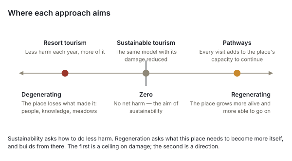
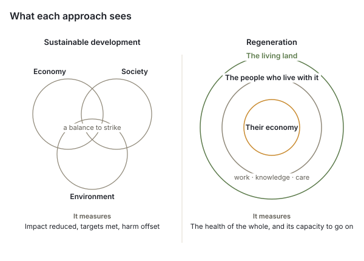
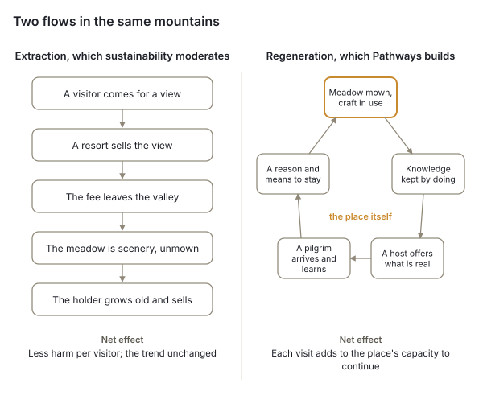

# Trans-Carpathian Pathways

*A living network of hosts, paths and Curators across the Carpathian arc — the case, the evidence and the design*

October 2026 · UBEC / Carpathian Hub Initiative · White Paper, draft v0.5

## How to read this paper

Trans-Carpathian Pathways has a proposal that says what it is, a starting prompt that records what has been decided, a co-creator agreement that says what each person in it promises, and a reasoning document that says why. This paper draws them together for readers outside the project — funders, partner initiatives along the arc, mountain communities and their councils, and the institutions now planning the Carpathians' future — and sets them against the evidence: what is happening to the Carpathians, what comparable projects elsewhere have learned, what the law allows, and what the research says about encounter, authenticity and the stewardship of lived-in landscapes.

Three kinds of statement appear here and are kept apart. **Decisions** are the project's, taken on dated record in its repository; they are cited as such. **Evidence** comes from the sources numbered in square brackets and listed at the end; where a figure could not be confirmed from a primary source, the text says so. **Proposals** are marked as proposals; nothing in this paper is decided by being written in it. The project is small and at an early stage, and this paper does not pretend otherwise: §11 says plainly what exists and what does not.

## Summary

The Carpathians are being re-valued from outside faster than from within. Resort property in Bukovel now sells for more per square metre than new flats in Kyiv [1]; tourist-tax receipts in Ivano-Frankivsk oblast have grown four and a half times in four years [5]; wind farms and a mega-resort are planned on high meadows that have never carried industry [12][13]; and in September 2026 Ukraine convened the first Carpathian summit in Bukovel to plan the region's future across borders, with energy and transport as the headline and a declared commitment to "cultural landscapes" and "the traditional way of life of mountain communities" that has, so far, no instrument [17][18]. Ukraine's path into the European Union will in time open its land to buyers from across the Union; Poland and Romania show what that did to land and resort prices [22][23][24]. Meanwhile the people who hold the old way of life are growing old, cattle in the oblast have fallen by roughly three quarters since 2003 [8], and the knowledge that made the meadows is passing with them.

Yet the mountains are also being re-inhabited. Some seventeen thousand people displaced by the war were registered in the Kosiv, Yaremche and Vorokhta hromadas by March 2025 — registrations, not residents [7]; a craft economy of more than a hundred workshops survives in Kosiv, whose painted ceramics are on UNESCO's list of intangible heritage [28][29]; herders have won Ukraine's first geographical indications for polonyna cheese [31]; and families and single people are leaving the cities to learn and live the Hutsul way of life rather than to look at it. Many of them are the people whose voice was not asked when the mountains' future was planned.

Trans-Carpathian Pathways stands with that second movement. It is a network of hosts who offer what they actually have — a bed, a meal, guidance, a craft — from where they live; a pathway that emerges from where those hosts are rather than being drawn above them; and local Curators who hold each stretch of it and suggest, never sell, a journey to each traveler. It runs on Plai, a consent-controlled map of the whole Carpathian range that UBEC already operates on its own server in the European Union. There is no booking calendar; the draft agreement adds no rating and no commission; payment is the host's to set, in forms the host chooses, and how it passes is still open; every host owns their own entry, or, where a Curator or steward entered it for them, has it changed or withdrawn whenever they ask. The first corridor runs from Vorokhta through Verkhovyna to Kosiv in the Hutsul highlands of western Ukraine.

The paper's argument, in short: Carpathian nature and Carpathian culture are one inheritance, made and kept by people living with the land, and the evidence from grassland ecology is unambiguous that the meadows depend on the mowing and grazing that made them [33][34][35][36]. What needs protecting is the relationship, not a landscape emptied of the people who made it. Travel that pays for that relationship to continue — encounter rather than extraction — is the one form of tourism that keeps a way of life rather than displaying it, and it works only if the encounter is real. That is the difference between sustaining and regenerating (§5): sustainability asks a resort to do less harm per visitor, and the resort now has an office for it; regeneration asks what a place needs to become more itself, and in mountains whose meadows degrade when left alone, less harm is not an answer. Comparable projects show that such networks live or die on maintenance budgets, named responsibility for every stretch, honest counting, and a steward designed before the money arrives [37][39][41][45]. Pathways is built to those lessons. Over time, the places its hosts share will trace corridors where cultural, natural and landscape heritage need stewardship as one whole — not wilderness, and not a designation from above, but a map a community can use to say what its land is worth before others decide it for them.

The project asks for support for people on the ground first and software second; for partner initiatives in each country of the arc; and for a place in the Carpathian Eight's and the Carpathian Convention's work on community support and cultural landscapes, as one concrete form that support can take.

## 1. The Carpathians at a turning point

### 1.1 Tourism and property

The Ukrainian Carpathians have become the one Ukrainian region where the war has raised, not frozen, the property market. Quality complexes in Bukovel start at about $2,500 a square metre fitted, and some apart-hotel formats reach $6,000, against a median of about $1,400 unfitted in Kyiv's new builds in May 2026 [1]. The pressure is no longer confined to the resort. An average house in Verkhovyna was listed at about 1.8 million hryvnia in October 2025 and in Kosiv at 1.9 million, against 7.1 million in Yablunytsia, 8.3 million in Mykulychyn and 11.7 million in Polianytsia, the hromada that holds Bukovel [2] — a gradient of six and a half to one from the resort to the first corridor's middle town, which is both the gap that makes Verkhovyna attractive to buyers and the measure of how far it has to rise. Verkhovyna already appears among the most expensive places to buy a house in the Ukrainian Carpathians, with prices up 10–15% between spring and summer 2025 [3].

Visitor pressure has grown with it. The oblast tourism department estimates 2.5 million visitors a year since 2023, against 2.0–2.3 million before the full-scale invasion, and its tourist-tax receipts rose from 10.4 million hryvnia in 2021 to 46.2 million in 2025 [5]. Over the 2024–25 New Year, Bukovel's hotels ran at 77–84% occupancy and visits to the Yaremche area were up 30–40% on the year; developers had 45 hotel-apartment complexes and 108 cottage towns in the pipeline for 2024–26 [6]. The resort is the reason the Polianytsia hromada records 2.4% unemployment and record tourist-tax income [4] — and the reason the mountains around it are being parcelled: in March 2026 a court annulled the cadastre registration of twenty forest plots of century-old beech and fir near Bukovel, taken on forged state acts for cottages and hotels; the prosecutors cited the Carpathian Convention [11].

The damage reaches the high ground. In 2026 off-road convoys of thirty to fifty vehicles sell two-hour tours of the ridges for 3,000–4,500 hryvnia; vehicles have been driven into Lake Herashaska on Svydovets and up stream beds, and an attempt was made to breach the barrier protecting the Petros–Hoverla stretch of the Carpathian Biosphere Reserve; the fine for a citizen is 153–408 hryvnia [10]. On the Dragobrat plateau more than fifty cottages and hotels crowd the ridge, with plots leased inside the Biosphere Reserve and some 190 hectares clear-cut below [9].

### 1.2 Energy and industry on the high meadows

Two larger projects would change the range itself. The Svydovets resort, planned by the owners of Bukovel on 1,430 hectares of one of the best-preserved massifs in the Ukrainian Carpathians, would bring 230 kilometres of pistes, 23 lifts, 60 hotels, 390 apartment blocks and 22,000 guests a day to a landscape of post-glacial lakes, old-growth forest and two Emerald Network sites [12]. In October 2024 the Supreme Court upheld the annulment of its detailed plans and no environmental assessment has been submitted; the file remains open before the Bern Convention's Standing Committee [14]. Wind farms are the newer front. On the Runa polonyna 30 turbines of 156 MW began construction before any environmental assessment; the assessment came back positive in February 2026, an appeal court ruled the felling of virgin forest for the access road illegal in July 2026, and more than forty hectares had already been cleared for a power line [13]. Wind Parks of Ukraine propose some 1.5 gigawatts across Zakarpattia's ridges, Svydovets among them [13]; the same 1.5-gigawatt "Carpathian wind-energy cluster" was pitched at the Carpathian Eight summit in September [19]. Environmental groups warn that the plans would turn up to half of Zakarpattia's high-altitude area into an industrial zone, and that oversight has weakened under martial law [15][16].

None of this is an argument against energy or against work in the mountains. It is an argument that the mountains' future is being decided by people who will not live in them, at a speed that leaves no time for the people who do to say what they want — and that the one thing all these projects have in common is that they treat the high meadows as empty.

### 1.3 The arc as a political region

The Carpathian Convention, adopted in Kyiv in 2003 and in force since 2006, binds seven countries — Czechia, Hungary, Poland, Romania, Serbia, Slovakia and Ukraine — to protect and develop the range together [25]. Its Protocol on Sustainable Tourism entered into force in 2013 [26]; a protocol on cultural heritage was drafted in 2014 and never adopted [27]. Its eighth Conference of the Parties is scheduled for the end of 2026, after which Ukraine holds the presidency for a year [25].

On 18–20 September 2026, in Bukovel, Ukraine launched the Carpathian Eight: Ukraine, Poland, Romania, Slovakia, Czechia, Austria, Hungary and Serbia, with the European Union as a whole. The agenda was security, energy, logistics, cross-border trade and "support for our communities"; fifty agreements worth over a billion euro were signed, more than half on solar and wind power [17][19]. The declaration was signed by six states — Austria, Poland, Romania, Serbia, Slovakia and Ukraine [18]. Hungary, counted by Kyiv among the eight, sent only its acting chargé d'affaires, did not sign, and says it is not a member of the initiative; Czechia took part but did not sign [20]. Its text matters for this project. It builds on the Carpathian Convention and commits the signatories to "the preservation of cultural landscapes, the traditional way of life of mountain communities", including intangible heritage, to "the development of shared cultural and tourist routes", to local crafts, and to biodiversity protection under the Convention; it considers an EU macro-regional strategy for the Carpathians and annual summits [18]. The official project list, however, runs to 90 projects worth $10.7 billion, of which energy accounts for $7.28 billion and transport $1.05 billion [19]. Cultural landscapes and the traditional way of life have a sentence; they do not yet have an instrument.

A month earlier the President met the heads of every mountain hromada in the four Carpathian oblasts. The agenda was roads, all-terrain buses, forestry and tourist-tax rules, flood prevention and veterans; depopulation, land and heritage were not on it [21].

### 1.4 Land, and the European Union

Ukraine opened its agricultural land market to citizens in July 2021 and to Ukrainian-owned companies in January 2024; foreigners and foreign-owned companies remain excluded until a national referendum, which cannot be held under martial law [22]. Some 636,000 hectares had changed hands by mid-2025, at prices rising from about 45,000 hryvnia a hectare in early 2024 to over 60,000 by June 2025 [23]. Within settlements, foreigners may already buy houses and non-agricultural plots; the garden plot of a village house is agricultural land and cannot pass to them [56].

Accession will change this. Free movement of capital is part of the acquis, and every recent entrant negotiated a transition rather than an exemption. Poland asked for eighteen years and got twelve, to 2016; over that period private farmland prices rose some 690%, and even in the mountainous Małopolskie region, which rose least, they rose 253% between 2005 and 2016 [24]. In Zakopane, the Polish Tatras' resort town, land reached about 5,000 złoty a square metre and tourist apartments 20,000, bought mainly as rental investments, against under 11,000 for a Warsaw flat [24]. Romania's seven-year restriction ended in 2014; the price boost in some areas was to twice the regional average, and in the Saxon villages of Transylvania — whose Saxon population fell, by one journalist's figure, from near a million before the war to some twenty thousand by 2002 — heritage houses were "modernised" with PVC and tin faster than any code could be enforced [22][24]. Ukraine's accession clusters were declared informally open in March 2026 and the first formally opened in June; a single member state's veto still blocks two others [59]. The question is not whether the Carpathians' land will open but how many years the mountain communities have to decide, before the market does, what their land is for.

### 1.5 The people who hold it

Ukraine has had no census since 2001, and population figures for raions have not been published since 2022, so the demography of the corridor is known only in outline [7]. Kosiv raion fell from 86,615 to 83,700 between January 2020 and 2022, before the full-scale war; Verkhovyna raion holds about 30,000 people on 1,254 square kilometres [7]. Studies of the Carpathian region find that many mountain villages did not depopulate between 1989 and 2020 as the plains did — recreation, forest and the mountain-settlement law held them — but that the mountainous districts of Ivano-Frankivsk and Chernivtsi oblasts have been losing people to the towns, and that "depopulation and ageing of rural areas" is the region's main threat [7].

The land itself records the change. Cattle in Ivano-Frankivsk oblast peaked at 294,300 head in 2003; in private households they fell from 109,500 in 2021 to 76,000 in 2024, 15.5% below the year before [8]. Ukraine's household sheep and goats fell from over two million around 2009 to under 1.4 million by 2019; herders' associations name the reasons: a ewe gives milk for 120 days and must be kept year-round, polonyna cheese sells for 100–120 hryvnia a kilogram with no protected name, and the work is hard and undervalued [8]. The age of those who still keep sheep and mow the meadows is not recorded anywhere this research could find; that the holders are growing old and their land will change hands within a generation is the project's own observation from living in the corridor, and §12 lists it among the things the first visits must establish.

## 2. What the mountains are: a continuing landscape, not wilderness

### 2.1 The meadows were made

The polonynas — the high pastures above the tree line that are the Carpathians' signature — are not natural. They were cleared by Vlach pastoralists from the fourteenth and fifteenth centuries onward, "within the forests up to the tree line and krummholz" [34]. Their biodiversity is a product of their use. A cross-border study of 48 parcels in eight villages of Maramureș and Bukovina, on both sides of the Ukrainian–Romanian border, found 78% of Ukrainian and 83% of Romanian parcels still traditionally managed; management explained plant richness better than topography or soil; regular mowing raised the richness of vascular plants and grazing that of bryophytes; and depopulation and falling livestock numbers were identified as the drivers of change [33]. In the Transylvanian subalpine meadows, 626 species were recorded across the stages of abandonment, with vascular plants peaking in the mown meadows and each successional stage holding the maximum for some group — so that the richest landscape is one kept in several stages of use at once [35]. Where grazing stops, green alder invades the polonyna and the species composition that centuries of use built begins to go [34]. Fischer, Hartel and Kuemmerle put the policy conclusion plainly: "the conservation value of traditional farming landscapes is often exceptional", unprofitability leads to abandonment on one side or intensification on the other, and what is needed is a transformation strategy that "seeks to support community-led efforts to create new, direct links with nature" [36].

This is why the project refuses the word *wilderness* for the Carpathians' meadows and villages. The frame is empirically wrong there even where it is right for the old-growth beech. A protected landscape that bans the mowing and grazing that made it, or that only the wealthy can afford to live in, has failed by its own measure.

### 2.2 Two vocabularies the world already uses

The vision has a footing in categories that governments and funders recognise. The IUCN's Category V, the *protected landscape*, is defined as an area "where the interaction of people and nature over time has produced an area of distinct character with significant ecological, biological, cultural and scenic value: and where safeguarding the integrity of this interaction is vital to protecting and sustaining the area" [60]. It covers more than half of Europe's protected-area estate; its critics rightly say it carries no automatic biodiversity value and should be judged by outcomes rather than by designation [60] — a caution this project accepts; §9's conditions and the signs of success and failure in §12 say how it would be met. UNESCO's World Heritage framework names the *continuing landscape*: one that "retains an active social role in contemporary society closely associated with the traditional way of life, and in which the evolutionary process is still in progress" [61]. The Hutsul polonyna economy is a textbook case. Behind both stands the concept of *biocultural diversity*, "the diversity of life in all its manifestations — biological, cultural, and linguistic — which are interrelated within a complex socio-ecological adaptive system" [62]. The Carpathian Convention already treats nature and culture together in its text [25]; what has been missing is an instrument at the scale of a village and a path.

### 2.3 Knowledge goes when practice stops

Traditional ecological knowledge is "a cumulative body of knowledge, practice, and belief, evolving by adaptive processes and handed down through generations by cultural transmission"; it is transmitted orally and by apprenticeship, and it breaks when the practice stops [71]. That is the mechanism behind the project's claim that encounter keeps a way of life alive where a museum cannot: knowledge of a meadow, a cheese or a loom is kept only by someone doing it beside someone who knows. A traveler who learns is one more kind of learner. A newcomer who stays is the one who matters most.

## 3. The people who keep the mountains alive

### 3.1 Those who stayed and those who came

The Hutsul craft economy is alive and concentrated. Kosiv holds more than a hundred private workshops, ten museums, the Kosiv Institute of Applied and Decorative Arts and the Saturday bazaar, the largest craft market in Ukraine; the Soviet-era "Hutsulshchyna" art enterprise once employed some three thousand people [28]. The tradition of Kosiv painted ceramics was inscribed on UNESCO's Representative List of the Intangible Cultural Heritage of Humanity in December 2019 [29]. In Yavoriv the Kischuk family keep a museum-workshop of lizhnyk weaving and the rare long-haired sheep that supply it [30]. On the polonynas, an association of producers of traditional high-mountain cheeses, founded in 2018 with Slow Food's support against lowland imitations, won Ukraine's first geographical indications: "Hutsul cow brynza" was registered in September 2020, managed by the Association of Carpathian Vatahy in Verkhovyna, with six polonynas certified in the first year — Krynta, Skupova, Lukovytsia, Bybratkivka, Zgarda and Shchivnyk [31]. A Kosiv programme to revive sheep farming, announced in 2022 with the aim of 16,000 sheep and 500 jobs in four years, rests on the observation that fifty sheep let a farmer stay rather than work abroad; its results are not yet published [8].

The war has brought people as well as pressure. Ivano-Frankivsk oblast had registered 92,624 internally displaced people by March 2025, against 3,829 in January 2021; the Kosiv hromada alone had 5,702, Yaremche 5,605 and Vorokhta 5,384 — the last roughly equal, on paper, to Vorokhta hromada's own population. Registrations overstate presence; in one town 1,474 were registered and 322 found [7]. Some have stayed to work: an atelier relocated from occupied Kakhovka to Kosiv in 2022 now employs fifty women from the town and its villages, several of whom had previously done seasonal work in Poland [32]. Beyond the displaced, families and single people are leaving the cities to learn and live the Hutsul way of life — the observation on which the project's hope rests, and for which this research found only anecdote. Counting them, and asking why they came, is work for the first corridor.

The literature on mountain newcomers is clear about what makes the difference. Studies of the Alps and Pyrenees find that "new highlanders" revive old trades and open "responsible, shared tourism between hosts and guests", but also that urban buyers raise prices and push out the young, that deep friendship across the line is rare ("you're always the immigrant"), and that resettlement "must be organised, accompanied, if not encouraged" [70]. Newcomers integrate rather than gentrify when they take up land-based work and shared labour, when housing is not commodified, and when they enter the institutions that exist — the hay-making, the festival, the church — rather than building parallel ones. The same line separates a host from a performer: the relationship to the place.

### 3.2 Who speaks for a community

When a resort or a wind farm is said to have local support, the first question is who said so, and who was not asked. A 2025 report from the Yasinia and Ust-Chorna communities says their leaders and residents still hope for the Svydovets resort, for the tax income it would bring — without saying which residents were asked — and in turn says the plaintiffs against it were sawmill owners protecting their logging [16]. Each side says the other's community voice is a cover for interests. The pattern is universal. The World Bank's review of participatory development found that induced participation is "often dominated by elites" unless there is a responsive centre and a long commitment [72]; Platteau calls elite capture "a serious problem" for community-driven development and finds no remedy that does not involve releasing resources gradually and checking [73]. Participatory mapping has its own ethics: the risk of "endangering people through the information they show", of data that outsiders "would then exploit", and of "demanding precision where fuzziness might be more appropriate" [74].

Pathways puts the question in every direction, to its own supporters included. It does not claim to speak for any village, and it is built so that no one has to: each host has their own account and their own entry, consents field by field, and withdraws at will — or, where a Curator or steward entered the place for them, has it changed or withdrawn whenever they ask; a Curator speaks for what they publish; the project speaks for itself. Across the Carpathians the people whose voice was passed over are finding each other and finding initiatives that will listen, and the tension between them and those who speak in their name is growing. A network of individual voices, each owning its own words, is the project's answer to that tension.

## 4. Why encounter

### 4.1 The diagnosis

Two problems meet in the Carpathians and share one answer. Travel has become extraction: travelers move through places without touching them, hosts perform hospitality instead of sharing it, and what the traveler takes away is a view while what stays behind is a fee, most of it to someone who does not live there. Mountain life is thinning out: villages lose people, knowledge goes unpassed, and the economy that sustained a way of life has moved elsewhere. Encounter answers both because knowledge passes from person to person, by doing something beside someone, and because a traveler who sleeps under a roof, eats at a table and learns how something is made leaves money and attention in the hands of the person who holds the knowledge. A host who shares what they actually have gains a reason to keep it, and a means to.

The condition is that the encounter be real. Half a century ago MacCannell described tourist settings as "a staged back region, a kind of living museum", built because "touristic consciousness is motivated by its desire for authentic experiences" [63]. Once a host performs, what is paid for is the performance, and the way of life is still lost — more slowly, and more profitably. Wang's distinction offers the way out: *existential* authenticity is a property of the activity rather than the object, found in shared work, walking and eating rather than in displays [64]. A network built on beds, meals, guidance and workshops in use, with no stage, is an attempt to stay on that side of the line.

### 4.2 What community-based tourism has learned the hard way

The record of community-based tourism is sobering and the project reads it as a checklist. Of 116 initiatives that experts identified as successful, 28 of the 133 surveyed answered, 15 met the definition, and only six were economically sustainable; a review of 200 community-tourism projects across the Americas found many lodgings running at about 5% occupancy; nine of the fifteen were still donor-dependent, and the authors recommend confirming that travelers exist before building beds and treating donor dependence after five years as a warning sign [45]. Blackstock's critique names three failings: the literature treats the host community "as a homogeneous bloc", takes a "functional approach" to involvement, and "neglects the structural constraints to local control" [65]. On leakage, the Overseas Development Institute finds that in the best cases a fifth to a third of destination tourist turnover reaches the poor, and that the food supply chain — not the bed — is the largest channel, about half of poor people's tourism earnings in its Luang Prabang case [46]. The lesson for a host network is that meals and workshops matter as much as lodging, and that a project which cannot show a traveler should not promise a host an income.

Regenerative tourism, the field's current frontier, asks that travel "deliver a net positive benefit to people, places and nature", finds that certification "contributes little", and warns that without consent and social licence tourism "risks becoming a dirty sector" [66]. The project's reading is that regeneration is not a label but a relationship, and that the relationship has to be visible in the design: who owns the data, who holds the route, who takes the money. §5 sets regeneration against the sustainable-development frame it replaces, and says why the Carpathians need the stronger one.

### 4.3 Pilgrimage to what

The proposal calls the pathway a "pilgrimage infrastructure", and the Hutsul region has real places of religious pilgrimage. The word is used here in the sense the anthropology of pilgrimage gives it — liminality, the threshold crossed, the *communitas* of people on the way together — and in Turner's caution that "a tourist is half a pilgrim, if a pilgrim is half a tourist" [67]. There is no shrine at the end of the path. A traveler walks into a relationship between people and land that has lasted centuries, is received into it for a night or a month, and leaves having taken part in it rather than having looked at it. The pilgrimage is to the relationship itself. Whether the word is kept, and whether the project says outright that it borrows no one's faith, is among the open questions in §12.

## 5. From sustaining to regenerating

The project has so far said what it refuses and why. This section says what it is for, in the terms the field now uses, and why it chose regeneration over the frame that has governed development for forty years.

### 5.1 What sustainable development promised, and where it stands

Sustainable development was defined in 1987 as "development that meets the needs of the present without compromising the ability of future generations to meet their own needs" [82]. It became the frame of the Rio conventions, of the seventeen Sustainable Development Goals and their 169 targets adopted in 2015, and of a vocabulary now used by every ministry, bank and resort. In tourism it took the form the UN agencies gave it in 2005: "tourism that takes full account of its current and future economic, social and environmental impacts, addressing the needs of visitors, the industry, the environment and host communities" [84].

Two things should be noticed about that definition before anything is said against it. It is a balance between four claimants, and the industry is one of them. And its verbs are to take account, to address, to minimise, to maintain. It asks how an activity can continue with less harm. It does not ask whether the activity is what the place needs.

Where the frame stands is on the record. The United Nations' own 2025 report finds that only 35 per cent of the Goals' targets with trend data are on track or making moderate progress, close to half are advancing too slowly or only marginally, and 18 per cent have regressed [83]. The record in the Carpathians is in §1, and it has a precise local form. Bukovel runs a Sustainable Development Office: free hourly buses, 0.6 megawatts of solar on hotel roofs, seven charging points, eleven hotels with Green Key certification, a partnership for low-carbon transport [85]. The same resort's owners planned the Svydovets mega-resort, and forest plots beside the resort were taken on forged acts for cottages until a court returned them in 2026 [11][12]. This is not an accusation of bad faith. It is what the frame does: it asks the resort to do less harm per visitor, and it is satisfied when the resort does. It has nothing to say about whether a valley of apart-hotels at $6,000 a square metre is what the valley should become, because "the industry" is one of the parties whose needs it exists to balance.

That is the sense in which sustainable development has been neglected in the areas where it would bite. It was applied where it was convenient — energy, waste, lighting, a certification — and left aside where it would have cost something: land, who decides, what a place is for, whether a way of life continues. And it was co-opted: a word available to any actor with a marketing budget is a word that soon means nothing. Critics inside the field say as much; regenerative tourism's own literature finds that sustainability certification "contributes little" [66].

### 5.2 What regeneration asks instead

Regenerative design has a lineage older than the Goals — Lyle's *Regenerative Design for Sustainable Development* of 1994 [86] — and a clear statement in Reed's 2007 argument: "Sustainability, as currently practised in the built environment, is primarily an exercise in efficiency." He set out a trajectory of approaches, each nested in the more whole: limiting the damage; then *neutral*, which is where green and sustainable design sit, "a generalized ideal of doing no harm"; then restoring the local living system to health; then regenerating, "the evolution of the whole system we are part of". Regeneration, he wrote, is "the only way to sustain sustainability". And it is place-based: the work "begins by attempting to understand how the systems of life work in each unique place", and the role of those involved "is to create a whole system of mutually beneficial relationships" [87]. Later work turns this into method: designing from place, with the community, watershed or bioregion as the sphere in which people can take part [88]; and into a research programme, regenerative sustainability as "thriving living systems in which whole-system health and wellbeing increase continually", with indicators specific to each place and developed through co-creation, and — unusually for the field — the integration of spirituality named among its conditions [89]. In tourism the same move is regenerative tourism, which asks that travel "deliver a net positive benefit to people, places and nature" rather than a reduced negative one [66].

The difference is not one of ambition but of question, unit and measure.

| | Sustainable development | Regeneration |
| --- | --- | --- |
| The question | How can this activity continue with less harm? | What does this place need to become more itself? |
| The unit | Three pillars to balance — economy, society, environment | One living place, people included, nested in a larger one |
| The measure | Impact reduced, targets met, harm offset | The health of the whole and its capacity to go on |
| The people | A stakeholder group whose needs are addressed | Participants in the place's life, and the ones who know it |
| The place | A site where generic standards are applied | The source of the design, each one different |
| Who defines success | The standard, the certifier, the global goal | The place and its people, co-creating the indicators |
| The aim | Neutral: no net harm | Net positive: more alive than before |

Regeneration does not discard sustainability's floor; doing no harm remains a condition. It refuses to treat the floor as the aim.

### 5.3 Why regeneration is the way forward for the Carpathians

**Because neutral is not enough where the land was made.** §2 showed that the Carpathian meadows depend on mowing and grazing and degrade when left alone. A frame whose aim is zero intervention and no net harm cannot keep a landscape that needs intervention to exist. For a continuing landscape, sustaining means holding still, and holding still means losing. The first diagram places the three approaches on one line: resort tourism, which does less harm each year and more of it; sustainable tourism, the same model with its damage reduced, aiming at zero; and Pathways, whose aim is that every visit adds to the place's capacity to continue.

**Because the pressures already speak sustainability's language.** The wind cluster pitched at the Carpathian Eight is renewable energy. The resort has a sustainability office. Accession is development. Each of the forces in §1 can describe itself as sustainable without lying, because the frame balances their needs against the mountains' and calls the balance the goal. A project that competes on doing less harm has already lost that argument; the resorts will always have more harm to reduce. The second diagram shows what each approach sees: three pillars to be balanced against one another, with the land one pillar among three; or a living place in which the land holds the people and the people hold their economy, and what moves between them is work, knowledge and care.

**Because the people who keep the mountains alive are already doing it.** Regeneration's unit is the living place, people included; its method is co-creation by those who know the place; its indicators are the place's own. That is a description of the second force in §3: the herders certifying their polonynas, the weavers keeping the long-haired sheep, the newcomers learning to mow. The third diagram sets the two flows side by side. On the left, the line sustainability moderates: a visitor comes for a view, a resort sells it, the fee leaves the valley, the meadow is scenery and goes unmown, the holder grows old and sells. On the right, the loop Pathways builds: a meadow mown and a craft in use keep knowledge alive by doing; a host offers what is real; a traveler arrives and learns; the host gains a reason and the means to stay; the meadow is mown again. The net effect of the first, at its sustainable best, is less harm per visitor with the trend unchanged. The net effect of the second is that each visit adds to the place's capacity to continue.

**Because the design is already regenerative in its parts.** Place-specific: one corridor at a time, its route emerging from where its hosts are, never a template. Co-creative: consent field by field, the Curator a person of the place, governance to pass to the corridor. Whole-system measure: success not counted in travelers but in hosts still hosting, a young person learning a meadow's work, money staying in the villages (§12). Grounded in relationship and, in §9's words, in spirituality — the condition Gibbons names and most of the field avoids. What this section adds is the name for the whole, and a test the project can be held to.

**Two cautions, so the word is not borrowed cheaply.** Regeneration can be co-opted as sustainability was; it is already a marketing adjective in tourism, and the project's own stress tests, recorded in its reviews, show how easily its language is lifted. The defence is not the word but the measure: a place is either more alive and more able to go on than before the pathway, or it is not, and §12's signs of success and failure are the project's way of being caught if it is not. And regeneration is a direction, not a credential: nobody certifies it, which is its strength against capture and its weakness before a funder who wants a label. The project offers the measure instead.

## 6. The model

### 6.1 Three interlocking things

Trans-Carpathian Pathways builds a network of hosts, a living pathway between them, and the people who hold it.

**Hosts** are people who choose to share something real from where they live. A host offers one or more of an overnight stay, a meal, local guidance and a workshop, and describes it as it is — the honest offer. Hosts are not service providers. One host is one place on the map, with a list of offers and, beside it, the months open, capacity in small whole numbers, the languages the host speaks and how the place is reached — on foot only, by car, with a pram, with a wheelchair (decided October 7, 2026).

**The pathway** is not designed from above. It emerges as hosts join: each becomes a point, the paths between them are traced over the existing trail network, and the Curator adjusts the result for terrain, season, capacity and the human logic of a journey. Viewpoints, springs and other places worth arriving at are mapped as places along the way, not as offers.

**The Curator** is the memory of the path, usually a local farmer, teacher or walker: someone who knows a stretch and its hosts, listens to each traveler's time, company and wish, suggests a route rather than prescribing one, and keeps track of who can receive whom and when. The Curator publishes what hosts enter, or holds it; holds the safety knowledge that is never published; and, as the draft agreement proposes, takes nothing from a host for sending travelers. Beside the Curator stands the **pathway steward**, a role added on October 8, 2026: someone who cares for a stretch of path, knows its hosts and places, may enter a place for a host who cannot and add places along the way, and leaves publishing to the Curator.

| Role | Does | On Plai |
| --- | --- | --- |
| Host | Enters their own place, or has it entered with their agreement | An entrant's account, or none |
| Pathway steward | Cares for a stretch; enters for a host; adds places along the way | A steward's account |
| Curator | Publishes or holds; suggests journeys; holds safety knowledge; also enters | A curator's and an entrant's account |
| Traveler | Walks a stretch, for an afternoon or a month | No account |

### 6.2 Plai: a map that already exists

The project does not start from zero. Plai is the Carpathian hub of UBEC Mapservice, an open-source map service that UBEC runs on its own server in Germany, under EU jurisdiction, on PostgreSQL/PostGIS, MapServer and Mapbender. In place today: a base map of the whole Carpathian range from OpenStreetMap, some 32 million features with hiking routes drawn on top; an entry surface where a person places a point exactly where they mean it and describes it; consent built into the database, field by field, so that a curator decides what is published and withdrawn entries leave every map and export; one photo per place, cleaned of location and camera data before it is stored; the host fields above, built and proven in a browser on October 7–8, 2026; a tick on every entry that the person has read and accepts the co-creator agreement, with the version and time recorded; and full export at any time. Pathways is a view of Plai's entries, not a system of its own (decided October 7, 2026): one place for a host to enter, one consent model, one curator queue. Plai's own name carries the idea (proposed as the project's wording): in the speech of these mountains a *plai* is a mountain path, the kind that follows a ridge from one pasture to the next. The name has a precedent in these mountains' own history: the Ukrainian regional studies and tourism society *Plai*, founded in Lviv in 1924, joined in one body the study of the land, the protection of natural and archaeological monuments, the marking of trails and the building of shelters, and built what is described as the first Ukrainian mountain shelter for tourists, on the Plisce meadow in the Gorgany, in 1933–35 [90]. The project takes the name in the same spirit and claims no descent from the society.

### 6.3 What it refuses

**No calendar.** Availability beyond the season is a conversation with the Curator, never a booking grid, because a calendar is the first step to a booking service and a booking service turns a host into a supplier with slots to fill.

**No ratings** (draft agreement §3, proposed; awaiting Michel's word). Hosts are not scored, ranked or reviewed in public, because a score teaches a host to perform for the score.

**No commission** (draft agreement §9, proposed). The project, its Curators and its stewards collect no payment for stays, meals, guidance or workshops and take no share; a Curator takes nothing from a host for sending travelers. A host chooses, for each offer, among a fixed contribution, a suggested contribution, an exchange of work, and ubec-pay or a community currency (decided October 7, 2026); the form of payment is public, the amount stays with the Curator. Whether payment passes directly from traveler to host, as the draft agreement says, or through the Curator or a community payment system, is the agreement's open money item (A-3); §12 names two more.

**No performance.** The encounter is real or it is nothing. Nobody stages tradition for visitors.

**No algorithm deciding.** A stage planner, if one is ever built, proposes daily stages to the Curator by walking time and ascent; it never answers a traveler. With five hosts the Curator plans on paper.

**No one speaks for a community.** A host speaks for their own place, a Curator for what they publish, the project for itself.

**Not wilderness.** People and land are one and the same. What needs protecting is the relationship.

### 6.4 Data stays with the people

Each person decides what is shown about them, field by field; unticking a consent removes that detail from the public map at once; withdrawing a place removes it from every map and every export; anyone may ask for a copy of everything held about them, or for deletion. The project never sells or lends data, shows no advertising, tracks no visitor, and hands data to no one, an authority included, unless the law compels it. As drafted (open A-2), entries and photos are not released under an open licence: the project review's reasoning is that an open licence cannot be revoked, so a host's home released under one could be copied forever after the host withdrew it, in wartime. The entrant keeps every right; UBEC holds a permission to store, show as consented, back up and hand back, which ends with withdrawal. These are the project's translation of the CARE principles for data governance — collective benefit, authority to control, responsibility, ethics — which "complement the existing data-centric approach" with one that is "people- and purpose-oriented" [75], and of the platform-cooperative principle that the people a platform serves, not its operator, own the data and the rules [76].

## 7. What others have learned

Nothing in this design is untested elsewhere, and the record of comparable projects is the project's most useful teacher. Eight cases, and the lesson each carries.

**Via Transilvanica (Romania).** Some 1,400 kilometres from Putna to Drobeta-Turnu Severin, built 2018–2022 by one NGO, Tășuleasa Social, with more than ten thousand volunteers and a thousand hand-carved andesite milestones; inaugurated October 2022; Europa Nostra's citizen-involvement award in 2023 [37]. Construction cost about €1.8 million from donations, by design without state money; the annual operating budget is now over €2.5 million from some 1,200 donors and a membership scheme, and 300–400 kilometres of marking must be refreshed every year [38]. Visitor counts drift — about 30,000 in 2024 by one estimate, 37,000 by another, and 120,000 claimed for 2025 — a four-fold jump that suggests a change of method rather than of travelers [38]. The host layer stayed informal: private guesthouses on an app map, with no published selection or standard, until in 2026 the association began building its own tiny-house modules on chosen families' land [38]. Documented outcomes are strong but anecdotal: one host up 600% in guests "but the figures are still small"; one village from 18 to 28 residents and its first birth in forty years [38]. Property-price rises, commodification and uneven benefit between villages on and off the route are the risks any such trail carries, and this paper names them for Pathways in §12. *Lesson:* a single committed body with a membership base and volunteer section-adopters can hold a long trail without the state — but maintenance is the recurring cost, counting must be owned by someone, and a host layer left informal becomes the operator's own beds in the end.

**Via Dinarica (the Dinaric Alps).** Donor-built from 2010 with USAID and UNDP, then Italian cooperation: over a thousand kilometres marked, dozens of huts and guesthouses rebuilt, grants to providers, jobs mostly seasonal; a stated goal in its second phase of a "community-owned and operated tourism product" [39]. After some $7 million and twelve years it still relies on a donor-funded support centre, and UNDP itself notes that communities "had yet to fully capitalize on economic opportunities" [39]. *Lesson:* design the steward before the grant, not after; "community-owned" was an objective, not an outcome.

**The hiking clubs of central Europe.** The Czech club KČT keeps about 43,000 kilometres marked through regional commissions in which each volunteer marker is assigned a section and reprimanded for neglect, with a small public subsidy it "could not manage without" [40]. Slovakia's KST has about 350 volunteer markers and a three-year renewal norm of some 5,500 kilometres a year; in 2025 it renewed 1,200 for lack of funds, and a bill to regulate trail care was postponed [40]. In Ukraine the Transcarpathian Tourist Trail — 398 kilometres marked in 2010 to Czech standards by a Swiss–Ukrainian forestry project — has no identified maintaining body, and the Eastern Carpathian Trail in the Gorgany was re-marked by a single volunteer mountain rescuer [41]. *Lesson:* a century of evidence that named responsibility per stretch plus a small steady subsidy keeps a path alive, and that where either is missing marking decays within a few seasons. The pathway steward is the project's version of the section-adopter.

**Bergsteigerdörfer (the Alps).** Since 2008 the Alpine clubs of Austria, Germany, Italy, Slovenia and Switzerland have certified 43 "mountaineering villages" that implement the Alpine Convention: no village over 2,500 residents, no firm over fifty staff, no valley-linking ski development, with mandatory criteria on alpine competence, landscape and mobility, an annual convention, and expulsion for a village that falls below them [42]. A 2012 evaluation found no measurable rise in overnight stays yet, high awareness among club members, and results that depended on whether a municipality or volunteers drove the work [42]. *Lesson:* a label is credible only if it can expel; and it earns awareness long before it earns income.

**Fundația ADEPT (Târnava Mare, Romania).** Since 2004 ADEPT has worked with some 1,500 farmers in the Saxon villages; it helped design Romania's high-nature-value grassland payment, which brought about 1,400 families some €1.5 million a year and over €2 million a year into the area, with 24,505 hectares of grassland under payment; its tourism work — festivals, markets, a wildlife centre — is described but not quantified [43]. By contrast, a matched study of Romania's LEADER local action groups found no significant difference in non-agricultural turnover or employment between participating and non-participating communes [44]. *Lesson:* the durable results came from a payment stream tied to land practice, not from tourism marketing or grant programmes alone.

**Donativo hospitality on the Camino de Santiago.** The pilgrim hostels that run on contribution rather than price survive on three things: volunteer hospitaleros, a building owned by a parish or association, and gifts from former pilgrims. Suggested giving is €5–12 for bed, dinner and breakfast; "stingy pilgrims send the albergue on a downward cycle", some private owners call a fixed €12 "donativo", and after the pandemic a hostel that once needed twenty pilgrims' gifts a night needs twelve [47]. The hospitality networks Servas (since 1949, hosts never charge, applicants interviewed by a national committee), Warm Showers and BeWelcome run on membership and volunteer governance [48]. *Lesson:* contribution-based payment needs a cost-carrier other than the guest's gift, and a definition of the difference between a contribution and a price that both host and traveler recognise.

**Platform cooperatives.** Fairbnb, the Italian cooperative alternative to Airbnb, raised a million euro in 2021, kept a 15% commission of which half went to local projects, was judged by a 2025 study to risk becoming "more of the same", and went into voluntary liquidation in 2024 before its brand was bought in 2025 [49]. CoopCycle's federated delivery platform worked where there was local trust and failed where a foreign licence caused friction [49]. Mapeo, the offline-first mapping tool built with Amazonian communities, shows that community-owned map data is operationally possible phone to phone [50]. In New Zealand an employment authority ruled in 2018 that "volunteers" working forty hours a week for board and a small payment were employees owed wages [51]. *Lesson:* a cooperative that imitates the incumbent inherits its economics; host-owned data is feasible; and hosted work must be framed as hospitality, never as labour for board.

**The Appalachian Trail (United States).** Benton MacKaye proposed it in 1921 not as a footpath but as a project in regional planning: a trail along the Appalachian skyline; shelter camps about a day's walk apart; community camps near it on land held in common, with no lots sold and run without profit; and in time cooperative farm and forest camps to supply them — a way back to the land, to work and to health, built by volunteers, each section kept by a local group under a federation [91]. The trail was built; the community and farm camps were not. It is kept today by some thirty volunteer clubs, each with its own section — from 2.2 miles to more than 280, many assigned in the 1920s and 1930s — coordinated by the Appalachian Trail Conservancy, with the National Park Service holding overall responsibility and a memorandum with each of the fourteen states [92]. To protect it, the National Trails System Act of 1968 and its 1978 amendments set out to acquire a corridor. Compulsory purchase met hard resistance from landowners; the 1978 bill made it a last resort behind negotiation and easements, and where an owner refused the route moved to a willing neighbour [93]. It is also a wilderness-recreation trail on largely public land, the frame this paper refuses for the Carpathians; its lessons lie in its structure and its history, not in its picture of nature. *Lesson:* the walking part of a vision finds volunteers and money, and the living part is dropped unless it is held from the start; a federation of section-keepers can hold a trail for a century; and a corridor bought or imposed from above turns the people inside the line against it — a corridor has to come from their consent.

| Lesson | From | What Pathways does |
| --- | --- | --- |
| Budget for maintenance first | Via Transilvanica | The path is held by stewards and the Curator; no infrastructure is built that no one is named to keep |
| Name a person per stretch | KČT, KST, the Gorgany | The pathway steward |
| Design the steward before the grant | Via Dinarica | Curator and stewards are the pilot's first work; funding goes to people before software |
| Confirm travelers exist before building beds | Goodwin & Santilli | Hosts offer what they already have; nothing is built for travelers |
| Meals and workshops carry village income | ODI | Four offers, not lodging alone |
| Contribution needs a cost-carrier | Camino donativo | Open: what the project says a contribution is (§12) |
| A label must be able to expel | Bergsteigerdörfer | The Curator holds or declines to suggest; the agreement allows closing an account for harm |
| Count honestly | Via Transilvanica | Gate 4 records walked distance, time and what was missing; success is not counted in travelers (§12) |
| Frame hosted work as hospitality | NZ ERA 2018 | Exchange of work is a form of payment a host may accept; the agreement must say what it is not (§10) |
| Do not imitate the incumbent | Fairbnb | No calendar, no ratings, no commission, no app for travelers |
| Host-owned data is feasible | Mapeo, CARE | Consent as columns, withdrawal, export; no open licence on homes (as drafted, A-2) |
| Keep the living part of the vision, not only the path | Appalachian Trail, 1921 | The hosts and the meadows are the project; the path is what joins them (§5, §9) |
| A federation of section-keepers can hold a trail for a century | Appalachian Trail | A steward per stretch; the first corridor's co-creators decide how it is governed from Phase 2 (agreement §4) |
| A corridor imposed from above turns the people inside it against it | Appalachian Trail, 1978 | Corridors as fuzzy bands drawn from consent, never parcels (§9) |

## 8. Foundations

### 8.1 Ubuntu, honestly

UBEC is the Ubuntu Bioregional Economic Commons. *Ubuntu* is usually rendered through Mbiti's "I am, because we are; and since we are, therefore I am" [68]: a person becomes a person through other people, and, in Metz's formulation, "an action is right insofar as it respects harmonious relationships, ones in which people identify with, and exhibit solidarity toward, one another" [68]. Southern African scholars have extended it to the more-than-human through the Shona notion of *ukama*, relatedness, which is the bridge between "I am because we are" and this project's "people and land are one and the same" [68]. The project uses the word with care. Its own proponents dispute its scope: some call its post-apartheid promotion an elite project whose metaphysical preconditions — small, kin-based communities — no longer hold, and others warn against generalising one "African environmental ethic" across many languages [68]. Pathways cites ubuntu as a named inspiration and a translated principle, not as a claim of equivalence, and pairs it with the Carpathians' own vernacular of neighbourliness — the *toloka*, the collective voluntary labour that built houses and brought in hay across Ukraine, is the indigenous analogue of what this paper calls contribution [69].

### 8.2 The bioregion

A bioregion "refers both to geographical terrain and a terrain of consciousness — to a place and the ideas that have developed about how to live in that place", and reinhabitation "means learning to live-in-place in an area that has been disrupted and injured through past exploitation" [77]. The critique is also on record: that bioregional writing lets nature dictate social arrangements and forgets that culture draws the lines [77]. Pathways avoids the determinism by defining its region through the places people actually share — the paths, polonynas, markets and parishes — rather than by watershed alone. The Carpathian arc is one living region across the borders of seven countries or more, and the project is bioregional before it is national: it starts in one corridor in Ukraine and is meant to cross every border on the arc, with a partner initiative in each country opening its own corridor under the same commitments on data, consent, safety and money.

### 8.3 The commons

Ostrom's eight design principles for enduring commons — clearly defined boundaries; rules congruent with local conditions; collective-choice arrangements; monitoring accountable to users; graduated sanctions; cheap conflict resolution; recognised right to organise; nested enterprises — have held up across ninety-one cases [78]. Read against a hospitality network, they map directly. The boundary is who counts as a host, a steward, a Curator and what is shared: routes, guest flow, data, the network's good name. Monitoring is the Curator reading every place before publishing and the steward walking the stretch. Sanctions are graduated — hold, decline to suggest, and only for serious harm close an account, after hearing the person. Conflict resolution runs talk first, then the Curator, then the lead, then a mediator. Nesting is village, corridor, arc. Collective choice is the one principle the pilot defers: in Phase 1 the project lead decides gate by gate after hearing those concerned, and the agreement promises that before Phase 2 opens the hosts, stewards and Curators of the first corridor are asked how the project should be governed from there (agreement §4). §12 names that deferral as a tension.

### 8.4 Hospitality, gift, contribution, price

Derrida distinguished the unconditional law of hospitality — welcome before asking a name — from the conditional laws that make it liveable, and called hospitality "culture itself and not simply one ethic amongst others" [79]. Mauss found in the gift three obligations: to give, to receive, to reciprocate; Hyde adds that "the gift must always move" and binds in a way no commodity can [80]. Between gift and price lies the *contribution*: the Camino's *donativo*, the Hutsul *toloka*, a payment that acknowledges a cost without fixing a value on the welcome. The project's four forms of payment live in that middle ground, and its one refusal — gift, named in the first draft and dropped — awaits its reason in writing (§12). Illich's word for the whole is *conviviality*: "autonomous and creative intercourse among persons, and the intercourse of persons with their environment" [81].

## 9. From places to corridors

Each host speaks for their own place. Placed side by side, those places and the paths between them begin to say something none says alone: where a living culture, a landscape and its nature still hold together, and where they are most at risk. Over time the pathway will trace corridors — stretches of the arc where cultural, natural and landscape heritage need stewardship as one whole, and sensitive areas that need it comprehensively.

These are not wilderness areas (§2). The stewardship they call for is grounded in spirituality, in connection, and in the relationships people have with each other and with the land, in the understanding that people and land are one and the same. A corridor is not drawn by the project. It emerges from the places people chose to share and speaks only for them. Where it gives a community the means to say what its land is worth before others decide it for them — before a wind farm, a resort or an accession-driven land market does — it has done its work.

Three conditions attach, and the project states them now rather than later. First, consent: a host agreed to be shown on a map, not to become evidence in a protection case; the agreement says data is held to put the network on the map, to let the Curator suggest journeys and to let travelers find hosts, "for nothing else", and a change in use needs each person's consent again (agreement §6, §13). No corridor draws on a host's place until the agreement says so and the host has agreed, with the right to stay on the map while declining that use. Second, the people inside the line: a corridor traced from the network crosses land where people live who never joined it, and "speaks only for them" must stay true when the corridor is put before a ministry, the Carpathian Eight or a funder. Third, protection as pressure: a designation can itself raise land prices and ban the mowing and grazing that made the meadows; a protected landscape that only the wealthy can afford to live in has failed.

The vocabulary already exists — the Convention's cultural landscapes, IUCN's Category V, UNESCO's continuing landscape, the C8 declaration's own words [18][25][60][61]. What a corridor drawn from below adds is the one thing a designation from above cannot: the consent, place by place, of the people whose land it is.

## 10. Working in wartime, and within the law

The pilot begins in Ukraine during the war, and the project is designed around that fact rather than despite it. This section reports what the law and official guidance say; it is not legal advice, and the agreement already names the two legal reads that must precede the first real account and the first traveler.

### 10.1 Entry, advisories and insurance

Ukraine's airspace is closed; foreigners enter by land. Nationals of the EU, the UK, the US, Canada and other visa-free states enter on a passport, with proof of funds under Cabinet Resolution 884 [52]. Every Western government advises against travel: the UK against all but essential travel to the five western oblasts, Ivano-Frankivsk among them, and against all travel elsewhere; the US at Level 4, "do not travel"; Germany and Canada with nationwide warnings; all note that consular help is severely limited and that travel insurance may be invalidated [53]. Ukrainian sources describe medical insurance from a Ukrainian-registered insurer as required of visa-free entrants, and Ukrainian insurers sell war-risk cover with limits around 100,000 hryvnia, while most Western insurers exclude Ukraine; the primary legal basis for an insurance requirement on visa-free entry was not found and is listed as unsettled [52]. The project's answer is the one the agreement already gives: a traveler reads their own government's advice, understands that Ukraine is under martial law, carries what insurance they can obtain, and is briefed honestly by the Curator before they come. The case for inviting travelers at all — solidarity, income where it is needed, witness — and the case against — risk to guests, burden on hosts, a home made visible — are both real, and §12 keeps the question open as to what the project says to a traveler from abroad, and who says it.

### 10.2 Curfew, alerts and the border strip

Ivano-Frankivsk oblast's curfew runs from midnight to five in the morning by decision of the oblast Defence Council [54]. During an air-raid alert everyone follows the official warning and the host's shelter; a journey pauses. The hard constraint for the first corridor is the state border. Under Cabinet Resolution 1147 as amended in December 2023, the border strip is five kilometres from the line; entering, staying or working in it needs written permission from the border detachment, decided within ten days and now issued as a QR code; settlements and mass-recreation areas are excluded, so entering a village needs no permit but leaving it into forest or polonyna does [55]. The Verkhovyna raion is a controlled border district, and Order 1663-АГ of the 31st (Chernivtsi) Border Detachment of May 2024 applies to the Zelena and Biloberizka communities: entry into the five-kilometre strip for tourism or recreation is banned without a permit, with limits on vehicles stopping or gathering at the roadside; routes to Pip Ivan Chornohirskyi, Pozhyzhevska and Lake Brebeneskul are closed or restricted, and later guidance adds Turkul and the polonynas; permits are valid a year and more than ten thousand had been issued by July 2024 [55]. Verkhovyna National Nature Park confirms that group leaders send route, dates and the passport data of participants to the detachment in advance [55]. How a foreigner obtains such a permit in practice, and which villages' surroundings fall inside the strip, no source answered; both are the Curator's to establish before any stage near the ridge is suggested, and a stage that needs a permit says so.

### 10.3 Hosting from the home

No dedicated law on rural tourism exists; drafts in 2021 and since were never adopted, and the sector "remains almost unregulated" [57]. What does exist is Cabinet Procedure 297 of 2006: owners of individual accommodation of up to thirty places may provide temporary lodging without registering as a business, provided they declare the income annually, keep a guest register, report statistics to the local authority and meet sanitary norms; an individual pays personal income tax at 18% plus the military levy, now 5% [57]. A host who prefers to register as a sole proprietor may offer hotel services under the simplified tax system [57]. Whether a household serving meals to paying guests must register a food facility under Law 771/97, and how the tourist tax applies to a non-registered host, are grey zones [57]. No licence is required of a local guide; licensing applies to tour operators only [58]. The project cannot check any of this for a host and must not seem to: the agreement says each host answers for their own (§9), and the project review asks that the Curator say so plainly at the first visit.

### 10.4 Money, and what the project is not

A payment for a bed or a meal is income from services whatever it is called; a genuine gift from a non-relative is taxed to the recipient, at a higher rate when the giver is a non-resident, so calling a contribution a gift brings no advantage [58]. Barter is lawful and in-kind income is taxable at fair value; community currencies have no legal status, the hryvnia being the sole legal tender, which is why "ubec-pay or a community currency" names a form of payment a host may accept and not a payment system the project runs [58]. A foreigner's exchange of work for board raises questions of work permits and volunteer law that remain unsettled, and the New Zealand precedent in §7 shows what happens when hosted work is treated as labour [51][58]. Under Ukraine's Law on Tourism a *tourist product* is a pre-arranged combination of two or more services sold at a set price, and only tour operators are licensed; a body that publishes hosts, takes no booking and no money forms and sells no product [58]. The EU's Package Travel Directive applies to traders and excludes arrangements "offered or facilitated occasionally and on a not-for-profit basis and only to a limited group of travellers" [58]. This is why the draft agreement says that the project, its Curators and its stewards "do not collect payment for stays, meals, guidance or workshops, and take no share of it", with payment passing directly from traveler to host as drafted (open A-3): it keeps Pathways what it says it is. The shape should be confirmed by someone who knows Ukrainian tourism law before the first traveler.

### 10.5 Data, in Germany and in Ukraine

The data sits on UBEC's own server in Germany, under EU law, in Plai's own database apart from every other project's. A published home location is personal data under both the GDPR, which names location data, and Ukraine's Law 2297-VI [56]. Ukraine's law of 2010 remains in force with trivial fines; the GDPR-aligned replacement passed first reading in November 2024 and in mid-2026 was still awaiting its second, and adopting it is a benchmark of accession Cluster 1, opened in June 2026 [56]. There is no EU adequacy decision for Ukraine; transfers to Germany are permitted under Ukraine's law because Germany is a party to Convention 108 [56]. The clean legal basis is explicit consent, given field by field and withdrawable — which is what Plai does. Whether a controller based in Ukraine who collects EU travelers' details falls under the GDPR's extraterritorial reach and needs an EU representative is for the data-protection read the agreement already requires before the first real account.

## 11. Where the project stands

Honesty about the stage is part of the design. On October 9, 2026:

**What exists.** The proposal in English and Ukrainian; a user manual for entrants and curators in both languages with the screens as they are; a co-creator agreement for every role — host, steward, Curator, traveler, contributor, partner initiative, funder, administrator — in both languages, as a draft with seven items open; a reasoning document; and, on Plai, the Carpathian base map, the entry surface with consent as columns, the host fields, hosts drawn in their own colour to the public, the photo, the agreement tick on every entry, and a published place clicked in a browser carrying every host field. Gates 0 and 2 — decisions, host fields — are closed on dated record; Gate 1, Plai in a browser, was passed in fact by the browser look of October 8 recorded under Gate 2, though the prompt's own line still reads "pending".

**What does not exist.** Any host, steward or Curator by name; any real account. Backups with an off-host copy, which is the service's own condition for the first real account. A mailer, so a forgotten password is reset by the administrator. A legal body: "UBEC" initiates every document but neither tree names its legal form, and the controller of every host's data is today the project lead personally. Any budget figure. The software is ahead of the agreements between people — the right order for a map, since the consent model had to be proven before anyone was asked to trust it — and Gate 3, the first hosts, is the first gate whose work is a promise made to a person.

**The risks the project has named for itself**, in its own review: one person holds everything, in wartime, and a deputy administrator with a second copy of the backup key is proposed and not yet named; no legal body; the shape of the project turns on how payment passes; hosts' own obligations under tax and martial law; wartime knowledge held by Curators with a written duty of confidence only in the draft agreement; a home at its exact point is safe only as an informed choice; paid roles with no terms yet; people in photographs and stories.

**The gates ahead.** Gate 3: three to five hosts in the corridor, entered with the Curator beside them, one Curator named — after backups. Gate 4: the corridor walked end to end, recording walked distance and time per stage, what was missing, and what a traveler needed and did not have. Gate 5: a stage planner, only if Gate 4 shows the Curator needs one. A gate opens on the work being done, not on a date.

## 12. What is open

The project keeps its tensions in view rather than resolving them on paper. The reasoning document sets out twelve; the paper names the ones a reader outside the project should know.

- **The map against "no performance".** A pin that says "a workshop" invites its host to become what the pin says. Honest offer, no calendar, no ratings and a Curator who reads every place before publishing are the guards; who says so when a host begins to perform, and what follows, is open.
- **Paid, but not a transaction.** What makes a contribution different from a price, in words a host and a traveler would both recognise; why gift was not among the four forms; and how payment passes (A-3).
- **The Curator's power.** The memory of the path is also the gatekeeper of who appears on it. How a Curator is chosen and by whom, and what a host passed over can do, are open; the agreement's dispute route is the first answer.
- **Organic growth that began from outside.** The map was built before there were hosts, by an initiative led by one person. What passes to the corridor, and when — for instance the corridor's own Curators choosing the next corridor — is the governance question Phase 2 must answer.
- **Enough.** How many travelers a host or a village can receive before encounter becomes throughput; capacity per offer is the first guard, a limit for a stretch is open.
- **The map as a buyer's guide.** In a rising market a map of old houses at their exact points is also a scouting list. A host may place their point at a nearby meeting place and tell travelers the rest in person; whether the Curator says this to every host in those words is open.
- **Newcomers.** Whether those who come to live and learn host on the same terms as those who were born there, and how the project speaks of them.
- **Consent for corridors, the people inside the line, protection as pressure** (§9).
- **Travelers in wartime.** What the project says to a traveler from abroad about advisories, insurance and martial law, and who says it (OI-P12).
- **Pilgrimage.** Whether the word is kept, and whether the project says outright that it borrows no one's faith.

**What is not yet known**, and what the first visits must learn: the age of the corridor's landholders and what happens to their land; how many newcomers have settled in its villages and why; what accession is already doing to land prices in the Ukrainian Carpathians; whether the Carpathian Eight will take up heritage and nature and whether it will hear communities directly; and what the corridor's own people call the stewardship this paper describes, in their own words, from which the Ukrainian text should come.

**What success would look like** (proposed). Hosts still hosting after three seasons on their own terms and saying it was worth it; a young person learning a craft or a meadow's work because the path brought them together; Curators and stewards who are people of the corridor and choose the next corridor themselves; travelers' money staying in the villages; a community using what the pathway shows to speak for its own land in a decision about it. **What failure would look like:** costumes and staged meals; prices along the pathway rising faster than around it, and houses on the map bought by people who found them there; one village saturated while others see no one; a Curator become an agent; and the project described by how many travelers it moved. Neither is counted in travelers. Behind both stands one regenerative test (§5): is this place more alive, and more able to go on, than it was before the pathway?

## 13. What is asked

**Of funders.** Support for the pilot goes to people on the ground first and software second, because the map already exists: finding and visiting hosts and sitting beside them while they enter; a paid first Curator under a written arrangement; walking the corridor and assessing each stage; the two legal reads; translation; hosting, backups and the safeguards that keep host data private. Funding gives no say over what is published or which journeys are suggested, and no access to hosts' or travelers' data; what came in and what it was spent on is to be reported at each gate (draft agreement, the funder's part). Budget figures are the first open item the pilot must close, and the project will not promise a host an income it cannot show. What is asked is funding for regeneration rather than mitigation: not a reduction in tourism's harm, which the resorts can fund themselves, but the capacity of a few places to continue, measured by the signs in §12.

**Of partner initiatives along the arc.** A corridor in any of the arc's other countries — which ones is itself open (OI-P11) — opened under the co-creator agreement or a version of it that keeps its commitments on data, consent, safety and money, with its own hosts, stewards and Curators in its own language, its data held under the same consent and handed over in full if the corridor goes its own way.

**Of mountain communities and their councils.** Not endorsement but attention: a reading of this paper; the names of people who already host, teach, herd or mow; and the questions a village would want answered before any of its people appear on a map.

**Of the Carpathian Eight and the Carpathian Convention.** The C8 declaration commits its signatories to cultural landscapes, the traditional way of life of mountain communities and shared cultural routes; the Convention has treated nature and culture together since 2003 and Ukraine will hold its presidency after COP8. Pathways is one concrete form that commitment can take, built from the communities outward, and it asks to be heard as such: as the places of named hosts and the paths between them, shown with their consent and speaking for no one else — never as what a community wants, which only a community can say.

**Of anyone.** The project's documents, code and record of every decision are open; its agreement is written in plain words on purpose; and anyone may propose. Contact: Michel Garand — stewardship@ubec.network.

## Appendix A — The project's documents, reviewed

All in the repository `ubeccommon/trans_carpathian_pathways`, documents under CC BY-SA 4.0 and code under AGPL-3.0-or-later. Read for this paper on October 9, 2026.

| Document | Version | What it holds |
| --- | --- | --- |
| Starting prompt | v0.21 | Load order, every decision with its date, roles, the first corridor, gates, open items; the source of truth |
| Proposal (EN, UK, PDF) | v0.2 | The outward summary: need, response, who it serves, the corridor, Plai, principles, safety, roadmap, funding, how to take part |
| Host-fields specification | v0.5 | What a host point carries on Plai and how it is proven |
| Mapservice state review | v0.1 | The stack Pathways runs on, read before any change |
| Project review | v0.1 | Eight drifts, eleven risks, what the agreement must settle |
| User manual (EN, UK, PDF) | v0.3 | Entering a place and curating, screen by screen, with what the stack cannot yet do |
| Co-creator agreement (EN, UK, PDF) | v0.2 | What every role promises; seven items open before signing |
| Reasoning | v0.1 | Why: roots, the two forces, corridors, each principle's reason, twelve tensions |

**Where the documents still differ from the decisions.** The proposal is at v0.2 and the project's own review of October 8 recorded four drifts that remain: the pathway steward does not appear in it; its pilot step 2 and safety section say the host enters, where a Curator or steward may now enter for a host who cannot; its contact line still reads "to be added", though the address has been stewardship@ubec.network since August; and its list of principles differs in wording and count from the starting prompt's and the agreement's. The reasoning document proposes that its own §6 become the single list of principles and that the proposal's next version take the "why now" and the corridors in short form. This paper does not change the proposal; it records that proposal v0.3 is due, in both languages.

**What this paper adds that no document yet held.** The pressures in figures with sources (§1); the grassland evidence for "not wilderness" (§2); the case for regeneration against sustainable development, with its diagrams (§5); the comparable projects and their lessons (§7); the legal frame in one place (§10); and the ask (§13). Where it has drawn on the project's own words it has kept their meaning; where it proposes, it says so.

## Sources

Read October 9, 2026. Figures from secondary compilations are marked; items marked *unverified* could not be confirmed from a primary source.

**The region**

1. Ekonomichna Pravda, "Буковель дорожчий за Київ", June 2026 (the cited page could not be re-fetched at checking; the text is confirmed word for word in a copy dated 23 June 2026) — https://epravda.com.ua/biznes/karpati-ta-bukovel-yak-zrostaye-investiciyna-neruhomist-i-pributki-kurortu-822922/
2. Zaxid.net, "Будинок в Карпатах: скільки коштує і від чого залежить ціна", 1 October 2025 (OLX listings) — https://zaxid.net/budinok_v_karpatah_skilki_koshtuye_i_vid_chogo_zalezhit_tsina_n1620372
3. Novyny.LIVE, "Ціни на будинки в горах", August 2025 — https://novyny.live/neruhomist/tsini-na-budinki-v-gorakh-skilki-groshei-treba-viddati-za-pokupku-272912.html
4. Ukrainian News, "Thanks to Bukovel, the Polianytsia community has recorded its highest ever tourist tax revenues", 12 June 2025 — https://ukranews.com/en/amp/news/1087356-thanks-to-bukovel-the-polianytsia-community-has-recorded-its-highest-ever-tourist-tax-revenues
5. Ivano-Frankivsk oblast tourism department, "Туризм Івано-Франківської області 2025" (visitor figures from 2020 are departmental estimates) — https://speakerdeck.com/iftourism/turizm-ivano-frankivskoyi-oblasti2025
6. Ekonomichna Pravda, "Відвідуваність українських курортів зросла до 40% на зимові свята", January 2025 — https://epravda.com.ua/biznes/vidviduvanist-ukrajinskih-kurortiv-zrosla-do-40-na-zimovi-svyata-802063/
7. Suspilne Ivano-Frankivsk, "У яких громадах Івано-Франківщини живуть найбільше переселенців", 21 May 2025 — https://suspilne.media/ivano-frankivsk/977307-u-akih-gromadah-ivano-frankivsini-zivut-najbilse-pereselenciv/; Suspilne, 9 February 2021 — https://suspilne.media/102967-pereselenci-na-prikarpatti-so-kaze-statistika-cerez-7-rokiv-vid-pocatku-vijni/; raion populations: Wikipedia "Kosiv Raion", "Verkhovyna Raion" (compiled from Ukrstat estimates; secondary); Lozynskyy & Zubyk, "Transformation of the Rural Settlement Network in the Carpathian Region of Ukraine (1989–2020)", *European Countryside* 14(2), 2022 — https://doi.org/10.2478/euco-2022-0014; Teslyuk & Rushchyshyn, *Herald of Khmelnytskyi National University* 296(4), 2021 — https://heraldes.khmnu.edu.ua/index.php/heraldes/en/article/view/1607
8. Suspilne Ivano-Frankivsk, "Як на Франківщині зменшується чисельність корів", 13 March 2025 — https://suspilne.media/ivano-frankivsk/968067-ak-na-frankivsini-zmensuetsa-ciselnist-koriv-statistika-z-1991-roku/; ZN.ua, "Біле золото Карпат", 20 September 2019 — https://zn.ua/ukr/business/bile-zoloto-karpat-324136_.html; UkrAgroConsult, "На Прикарпатті відроджуватимуть вівчарство", 5 September 2022 — https://ukragroconsult.com/news/na-prykarpatti-vidrodzhuvatymut-vivcharstvo/
9. Texty.org.ua, "Карпати 3D", c. 2017 — https://texty.org.ua/d/carpathians-3d
10. LB.ua, "Джипер високогір'я", 3 August 2026 — https://lb.ua/society/2026/08/03/756098_dzhiper_visokogiryi_tse_ruskiy.html
11. Vikna.tv, "Держава повернула 20 ділянок лісу біля Буковелю", 6 March 2026 — https://vikna.tv/dlia-tebe/novyny-ukrayiny/derzhava-povernula-20-dilyanok-lisu-bilya-bukovelyu-rishennya-sudu/amp/
12. Bruno Manser Fonds, "The Svydovets Case", June 2019 — https://en.forumcivique.org/kampagnen/forest/report_the_svydovets_case.pdf
13. CEE Bankwatch Network, "Ukraine's Mount Runa at risk", issue paper, 27 August 2026 (updated 25 September 2026) — https://bankwatch.org/wp-content/uploads/2026/08/2026_08_Issue-Paper_Ukraine-s-Mount-Runa-at-risk.pdf
14. Government of Ukraine, report to the Bern Convention Standing Committee, file 2018/5 Skhidnyi Svydovets, 20 January 2025 — https://rm.coe.int/files-2018-5-ukraine-skhidnyi-svydovets-2025-gov-2757-1931-8795-1/1680b4b790
15. Ukrainian Nature Conservation Group, "High-level meeting called to address Carpathian wind farm crisis", 2025 — https://uncg.org.ua/en/high-level-meeting-called-address-carpathian-wind-farm-crisis/; Derevo.ua, "How the War is Changing the Ecological Balance of the Carpathians" — https://derevo.ua/en/publication/vijna-zagostrila-ekologichni-konflikti-v-3801
16. Ukrainian News, "'The Forest Republic': How Logging Interests in Zakarpattia Are Blocking Investment Projects", 2025 — https://ukranews.com/en/amp/news/1076072-the-forest-republic-how-logging-interests-in-zakarpattia-are-blocking-investment-projects-to-keep
17. European Pravda, "Zelenskyy announces new format for cooperation with neighbours: the Carpathian Eight", 18 September 2026 — https://www.eurointegration.com.ua/eng/news/2026/09/18/7245769/
18. President of Ukraine, "Declaration of the Summit of the Carpathian Integration Initiative", 18 September 2026 — https://www.president.gov.ua/en/news/deklaraciya-samitu-karpatskoyi-integracijnoyi-iniciativi-106445
19. Kyiv Post, 18 September 2026 — https://www.kyivpost.com/post/84863 and https://www.kyivpost.com/post/84833; Reuters via Internazionale, 19 September 2026 — https://www.internazionale.it/ultime-notizie-reuters/2026/09/19/zelenskiy-launches-carpathian-eight-initiative-on-trade-security; Ministry of Economy of Ukraine, panel "Єдиний карпатський простір", 22 September 2026 — https://me.gov.ua/News/Print/ec56852e-bdba-46a7-9ab1-30aaaed8fb29?lang=uk-UA
20. AFP via Courthouse News, 22 September 2026 (Hungary's representation and its Foreign Ministry's statement); signatories from the declaration text [18]
21. President of Ukraine, meeting with heads of mountain hromadas, 13 August 2026 — https://www.president.gov.ua/en/news/prezident-obgovoriv-iz-predstavnikami-girskih-gromad-vikliki-105813
22. OSW, "Ukraine: two years of free trading in arable land", 17 July 2023 — https://www.osw.waw.pl/en/publikacje/analyses/2023-07-17/ukraine-two-years-free-trading-arable-land; Mondaq on Romania's Law 17/2014, 28 January 2014 — https://www.mondaq.com/Article/452626
23. Demagog.pl, "Problem własności gruntów rolnych: wnioski dla Ukrainy z polskiej drogi do UE", 8 April 2026 — https://demagog.org.pl/analizy_i_raporty/problem-wlasnosci-gruntow-rolnych-wnioski-dla-ukrainy-z-polskiej-drogi-do-ue/
24. Bórawski et al., *Land Use Policy* 82 (2019) 486–496 — https://doi.org/10.1016/j.landusepol.2018.11.027; Warsaw Business Journal, "Real estate and land prices are breaking new records in Zakopane", 29 December 2021 — https://wbj.pl/real-estate-and-land-prices-are-breaking-new-records-in-zakopane/post/133108; Butnaru, "The impact of liberalization on the Romanian land market", ASE Bucharest, c. 2014 — https://www.cafee.ase.ro/wp-content/uploads/2022/10/THE-IMPACT-OF-LIBERALIZATION-ON-THE-ROMANIAN-LAND-MARKET-SALES.pdf; Osservatorio Balcani e Caucaso, "The Saxons' fragile treasure", 22 September 2009 — https://www.balcanicaucaso.org/en/cp_article/the-saxons-fragile-treasure/
25. Carpathian Convention (FAO/Mountain Partnership summary) — https://fao.org/fileadmin/templates/mountain_partnership/doc/4th_global_meeting_presentations/Carpathian_Convention.pdf; Government of Ukraine on COP8 and the presidency, 10 November 2025 — https://www.kmu.gov.ua/en/news/ukraina-hotuietsia-do-prezydentstva-v-karpatskii-konventsii
26. InforMEA, Protocol on Sustainable Tourism — https://www.informea.org/en/treaties/protocol-sustainable-tourism/decisions
27. InforMEA, decision COP4/7 on cultural heritage and traditional knowledge, 2014 — https://www.informea.org/en/decision/cop47-cultural-heritage-and-traditional-knowledge
28. ReHERIT, heritage profile of Kosiv, 2020 — https://reherit.org.ua/wp-content/uploads/2020/08/Kosiv_profil-spadshhyny_REHERIT.pdf
29. UNESCO, "Tradition of Kosiv painted ceramics", Representative List 2019 — https://ich.unesco.org/en/RL/tradition-of-kosiv-painted-ceramics-01456
30. Discover Ivano-Frankivsk, the Kischuk family lizhnyk museum-workshop, Yavoriv — https://discover.if.ua/en/locations/muzej-majsterna-liznikarstva-rodini-kisukiv-u-avorovi
31. Suspilne, "Гуцульська коров'яча бриндза отримала географічне зазначення", 14 September 2020 — https://suspilne.media/62845-guculska-korovaca-brindza-otrimala-geograficne-zaznacenna/; Slow Food Foundation, "In defense of authentic Hutsul bryndza", 24 April 2018 — https://www.fondazioneslowfood.com/en/in-defense-of-authentic-hutsul-bryndza/
32. Ekonomichna Pravda, "З Каховки до Косова", 2025 — https://epravda.com.ua/biznes/z-kahovki-do-kosova-809595/

**The landscape**

33. Janišová et al., "Agricultural legacy shapes plant diversity patterns in mountain grasslands of Maramureș and Bukovina", *People and Nature* 6(6), 2024 — https://doaj.org/article/9caebdd433aa40af98967f90d8c0b455
34. Kricsfalusy, "Mountain grasslands of high conservation value in the Eastern Carpathians", *Thaiszia* 23(1), 2013 — https://www.upjs.sk/public/media/9724/067-112-kricsfalusy-upr.pdf
35. Baur et al., "Effects of abandonment of subalpine hay meadows on plant and invertebrate diversity in Transylvania, Romania", *Biological Conservation* 132(2), 2006 — https://edoc.unibas.ch/12896
36. Fischer, Hartel & Kuemmerle, "Conservation policy in traditional farming landscapes", *Conservation Letters* 5, 2012.

**Comparable initiatives**

37. Via Transilvanica — Wikipedia (secondary) — https://en.wikipedia.org/wiki/Via_Transilvanica; Romania Insider, 10 September 2025 — https://www.romania-insider.com/via-transilvanica-norway-grants-pislaru-sept-2025
38. Ziarul Financiar, 1 August 2025 — https://www.zf.ro/via-transilvanica/via-transilvanica-mult-traseu-turistic-ajuta-dezvoltarea-zonelor-22867654; ZF, 22 September 2025 — https://www.zf.ro/via-transilvanica/via-transilvanica-drumul-uneste-comunitati-businessuri-cristina-toma-22908279; Agerpres, 14 May 2026 — https://agerpres.ro/2026/05/14/reportaj-mures-primul-modul-de-cazare-pentru-drumetii-de-pe-via-transilvanica---inaugurat-la-saparto--1556156; Economedia on The Guardian — https://economedia.ro/?p=231748; Tălpău et al., Mendel University Press, c. 2025 — https://doi.mendelu.cz/pdfs/doi/9900/08/3500.pdf
39. UNDP Bosnia and Herzegovina, Via Dinarica project pages — https://global-prod.acquia.undp.org/node/91131 and https://www.undp.org/node/442241; AICS Tirana project sheet, January 2026 — https://tirana.aics.gov.it/wp-content/uploads/2026/01/Sustainable-Tourism-for-Green-Growth-Along-the-Via-Dinarica-Trails-in-Bosnia-and-Herzegovina.pdf
40. ČT24, 17 January 2019 — https://ct24.ceskatelevize.cz/domaci/2708774-pred-130-lety-byla-v-cesku-namalovana-prvni-turisticka-znacka-sit-znacenych-tras-meri; TASR, 17 May 2026 — https://www.teraz.sk/slovensko/klub-turistov-priblizne-350-znackaro/963427-clanok.html; Noviny.sk, 13 June 2025 — https://www.noviny.sk/slovensko/1072270-hory-su-plne-turistov-znacenie-tras-je-v-rukach-dobrovolnikov-zakon-ktory-mal-upratat-chaos-sa-odklada
41. Ukrinform, 14 May 2021 — https://www.ukrinform.ua/rubric-tourism/3244990-na-zakarpatti-turistiv-zaprosuut-projti-najdovsij-marsrut-karpatami.html; Suspilne, 2 June 2021 — https://suspilne.media/135818-u-gorganah-vidnovluut-markuvanna-na-shidno-karpatskomu-turisticnomu-slahu/
42. Bergsteigerdörfer, criteria 2017 (EN) — https://www.bergsteigerdoerfer.org/files/criteria_for_mountaineering_villages_2017.pdf; criteria 2025 (DE) — https://alpenverein.it/wp-content/uploads/2026/01/Kriterien-der-Bergsteigerdoerfer-Fassung-2025.pdf; Czaja, mid-term evaluation, 2012 — https://trustsoft.uni-oldenburg.de/f/5/inst/biologie/ag/geoumwelt/zenario/Abschlussarbeiten/Masterarbeit_Iris_Czaja.pdf
43. Fundația ADEPT, Darwin Initiative final report EIDPO037, 20 May 2013 — https://www.darwininitiative.org.uk/documents/EIDPO037/23507/EIDPO037%20FR%20-%20Edited.pdf; Sigrid Rausing Trust, 2021 — https://www.sigrid-rausing-trust.org/story/biodiversity-and-environmentally-friendly-farming-in-romania/
44. Pocol et al., *AgroLife Scientific Journal* 6(1), 2017 — https://expertise.unimi.it/resource/item/563408
45. Goodwin & Santilli, "Community-Based Tourism: a success?", ICRT Occasional Paper 11, 2009 — https://www.andamandiscoveries.com/press/press-harold-goodwin.pdf
46. Mitchell & Ashley, ODI Briefing Paper 22, June 2007 — https://cdn.odi.org/media/documents/110_yFKzu3c.pdf
47. Camino de Santiago forum, "Donativos: time for a gentle reminder" — https://caminodesantiago.me/community/threads/donativos-time-for-a-gentle-reminder.66075; Gronze, 8 May 2021 — https://www.gronze.com/articulos/camino-post-covid-albergues-mas-pequenos-mejores-servicios-y-mayor-precio-22087
48. Servas International — https://en.wikipedia.org/wiki/Servas_International (secondary); BeVolunteer statutes — https://www.bevolunteer.org/about-bevolunteer/statutes/
49. Co-op News, 16 November 2021 — https://www.thenews.coop/fundraising-year-nets-e1m-for-platform-co-op-fairbnb/; Co-op News, 7 April 2025 — https://www.thenews.coop/co-op-solutions-to-the-problems-caused-by-short-term-rentals/; TU Dresden, *Current Issues in Tourism*, 2025 — https://fis.tu-dresden.de/portal/en/publications/a-fair-airbnb-selfperceptions-in-the-fairbnb-cooperative-that-aims-to-revolutionise-the-short-term-rental-market(f6590dee-6140-4d3f-bcb4-bed375e7e532).html; Gualavisí & Vizuete-Sandoval, *Internet Policy Review* 15(1), 2026 — https://policyreview.info/articles/analysis/solidarity-coopcycle-latin-america
50. Awana Digital, Mapeo — https://awana.digital/archived-case-studies/mapeo
51. 1News, "ERA rules that Christchurch farm exploited volunteer workers", 11 January 2018 — https://www.1news.co.nz/2018/01/10/era-rules-that-christchurch-farm-exploited-volunteer-workers-fed-them-spoiled-meat

**The legal frame**

52. Pravdop, "Правила въезда в Украину для иностранцев в 2026 году", January 2026 — https://pravdop.com/en/publications/kommentarii-zakonodatelstva/pravila-vezda-v-ukrainu-dlya-inostrancev-v-2026-godu-kak-izbezhat-otkazov-i-proyti-granicu-bez-riskov-01-2026-137/; Minfin, 12 January 2026 — https://minfin.com.ua/ua/amp/2026/01/12/166090510/ (insurance requirement for visa-free entry: *unsettled*)
53. UK FCDO travel advice, 14 August 2026 — https://www.gov.uk/foreign-travel-advice/ukraine; US Department of State, 3 September 2026 — https://travel.state.gov/en/international-travel/travel-advisories/ukraine.html; Auswärtiges Amt, 9 October 2026 — https://www.auswaertiges-amt.de/de/reiseundsicherheit/ukrainesicherheit-201946; Government of Canada — https://travel.gc.ca/destinations/ukraine
54. Visnyk NANU, "Комендантська година Івано-Франківськ: актуальні правила 2026", 18 August 2026 (secondary; to be confirmed against the oblast order) — https://visnyk-nanu.org.ua/komendantska-godyna-ivano-frankivsk-aktualni-pravyla-2026/
55. Suspilne, "У ДПСУ розповіли деталі у змінах щодо прикордонного режиму", 16 December 2023 — https://suspilne.media/640822-u-dpsu-rozpovili-detali-u-zminah-sodo-prikordonnogo-rezimu/; Focus, 16 July 2024 — https://focus.ua/uk/eksklyuzivy/657923-zaborona-na-karpati-kogo-ne-pustyat-u-gori; TSN, 19 October 2025 — https://tsn.ua/tourism/iaki-dokumenty-potribno-maty-dlia-toho-shchob-pity-v-hory-poblyzu-kordonu-perelik-2937875.html; Verkhovynskyi National Nature Park — https://verkhovynskyi-park.in.ua/en/activity/
56. RecordingLaw, Ukraine data privacy laws, 2026 — https://www.recordinglaw.com/world-laws/world-data-privacy-laws/ukraine-data-privacy-laws/; DSLUA digest, June 2026 — https://dslua.org/wp-content/uploads/2026/07/media_jun26.pdf; EDPB Guidelines 3/2018 on territorial scope — https://edpb.europa.eu/sites/edpb/files/files/file1/edpb_guidelines_3_2018_territorial_scope_en.pdf; LegalAid.ua on property purchase by foreigners, 7 January 2025 — https://legalaid.ua/ua/kupivlya-neruhomosti-inozemczem-v-ukrayini-osnovni-aspekty/
57. DTKT consulting, "Зелений туризм: чи є податкові пільги?", 23 May 2023 — https://consulting.dtkt.ua/taxation/other/19536-zelenii-turizm-ci-je-podatkovi-pilgi; Verkhovna Rada, 29 April 2021 — https://www.rada.gov.ua/news/Povidomlennya/207789.html; Suspilne, 29 April 2021 — https://suspilne.media/126865-rada-poperedno-pidtrimala-zmini-do-zakonu-pro-turizm-so-voni-peredbacaut/; Derzhprodspozhyvsluzhba Ternopil, 25 April 2023 — https://dpss-te.gov.ua/news/shcho-potribno-ekspluatatsiinyi-dozvil-chy-derzhavna-reiestratsiia-potuzhnostei-operatora-rynku
58. Law of Ukraine "On Tourism", art. 1 and 17 — https://protocol.ua/ua/pro_turizm_stattya_1/ and https://protocol.ua/ua/pro_turizm_stattya_17/; Jurliga on gift taxation, 20 September 2021 — https://jurliga.ligazakon.net/news/206312_otrimano-podarunok-podatkvts-poyasnili-shcho-neobkhdno-znati; DTKT on barter, 12 March 2025 — https://news.dtkt.ua/accounting/automation/96844-ci-moze-fizosoba-zagalnik-zaimatisia-barterom; Directive (EU) 2015/2302, art. 2(2) — https://www.legislation.gov.uk/eudr/2015/2302/article/2/2020-12-31/data.htm
59. Euronews, 17 March 2026 — https://www.euronews.com/my-europe/2026/03/17/; European Pravda, 16 June 2026 — https://www.eurointegration.com.ua/eng/news/2026/06/16/7239763/; European Pravda, 29 September 2026 — https://www.eurointegration.com.ua/eng/news/2026/09/29/7246508/

**Theory and frameworks**

60. Dudley (ed.), *Guidelines for Applying Protected Area Management Categories*, IUCN 2008; Dudley, Phillips, Amend, Brown & Stolton, "Evidence for Biodiversity Conservation in Protected Landscapes", *Land* 5(4):38, 2016 — https://www.mdpi.com/2073-445x/5/4/38; Locke & Dearden, *Environmental Conservation* 32(1), 2005
61. UNESCO, Report of the Expert Group on Cultural Landscapes, La Petite Pierre, 1992, ¶38–40 — https://whc.unesco.org/archive/pierre92.htm; *Operational Guidelines*, Annex 3
62. Maffi, "Linguistic, Cultural, and Biological Diversity", *Annual Review of Anthropology* 34, 2005, p. 601 — https://www.cbd.int/financial/doc/maffi_linguistic_cultural_biological_diversity.pdf
63. MacCannell, "Staged Authenticity", *American Journal of Sociology* 79(3), 1973, pp. 596–597
64. Wang, "Rethinking authenticity in tourism experience", *Annals of Tourism Research* 26(2), 1999
65. Blackstock, "A critical look at community based tourism", *Community Development Journal* 40(1), 2005
66. Dredge, "Regenerative tourism: transforming mindsets, systems and practices", *Journal of Tourism Futures* 8(3), 2022 — https://www.emerald.com/jtf/article-pdf/8/3/269/1662658/jtf-01-2022-0015.pdf
67. Turner & Turner, *Image and Pilgrimage in Christian Culture*, Columbia University Press 1978, p. 20
68. Mbiti, *African Religions and Philosophy*, Heinemann 1969; Metz, "Toward an African Moral Theory", *Journal of Political Philosophy* 15(3), 2007 — https://philarchive.org/rec/METTAA; Le Grange, "Ubuntu, Ukama and the Healing of Nature, Self and Society", *Educational Philosophy and Theory* 44(S2), 2012; Matolino & Kwindingwi, "The end of ubuntu", *South African Journal of Philosophy* 32(2), 2013; Gwaravanda in Chemhuru (ed.), *African Environmental Ethics*, Springer 2019
69. *Toloka*: the pan-Ukrainian custom of collective voluntary labour, documented in Ukrainian ethnography; no English-language study of Hutsul guest customs specifically was found — the primary ethnographies are Shukhevych, *Hutsulshchyna* (1899–1908) and Kaindl, *Die Huzulen* (1894)
70. Corrado, Dematteis & Di Gioia (eds.), *Nuovi montanari: Abitare le Alpi nel XXI secolo*, FrancoAngeli 2014; Solana-Solana, "Rural gentrification in Catalonia, Spain", *Geoforum* 41(3), 2010; Solé, Solana & Mendizabal, "Integration and international migration in a mountain area: the Catalan Pyrenees", *Journal of Alpine Research* 102-3, 2014; Moss (ed.), *The Amenity Migrants*, CABI 2006
71. Berkes, Colding & Folke, "Rediscovery of traditional ecological knowledge as adaptive management", *Ecological Applications* 10(5), 2000, p. 1252
72. Mansuri & Rao, *Localizing Development: Does Participation Work?*, World Bank 2013 — https://www.worldbank.org/en/research/publication/localizing-development-does-participation-work
73. Platteau, "Monitoring Elite Capture in Community-Driven Development", *Development and Change* 35(2), 2004
74. Rambaldi, Chambers, McCall & Fox, "Practical ethics for PGIS practitioners, facilitators, technology intermediaries and researchers", *PLA* 54, IIED 2006 — https://www.iied.org/g02957
75. Carroll et al., "The CARE Principles for Indigenous Data Governance", *Data Science Journal* 19(1):43, 2020 — https://doi.org/10.5334/dsj-2020-043
76. Scholz, *Platform Cooperativism: Challenging the Corporate Sharing Economy*, Rosa Luxemburg Stiftung 2016 — https://resources.uwcc.wisc.edu/Platform/platformcoop.pdf
77. Berg & Dasmann, "Reinhabiting California", *The Ecologist* 7(10), 1977 — https://planetdrum.org/reinhabiting-california/; Alexander, "Bioregionalism: Science or Sensibility?", *Environmental Ethics* 12(2), 1990
78. Ostrom, *Governing the Commons*, Cambridge University Press 1990; Cox, Arnold & Villamayor-Tomás, *Ecology and Society* 15(4):38, 2010
79. Derrida, *Of Hospitality*, Stanford 2000; *On Cosmopolitanism and Forgiveness*, Routledge 2001, p. 16
80. Mauss, *The Gift*, 1925; Hyde, *The Gift*, 1983, ch. 1
81. Illich, *Tools for Conviviality*, 1973 (standard citation p. 11; checked only in a secondary source)

**Sustaining and regenerating**

82. World Commission on Environment and Development, *Our Common Future* (the Brundtland Report), Oxford University Press 1987, ch. 2 ¶1
83. United Nations, *The Sustainable Development Goals Report 2025*, key findings — https://unstats.un.org/sdgs/files/report/2025/SDGs_Report_Key_Findings_2025.pdf
84. UNEP and UNWTO, *Making Tourism More Sustainable: A Guide for Policy Makers*, 2005, pp. 11–12
85. Interfax-Ukraine, "Буковель" on its Sustainable Development Office (Bohdan Krasavtsev), 19 May 2025 — https://interfax.com.ua/news/economic/1072976.html
86. Lyle, *Regenerative Design for Sustainable Development*, Wiley 1994
87. Reed, "Shifting from 'sustainability' to regeneration", *Building Research & Information* 35(6):674–680, 2007 — https://doi.org/10.1080/09613210701475753
88. Mang & Reed, "Designing from place: a regenerative framework and methodology", *Building Research & Information* 40(1):23–38, 2012
89. Gibbons, "Regenerative—The New Sustainable?", *Sustainability* 12(13):5483, 2020 — https://doi.org/10.3390/su12135483; Wahl, *Designing Regenerative Cultures*, Triarchy Press 2016

**History**

90. Стежки та мапи, "Товариство Плай" (the society *Plai*), undated, read October 9, 2026 — https://stezhky.org/stezhky/istoriya-fundacziyi-ks/prytulky/prytulok-pliscze/tovarystvo-plaj/

**The Appalachian Trail**

91. MacKaye, "An Appalachian Trail: A Project in Regional Planning", *Journal of the American Institute of Architects*, October 1921 — https://www.hudsonrivervalley.org/documents/d/guest/mackaye1921
92. Appalachian Trail Conservancy, "A Cooperative Approach to Managing the Appalachian Trail", undated (after 2016; 31 maintaining clubs) — https://appalachiantrail.org/wp-content/uploads/2020/04/cooperative-management.pdf; ATC, "Clubs & Partners" (30 affiliated clubs listed), read October 9, 2026 — https://appalachiantrail.org/protect/trail-management/clubs-partners/
93. Appalachian Trail Histories, "Eminent domain" — https://appalachiantrailhistory.org/exhibits/show/federal-land-acquisition--the-/eminent-domain; Appalachian Trail Conservancy, "The Appalachian Trail Bill of 1978" — https://appalachiantrail.org/news-stories/at-bill-of-1978/

*This is a living document. It will change as the network grows, and every change will be written down.*
