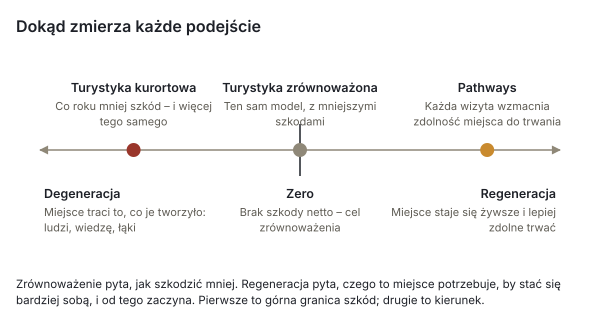
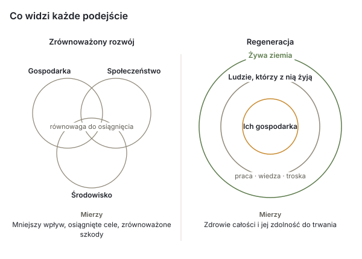
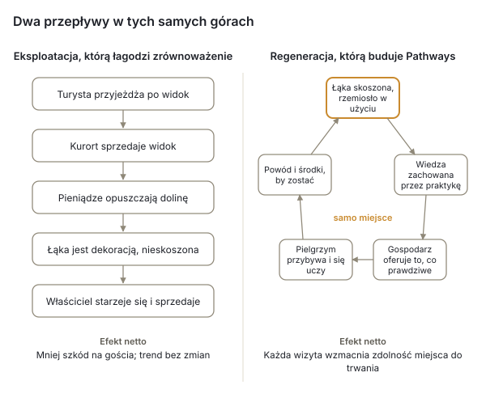

# Trans-Carpathian Pathways

*Żywa sieć gospodarzy, ścieżek i kuratorów wzdłuż łuku Karpat – argumenty, dowody i koncepcja*

Październik 2026 · UBEC / Inicjatywa Karpackiego Hubu · Biała księga, wersja robocza v0.9

## Jak czytać ten dokument

Trans-Carpathian Pathways ma propozycję projektu, która mówi, czym jest; prompt startowy, który zapisuje, co postanowiono; porozumienie współtwórców, które mówi, co obiecuje każda uczestnicząca w nim osoba; oraz dokument uzasadnień, który mówi dlaczego. Ta biała księga zbiera je razem dla czytelników spoza projektu – darczyńców, inicjatyw partnerskich wzdłuż łuku Karpat, społeczności górskich i ich rad oraz instytucji, które planują dziś przyszłość Karpat – i konfrontuje je z dowodami: co dzieje się z Karpatami, czego nauczyły się porównywalne projekty w innych miejscach, na co pozwala prawo i co mówią badania o spotkaniu, autentyczności i opiece nad zamieszkanymi krajobrazami.

Występują tu trzy rodzaje stwierdzeń i są one od siebie oddzielone. **Decyzje** należą do projektu i zostały podjęte oraz zapisane z datą w jego repozytorium; przytacza się je jako decyzje. **Dowody** pochodzą ze źródeł oznaczonych numerami w nawiasach kwadratowych i wymienionych na końcu; tam, gdzie liczby nie dało się potwierdzić w źródle pierwotnym, tekst to zaznacza. **Propozycje** są oznaczone jako propozycje; nic w tym dokumencie nie zostaje postanowione przez to, że zostało w nim zapisane. Projekt jest mały i znajduje się na wczesnym etapie, a ten dokument nie udaje, że jest inaczej: §11 mówi wprost, co istnieje, a czego nie ma.

## Streszczenie

Karpaty są przewartościowywane z zewnątrz szybciej niż od wewnątrz. Nieruchomości kurortowe w Bukowelu sprzedają się dziś drożej za metr kwadratowy niż nowe mieszkania w Kijowie [1]; wpływy z opłaty turystycznej w obwodzie iwanofrankiwskim wzrosły w ciągu czterech lat 4,5 raza [5]; na wysokogórskich łąkach, na których nigdy nie było przemysłu, planuje się farmy wiatrowe i megakurort [12][13]; a we wrześniu 2026 roku Ukraina zwołała w Bukowelu pierwszy szczyt karpacki, by ponad granicami planować przyszłość regionu – z energetyką i transportem na pierwszym planie oraz z deklarowanym zobowiązaniem wobec „krajobrazów kulturowych” i „tradycyjnego sposobu życia społeczności górskich”, które jak dotąd nie ma żadnego instrumentu [17][18]. Droga Ukrainy do Unii Europejskiej z czasem otworzy jej ziemię dla nabywców z całej Unii; Polska i Rumunia pokazują, co to oznaczało dla cen ziemi i nieruchomości w kurortach [22][23][24]. Tymczasem ludzie, którzy podtrzymują dawny sposób życia, starzeją się, pogłowie bydła w gospodarstwach domowych obwodu spadło w latach 2021–2024 o prawie jedną trzecią [8], a wiedza, która stworzyła łąki, odchodzi razem z nimi.

Góry również przyjmują ludzi. Do marca 2025 roku w hromadach kosowskiej, jaremczańskiej i worochtańskiej zarejestrowano około siedemnastu tysięcy osób wypędzonych z domów przez wojnę – są to rejestracje, a nie mieszkańcy, i trudne położenie, które hromady dźwigają razem z nimi, a nie wybór sposobu życia [7]. Góry są też ponownie zasiedlane: w Kosowie przetrwała gospodarka rzemieślnicza licząca ponad sto pracowni, a tamtejsza ceramika malowana znajduje się na liście niematerialnego dziedzictwa UNESCO [28][29]; pasterze uzyskali pierwsze w Ukrainie oznaczenia geograficzne dla sera połonińskiego [31]; a rodziny i osoby samotne opuszczają miasta, by uczyć się huculskiego sposobu życia i nim żyć, a nie po to, by mu się przyglądać. Wielu z nich to ludzie, o których głos nikt nie zapytał, gdy planowano przyszłość gór.

Trans-Carpathian Pathways staje po stronie tego drugiego ruchu. Jest to sieć gospodarzy, którzy oferują to, co naprawdę mają – nocleg, posiłek, przewodnictwo, rzemiosło – tam, gdzie mieszkają; szlak, który wyłania się z tego, gdzie ci gospodarze są, zamiast być wyrysowany ponad ich głowami; oraz lokalni kuratorzy, którzy opiekują się każdym jego odcinkiem i każdemu pielgrzymowi płaju – jak projekt nazywa każdego, kto przychodzi (§4.3) – sugerują podróż, nigdy jej nie sprzedając. Projekt działa w oparciu o Plai, opartą na zgodzie mapę całego pasma Karpat, którą UBEC już prowadzi na własnym serwerze w Unii Europejskiej. Nie ma kalendarza rezerwacji; projekt porozumienia dodaje zasady: bez ocen i bez prowizji; zapłatę ustala gospodarz, w formach, które sam wybiera, i trafia ona bezpośrednio od pielgrzyma do gospodarza; każdy gospodarz jest właścicielem własnego wpisu, a jeśli wprowadził go za niego kurator lub opiekun szlaku, na każdą jego prośbę wpis zostaje zmieniony lub wycofany. Pierwszy korytarz biegnie z Worochty przez Werchowynę do Kosowa, na Huculszczyźnie w zachodniej Ukrainie.

Argument tego dokumentu w skrócie: przyroda Karpat i kultura Karpat to jedno dziedzictwo, stworzone i zachowane przez ludzi żyjących z ziemią, a dowody z ekologii łąk nie pozostawiają wątpliwości, że łąki zależą od koszenia i wypasu, które je stworzyły [33][34][35][36]. Ochrony wymaga ta relacja, a nie krajobraz opróżniony z ludzi, którzy go stworzyli. Podróżowanie, które płaci za to, by ta relacja trwała – spotkanie zamiast eksploatacji – to jedyna forma turystyki, która podtrzymuje sposób życia, zamiast wystawiać go na pokaz, i działa tylko wtedy, gdy spotkanie jest prawdziwe. Na tym polega różnica między podtrzymywaniem a regeneracją (§5): zrównoważony rozwój prosi kurort, by wyrządzał mniej szkód na jednego odwiedzającego, i kurort ma już do tego biuro; regeneracja pyta, czego miejsce potrzebuje, by bardziej stać się sobą, a w górach, których łąki niszczeją pozostawione same sobie, mniej szkód nie jest odpowiedzią. Porównywalne projekty pokazują, że takie sieci żyją albo umierają w zależności od budżetów na utrzymanie, imiennie przypisanej odpowiedzialności za każdy odcinek, uczciwego liczenia oraz opiekuna zaprojektowanego, zanim nadejdą pieniądze [37][39][41][45]. Pathways zbudowano zgodnie z tymi lekcjami. Z czasem miejsca, którymi dzielą się jego gospodarze, wyznaczą korytarze, w których dziedzictwo kulturowe, przyrodnicze i krajobrazowe wymaga opieki jako jedna całość – nie dzicz i nie forma ochrony narzucona z góry, lecz mapa, dzięki której społeczność może powiedzieć, ile warta jest jej ziemia, zanim inni zdecydują o tym za nią.

Projekt prosi o wsparcie najpierw dla ludzi w terenie, a dopiero potem dla oprogramowania; o inicjatywy partnerskie w każdym kraju łuku Karpat; oraz o miejsce w pracach Karpackiej Ósemki i Konwencji karpackiej nad wsparciem społeczności i krajobrazami kulturowymi – jako jedną konkretną formę, jaką to wsparcie może przybrać.

## 1. Karpaty w punkcie zwrotnym

### 1.1 Turystyka i nieruchomości

Ukraińskie Karpaty stały się jedynym regionem Ukrainy, w którym wojna nie zamroziła rynku nieruchomości, lecz go podniosła. Kompleksy dobrej klasy w Bukowelu zaczynają się od około 2500 $ za metr kwadratowy z wykończeniem, a niektóre formaty aparthoteli sięgają 6000 $, wobec mediany około 1400 $ bez wykończenia w kijowskich nowych inwestycjach w maju 2026 roku [1]. Presja nie ogranicza się już do kurortu. Przeciętny dom w Werchowynie wystawiano w październiku 2025 roku za około 1,8 mln hrywien, a w Kosowie za 1,9 mln, wobec 7,1 mln w Jabłonicy, 8,3 mln w Mikuliczynie i 11,7 mln w hromadzie Polanycia, na której terenie leży Bukowel [2] – to spadek w stosunku sześć i pół do jednego od kurortu do środkowego miasteczka pierwszego korytarza, różnica, która przyciąga dziś nabywców do Werchowyny, i miara presji, która dopiero nadejdzie. Werchowyna pojawia się już wśród najdroższych miejsc zakupu domu w ukraińskich Karpatach; między wiosną a latem 2025 roku ceny wzrosły tam o 10–15% [3].

Wraz z tym wzrosła presja odwiedzających. Obwodowy departament turystyki szacuje liczbę odwiedzających na 2,5 mln rocznie od 2023 roku, wobec 2,0–2,3 mln przed pełnoskalową inwazją, a wpływy z opłaty turystycznej wzrosły z 10,4 mln hrywien w 2021 roku do 46,2 mln w 2025 roku [5]. W okresie noworocznym 2024–25 obłożenie hoteli w Bukowelu wynosiło 77–84%, a liczba wizyt w okolicach Jaremcza wzrosła o 30–40% rok do roku; deweloperzy mieli w przygotowaniu na lata 2024–26 45 kompleksów apartamentowo-hotelowych i 108 osiedli domków [6]. To dzięki kurortowi hromada Polanycia notuje 2,4% bezrobocia i rekordowe wpływy z opłaty turystycznej [4], a jego sukces wywiera presję na otaczającą go ziemię: w marcu 2026 roku sąd unieważnił wpis do katastru dwudziestu działek leśnych ze stuletnimi bukami i jodłami w pobliżu Bukowela, zarejestrowanych na podstawie sfałszowanych aktów państwowych pod domki i hotele; prokuratorzy powołali się na Konwencję karpacką [11].

Szkody sięgają wysokich partii gór. W 2026 roku kolumny terenówek liczące od trzydziestu do pięćdziesięciu pojazdów sprzedają dwugodzinne wycieczki po grzbietach za 3000–4500 hrywien; pojazdy wjeżdżały do jeziora Heraszaska na Swidowcu i w koryta potoków, podjęto też próbę sforsowania szlabanu chroniącego odcinek Petros–Howerla Karpackiego Rezerwatu Biosfery; grzywna dla obywatela wynosi 153–408 hrywien [10]. Na płaskowyżu Drahobrat, według obliczeń Texty.org.ua z około 2017 roku, na grzbiecie tłoczyło się ponad pięćdziesiąt domków i hoteli, działki dzierżawiono w granicach Rezerwatu Biosfery, a niżej wycięto zrębem zupełnym około 190 hektarów lasu [9].

### 1.2 Energetyka i przemysł na wysokogórskich łąkach

Dwa większe projekty zmieniłyby samo pasmo. Kurort na Swidowcu, który według raportu Bruno Manser Fonds z 2019 roku planowali właściciele Bukowela, na 1430 hektarach jednego z najlepiej zachowanych masywów ukraińskich Karpat, wprowadziłby 230 kilometrów tras narciarskich, 60 hoteli, 390 domów wypoczynkowych i do 22 000 gości dziennie w krajobraz polodowcowych jezior, starodrzewów i dwóch obszarów Sieci Szmaragdowej [12]. W październiku 2024 roku Sąd Najwyższy utrzymał w mocy unieważnienie jego planów szczegółowych, a żadnej oceny oddziaływania na środowisko nie złożono; sprawa pozostaje otwarta przed Stałym Komitetem Konwencji berneńskiej [14]. Farmy wiatrowe to nowszy front. Na połoninie Runa, jak podaje CEE Bankwatch, budowę 30 turbin o mocy 156 MW rozpoczęto przed jakąkolwiek oceną oddziaływania na środowisko; ocena wypadła pozytywnie w lutym 2026 roku, w lipcu 2026 roku sąd apelacyjny uznał wycinkę puszczy pod drogę dojazdową za nielegalną, a pod linię energetyczną wycięto już ponad czterdzieści hektarów [13]. Wind Parks of Ukraine proponują około 1,5 gigawata na grzbietach Zakarpacia, w tym na Swidowcu [13]; ten sam 1,5-gigawatowy „karpacki klaster energetyki wiatrowej” przedstawiono na wrześniowym szczycie Karpackiej Ósemki [19]. Organizacje ekologiczne ostrzegają, że plany te zamieniłyby w strefę przemysłową do połowy wysokogórskiego obszaru Zakarpacia i że w warunkach stanu wojennego nadzór osłabł [15][16].

Nic z tego nie jest argumentem przeciwko energetyce ani przeciwko pracy w górach. Jest to argument, że o przyszłości gór decydują ludzie, którzy nie będą w nich mieszkać, w tempie, które nie zostawia tym, którzy w nich mieszkają, czasu, by powiedzieli, czego chcą – i że jedyną wspólną cechą wszystkich tych projektów jest to, że traktują wysokogórskie łąki jak puste.

### 1.3 Łuk Karpat jako region polityczny

Konwencja karpacka, przyjęta w Kijowie w 2003 roku i obowiązująca od 2006 roku, zobowiązuje siedem państw – Czechy, Węgry, Polskę, Rumunię, Serbię, Słowację i Ukrainę – do wspólnej ochrony i rozwoju pasma [25]. Jej Protokół w sprawie zrównoważonej turystyki wszedł w życie w 2013 roku [26]; protokół w sprawie dziedzictwa kulturowego opracowano w 2014 roku, ale nigdy go nie przyjęto [27]. Ósma Konferencja Stron jest zaplanowana na koniec 2026 roku, po czym Ukraina przez rok sprawuje prezydencję [25].

W dniach 18–20 września 2026 roku w Bukowelu Ukraina zainaugurowała Karpacką Ósemkę: Ukrainę, Polskę, Rumunię, Słowację, Czechy, Austrię, Węgry i Serbię, wraz z Unią Europejską jako całością. Program obejmował bezpieczeństwo, energetykę, logistykę, handel transgraniczny i „wsparcie dla naszych społeczności”; podpisano pięćdziesiąt umów o wartości ponad miliarda euro, z czego ponad połowa dotyczyła energii słonecznej i wiatrowej [17][19]. Deklarację podpisało sześć państw – Austria, Polska, Rumunia, Serbia, Słowacja i Ukraina [18]. Węgry, zaliczane przez Kijów do ósemki, wysłały jedynie pełniącego obowiązki chargé d'affaires, nie podpisały deklaracji i twierdzą, że nie są członkiem inicjatywy; Czechy wzięły udział, ale nie podpisały [20]. Tekst deklaracji ma znaczenie dla tego projektu. Opiera się na Konwencji karpackiej i zobowiązuje sygnatariuszy do „zachowania krajobrazów kulturowych, tradycyjnego sposobu życia społeczności górskich”, w tym dziedzictwa niematerialnego, do „rozwoju wspólnych szlaków kulturowych i turystycznych”, do działań na rzecz lokalnego rzemiosła oraz do ochrony różnorodności biologicznej w ramach Konwencji; rozważa strategię makroregionalną UE dla Karpat i coroczne szczyty [18]. Oficjalna lista projektów obejmuje jednak 90 projektów o wartości 10,7 mld $, z czego na energetykę przypada 7,28 mld $, a na transport 1,05 mld $ [19]. Krajobrazy kulturowe i tradycyjny sposób życia doczekały się jednego zdania; instrumentu jeszcze nie mają.

Miesiąc wcześniej prezydent spotkał się z przewodniczącymi wszystkich górskich hromad w czterech obwodach karpackich. Program obejmował drogi, autobusy terenowe, leśnictwo i zasady opłaty turystycznej, zapobieganie powodziom oraz weteranów; wyludnienia, ziemi i dziedzictwa w nim nie było [21].

### 1.4 Ziemia i Unia Europejska

Ukraina otworzyła rynek gruntów rolnych dla obywateli w lipcu 2021 roku, a dla spółek będących własnością Ukraińców w styczniu 2024 roku; cudzoziemcy i spółki z kapitałem zagranicznym pozostają wyłączeni do czasu ogólnokrajowego referendum, którego nie można przeprowadzić w stanie wojennym [22]. Do połowy 2025 roku właściciela zmieniło około 636 000 hektarów, przy cenach rosnących z około 45 000 hrywien za hektar na początku 2024 roku do ponad 60 000 w czerwcu 2025 roku [23]. W granicach miejscowości cudzoziemcy mogą już kupować domy i działki nierolne; działka przydomowa wiejskiego domu jest gruntem rolnym i nie może przejść w ich ręce [56].

Akcesja to zmieni. Swobodny przepływ kapitału jest częścią acquis, a każdy z niedawno przyjętych krajów wynegocjował okres przejściowy, a nie wyłączenie. Polska prosiła o osiemnaście lat i dostała dwanaście, do 2016 roku; w tym okresie ceny prywatnych gruntów rolnych wzrosły o około 690%, a nawet w górzystym województwie małopolskim, gdzie wzrosły najmniej, podniosły się o 253% w latach 2005–2016 [24]. W Zakopanem, kurorcie polskich Tatr, ziemia osiągnęła około 5000 złotych za metr kwadratowy, a apartamenty turystyczne – kupowane głównie jako inwestycje pod wynajem – 20 000, wobec niespełna 11 000 za mieszkanie w Warszawie [24]. Siedmioletnie ograniczenie w Rumunii wygasło w 2014 roku; na niektórych obszarach wzrost cen sięgnął dwukrotności średniej regionalnej, a w saskich wsiach Siedmiogrodu – których ludność saska, według danych jednego dziennikarza, zmniejszyła się z blisko miliona przed wojną do około dwudziestu tysięcy w 2002 roku – zabytkowe domy „modernizowano” przy użyciu PCV i blachy szybciej, niż dało się egzekwować jakiekolwiek przepisy [22][24]. Klastry negocjacyjne Ukrainy nieformalnie ogłoszono za otwarte w marcu 2026 roku, a pierwszy formalnie otwarto w czerwcu; weto jednego państwa członkowskiego wciąż blokuje dwa kolejne [59]. Pytanie nie brzmi, czy ziemia Karpat zostanie otwarta, lecz ile lat mają społeczności górskie, by – zanim zrobi to rynek – zdecydować, czemu ma służyć ich ziemia.

### 1.5 Ludzie, którzy ją utrzymują

Ukraina nie przeprowadziła spisu powszechnego od 2001 roku, a dane o ludności rejonów nie są publikowane od 2022 roku, więc demografia korytarza znana jest tylko w zarysie [7]. Liczba ludności rejonu kosowskiego spadła z 86 615 do 83 700 między styczniem 2020 roku a 2022 rokiem, jeszcze przed pełnoskalową wojną; rejon werchowyński liczy około 30 000 mieszkańców na 1254 kilometrach kwadratowych [7]. Badania regionu karpackiego wskazują, że wiele wsi górskich nie wyludniło się w latach 1989–2020 tak jak wsie na nizinach – utrzymały je rekreacja, las i ustawa o statusie miejscowości górskich – ale że górzyste rejony obwodów iwanofrankiwskiego i czerniowieckiego tracą mieszkańców na rzecz miast, a „wyludnianie się i starzenie obszarów wiejskich” jest głównym zagrożeniem dla regionu [7].

Sama ziemia rejestruje tę zmianę. Pogłowie bydła w obwodzie iwanofrankiwskim osiągnęło szczyt w 2003 roku – 294 300 sztuk; w gospodarstwach domowych spadło ze 109 500 w 2021 roku do 76 000 w 2024 roku, o 15,5% mniej niż rok wcześniej [8]. Liczba owiec i kóz w ukraińskich gospodarstwach domowych spadła z ponad dwóch milionów około 2009 roku do poniżej 1,4 miliona w 2019 roku; stowarzyszenia pasterzy wymieniają przyczyny: owca daje mleko przez 120 dni, a trzeba ją utrzymywać przez cały rok, ser połoniński sprzedaje się po 100–120 hrywien za kilogram bez chronionej nazwy, a praca jest ciężka i niedoceniana [8]. Wieku tych, którzy wciąż trzymają owce i koszą łąki, nie odnotowano nigdzie, gdzie mogły dotrzeć te badania; to, że gospodarujący ziemią się starzeją, a ich ziemia w ciągu jednego pokolenia zmieni właściciela, jest własną obserwacją projektu w regionie, a §12 wymienia to wśród spraw, które muszą ustalić pierwsze wizyty.

## 2. Czym są góry: krajobraz ciągły, a nie dzicz

### 2.1 Łąki zostały stworzone

Większość połonin – wysokogórskich pastwisk, które są znakiem rozpoznawczym Karpat – nie jest naturalna. Wykarczowali je pasterze, zwłaszcza w okresie kolonizacji wołoskiej od XIV i XV wieku, „w obrębie lasów aż po górną granicę lasu i kosodrzewinę” [34]; łąki naturalne występują tylko powyżej górnej granicy lasu. Ich różnorodność biologiczna jest wytworem ich użytkowania. Transgraniczne badanie 48 działek w ośmiu wsiach Marmaroszu i Bukowiny, po obu stronach granicy ukraińsko-rumuńskiej, wykazało, że 78% działek ukraińskich i 83% rumuńskich jest wciąż użytkowanych tradycyjnie; sposób użytkowania lepiej wyjaśniał bogactwo roślin niż ukształtowanie terenu czy gleba; regularne koszenie zwiększało bogactwo roślin naczyniowych, a wypas – mszaków; jako czynniki zmian wskazano wyludnienie i spadek pogłowia zwierząt [33]. Na subalpejskich łąkach Siedmiogrodu odnotowano 626 gatunków na kolejnych etapach porzucania użytkowania; rośliny naczyniowe osiągały maksimum na łąkach koszonych, a każde stadium sukcesji było miejscem największego bogactwa jakiejś grupy – tak że najbogatszy jest krajobraz utrzymywany jednocześnie w kilku stadiach użytkowania [35]. Tam, gdzie ustaje wypas, połoninę opanowuje olcha zielona, a skład gatunkowy, który zbudowały wieki użytkowania, zaczyna zanikać [34]. Fischer, Hartel i Kuemmerle formułują wniosek dla polityki wprost: „wartość przyrodnicza tradycyjnych krajobrazów rolniczych jest często wyjątkowa”, nierentowność prowadzi z jednej strony do porzucenia, z drugiej do intensyfikacji, a potrzebna jest strategia transformacji, która „dąży do wspierania oddolnych wysiłków społeczności zmierzających do tworzenia nowych, bezpośrednich więzi z przyrodą” [36].

Dlatego projekt odrzuca słowo *dzicz* w odniesieniu do karpackich łąk i wsi. Ta rama jest tam empirycznie błędna, nawet jeśli trafnie opisuje starodrzewy bukowe. Krajobraz chroniony, który zakazuje koszenia i wypasu, które go stworzyły, albo na którego zamieszkanie stać tylko zamożnych, poniósł porażkę według własnej miary.

### 2.2 Dwa słowniki, którymi świat już się posługuje

Ta wizja ma oparcie w kategoriach, które uznają rządy i darczyńcy. Kategoria V IUCN, *krajobraz chroniony*, jest zdefiniowana jako obszar, „na którym interakcja ludzi i przyrody w czasie wytworzyła obszar o odrębnym charakterze i znaczących wartościach ekologicznych, biologicznych, kulturowych i krajobrazowych i na którym zachowanie integralności tej interakcji ma zasadnicze znaczenie dla ochrony i utrzymania tego obszaru” [60]. Obejmuje ona ponad połowę europejskich obszarów chronionych; jej krytycy słusznie zauważają, że nie niesie automatycznie wartości dla różnorodności biologicznej i powinna być oceniana po wynikach, a nie po samym ustanowieniu ochrony [60] – to zastrzeżenie projekt przyjmuje; warunki z §9 oraz oznaki sukcesu i porażki z §12 mówią, jak mu sprostać. Ramy światowego dziedzictwa UNESCO wymieniają *krajobraz ciągły*: taki, który „zachowuje aktywną rolę społeczną we współczesnym społeczeństwie, ściśle związaną z tradycyjnym sposobem życia, i w którym proces ewolucji wciąż trwa” [61]. Huculska gospodarka połonińska jest podręcznikowym przykładem. Za obiema kategoriami stoi pojęcie *różnorodności biokulturowej* – „różnorodności życia we wszystkich jej przejawach – biologicznych, kulturowych i językowych – które są ze sobą powiązane w złożonym, adaptacyjnym systemie społeczno-ekologicznym” [62]. Konwencja karpacka już w swoim tekście traktuje przyrodę i kulturę łącznie [25]; brakowało dotąd instrumentu w skali wsi i ścieżki.

### 2.3 Wiedza odchodzi, gdy ustaje praktyka

Tradycyjna wiedza ekologiczna to „skumulowany zasób wiedzy, praktyk i przekonań, rozwijający się w procesach adaptacyjnych i przekazywany z pokolenia na pokolenie drogą transmisji kulturowej”; przekazuje się ją ustnie i przez terminowanie, a przerywa się ona, gdy ustaje praktyka [71]. Taki jest mechanizm stojący za twierdzeniem projektu, że spotkanie utrzymuje sposób życia przy życiu tam, gdzie nie potrafi tego muzeum: wiedzę o łące, serze czy krośnie zachowuje tylko ktoś, kto to robi obok kogoś, kto to umie. Pielgrzym, który się uczy, jest jeszcze jednym uczącym się. Najwięcej znaczy ten, kto zostaje i przejmuje wiedzę – wnuk gospodarza, sąsiad albo rodzina, która przyjechała żyć w górach.

## 3. Ludzie, którzy utrzymują góry przy życiu

### 3.1 Ci, którzy zostali, i ci, którzy przybyli

Huculska gospodarka rzemieślnicza żyje i jest skupiona w jednym miejscu. W Kosowie działa ponad sto prywatnych pracowni, dziesięć muzeów, Kosowski Instytut Sztuki Użytkowej i Dekoracyjnej oraz sobotni bazar – największy targ rzemiosła w Ukrainie; radzieckie przedsiębiorstwo artystyczne „Huculszczyzna” zatrudniało niegdyś około trzech tysięcy osób [28]. Tradycja kosowskiej ceramiki malowanej została wpisana na Listę reprezentatywną niematerialnego dziedzictwa kulturowego ludzkości UNESCO w grudniu 2019 roku [29]. W Jaworowie rodzina Kiszczuków prowadzi muzeum-pracownię tkania liżników i hoduje rzadkie długowłose owce, które dostarczają do nich wełny [30]. Na połoninach stowarzyszenie producentów tradycyjnych serów wysokogórskich, założone w 2018 roku przy wsparciu Slow Food w obronie przed nizinnymi podróbkami, uzyskało pierwsze w Ukrainie oznaczenia geograficzne: „huculska bryndza krowia” została zarejestrowana we wrześniu 2020 roku, zarządza nią Stowarzyszenie Karpackich Watahów w Werchowynie, a w pierwszym roku certyfikowano sześć połonin – Kryntę, Skupową, Łukowicę, Bybratkiwkę, Zgardę i Szczywnyk [31]. Kosowski program odrodzenia hodowli owiec, ogłoszony w 2022 roku z celem 16 000 owiec i 500 miejsc pracy w ciągu czterech lat, opiera się na obserwacji, że pięćdziesiąt owiec pozwala rolnikowi zostać na miejscu zamiast wyjeżdżać do pracy za granicę; jego wyniki nie zostały jeszcze opublikowane [8].

Wojna przyniosła nie tylko presję, ale i ludzi. Do marca 2025 roku w obwodzie iwanofrankiwskim zarejestrowano 92 624 osoby wewnętrznie przesiedlone, wobec 3829 w styczniu 2021 roku; w samej hromadzie kosowskiej było ich 5702, w jaremczańskiej 5605, a w worochtańskiej 5384 – ta ostatnia liczba jest na papierze mniej więcej równa liczbie ludności samej hromady worochtańskiej. Rejestracje zawyżają rzeczywistą obecność; w jednym mieście zarejestrowano 1474 osoby, a odnaleziono 322 [7]. Niektórzy zostali, by pracować: atelier przeniesione w 2022 roku z okupowanej Kachowki do Kosowa zatrudnia dziś pięćdziesiąt kobiet z miasteczka i okolicznych wsi, z których kilka pracowało wcześniej sezonowo w Polsce [32]. Poza przesiedlonymi także rodziny i osoby samotne opuszczają miasta, by uczyć się huculskiego sposobu życia i nim żyć – to obserwacja, na której opiera się nadzieja projektu i na którą te badania znalazły jedynie anegdotyczne potwierdzenie. Policzenie ich i zapytanie, dlaczego przybyli, to zadanie dla pierwszego korytarza.

Literatura o nowych mieszkańcach gór jasno mówi, od czego zależy różnica. Badania Alp i Pirenejów pokazują, że „nowi górale” ożywiają dawne zawody i otwierają „odpowiedzialną, współdzieloną turystykę między gospodarzami a gośćmi”, ale też, że miejscy nabywcy podnoszą ceny i wypychają młodych, że głęboka przyjaźń ponad tą granicą jest rzadka („zawsze jesteś imigrantem”), a ponowne zasiedlanie „musi być zorganizowane, wspierane, jeśli nie wręcz zachęcane” [70]. Nowi mieszkańcy integrują się, zamiast gentryfikować, gdy podejmują pracę związaną z ziemią i pracę wspólną, gdy mieszkania nie są towarem i gdy wchodzą do istniejących instytucji – sianokosów, święta, kościoła – zamiast budować równoległe. Ta sama granica oddziela gospodarza od kogoś, kto odgrywa przedstawienie: relacja z miejscem.

### 3.2 Kto mówi w imieniu społeczności

Gdy mówi się, że kurort czy farma wiatrowa ma poparcie miejscowych, pierwsze pytanie brzmi: kto to powiedział i kogo nie zapytano. Raport z 2025 roku pochodzący od społeczności Jasini i Ust-Czornej podaje, że ich przywódcy i mieszkańcy wciąż liczą na kurort na Swidowcu ze względu na dochody podatkowe, jakie by przyniósł – nie mówiąc, których mieszkańców zapytano – i z kolei przedstawia przeciwników kurortu jako działających w interesie przemysłu drzewnego [16]. Każda ze stron twierdzi, że głos społeczności po drugiej stronie jest przykrywką dla interesów. Ten wzorzec jest powszechny. Przegląd rozwoju partycypacyjnego przeprowadzony przez Bank Światowy stwierdził, że partycypacja indukowana jest „często zdominowana przez elity”, o ile nie istnieje reagujący ośrodek centralny i długotrwałe zaangażowanie [72]; Platteau nazywa przechwytywanie korzyści przez elity „poważnym problemem” rozwoju sterowanego przez społeczności i nie znajduje środka zaradczego, który nie polegałby na stopniowym uwalnianiu środków i ich kontrolowaniu [73]. Mapowanie partycypacyjne ma własną etykę: ryzyko „narażania ludzi przez informacje, które ono pokazuje”, danych, które ludzie z zewnątrz „mogliby następnie wykorzystać”, oraz „wymagania precyzji tam, gdzie bardziej stosowna byłaby nieostrość” [74].

Pathways stawia to pytanie we wszystkich kierunkach, także wobec własnych zwolenników. Nie twierdzi, że mówi w imieniu jakiejkolwiek wsi, i jest zbudowany tak, by nikt nie musiał tego robić: każdy gospodarz ma własne konto i własny wpis, wyraża zgodę pole po polu i wycofuje się, kiedy chce – albo, jeśli miejsce wprowadził za niego kurator lub opiekun szlaku, na każdą jego prośbę wpis zostaje zmieniony lub wycofany; kurator mówi w imieniu tego, co publikuje; projekt mówi w imieniu samego siebie. W całych Karpatach ludzie, których głos pominięto, odnajdują się nawzajem i znajdują inicjatywy, które chcą ich słuchać, a napięcie między nimi a tymi, którzy mówią w ich imieniu, rośnie. Sieć indywidualnych głosów, z których każdy jest właścicielem własnych słów, jest odpowiedzią projektu na to napięcie.

## 4. Dlaczego spotkanie

### 4.1 Diagnoza

W Karpatach spotykają się dwa problemy, które mają jedną odpowiedź. Podróżowanie coraz częściej jest eksploatacją: podróżni przemieszczają się przez miejsca, nie dotykając ich, gościnność coraz częściej jest inscenizowana, a podróżny zabiera ze sobą widok, podczas gdy na miejscu zostaje opłata, w większości dla kogoś, kto tam nie mieszka. Życie w górach się przerzedza: wsie tracą mieszkańców, wiedza nie zostaje przekazana, a gospodarka, która podtrzymywała sposób życia, przeniosła się gdzie indziej. Spotkanie odpowiada na oba problemy, bo wiedza przechodzi z człowieka na człowieka, przez robienie czegoś obok kogoś, i bo pielgrzym, który śpi pod czyimś dachem, je przy czyimś stole i uczy się, jak coś się robi, zostawia pieniądze i uwagę w rękach osoby, która tę wiedzę posiada. Gospodarz, który dzieli się tym, co naprawdę ma, zyskuje powód, by to zachować, i środki, by to zrobić.

Warunek jest taki, że spotkanie musi być prawdziwe. Pół wieku temu MacCannell opisał miejsca turystyczne jako „inscenizowane zaplecze, rodzaj żywego muzeum”, budowane dlatego, że „świadomością turystyczną kieruje pragnienie autentycznych doświadczeń” [63]. Gdy tylko gospodarz zaczyna odgrywać przedstawienie, płaci się za przedstawienie, a sposób życia i tak przepada – wolniej i z większym zyskiem. Rozróżnienie Wanga wskazuje wyjście: autentyczność *egzystencjalna* jest cechą działania, a nie przedmiotu, i odnajduje się ją we wspólnej pracy, wędrowaniu i jedzeniu, a nie w ekspozycjach [64]. Sieć zbudowana na noclegach, posiłkach, przewodnictwie i działających pracowniach, bez sceny, jest próbą pozostania po tej stronie granicy.

### 4.2 Czego turystyka oparta na społecznościach nauczyła się na własnych błędach

Doświadczenia turystyki opartej na społecznościach otrzeźwiają, a projekt czyta je jak listę kontrolną. Spośród 116 inicjatyw, które eksperci wskazali jako udane, na ankietę odpowiedziało 28 ze 133 objętych badaniem, 15 spełniło definicję, a tylko sześć było ekonomicznie trwałych; przegląd 200 projektów turystyki społecznościowej w obu Amerykach wykazał, że wiele obiektów noclegowych miało obłożenie około 5%; dziewięć z piętnastu wciąż zależało od darczyńców, a autorzy zalecają, by przed budową łóżek upewnić się, że podróżni istnieją, i by zależność od darczyńców po pięciu latach traktować jako sygnał ostrzegawczy [45]. Krytyka Blackstock wskazuje trzy słabości: literatura traktuje społeczność gospodarzy „jako jednolity blok”, przyjmuje wobec zaangażowania „podejście funkcjonalne” i „pomija strukturalne ograniczenia kontroli lokalnej” [65]. Co do wycieku dochodów, Overseas Development Institute ustala, że w najlepszych przypadkach do ubogich trafia od jednej piątej do jednej trzeciej obrotów turystycznych w miejscu docelowym, a największym kanałem jest łańcuch dostaw żywności – nie nocleg – odpowiadający w przypadku Luang Prabang za mniej więcej połowę dochodów ubogich z turystyki [46]. Lekcja dla sieci gospodarzy jest taka, że posiłki i warsztaty liczą się tak samo jak noclegi, a projekt, który nie potrafi wskazać podróżnego, nie powinien obiecywać gospodarzowi dochodu.

Turystyka regeneratywna, obecny front tej dziedziny, wymaga, by podróżowanie „przynosiło ludziom, miejscom i przyrodzie korzyść netto”, stwierdza, że certyfikacja „wnosi niewiele”, i ostrzega, że bez zgody i społecznej akceptacji turystyka „ryzykuje, że stanie się brudną branżą” [66]. Projekt odczytuje to tak, że regeneracja nie jest etykietą, lecz relacją, a relacja ta musi być widoczna w samej koncepcji: kto jest właścicielem danych, kto opiekuje się trasą, kto bierze pieniądze. §5 przeciwstawia regenerację ramie zrównoważonego rozwoju, którą zastępuje, i wyjaśnia, dlaczego Karpaty potrzebują tej mocniejszej.

### 4.3 Pielgrzymka – dokąd

Propozycja projektu nazywa szlak „infrastrukturą pielgrzymkową”, a na Huculszczyźnie istnieją prawdziwe miejsca pielgrzymek religijnych. Słowo to jest tu używane w znaczeniu, jakie nadaje mu antropologia pielgrzymki – liminalność, przekroczony próg, *communitas* ludzi wspólnie będących w drodze – oraz z uwzględnieniem przestrogi Turnera, że „turysta jest w połowie pielgrzymem, jeśli pielgrzym jest w połowie turystą” [67]. Na końcu ścieżki nie ma sanktuarium. Pielgrzym wchodzi w trwającą od stuleci relację między ludźmi a ziemią, zostaje do niej przyjęty na jedną noc albo na miesiąc i odchodzi, wziąwszy w niej udział, a nie przyjrzawszy się jej. Pielgrzymka prowadzi do samej relacji. Słowo zostaje zachowane i daje projektowi nazwę dla osoby, która przychodzi: **pielgrzym płaju**, po ukraińsku *прочанин плаю* (decyzja Michela, 10 października 2026). *Płaj* to huculskie i rumuńskie słowo oznaczające dawną ścieżkę przez wysokogórskie pastwiska, którą pędzono stada w górę i w dół; mapa, na której działa projekt, bierze od niego swoją nazwę (§6.2). *Прочанин* pochodzi od *проща* – pielgrzymki, którą w regionie wciąż się odbywa i którą odróżnia się tam od turystyki jako pracę wewnętrzną; słowo to jest spokrewnione z *прощати*, przebaczać, niesie więc zarówno pojednanie, jak i poszukiwanie. Pielgrzymka prowadzi do płaju i do ludzi, którzy go utrzymują, a nie do sanktuarium. To, czy projekt powie wprost, że nie zapożycza niczyjej wiary, pozostaje wśród otwartych pytań w §12.

## 5. Od podtrzymywania do regeneracji

Projekt powiedział dotąd, co odrzuca i dlaczego. Ten rozdział mówi, czemu służy, w kategoriach, jakimi posługuje się dziś ta dziedzina, i dlaczego wybrał regenerację zamiast ramy, która od czterdziestu lat wyznacza kierunek rozwoju.

### 5.1 Co obiecywał zrównoważony rozwój i gdzie dziś stoi

Zrównoważony rozwój zdefiniowano w 1987 roku jako „rozwój, który zaspokaja potrzeby obecnego pokolenia bez ograniczania możliwości zaspokajania potrzeb przyszłych pokoleń” [82]. Stał się on ramą konwencji z Rio, siedemnastu Celów Zrównoważonego Rozwoju i ich 169 zadań przyjętych w 2015 roku oraz słownika, którym posługuje się dziś każde ministerstwo, bank i kurort. W turystyce przybrał formę, jaką nadały mu w 2005 roku agencje ONZ: „turystyka, która w pełni uwzględnia swoje obecne i przyszłe skutki gospodarcze, społeczne i środowiskowe, odpowiadając na potrzeby odwiedzających, branży, środowiska i społeczności przyjmujących” [84].

Zanim cokolwiek zostanie powiedziane przeciwko tej definicji, warto zauważyć w niej dwie rzeczy. Jest ona równowagą między czterema stronami roszczącymi sobie prawa, a branża jest jedną z nich. A jej czasowniki to: uwzględniać, odpowiadać na potrzeby, minimalizować, utrzymywać. Pyta, jak działalność może trwać, wyrządzając mniej szkód. Nie pyta, czy ta działalność jest tym, czego miejsce potrzebuje.

To, gdzie ta rama stoi, jest udokumentowane. Raport samej Organizacji Narodów Zjednoczonych z 2025 roku stwierdza, że tylko 35 procent zadań w ramach Celów, dla których istnieją dane o trendach, jest na dobrej drodze lub robi umiarkowane postępy, blisko połowa posuwa się zbyt wolno lub tylko nieznacznie, a 18 procent się cofnęło [83]. Bilans w Karpatach przedstawia §1 i ma on precyzyjną lokalną postać. Bukowel prowadzi Biuro Zrównoważonego Rozwoju: bezpłatne autobusy kursujące co godzinę, 0,6 megawata paneli słonecznych na dachach hoteli, siedem punktów ładowania, jedenaście hoteli z certyfikatem Green Key, partnerstwo na rzecz niskoemisyjnego transportu [85]. Właściciele tego samego kurortu planowali megakurort na Swidowcu [12]. Odrębnie, dwadzieścia działek leśnych w pobliżu kurortu, zarejestrowanych na podstawie aktów państwowych, które sąd uznał za sfałszowane, zwrócono państwu w 2026 roku [11]; ten dokument nie twierdzi niczego o tym, kto je zarejestrował. Nie jest to oskarżenie o złą wiarę. Tak właśnie działa ta rama: prosi kurort, by wyrządzał mniej szkód na jednego odwiedzającego, i jest usatysfakcjonowana, gdy kurort to robi. Nie ma nic do powiedzenia o tym, czy dolina aparthoteli po 6000 $ za metr kwadratowy jest tym, czym dolina powinna się stać, bo „branża” jest jedną ze stron, których potrzeby rama ta ma równoważyć.

W tym sensie zrównoważony rozwój zaniedbano w obszarach, w których miałby realne znaczenie. Stosowano go tam, gdzie było to wygodne – energia, odpady, oświetlenie, certyfikat – a pomijano tam, gdzie by coś kosztował: ziemię, to, kto decyduje, czemu służy miejsce, czy sposób życia przetrwa. I został zawłaszczony: słowo dostępne dla każdego podmiotu z budżetem marketingowym to słowo, które wkrótce nic nie znaczy. Krytycy wewnątrz tej dziedziny mówią to samo; literatura turystyki regeneratywnej stwierdza, że certyfikacja zrównoważonego rozwoju „wnosi niewiele” [66].

### 5.2 O co zamiast tego pyta regeneracja

Projektowanie regeneratywne ma rodowód starszy niż Cele – *Regenerative Design for Sustainable Development* Lyle'a z 1994 roku [86] – oraz jasny wykład w argumentacji Reeda z 2007 roku: „Zrównoważony rozwój, w obecnej praktyce w środowisku zbudowanym, jest przede wszystkim ćwiczeniem z efektywności”. Przedstawił on trajektorię podejść, z których każde zawiera się w pełniejszym: ograniczanie szkód; następnie podejście *neutralne*, w którym mieści się projektowanie ekologiczne i zrównoważone, „uogólniony ideał nieszkodzenia”; następnie przywracanie lokalnego systemu żywego do zdrowia; wreszcie regeneracja, „ewolucja całego systemu, którego jesteśmy częścią”. Regeneracja, pisał, jest „jedynym sposobem, by podtrzymać zrównoważenie”. I jest zakorzeniona w miejscu: praca „zaczyna się od próby zrozumienia, jak działają systemy życia w każdym niepowtarzalnym miejscu”, a rolą zaangażowanych „jest stworzenie całego systemu wzajemnie korzystnych relacji” [87]. Późniejsze prace przekształcają to w metodę: projektowanie wychodzące od miejsca, ze społecznością, zlewnią lub bioregionem jako sferą, w której ludzie mogą uczestniczyć [88]; oraz w program badawczy – zrównoważenie regeneratywne jako „kwitnące systemy żywe, w których zdrowie i dobrostan całego systemu stale się zwiększają”, ze wskaźnikami właściwymi dla każdego miejsca i opracowywanymi we współtworzeniu, oraz – co w tej dziedzinie niezwykłe – z integracją duchowości wymienioną wśród warunków [89]. W turystyce ten sam ruch to turystyka regeneratywna, która wymaga, by podróżowanie „przynosiło ludziom, miejscom i przyrodzie korzyść netto”, a nie zmniejszony skutek ujemny [66].

Różnica nie dotyczy ambicji, lecz pytania, jednostki i miary.

| | Zrównoważony rozwój | Regeneracja |
| --- | --- | --- |
| Pytanie | Jak ta działalność może trwać, wyrządzając mniej szkód? | Czego to miejsce potrzebuje, by bardziej stać się sobą? |
| Jednostka | Trzy filary do zrównoważenia – gospodarka, społeczeństwo, środowisko | Jedno żywe miejsce, łącznie z ludźmi, zawarte w większym |
| Miara | Ograniczony wpływ, osiągnięte cele, skompensowane szkody | Zdrowie całości i jej zdolność do dalszego trwania |
| Ludzie | Grupa interesariuszy, na której potrzeby się odpowiada | Uczestnicy życia miejsca i ci, którzy je znają |
| Miejsce | Teren, na którym stosuje się ogólne standardy | Źródło koncepcji, każde inne |
| Kto określa sukces | Standard, certyfikujący, cel globalny | Miejsce i jego ludzie, współtworzący wskaźniki |
| Cel | Neutralność: brak szkód netto | Korzyść netto: więcej życia niż przedtem |

Regeneracja nie odrzuca dolnej granicy, jaką wyznacza zrównoważony rozwój; nieszkodzenie pozostaje warunkiem. Odmawia jednak traktowania tej dolnej granicy jako celu.

### 5.3 Dlaczego regeneracja jest drogą naprzód dla Karpat

**Ponieważ neutralność nie wystarcza tam, gdzie ziemia została stworzona.** §2 pokazał, że karpackie łąki zależą od koszenia i wypasu i niszczeją pozostawione same sobie. Rama, której celem jest zerowa ingerencja i brak szkód netto, nie utrzyma krajobrazu, który do istnienia potrzebuje ingerencji. W przypadku krajobrazu ciągłego podtrzymywanie oznacza bezruch, a bezruch oznacza utratę. Pierwszy diagram umieszcza trzy podejścia na jednej linii: turystykę kurortową, która z roku na rok wyrządza mniej szkód na odwiedzającego i coraz więcej szkód w ogóle; turystykę zrównoważoną – ten sam model z ograniczonymi szkodami, zmierzający do zera; oraz Pathways, którego celem jest, by każda wizyta zwiększała zdolność miejsca do dalszego trwania.

**Ponieważ presje już mówią językiem zrównoważonego rozwoju.** Klaster wiatrowy przedstawiony na szczycie Karpackiej Ósemki to energia odnawialna. Kurort ma biuro zrównoważonego rozwoju. Akcesja to rozwój. Każda z sił opisanych w §1 może bez kłamstwa nazwać siebie zrównoważoną, bo rama ta równoważy ich potrzeby z potrzebami gór i nazywa tę równowagę celem. Projekt, który konkuruje na polu wyrządzania mniejszych szkód, już przegrał ten spór; kurorty zawsze będą miały więcej szkód do ograniczenia. Drugi diagram pokazuje, co widzi każde z podejść: trzy filary do zrównoważenia jeden względem drugiego, w których ziemia jest jednym z trzech; albo żywe miejsce, w którym ziemia utrzymuje ludzi, a ludzie utrzymują swoją gospodarkę, a tym, co krąży między nimi, jest praca, wiedza i troska.

**Ponieważ ludzie, którzy utrzymują góry przy życiu, już to robią.** Jednostką regeneracji jest żywe miejsce, łącznie z ludźmi; jej metodą jest współtworzenie przez tych, którzy miejsce znają; jej wskaźniki są wskaźnikami samego miejsca. To opis drugiej siły z §3: pasterzy certyfikujących swoje połoniny, tkaczy utrzymujących długowłose owce, nowych mieszkańców uczących się kosić. Trzeci diagram zestawia oba przepływy obok siebie. Po lewej linia, którą łagodzi zrównoważony rozwój: odwiedzający przyjeżdża po widok, kurort go sprzedaje, opłata opuszcza dolinę, łąka jest dekoracją i pozostaje nieskoszona, ten, kto gospodaruje ziemią, starzeje się i sprzedaje. Po prawej pętla, którą buduje Pathways: skoszona łąka i używane rzemiosło utrzymują wiedzę przy życiu przez działanie; gospodarz oferuje to, co prawdziwe; pielgrzym przybywa i się uczy; gospodarz zyskuje powód i środki, by zostać; łąka znów zostaje skoszona. Efektem netto pierwszego przepływu, w jego najlepszej, zrównoważonej postaci, jest mniej szkód na odwiedzającego przy niezmienionym trendzie. Efektem netto drugiego jest to, że każda wizyta zwiększa zdolność miejsca do dalszego trwania.

**Ponieważ koncepcja już w swoich częściach jest regeneratywna.** Właściwa dla miejsca: jeden korytarz naraz, trasa wyłaniająca się z tego, gdzie są gospodarze, nigdy szablon. Współtwórcza: zgoda pole po polu, kurator jako osoba z tego miejsca, zarządzanie, które ma przejść na korytarz. Miara całego systemu: sukcesu nie liczy się w pielgrzymach, lecz w gospodarzach, którzy wciąż przyjmują gości, w młodym człowieku uczącym się pracy na łące, w pieniądzach zostających we wsiach (§12). Zakorzeniona w relacji i, słowami §9, w duchowości – warunku, który wymienia Gibbons, a którego większość tej dziedziny unika. Ten rozdział dodaje nazwę dla całości i test, z którego można projekt rozliczyć.

**Dwa zastrzeżenia, by słowa nie zapożyczać tanim kosztem.** Regeneracja może zostać zawłaszczona tak jak zrównoważony rozwój; w turystyce jest już przymiotnikiem marketingowym, a własne testy obciążeniowe projektu, zapisane w jego przeglądach, pokazują, jak łatwo można przejąć jego język. Obroną nie jest słowo, lecz miara: miejsce albo jest bardziej żywe i bardziej zdolne do trwania niż przed powstaniem szlaku, albo nie jest, a oznaki sukcesu i porażki z §12 są sposobem, w jaki projekt może zostać przyłapany, jeśli nie jest. Regeneracja jest też kierunkiem, a nie poświadczeniem: nikt jej nie certyfikuje, co jest jej siłą wobec zawłaszczenia i słabością wobec darczyńcy, który chce etykiety. Projekt oferuje w zamian miarę.

## 6. Model

### 6.1 Trzy powiązane ze sobą elementy

Trans-Carpathian Pathways buduje sieć gospodarzy, żywy szlak między nimi oraz ludzi, którzy się nim opiekują.

**Gospodarze** to ludzie, którzy postanawiają dzielić się czymś prawdziwym tam, gdzie mieszkają. Gospodarz oferuje co najmniej jedno z następujących: nocleg, posiłek, lokalne przewodnictwo, warsztat – i opisuje to takim, jakie jest: to uczciwa oferta. Gospodarze nie są usługodawcami. Jeden gospodarz to jedno miejsce na mapie, z listą ofert, a obok niej z miesiącami, w których miejsce jest otwarte, liczbą miejsc wyrażoną w małych liczbach całkowitych, językami, którymi gospodarz mówi, oraz sposobem dotarcia – tylko pieszo, samochodem, z wózkiem dziecięcym, na wózku inwalidzkim (postanowiono 7 października 2026).

**Szlak** nie jest projektowany z góry. Wyłania się w miarę dołączania gospodarzy: każdy z nich staje się punktem, ścieżki między nimi są wytyczane po istniejącej sieci szlaków, a kurator dostosowuje wynik do terenu, pory roku, liczby miejsc i ludzkiej logiki podróży. Punkty widokowe, źródła i inne miejsca, do których warto dotrzeć, są mapowane jako miejsca po drodze, a nie jako oferty.

**Kurator** to pamięć szlaku, zwykle miejscowy rolnik, nauczyciel lub wędrowiec: ktoś, kto zna dany odcinek i jego gospodarzy, wsłuchuje się w czas, towarzystwo i życzenia każdego pielgrzyma, sugeruje trasę zamiast ją narzucać i wie, kto kogo i kiedy może przyjąć. Kurator publikuje to, co wprowadzają gospodarze, albo to wstrzymuje; przechowuje wiedzę o bezpieczeństwie, która nigdy nie jest publikowana; oraz, zgodnie z propozycją zawartą w projekcie porozumienia, nie bierze od gospodarza nic za kierowanie do niego pielgrzymów. Obok kuratora stoi **opiekun szlaku** – rola dodana 8 października 2026: ktoś, kto dba o odcinek ścieżki, zna jego gospodarzy i miejsca, może wprowadzić miejsce za gospodarza, który nie jest w stanie zrobić tego sam, i dodawać miejsca po drodze, a publikowanie pozostawia kuratorowi.

| Rola | Co robi | W Plai |
| --- | --- | --- |
| Gospodarz | Wprowadza własne miejsce albo pozwala, by wprowadzono je za jego zgodą | Konto wprowadzającego albo brak konta |
| Opiekun szlaku | Dba o odcinek; wprowadza miejsca za gospodarzy; dodaje miejsca po drodze | Konto opiekuna |
| Kurator | Publikuje lub wstrzymuje; sugeruje podróże; przechowuje wiedzę o bezpieczeństwie; również wprowadza | Konto kuratora i konto wprowadzającego |
| Pielgrzym płaju | Przemierza odcinek, przez jedno popołudnie albo przez miesiąc, i przybywa jako gość | Brak konta |

### 6.2 Plai: mapa, która już istnieje

Projekt nie zaczyna od zera. Plai to karpacki hub UBEC Mapservice, otwartoźródłowego serwisu mapowego, który UBEC prowadzi na własnym serwerze w Niemczech, w oparciu o PostgreSQL/PostGIS, MapServer i Mapbender. Już dziś istnieją: mapa bazowa całego pasma Karpat z OpenStreetMap, około 32 milionów obiektów z naniesionymi szlakami turystycznymi; formularz wprowadzania, w którym osoba umieszcza punkt dokładnie tam, gdzie chce, i go opisuje; zgoda wbudowana w bazę danych, pole po polu, tak że kurator decyduje, co jest publikowane, a wycofane wpisy znikają z każdej mapy i każdego eksportu; jedno zdjęcie na miejsce, oczyszczone z danych o lokalizacji i aparacie przed zapisaniem; opisane wyżej pola gospodarza, zbudowane i sprawdzone w przeglądarce w dniach 7–8 października 2026; przy każdym wpisie zaznaczenie, że osoba przeczytała i akceptuje porozumienie współtwórców, z zapisaną wersją i czasem; oraz pełny eksport w dowolnym momencie. Pathways jest widokiem wpisów w Plai, a nie odrębnym systemem (postanowiono 7 października 2026): jedno miejsce, w którym gospodarz wprowadza dane, jeden model zgody, jedna kolejka kuratora. Sama nazwa Plai niesie tę ideę (propozycja; jeszcze nie postanowiono): w mowie tych gór *płaj* to górska ścieżka, taka, która biegnie grzbietem od jednego pastwiska do następnego. Nazwa ma precedens w historii samych tych gór: ukraińskie towarzystwo krajoznawczo-turystyczne *Płaj*, założone we Lwowie w 1924 roku, łączyło w jednej organizacji poznawanie kraju, ochronę zabytków przyrody i archeologii, znakowanie szlaków i budowę schronisk, a w latach 1933–35 zbudowało – jak się je opisuje – pierwsze ukraińskie górskie schronisko dla turystów, na polanie Pliszcze w Gorganach [90]. Projekt przyjmuje tę nazwę w tym samym duchu i nie rości sobie prawa do dziedzictwa po towarzystwie.

### 6.3 Czego odmawia

**Bez kalendarza.** Dostępność poza sezonem to rozmowa z kuratorem, nigdy siatka rezerwacji, bo kalendarz jest pierwszym krokiem do serwisu rezerwacyjnego, a serwis rezerwacyjny zamienia gospodarza w dostawcę z terminami do zapełnienia.

**Bez ocen** (postanowiono 11 października 2026). Gospodarze nie są publicznie oceniani, klasyfikowani ani recenzowani, chyba że wyrażą na to zgodę, bo ocena uczy gospodarza grać pod ocenę.

**Bez prowizji** (porozumienie §8; postanowiono 9 października 2026). Projekt, jego kuratorzy i opiekunowie szlaku nie pobierają zapłaty za noclegi, posiłki, przewodnictwo ani warsztaty i nie biorą z niej udziału; kurator nie bierze od gospodarza nic za kierowanie do niego pielgrzymów. Gospodarz wybiera dla każdej oferty spośród stałego wkładu, sugerowanego wkładu, pracy w zamian za nocleg i wyżywienie oraz ubec-pay lub waluty społecznościowej (postanowiono 7 października 2026); forma zapłaty jest pokazana na mapie, kwotę natomiast przekazuje się kuratorowi i nigdy się jej nie pokazuje, a kurator nigdy nie przechowuje pieniędzy. Zapłata trafia bezpośrednio od pielgrzyma do gospodarza (postanowiono 9 października 2026; A-3 zamknięte); dlaczego wśród form nie ma daru, pozostaje otwarte (§12).

**Nic na pokaz.** Spotkanie jest prawdziwe albo nie ma go wcale. Nikt nie inscenizuje tradycji dla odwiedzających.

**Bez algorytmu, który decyduje.** Planer etapów, jeśli kiedykolwiek powstanie, proponuje kuratorowi etapy dzienne według czasu marszu i przewyższenia; nigdy nie odpowiada pielgrzymowi. Przy pięciu gospodarzach kurator planuje na papierze.

**Nikt nie mówi w imieniu społeczności.** Gospodarz mówi w imieniu własnego miejsca, kurator w imieniu tego, co publikuje, projekt w imieniu samego siebie.

**To nie dzicz.** Ludzie i ziemia są jednym i tym samym. Ochrony wymaga relacja.

### 6.4 Dane zostają przy ludziach

Każda osoba decyduje, co jest o niej pokazywane, pole po polu; odznaczenie zgody natychmiast usuwa daną informację z publicznej mapy; wycofanie miejsca usuwa je z każdej mapy i każdego eksportu; każdy może poprosić o kopię wszystkiego, co jest o nim przechowywane, albo o usunięcie. Projekt nigdy nie sprzedaje ani nie użycza danych, nie wyświetla reklam, nie śledzi żadnego odwiedzającego i nie przekazuje danych nikomu, także władzom, chyba że wymaga tego prawo. W obecnym brzmieniu projektu porozumienia (otwarta kwestia A-2) wpisy i zdjęcia nie są udostępniane na otwartej licencji: uzasadnienie przeglądu projektu jest takie, że otwartej licencji nie można odwołać, więc dom gospodarza udostępniony na takiej licencji mógłby być kopiowany bez końca po tym, jak gospodarz go wycofał – w czasie wojny. Wprowadzający zachowuje wszystkie prawa; UBEC posiada zezwolenie na przechowywanie, pokazywanie w zakresie wyrażonej zgody, tworzenie kopii zapasowych i zwrot danych, które wygasa z chwilą wycofania. Jest to przełożenie przez projekt zasad CARE dotyczących zarządzania danymi – wspólna korzyść, prawo do kontroli, odpowiedzialność, etyka – które „uzupełniają istniejące podejście skoncentrowane na danych” podejściem „zorientowanym na ludzi i cel” [75], oraz zasady kooperatyw platformowych, zgodnie z którą właścicielami danych i reguł są ludzie, którym platforma służy, a nie jej operator [76].

## 7. Czego nauczyli się inni

Nic w tej koncepcji nie jest gdzie indziej niesprawdzone, a doświadczenia porównywalnych projektów są dla projektu najużyteczniejszym nauczycielem. Osiem przypadków i lekcja, którą niesie każdy z nich.

**Via Transilvanica (Rumunia).** Około 1400 kilometrów z Putny do Drobety-Turnu Severin, zbudowanych w latach 2018–2022 przez jedną organizację pozarządową, Tășuleasa Social, z udziałem ponad dziesięciu tysięcy wolontariuszy i tysiąca ręcznie rzeźbionych andezytowych słupków; otwarta w październiku 2022 roku; nagroda Europa Nostra za zaangażowanie obywateli w 2023 roku [37]. Budowa kosztowała około 1,8 mln € z darowizn, celowo bez pieniędzy państwowych; roczny budżet operacyjny przekracza dziś 2,5 mln € od około 1200 darczyńców i z programu członkowskiego, a co roku trzeba odnawiać 300–400 kilometrów oznakowania [38]. Liczby odwiedzających rozjeżdżają się – około 30 000 w 2024 roku według jednego szacunku, 37 000 według innego i 120 000 deklarowanych za 2025 rok – a źródła nie mówią, jak je liczono [38]. Warstwa gospodarzy pozostała nieformalna: prywatne pensjonaty na mapie w aplikacji, bez opublikowanych zasad wyboru czy standardu, dopóki w 2026 roku stowarzyszenie nie zaczęło budować własnych modułów typu tiny house na ziemi wybranych rodzin [38]. Udokumentowane efekty są wyraźne, ale anegdotyczne: u jednego gospodarza liczba gości wzrosła o 600%, „ale liczby wciąż są małe”; jedna wieś urosła z 18 do 28 mieszkańców i doczekała się pierwszych narodzin od czterdziestu lat [38]. Wzrost cen nieruchomości, utowarowienie i nierówny podział korzyści między wsiami na trasie i poza nią to ryzyka, które niesie każdy taki szlak, a ten dokument wymienia je w odniesieniu do Pathways w §12. *Lekcja:* jedna zaangażowana organizacja z bazą członkowską i wolontariuszami adoptującymi odcinki może utrzymać długi szlak bez państwa – ale utrzymanie jest kosztem powtarzającym się, za liczenie ktoś musi odpowiadać, a warstwa gospodarzy pozostawiona jako nieformalna pozostawia otwarte pytanie, kim są gospodarze i co zyskują.

**Via Dinarica (Alpy Dynarskie).** Budowana od 2010 roku przez darczyńców, z USAID i UNDP, a następnie z włoską współpracą rozwojową: ponad tysiąc kilometrów oznakowanych tras, odbudowane dziesiątki schronisk i pensjonatów, granty dla usługodawców, miejsca pracy głównie sezonowe; deklarowany cel drugiej fazy to „produkt turystyczny będący własnością społeczności i przez nią prowadzony” [39]. Po wydaniu około 7 mln $ i dwunastu latach szlak wciąż opiera się na finansowanym przez darczyńców centrum wsparcia, a samo UNDP zauważa, że społeczności „nie w pełni jeszcze wykorzystały szanse gospodarcze” [39]. *Lekcja:* zaprojektuj opiekuna przed grantem, a nie po nim; „własność społeczności” była celem, a nie rezultatem.

**Kluby turystyczne Europy Środkowej.** Czeski klub KČT utrzymuje oznakowanie około 43 000 kilometrów za pośrednictwem komisji regionalnych, w których każdy wolontariusz-znakarz ma przydzielony odcinek i otrzymuje upomnienie za zaniedbania, przy niewielkiej dotacji publicznej, bez której klub „nie dałby sobie rady” [40]. Słowacki KST ma około 350 wolontariuszy-znakarzy i trzyletnią normę odnawiania wynoszącą około 5500 kilometrów rocznie; w 2025 roku z braku środków odnowił 1200, a ustawę regulującą utrzymanie szlaków odłożono [40]. Na Ukrainie Zakarpacki Szlak Turystyczny – 398 kilometrów oznakowanych w 2010 roku według czeskich standardów przez szwajcarsko-ukraiński projekt leśny – nie ma wskazanego podmiotu, który by go utrzymywał, a Wschodniokarpacki Szlak Turystyczny w Gorganach ponownie oznakował jeden wolontariusz, ratownik górski [41]. *Lekcja:* stulecie dowodów na to, że imiennie przypisana odpowiedzialność za odcinek plus niewielka stała dotacja utrzymuje ścieżkę przy życiu, a tam, gdzie brakuje jednego albo drugiego, oznakowanie niszczeje w ciągu kilku sezonów. Opiekun szlaku jest projektową wersją osoby adoptującej odcinek.

**Bergsteigerdörfer (Alpy).** Od 2008 roku kluby alpejskie Austrii, Niemiec, Włoch, Słowenii i Szwajcarii certyfikowały 43 „wsie alpinistyczne”, które wdrażają Konwencję alpejską: żadna wieś powyżej 2500 mieszkańców, żadna firma powyżej pięćdziesięciu pracowników, żadnej infrastruktury narciarskiej łączącej doliny, przy obowiązkowych kryteriach dotyczących kompetencji alpejskich, krajobrazu i mobilności, corocznym zjeździe oraz wykluczeniu wsi, która przestaje je spełniać [42]. Ewaluacja z 2012 roku nie stwierdziła jeszcze mierzalnego wzrostu liczby noclegów, za to wysoką rozpoznawalność wśród członków klubów oraz wyniki zależne od tego, czy pracę napędzała gmina, czy wolontariusze [42]. *Lekcja:* etykieta jest wiarygodna tylko wtedy, gdy może wykluczyć; a rozpoznawalność zdobywa długo przed tym, zanim zacznie przynosić dochód.

**Fundația ADEPT (Târnava Mare, Rumunia).** Od 2004 roku ADEPT współpracuje z około 1500 rolnikami w saskich wsiach; pomogła zaprojektować rumuńską płatność dla użytków zielonych o wysokiej wartości przyrodniczej, która przyniosła około 1400 rodzinom około 1,5 mln € rocznie, a do całego obszaru ponad 2 mln € rocznie, przy 24 505 hektarach użytków zielonych objętych płatnością; jej działania turystyczne – festiwale, targi, centrum przyrodnicze – są opisane, ale nie zmierzone [43]. Dla porównania badanie rumuńskich lokalnych grup działania LEADER, oparte na dopasowanych parach, nie wykazało istotnej różnicy w obrotach pozarolniczych ani zatrudnieniu między gminami uczestniczącymi a nieuczestniczącymi [44]. *Lekcja:* trwałe rezultaty przyniósł strumień płatności powiązany z praktyką gospodarowania ziemią, a nie sam marketing turystyczny czy programy grantowe.

**Gościnność donativo na Camino de Santiago.** Schroniska dla pielgrzymów, które działają w oparciu o wkład zamiast ceny, utrzymują się dzięki trzem rzeczom: wolontariuszom-hospitalerom, budynkowi należącemu do parafii lub stowarzyszenia oraz darom od byłych pielgrzymów. Sugerowana ofiara wynosi 5–12 € za łóżko, kolację i śniadanie; „skąpi pielgrzymi wpychają albergue w spiralę w dół”, niektórzy prywatni właściciele nazywają stałą opłatę 12 € „donativo”, a po pandemii schronisko, które kiedyś potrzebowało ofiar dwudziestu pielgrzymów na noc, potrzebuje dwunastu [47]. Sieci gościnności Servas (od 1949 roku; gospodarze nigdy nie pobierają opłat, z kandydatami rozmawia komitet krajowy), Warm Showers i BeWelcome opierają się na członkostwie i wolontariackim zarządzaniu [48]. *Lekcja:* zapłata oparta na wkładzie potrzebuje kogoś, kto pokrywa koszty, innego niż dar gościa, oraz definicji różnicy między wkładem a ceną, którą rozpoznają zarówno gospodarz, jak i pielgrzym.

**Kooperatywy platformowe.** Fairbnb, włoska spółdzielcza alternatywa dla Airbnb, zebrała w 2021 roku milion euro, pobierała 15% prowizji, z czego połowa trafiała na projekty lokalne, w badaniu z 2025 roku oceniono, że grozi jej stanie się „więcej tym samym”, a w 2024 roku weszła w dobrowolną likwidację, zanim w 2025 roku jej markę kupiono [49]. Sfederowana platforma dostaw CoopCycle działała tam, gdzie istniało lokalne zaufanie, i zawodziła tam, gdzie zagraniczna licencja wywoływała tarcia [49]. Mapeo, narzędzie do mapowania działające przede wszystkim offline, zbudowane razem ze społecznościami amazońskimi, pokazuje, że dane mapowe należące do społeczności są wykonalne w praktyce, z telefonu na telefon [50]. W Nowej Zelandii w 2018 roku urząd ds. stosunków pracy orzekł, że „wolontariusze” pracujący czterdzieści godzin tygodniowo za wyżywienie, zakwaterowanie i niewielką zapłatę byli pracownikami, którym należało się wynagrodzenie [51]. *Lekcja:* kooperatywa, która naśladuje zasiedziałego gracza, dziedziczy jego ekonomię; dane należące do gospodarzy są wykonalne; a pracę u gospodarza trzeba ujmować jako gościnność, nigdy jako pracę za utrzymanie.

**Appalachian Trail (Stany Zjednoczone).** Benton MacKaye zaproponował go w 1921 roku nie jako ścieżkę pieszą, lecz jako projekt planowania regionalnego: szlak wzdłuż grzbietów Appalachów; obozy-schroniska w odstępach mniej więcej jednego dnia marszu; obozy społeczności w jego pobliżu, na ziemi będącej własnością wspólną, bez sprzedaży działek i prowadzone bez zysku; a z czasem spółdzielcze obozy rolne i leśne, które by je zaopatrywały – droga powrotu do ziemi, do pracy i do zdrowia, budowana przez wolontariuszy, z każdym odcinkiem utrzymywanym przez lokalną grupę w ramach federacji [91]. Szlak powstał; obozy społeczności i obozy rolne nie. Utrzymuje go dziś około trzydziestu klubów wolontariuszy, każdy z własnym odcinkiem – od 2,2 mili do ponad 280, wiele przydzielonych w latach 20. i 30. XX wieku – koordynowanych przez Appalachian Trail Conservancy, przy czym ogólną odpowiedzialność ponosi National Park Service, który ma memorandum z każdym z czternastu stanów [92]. Aby szlak chronić, ustawa o krajowym systemie szlaków (National Trails System Act) z 1968 roku i jej nowelizacje z 1978 roku przewidziały nabycie korytarza. Przymusowy wykup napotkał silny opór właścicieli ziemi; ustawa z 1978 roku uczyniła go ostatecznością, po negocjacjach i służebnościach, a tam, gdzie właściciel odmawiał, trasę przenoszono do chętnego sąsiada [93]. Jest to też szlak rekreacji w dziczy, w dużej mierze na gruntach publicznych – rama, którą ten dokument odrzuca w odniesieniu do Karpat; jego lekcje tkwią w jego strukturze i historii, a nie w jego obrazie przyrody. *Lekcja:* wędrowna część wizji znajduje wolontariuszy i pieniądze, a jej żywa część zostaje porzucona, jeśli nie podtrzymuje się jej od początku; federacja opiekunów odcinków może utrzymać szlak przez stulecie; a korytarz kupiony lub narzucony z góry obraca przeciwko sobie ludzi mieszkających w jego granicach – korytarz musi wynikać z ich zgody.

| Lekcja | Skąd | Co robi Pathways |
| --- | --- | --- |
| Najpierw budżet na utrzymanie | Via Transilvanica | Szlakiem opiekują się opiekunowie szlaku i kurator; nie buduje się żadnej infrastruktury, do której utrzymania nikt nie został wskazany |
| Jedna wskazana osoba na odcinek | KČT, KST, Gorgany | Opiekun szlaku |
| Zaprojektuj opiekuna przed grantem | Via Dinarica | Kurator i opiekunowie szlaku to pierwsze zadanie pilotażu; finansowanie trafia do ludzi przed oprogramowaniem |
| Upewnij się, że podróżni istnieją, zanim zbudujesz łóżka | Goodwin & Santilli | Gospodarze oferują to, co już mają; nic nie jest budowane dla pielgrzymów |
| Posiłki i warsztaty niosą dochód wsi | ODI | Cztery rodzaje ofert, nie sam nocleg |
| Wkład potrzebuje kogoś, kto pokrywa koszty | Camino donativo | Wkład jest zdefiniowany w porozumieniu (§8) jako proponowane brzmienie; kto pokrywa jego koszt po grancie, pozostaje otwarte (§12) |
| Etykieta musi móc wykluczać | Bergsteigerdörfer | Kurator wstrzymuje lub odmawia sugerowania; porozumienie pozwala zamknąć konto z powodu szkody |
| Licz uczciwie | Via Transilvanica | Próg 4 zapisuje przebytą odległość, czas i to, czego brakowało; sukcesu nie liczy się w pielgrzymach (§12) |
| Ujmuj pracę u gospodarza jako gościnność | NZ ERA 2018 | Praca w zamian za nocleg i wyżywienie to forma zapłaty, którą gospodarz może przyjąć; porozumienie musi powiedzieć, czym ona nie jest (§10) |
| Nie naśladuj zasiedziałego gracza | Fairbnb | Bez kalendarza, bez ocen, bez prowizji, bez aplikacji dla pielgrzymów |
| Dane należące do gospodarzy są wykonalne | Mapeo, CARE | Zgoda jako kolumny, wycofanie, eksport; brak otwartej licencji na domy (w obecnym brzmieniu, A-2) |
| Zachowaj żywą część wizji, nie tylko ścieżkę | Appalachian Trail, 1921 | Gospodarze i łąki są projektem; ścieżka jest tym, co ich łączy (§5, §9) |
| Federacja opiekunów odcinków może utrzymać szlak przez stulecie | Appalachian Trail | Jeden opiekun szlaku na odcinek; współtwórcy pierwszego korytarza decydują, jak będzie on zarządzany od fazy 2 (porozumienie §4) |
| Korytarz narzucony z góry obraca przeciwko sobie ludzi w jego granicach | Appalachian Trail, 1978 | Korytarze jako nieostre pasy wyznaczone na podstawie zgody, nigdy jako działki (§9) |

## 8. Podstawy

### 8.1 Ubuntu – uczciwie

UBEC to Ubuntu Bioregional Economic Commons. *Ubuntu* oddaje się zwykle słowami Mbitiego: „Jestem, ponieważ my jesteśmy; a skoro my jesteśmy, to i ja jestem” [68]: człowiek staje się człowiekiem przez innych ludzi, a w ujęciu Metza „działanie jest słuszne o tyle, o ile szanuje harmonijne relacje, czyli takie, w których ludzie utożsamiają się ze sobą nawzajem i okazują sobie solidarność” [68]. Badacze z południowej Afryki rozszerzyli je na to, co więcej niż ludzkie, poprzez szońskie pojęcie *ukama*, powiązania, które jest pomostem między „jestem, ponieważ my jesteśmy” a zasadą tego projektu: „ludzie i ziemia są jednym i tym samym” [68]. Projekt używa tego słowa ostrożnie. Sami jego zwolennicy spierają się o jego zakres: niektórzy nazywają jego promowanie po apartheidzie projektem elit, którego metafizyczne przesłanki – małe, oparte na pokrewieństwie wspólnoty – już nie obowiązują, inni przestrzegają przed uogólnianiem jednej „afrykańskiej etyki środowiskowej” na wiele języków [68]. Pathways przywołuje ubuntu jako nazwaną inspirację i przetłumaczoną zasadę, a nie jako twierdzenie o równoważności, i zestawia je z własnym, karpackim słownikiem sąsiedzkości – *toloka* (tłoka), nieodpłatna wspólna praca sąsiadów, dzięki której w całej Ukrainie stawiano domy i zwożono siano, jest najbliższym lokalnym odpowiednikiem tego, co ten dokument nazywa pracą w zamian za nocleg i wyżywienie; pieniężny wkład gościa nie jest toloką [69].

### 8.2 Bioregion

Bioregion „odnosi się zarówno do terenu geograficznego, jak i do terenu świadomości – do miejsca i do idei, jakie rozwinęły się na temat tego, jak w tym miejscu żyć”, a ponowne zamieszkiwanie „oznacza uczenie się życia-w-miejscu na obszarze, który został zaburzony i zraniony przez dawną eksploatację” [77]. Odnotowana jest też krytyka: że pisarstwo bioregionalne pozwala przyrodzie dyktować układy społeczne i zapomina, że to kultura wyznacza granice [77]. Pathways unika tego determinizmu, definiując swój region przez miejsca, które ludzie faktycznie współdzielą – ścieżki, połoniny, targi i parafie – a nie wyłącznie przez zlewnię. Łuk Karpat jest jednym żywym regionem ponad granicami siedmiu lub więcej państw, a projekt jest bioregionalny, zanim jest narodowy: zaczyna od jednego korytarza w Ukrainie i ma przekroczyć każdą granicę na łuku Karpat, z inicjatywą partnerską w każdym kraju, która otwiera własny korytarz na tych samych zobowiązaniach dotyczących danych, zgody, bezpieczeństwa i pieniędzy.

### 8.3 Dobro wspólne

Osiem zasad projektowych Ostrom dla trwałych dóbr wspólnych – jasno określone granice; reguły dostosowane do lokalnych warunków; ustalenia dotyczące wyborów zbiorowych; monitorowanie odpowiedzialne przed użytkownikami; stopniowane sankcje; tanie rozwiązywanie konfliktów; uznane prawo do samoorganizacji; zagnieżdżone przedsięwzięcia – sprawdziło się w dziewięćdziesięciu jeden przypadkach [78]. Odczytane w odniesieniu do sieci gościnności, przekładają się wprost. Granica to to, kto jest gospodarzem, opiekunem szlaku, kuratorem, oraz to, co jest współdzielone: trasy, przepływ gości, dane, dobre imię sieci. Monitorowanie to kurator czytający każde miejsce przed publikacją i opiekun szlaku przemierzający odcinek. Sankcje są stopniowane – wstrzymanie, odmowa sugerowania i dopiero przy poważnej szkodzie zamknięcie konta, po wysłuchaniu danej osoby. Rozwiązywanie konfliktów przebiega tak: najpierw rozmowa, potem kurator, potem kierownik projektu, potem mediator. Zagnieżdżenie to wieś, korytarz, łuk Karpat. Wybór zbiorowy to jedyna zasada, którą pilotaż odkłada: w fazie 1 kierownik projektu decyduje próg po progu po wysłuchaniu zainteresowanych, a porozumienie obiecuje, że przed otwarciem fazy 2 gospodarze, opiekunowie szlaku i kuratorzy pierwszego korytarza zostaną zapytani, jak projekt powinien być od tej pory zarządzany (porozumienie §4). §12 wymienia to odroczenie jako napięcie.

### 8.4 Gościnność, dar, wkład, cena

Derrida odróżniał bezwarunkowe prawo gościnności – przyjąć, zanim zapyta się o imię – od warunkowych praw, które czynią ją możliwą do przeżycia, i nazwał gościnność „samą kulturą, a nie po prostu jedną etyką spośród innych” [79]. Mauss odnalazł w darze trzy obowiązki: dawać, przyjmować, odwzajemniać; Hyde dodaje, że „dar musi zawsze krążyć”, i wiąże w sposób, w jaki nie potrafi tego żaden towar [80]. Między darem a ceną leży *wkład*: *donativo* z Camino, zapłata, która uznaje koszt, nie wyznaczając wartości przyjęcia. Cztery formy zapłaty przyjęte w projekcie mieszczą się w tej przestrzeni pośrodku, a jedyna odmowa – dar, wymieniony w pierwszej wersji roboczej i usunięty – czeka na pisemne uzasadnienie (§12). Illich nazywa całość *konwiwialnością*: „autonomiczne i twórcze obcowanie między osobami oraz obcowanie osób z ich środowiskiem” [81].

## 9. Od miejsc do korytarzy

Każdy gospodarz mówi w imieniu własnego miejsca. Zestawione obok siebie, te miejsca i ścieżki między nimi zaczynają mówić coś, czego żadne z nich nie mówi samo: gdzie żywa kultura, krajobraz i jego przyroda wciąż trzymają się razem i gdzie są najbardziej zagrożone. Z czasem szlak wyznaczy korytarze – odcinki łuku Karpat, na których dziedzictwo kulturowe, przyrodnicze i krajobrazowe wymaga opieki jako jedna całość, oraz obszary wrażliwe, które wymagają opieki kompleksowej.

Nie są to obszary dzikiej przyrody (§2). Opieka, której wymagają, jest zakorzeniona w duchowości, w więzi oraz w relacjach, jakie ludzie mają ze sobą nawzajem i z ziemią, w zrozumieniu, że ludzie i ziemia są jednym i tym samym. Korytarza nie wyznacza projekt. Wyłania się on z miejsc, którymi ludzie postanowili się podzielić, i mówi tylko w ich imieniu. Tam, gdzie daje społeczności środki, by powiedziała, ile warta jest jej ziemia, zanim inni zdecydują o tym za nią – zanim zrobi to farma wiatrowa, kurort czy napędzany akcesją rynek ziemi – spełnił swoje zadanie.

Wiążą się z tym trzy warunki, a projekt formułuje je teraz, a nie później. Po pierwsze, zgoda: gospodarz zgodził się na pokazanie na mapie, a nie na to, by stać się dowodem w sprawie o ochronę; porozumienie mówi, że dane są przechowywane po to, by umieścić sieć na mapie, by kurator mógł sugerować podróże, a pielgrzymi mogli znajdować gospodarzy, „i do niczego innego”, a zmiana sposobu wykorzystania wymaga ponownej zgody każdej osoby (porozumienie §5, §13). Żaden korytarz nie korzysta z miejsca gospodarza bez odrębnej zgody, której gospodarz może odmówić, pozostając na mapie, i którą może w każdej chwili wycofać; a korytarz jest pokazywany jako szeroki pas, nigdy jako działki, i nigdy z liczbą zgód zestawioną z ludźmi, którzy mieszkają w jego granicach (postanowiono 9 października 2026; zgoda jest zapisana w projekcie porozumienia v0.6). Po drugie, ludzie w granicach linii: korytarz wyznaczony na podstawie sieci przecina ziemię, na której mieszkają ludzie, którzy nigdy do niej nie dołączyli, a zasada „mówi tylko w ich imieniu” musi pozostać prawdziwa, gdy korytarz zostanie przedstawiony ministerstwu, Karpackiej Ósemce czy darczyńcy. Po trzecie, ochrona jako presja: sama forma ochrony może podnieść ceny ziemi i zakazać koszenia i wypasu, które stworzyły łąki; krajobraz chroniony, na którego zamieszkanie stać tylko zamożnych, poniósł porażkę.

Słownik już istnieje – krajobrazy kulturowe Konwencji, kategoria V IUCN, krajobraz ciągły UNESCO, słowa samej deklaracji C8 [18][25][60][61]. Korytarz wyznaczony oddolnie dodaje jedyną rzecz, której nie może dać forma ochrony narzucona z góry: zgodę, miejsce po miejscu, ludzi, do których należy ta ziemia.

## 10. Praca w czasie wojny i w granicach prawa

Pilotaż rozpoczyna się w Ukrainie w czasie wojny, a projekt jest zaprojektowany wokół tego faktu, a nie wbrew niemu. Ten rozdział przedstawia, co mówią prawo i oficjalne wytyczne; nie jest poradą prawną, a porozumienie już wymienia dwie analizy prawne, które muszą poprzedzić pierwsze prawdziwe konto i pierwszego pielgrzyma.

### 10.1 Wjazd, ostrzeżenia i ubezpieczenie

Przestrzeń powietrzna Ukrainy jest zamknięta; cudzoziemcy wjeżdżają drogą lądową. Obywatele UE, Wielkiej Brytanii, USA, Kanady i innych państw ruchu bezwizowego wjeżdżają na paszport, z potwierdzeniem posiadania środków zgodnie z uchwałą Gabinetu Ministrów nr 884 [52]. Każdy rząd zachodni odradza podróże: Wielka Brytania – wszystkie podróże poza niezbędnymi do pięciu zachodnich obwodów, w tym iwanofrankiwskiego, i wszystkie podróże w inne regiony; USA – poziom 4, „nie podróżuj”; Niemcy i Kanada – ostrzeżenia dla całego kraju; wszystkie zaznaczają, że pomoc konsularna jest poważnie ograniczona, a ubezpieczenie podróżne może stracić ważność [53]. Źródła ukraińskie opisują ubezpieczenie medyczne od ubezpieczyciela zarejestrowanego w Ukrainie jako wymagane od osób wjeżdżających bez wizy, a ukraińscy ubezpieczyciele sprzedają ochronę od ryzyka wojennego z limitami około 100 000 hrywien, podczas gdy większość zachodnich ubezpieczycieli wyłącza Ukrainę; podstawy prawnej obowiązku ubezpieczenia przy wjeździe bezwizowym w źródle pierwotnym nie znaleziono i sprawa jest wymieniona jako nierozstrzygnięta [52]. Odpowiedź projektu jest taka, jaką już daje porozumienie: pielgrzym czyta ostrzeżenia własnego rządu, rozumie, że w Ukrainie obowiązuje stan wojenny, ma takie ubezpieczenie, jakie zdoła uzyskać, a jeśli przybywa za pośrednictwem kuratora, przed przyjazdem otrzymuje uczciwe informacje. Argumenty za zapraszaniem pielgrzymów w ogóle – solidarność, dochód tam, gdzie jest potrzebny, świadectwo – i argumenty przeciw – ryzyko dla gości, obciążenie dla gospodarzy, dom uczyniony widocznym – są jedne i drugie prawdziwe. To, co słyszy pielgrzym z zagranicy, zostało postanowione (9 października 2026); to, czy w ogóle zapraszać pielgrzymów z zagranicy, pozostaje pytaniem, które projekt ma na uwadze (§12).

### 10.2 Godzina policyjna, alarmy i pas przygraniczny

Godzina policyjna w obwodzie iwanofrankiwskim obowiązuje od północy do piątej rano na mocy decyzji obwodowej Rady Obrony [54]. Podczas alarmu przeciwlotniczego wszyscy stosują się do oficjalnego ostrzeżenia i udają się do najbliższego schronu, jaki zna gospodarz; podróż zostaje wstrzymana. Twardym ograniczeniem dla pierwszego korytarza jest granica państwowa. Zgodnie z uchwałą Gabinetu Ministrów nr 1147 ze zmianami z grudnia 2023 roku pas przygraniczny obejmuje pięć kilometrów od linii granicy; wejście, przebywanie lub praca w nim wymagają pisemnego zezwolenia oddziału straży granicznej, wydawanego w ciągu dziesięciu dni, obecnie w postaci kodu QR; miejscowości i tereny masowego wypoczynku są wyłączone, więc wejście do wsi nie wymaga zezwolenia, ale wyjście z niej do lasu lub na połoninę – tak [55]. Rejon werchowyński jest kontrolowanym rejonem przygranicznym, a rozkaz nr 1663-АГ 31. (Czerniowieckiego) Oddziału Straży Granicznej z maja 2024 roku dotyczy hromad Zełene i Biłoberizka: wejście do pięciokilometrowego pasa w celach turystycznych lub rekreacyjnych bez zezwolenia jest zakazane, z ograniczeniami dotyczącymi zatrzymywania się i gromadzenia pojazdów na poboczu; trasy na Pop Iwan Czarnohorski, Pożyżewską i jezioro Brebeneskuł są zamknięte lub ograniczone, a późniejsze wytyczne dodają Turkuł i połoniny; zezwolenia są ważne rok, a do lipca 2024 roku wydano ich ponad dziesięć tysięcy [55]. Werchowyński Park Narodowy potwierdza, że kierownicy grup przesyłają oddziałowi z wyprzedzeniem trasę, daty i dane paszportowe uczestników [55]. Jak cudzoziemiec uzyskuje takie zezwolenie w praktyce i okolice których wsi znajdują się w pasie – na to żadne źródło nie odpowiedziało; obie sprawy kurator musi ustalić, zanim zasugeruje jakikolwiek etap w pobliżu grzbietu granicznego, a etap, który wymaga zezwolenia, mówi o tym.

### 10.3 Przyjmowanie gości we własnym domu

Nie istnieje odrębna ustawa o turystyce wiejskiej; projekty z 2021 roku i późniejsze nigdy nie zostały przyjęte, a sektor „pozostaje niemal nieuregulowany” [57]. Istnieje natomiast Procedura Gabinetu Ministrów nr 297 z 2006 roku: właściciele indywidualnych obiektów noclegowych do trzydziestu miejsc mogą świadczyć usługi czasowego zakwaterowania bez rejestrowania działalności gospodarczej, pod warunkiem że co roku deklarują dochód, prowadzą księgę gości, przekazują dane statystyczne władzom lokalnym i spełniają normy sanitarne; osoba fizyczna płaci podatek dochodowy od osób fizycznych w wysokości 18% plus daninę wojskową, obecnie 5% [57]. Gospodarz, który woli zarejestrować się jako jednoosobowy przedsiębiorca, może oferować usługi hotelowe w uproszczonym systemie podatkowym [57]. To, czy gospodarstwo domowe podające posiłki płacącym gościom musi rejestrować obiekt spożywczy na podstawie ustawy nr 771/97 i jak opłata turystyczna ma zastosowanie do niezarejestrowanego gospodarza, to szare strefy [57]. Lokalny przewodnik nie potrzebuje licencji; licencjonowanie dotyczy wyłącznie touroperatorów [58]. Projekt nie może sprawdzić niczego z tego za gospodarza i nie może sprawiać wrażenia, że to robi: porozumienie mówi, że każdy gospodarz odpowiada za własne sprawy (§8), a przegląd projektu prosi, by kurator powiedział to jasno podczas pierwszej wizyty.

### 10.4 Pieniądze i to, czym projekt nie jest

Zapłata za łóżko czy posiłek jest dochodem z usług, jakkolwiek się ją nazwie; prawdziwy dar od osoby niespokrewnionej jest opodatkowany po stronie odbiorcy, według wyższej stawki, gdy darczyńca jest nierezydentem, więc nazwanie wkładu darem nie daje żadnej korzyści [58]. Barter jest legalny, a dochód w naturze podlega opodatkowaniu według wartości godziwej; waluty społecznościowe nie mają statusu prawnego, a jedynym prawnym środkiem płatniczym jest hrywna, dlatego „ubec-pay lub waluta społecznościowa” oznacza formę zapłaty, którą gospodarz może przyjąć, a nie system płatności prowadzony przez projekt [58]. Praca cudzoziemca w zamian za nocleg i wyżywienie rodzi pytania o zezwolenia na pracę i prawo o wolontariacie, które pozostają nierozstrzygnięte, a precedens nowozelandzki z §7 pokazuje, co się dzieje, gdy pracę u gospodarza traktuje się jak pracę najemną [51][58]. Zgodnie z ukraińską ustawą o turystyce *produkt turystyczny* to z góry ustalone połączenie dwóch lub więcej usług sprzedawane po ustalonej cenie, a licencjonowani są wyłącznie touroperatorzy [58]. Projekt zamierza nie sprzedawać żadnego produktu i nie przyjmować żadnych rezerwacji ani pieniędzy; czy opłacany kurator, który sugeruje podróże i mówi gospodarzom, kto przyjeżdża, mieści się w tej definicji, to pierwsze pytanie dla ukraińskiej analizy prawnej. Unijna dyrektywa w sprawie imprez turystycznych dotyczy przedsiębiorców i wyłącza imprezy turystyczne oraz powiązane usługi turystyczne, „które są odpowiednio oferowane oraz których zamawianie jest ułatwiane okazjonalnie i na zasadach niekomercyjnych, i wyłącznie ograniczonej grupie podróżnych” [58]; to, czy stała sieć jest „okazjonalna”, rozstrzygnie ta sama analiza. Porozumienie mówi, że projekt, jego kuratorzy i opiekunowie szlaku „nie pobierają zapłaty za noclegi, posiłki, przewodnictwo ani warsztaty i nie biorą z niej żadnego udziału”, a zapłata trafia bezpośrednio od pielgrzyma do gospodarza (postanowiono 9 października 2026). Ten kształt ma potwierdzić ktoś, kto zna ukraińskie prawo turystyczne, przed przybyciem pierwszego pielgrzyma.

### 10.5 Dane – w Niemczech i w Ukrainie

Dane znajdują się na własnym serwerze UBEC w Niemczech, we własnej bazie danych Plai, oddzielonej od baz wszystkich innych projektów. Opublikowana lokalizacja domu jest daną osobową zarówno w rozumieniu RODO, które wymienia dane o lokalizacji, jak i ukraińskiej ustawy nr 2297-VI [56]. Ukraińska ustawa z 2010 roku pozostaje w mocy, z symbolicznymi karami; zgodna z RODO ustawa, która ma ją zastąpić, przeszła pierwsze czytanie w listopadzie 2024 roku, w połowie 2026 roku wciąż czekała na drugie, a jej przyjęcie jest jednym z kryteriów klastra akcesyjnego 1, otwartego w czerwcu 2026 roku [56]. Nie ma decyzji UE stwierdzającej odpowiedni stopień ochrony w odniesieniu do Ukrainy; przekazywanie danych do Niemiec jest dozwolone na mocy prawa ukraińskiego, ponieważ Niemcy są stroną Konwencji 108 [56]. Zamierzoną podstawą jest zgoda: porozumienie akceptowane przy każdym wpisie oraz osobne zaznaczenie dla każdej danej kontaktowej i dla zdjęcia, każde możliwe do wycofania. To, czy to wystarcza i na gruncie którego prawa, rozstrzygnie analiza ochrony danych. To, czy administrator z siedzibą w Ukrainie, który zbiera dane pielgrzymów z UE, podlega eksterytorialnemu zasięgowi RODO i potrzebuje przedstawiciela w UE, rozstrzygnie analiza ochrony danych, której porozumienie już wymaga przed pierwszym prawdziwym kontem.

## 11. Na jakim etapie jest projekt

Uczciwość co do etapu jest częścią koncepcji. Stan na 10 października 2026:

**Co istnieje.** Propozycja projektu po angielsku i po ukraińsku; podręcznik użytkownika dla wprowadzających i kuratorów w obu językach, z ekranami w ich obecnej postaci; porozumienie współtwórców dla każdej roli – gospodarza, opiekuna szlaku, kuratora, pielgrzyma, współpracownika, inicjatywy partnerskiej, darczyńcy, administratora – w obu językach, jako projekt z trzema otwartymi kwestiami (A-2, A-5, A-6) i jedną przekazaną zespołowi głównemu (A-4); dokument uzasadnień; a w Plai: karpacka mapa bazowa, formularz wprowadzania ze zgodą w postaci kolumn, pola gospodarza, miejsca gospodarzy pokazywane publicznie, zdjęcie, zaznaczenie porozumienia przy każdym wpisie oraz opublikowane miejsce, kliknięte w przeglądarce, wyświetlające wszystkie pola gospodarza. Progi 0, 1 i 2 – decyzje, Plai w przeglądarce, pola gospodarza – są zamknięte i zapisane z datą.

**Czego nie ma.** Żadnego gospodarza, opiekuna szlaku ani kuratora wskazanego z imienia i nazwiska; żadnego prawdziwego konta. Kopii zapasowych z kopią poza serwerem, co jest własnym warunkiem serwisu dla pierwszego prawdziwego konta. Systemu wysyłki e-maili – zapomniane hasło resetuje więc administrator, gdy potwierdzi prośbę z jej właścicielem. Podmiotu prawnego: dokumenty wymieniają dwóch inicjatorów, UBEC i Zhyva Khata, ale żadna z tych struktur nie wskazuje formy prawnej projektu, a administratorem danych każdego gospodarza jest dziś osobiście kierownik projektu. Uchwalonego budżetu: pilotaż trwający osiemnaście miesięcy za około 25 700 € jest zalecany w propozycji projektu, a nie postanowiony. Oprogramowanie wyprzedza porozumienia między ludźmi – to właściwa kolejność w przypadku mapy, bo model zgody musiał zostać sprawdzony, zanim kogokolwiek poproszono o zaufanie – a próg 3, pierwsi gospodarze, jest pierwszym progiem, którego treścią jest obietnica złożona konkretnej osobie.

**Ryzyka, które projekt sam wskazał** we własnym przeglądzie: serwis zależy od jednej osoby, w czasie wojny, i nie wskazano jeszcze zastępcy; brak podmiotu prawnego; własne obowiązki gospodarzy wynikające z prawa podatkowego i stanu wojennego; wiedza z czasów wojny przechowywana przez kuratorów, objęta pisemnym obowiązkiem zachowania poufności jedynie w projekcie porozumienia; dom pokazany w dokładnym punkcie jest adresem, a jego pokazanie musi być świadomym wyborem gospodarza; płatne role bez ustalonych jeszcze warunków; ludzie na zdjęciach i w opowieściach.

**Progi przed nami.** Próg 3: trzech do pięciu gospodarzy w korytarzu, wprowadzonych z kuratorem u boku, jeden kurator wskazany z imienia i nazwiska – po wdrożeniu kopii zapasowych. Próg 4: korytarz przebyty od końca do końca, z zapisem przebytej odległości i czasu na każdym etapie, tego, czego brakowało, i tego, czego pielgrzym potrzebował, a czego nie miał. Próg 5: planer etapów – tylko jeśli próg 4 pokaże, że kurator go potrzebuje. Próg otwiera się wtedy, gdy praca zostanie wykonana, a nie w określonym dniu.

## 12. Co pozostaje otwarte

Projekt ma swoje napięcia na widoku, zamiast rozwiązywać je na papierze. Dokument uzasadnień przedstawia ich dwanaście; ta biała księga wymienia te, o których powinien wiedzieć czytelnik spoza projektu.

- **Mapa a zasada „nic na pokaz”.** Pinezka z napisem „warsztat” zachęca gospodarza, by stał się tym, co mówi pinezka. Zabezpieczeniami są uczciwa oferta, brak kalendarza, brak ocen i kurator, który czyta każde miejsce przed publikacją; kto powie o tym, gdy gospodarz zacznie odgrywać przedstawienie, i co z tego wyniknie, pozostaje otwarte.
- **Odpłatnie, ale nie jako transakcja.** Co odróżnia wkład od ceny – słowami, które rozpoznaliby zarówno gospodarz, jak i pielgrzym; i dlaczego dar nie znalazł się wśród czterech form.
- **Władza kuratora.** Pamięć szlaku decyduje też o tym, kto się na nim pojawia. Pierwszym kuratorem jest kierownik projektu, wskazany przed pierwszymi gospodarzami; potem decyduje zespół główny, a kolejnych kuratorów wskazują wszyscy współtwórcy (9 października 2026). Co może zrobić gospodarz pominięty przez kuratora, pozostaje otwarte; pierwszą odpowiedzią jest ścieżka rozstrzygania sporów przewidziana w porozumieniu.
- **Organiczny wzrost, który zaczął się z zewnątrz.** Mapę zbudowano, zanim pojawili się gospodarze, w ramach inicjatywy kierowanej przez jedną osobę. Co przechodzi na korytarz i kiedy – na przykład to, że kuratorzy korytarza sami wybierają kolejny korytarz – to pytanie o zarządzanie, na które musi odpowiedzieć faza 2.
- **Ile wystarczy.** Ilu pielgrzymów może przyjąć gospodarz albo wieś, zanim spotkanie zamieni się w obsługę ruchu; pierwszym zabezpieczeniem jest liczba miejsc dla każdej oferty; nie ma stałego pułapu, a kurator ma przegląd chłonności każdego gospodarza, każdego odcinka i całego szlaku (9 października 2026).
- **Mapa jako przewodnik dla nabywcy.** Na rosnącym rynku mapa starych domów w ich dokładnych punktach jest też listą obiektów do rozpoznania. Gospodarz może umieścić swój punkt w pobliskim miejscu spotkań i resztę powiedzieć pielgrzymom osobiście; to wyłącznie jego wybór i nikt mu tego nie proponuje (9 października 2026).
- **Nowi mieszkańcy.** Czy ci, którzy przybywają, by żyć i się uczyć, przyjmują gości na tych samych zasadach co ci, którzy się tu urodzili, i jak projekt o nich mówi.
- **Zgoda na korytarze, ludzie w granicach linii, ochrona jako presja** (§9).
- **Pielgrzymi w czasie wojny.** To, co słyszy pielgrzym z zagranicy, zostało postanowione (OI-P12, 9 października 2026): przygotowuje się sam w domu, a kurator powtarza to tym, którzy przybywają za jego pośrednictwem. To, czy w ogóle zapraszać pielgrzymów z zagranicy, dopóki trwa wojna, pozostaje na widoku.
- **Pielgrzymka.** Słowo zostaje zachowane, w nazwie „pielgrzym płaju” (§4.3); czy projekt powie wprost, że nie zapożycza niczyjej wiary, wciąż pozostaje otwarte.

**Czego jeszcze nie wiadomo** i czego muszą się dowiedzieć pierwsze wizyty: ile lat mają osoby gospodarujące ziemią w korytarzu i co dzieje się z ich ziemią; ilu nowych mieszkańców osiedliło się w jego wsiach i dlaczego; co akcesja już robi z cenami ziemi w ukraińskich Karpatach; czy Karpacka Ósemka zajmie się dziedzictwem i przyrodą i czy będzie słuchać społeczności bezpośrednio; oraz jak sami ludzie korytarza nazywają – własnymi słowami – opiekę, którą opisuje ten dokument; z tych słów powinien wyjść tekst ukraiński.

**Jak wyglądałby sukces** (propozycja). Gospodarze, którzy po trzech sezonach wciąż przyjmują gości na własnych warunkach i mówią, że było warto; młody człowiek uczący się rzemiosła albo pracy na łące, bo ścieżka ich ze sobą zetknęła; kuratorzy i opiekunowie szlaku, którzy są ludźmi z korytarza i sami wybierają kolejny korytarz; pieniądze pielgrzymów zostające we wsiach; społeczność, która korzysta z tego, co pokazuje szlak, by zabrać głos w sprawie własnej ziemi, gdy zapada o niej decyzja. **Jak wyglądałaby porażka:** kostiumy i inscenizowane posiłki; ceny wzdłuż szlaku rosnące szybciej niż w jego otoczeniu i domy z mapy kupowane przez ludzi, którzy je tam znaleźli; jedna wieś przesycona, podczas gdy do innych nikt nie dociera; kurator, który stał się agentem; i projekt opisywany przez to, ilu pielgrzymów przez niego przeszło. Ani jedno, ani drugie nie jest liczone w pielgrzymach. Za obydwoma stoi jeden test regeneratywny (§5): czy to miejsce jest bardziej żywe i bardziej zdolne do dalszego trwania, niż było przed powstaniem szlaku?

## 13. O co prosimy

**Darczyńców.** Wsparcie pilotażu trafia najpierw do ludzi w terenie, a dopiero potem na oprogramowanie, bo mapa już istnieje: na odnajdywanie i odwiedzanie gospodarzy i siedzenie obok nich, gdy wprowadzają dane; na opłacanego pierwszego kuratora na podstawie pisemnych ustaleń; na przejście korytarza i ocenę każdego etapu; na dwie analizy prawne; na tłumaczenia; na hosting, kopie zapasowe i zabezpieczenia, które chronią prywatność danych gospodarzy. Finansowanie nie daje wpływu na to, co jest publikowane ani jakie podróże są sugerowane, ani dostępu do danych gospodarzy czy pielgrzymów; to, co wpłynęło i na co zostało wydane, ma być raportowane na każdym progu (projekt porozumienia, część dotycząca darczyńcy). Budżet jest zalecany, a nie postanowiony (propozycja projektu, rozdział o finansowaniu), a projekt nie obieca gospodarzowi dochodu, którego nie potrafi wykazać. Prosimy o finansowanie regeneracji, a nie łagodzenia szkód: nie o ograniczenie szkód wyrządzanych przez turystykę, które kurorty mogą sfinansować same, lecz o zdolność kilku miejsc do dalszego trwania, mierzoną oznakami z §12.

**Inicjatywy partnerskie wzdłuż łuku Karpat.** O korytarz w którymkolwiek z pozostałych krajów łuku – o to, w których, samo w sobie jest otwartą kwestią (OI-P11) – otwarty na podstawie porozumienia współtwórców albo jego wersji, która zachowuje jego zobowiązania dotyczące danych, zgody, bezpieczeństwa i pieniędzy, z własnymi gospodarzami, opiekunami szlaku i kuratorami we własnym języku, z danymi przechowywanymi na podstawie tej samej zgody i przekazanymi w całości, jeśli korytarz pójdzie własną drogą.

**Społeczności górskie i ich rady.** Nie o poparcie, lecz o uwagę: o przeczytanie tego dokumentu; o przekazanie ludziom, którzy już przyjmują gości, uczą, wypasają albo koszą, wiadomości, że projekt istnieje i jak się z nim skontaktować, tak by sami zdecydowali, czy się zgłosić; oraz o pytania, na które wieś chciałaby otrzymać odpowiedź, zanim którykolwiek z jej mieszkańców pojawi się na mapie.

**Karpacką Ósemkę i Konwencję karpacką.** Deklaracja C8 zobowiązuje sygnatariuszy do ochrony krajobrazów kulturowych, tradycyjnego sposobu życia społeczności górskich i wspólnych szlaków kulturowych; Konwencja od 2003 roku traktuje przyrodę i kulturę łącznie, a Ukraina obejmie jej prezydencję po COP8. Pathways jest jedną konkretną formą, jaką to zobowiązanie może przybrać, zbudowaną od społeczności na zewnątrz, i prosi, by go wysłuchać jako takiej: jako miejsc wskazanych z imienia gospodarzy i ścieżek między nimi, pokazanych za ich zgodą i niemówiących w niczyim innym imieniu – nigdy jako tego, czego chce społeczność, bo to może powiedzieć tylko sama społeczność.

**Każdego.** Dokumenty projektu, jego kod i zapis każdej decyzji wraz z datą są otwarte w publicznym repozytorium `ubeccommon/trans_carpathian_pathways`; jego porozumienie jest celowo napisane prostym językiem; a każdy może składać propozycje. Kontakt: Michel Garand – stewardship@ubec.network.

## Załącznik A – Przegląd dokumentów projektu

Wszystkie w publicznym repozytorium `ubeccommon/trans_carpathian_pathways`, dokumenty na licencji CC BY-SA 4.0, a kod na licencji AGPL-3.0-or-later. Przeczytane na potrzeby tego dokumentu 9 października 2026, w wersjach podanych niżej; repozytorium zawiera wersje aktualne.

| Dokument | Wersja | Co zawiera |
| --- | --- | --- |
| Prompt startowy | v0.21 | Kolejność ładowania, każda decyzja z datą, role, pierwszy korytarz, progi, otwarte kwestie; źródło prawdy |
| Propozycja projektu (EN, UK, PDF) | v0.2 | Streszczenie na zewnątrz: potrzeba, odpowiedź, komu służy, korytarz, Plai, zasady, bezpieczeństwo, harmonogram, finansowanie, jak się włączyć |
| Specyfikacja pól gospodarza | v0.5 | Co zawiera punkt gospodarza w Plai i jak to jest sprawdzane |
| Przegląd stanu Mapservice | v0.1 | Stos technologiczny, na którym działa Pathways, do przeczytania przed każdą zmianą |
| Przegląd projektu | v0.1 | Osiem rozbieżności, jedenaście ryzyk, co musi rozstrzygnąć porozumienie |
| Podręcznik użytkownika (EN, UK, PDF) | v0.3 | Wprowadzanie miejsca i kuratorowanie, ekran po ekranie, z tym, czego stos jeszcze nie potrafi |
| Porozumienie współtwórców (EN, UK, PDF) | v0.2 | Co obiecuje każda rola; siedem kwestii otwartych przed podpisaniem |
| Dokument uzasadnień | v0.1 | Dlaczego: korzenie, dwie siły, korytarze, uzasadnienie każdej zasady, dwanaście napięć |

**Gdzie dokumenty różniły się od decyzji.** 9 października propozycja projektu była w wersji v0.2, a własny przegląd projektu z 8 października odnotował w niej cztery rozbieżności (D-2, D-3, D-4, D-6); propozycja v0.3 skorygowała wszystkie cztery tego samego dnia, a §5 dokumentu uzasadnień jest teraz jedyną listą zasad.

**Co ten dokument dodaje, czego nie zawierał jeszcze żaden dokument.** Presje w liczbach, ze źródłami (§1); dowody z badań łąk na rzecz tezy „to nie dzicz” (§2); argumenty za regeneracją w zestawieniu ze zrównoważonym rozwojem, wraz z diagramami (§5); porównywalne projekty i ich lekcje (§7); ramy prawne w jednym miejscu (§10); oraz prośbę (§13). Tam, gdzie opiera się na własnych słowach projektu, zachowuje ich znaczenie; tam, gdzie coś proponuje, mówi o tym.

## Źródła {#sources}

Przeczytane 9 października 2026. Liczby pochodzące z opracowań wtórnych są oznaczone; pozycje oznaczone jako *niezweryfikowane* nie mogły zostać potwierdzone w źródle pierwotnym.

**Region**

1. Ekonomichna Pravda, „Буковель дорожчий за Київ”, czerwiec 2026 (przytoczonej strony nie udało się ponownie pobrać podczas weryfikacji; tekst potwierdzono słowo w słowo w kopii z 23 czerwca 2026) — https://epravda.com.ua/biznes/karpati-ta-bukovel-yak-zrostaye-investiciyna-neruhomist-i-pributki-kurortu-822922/
2. Zaxid.net, „Будинок в Карпатах: скільки коштує і від чого залежить ціна”, 1 października 2025 (ogłoszenia OLX) — https://zaxid.net/budinok_v_karpatah_skilki_koshtuye_i_vid_chogo_zalezhit_tsina_n1620372
3. Novyny.LIVE, „Ціни на будинки в горах”, sierpień 2025 — https://novyny.live/neruhomist/tsini-na-budinki-v-gorakh-skilki-groshei-treba-viddati-za-pokupku-272912.html
4. Ukrainian News, „Thanks to Bukovel, the Polianytsia community has recorded its highest ever tourist tax revenues”, 12 czerwca 2025 — https://ukranews.com/en/amp/news/1087356-thanks-to-bukovel-the-polianytsia-community-has-recorded-its-highest-ever-tourist-tax-revenues
5. Departament turystyki obwodu iwanofrankiwskiego, „Туризм Івано-Франківської області 2025” (dane o liczbie odwiedzających od 2020 roku to szacunki departamentu) — https://speakerdeck.com/iftourism/turizm-ivano-frankivskoyi-oblasti2025
6. Ekonomichna Pravda, „Відвідуваність українських курортів зросла до 40% на зимові свята”, styczeń 2025 — https://epravda.com.ua/biznes/vidviduvanist-ukrajinskih-kurortiv-zrosla-do-40-na-zimovi-svyata-802063/
7. Suspilne Iwano-Frankiwsk, „У яких громадах Івано-Франківщини живуть найбільше переселенців”, 21 maja 2025 — https://suspilne.media/ivano-frankivsk/977307-u-akih-gromadah-ivano-frankivsini-zivut-najbilse-pereselenciv/; Suspilne, 9 lutego 2021 — https://suspilne.media/102967-pereselenci-na-prikarpatti-so-kaze-statistika-cerez-7-rokiv-vid-pocatku-vijni/; ludność rejonów: Wikipedia „Kosiv Raion”, „Verkhovyna Raion” (zestawione z szacunków Ukrstatu; źródło wtórne); Lozynskyy & Zubyk, „Transformation of the Rural Settlement Network in the Carpathian Region of Ukraine (1989–2020)”, *European Countryside* 14(2), 2022 — https://doi.org/10.2478/euco-2022-0014; Teslyuk & Rushchyshyn, *Herald of Khmelnytskyi National University* 296(4), 2021 — https://heraldes.khmnu.edu.ua/index.php/heraldes/en/article/view/1607
8. Suspilne Iwano-Frankiwsk, „Як на Франківщині зменшується чисельність корів”, 13 marca 2025 — https://suspilne.media/ivano-frankivsk/968067-ak-na-frankivsini-zmensuetsa-ciselnist-koriv-statistika-z-1991-roku/; ZN.ua, „Біле золото Карпат”, 20 września 2019 — https://zn.ua/ukr/business/bile-zoloto-karpat-324136_.html; UkrAgroConsult, „На Прикарпатті відроджуватимуть вівчарство”, 5 września 2022 — https://ukragroconsult.com/news/na-prykarpatti-vidrodzhuvatymut-vivcharstvo/
9. Texty.org.ua, „Карпати 3D”, ok. 2017 — https://texty.org.ua/d/carpathians-3d
10. LB.ua, „Джипер високогір'я”, 3 sierpnia 2026 — https://lb.ua/society/2026/08/03/756098_dzhiper_visokogiryi_tse_ruskiy.html
11. Vikna.tv, „Держава повернула 20 ділянок лісу біля Буковелю”, 6 marca 2026 — https://vikna.tv/dlia-tebe/novyny-ukrayiny/derzhava-povernula-20-dilyanok-lisu-bilya-bukovelyu-rishennya-sudu/amp/
12. Bruno Manser Fonds, „The Svydovets Case”, czerwiec 2019 — https://en.forumcivique.org/kampagnen/forest/report_the_svydovets_case.pdf
13. CEE Bankwatch Network, „Ukraine's Mount Runa at risk”, opracowanie problemowe (issue paper), 27 sierpnia 2026 (zaktualizowane 25 września 2026) — https://bankwatch.org/wp-content/uploads/2026/08/2026_08_Issue-Paper_Ukraine-s-Mount-Runa-at-risk.pdf
14. Rząd Ukrainy, sprawozdanie dla Stałego Komitetu Konwencji berneńskiej, sprawa 2018/5 Skhidnyi Svydovets, 20 stycznia 2025 — https://rm.coe.int/files-2018-5-ukraine-skhidnyi-svydovets-2025-gov-2757-1931-8795-1/1680b4b790
15. Ukrainian Nature Conservation Group, „High-level meeting called to address Carpathian wind farm crisis”, 2025 — https://uncg.org.ua/en/high-level-meeting-called-address-carpathian-wind-farm-crisis/; Derevo.ua, „How the War is Changing the Ecological Balance of the Carpathians” — https://derevo.ua/en/publication/vijna-zagostrila-ekologichni-konflikti-v-3801
16. Ukrainian News, „'The Forest Republic': How Logging Interests in Zakarpattia Are Blocking Investment Projects”, 2025 — https://ukranews.com/en/amp/news/1076072-the-forest-republic-how-logging-interests-in-zakarpattia-are-blocking-investment-projects-to-keep
17. European Pravda, „Zelenskyy announces new format for cooperation with neighbours: the Carpathian Eight”, 18 września 2026 — https://www.eurointegration.com.ua/eng/news/2026/09/18/7245769/
18. Prezydent Ukrainy, „Declaration of the Summit of the Carpathian Integration Initiative”, 18 września 2026 — https://www.president.gov.ua/en/news/deklaraciya-samitu-karpatskoyi-integracijnoyi-iniciativi-106445
19. Kyiv Post, 18 września 2026 — https://www.kyivpost.com/post/84863 i https://www.kyivpost.com/post/84833; Reuters za Internazionale, 19 września 2026 — https://www.internazionale.it/ultime-notizie-reuters/2026/09/19/zelenskiy-launches-carpathian-eight-initiative-on-trade-security; Ministerstwo Gospodarki Ukrainy, panel „Єдиний карпатський простір”, 22 września 2026 — https://me.gov.ua/News/Print/ec56852e-bdba-46a7-9ab1-30aaaed8fb29?lang=uk-UA
20. AFP za Courthouse News, 22 września 2026 (reprezentacja Węgier i oświadczenie węgierskiego Ministerstwa Spraw Zagranicznych); sygnatariusze według tekstu deklaracji [18]
21. Prezydent Ukrainy, spotkanie z przewodniczącymi hromad górskich, 13 sierpnia 2026 — https://www.president.gov.ua/en/news/prezident-obgovoriv-iz-predstavnikami-girskih-gromad-vikliki-105813
22. OSW, „Ukraine: two years of free trading in arable land”, 17 lipca 2023 — https://www.osw.waw.pl/en/publikacje/analyses/2023-07-17/ukraine-two-years-free-trading-arable-land; Mondaq o rumuńskiej ustawie 17/2014, 28 stycznia 2014 — https://www.mondaq.com/Article/452626
23. Demagog.pl, „Problem własności gruntów rolnych: wnioski dla Ukrainy z polskiej drogi do UE”, 8 kwietnia 2026 — https://demagog.org.pl/analizy_i_raporty/problem-wlasnosci-gruntow-rolnych-wnioski-dla-ukrainy-z-polskiej-drogi-do-ue/
24. Bórawski i in., *Land Use Policy* 82 (2019) 486–496 — https://doi.org/10.1016/j.landusepol.2018.11.027; Warsaw Business Journal, „Real estate and land prices are breaking new records in Zakopane”, 29 grudnia 2021 — https://wbj.pl/real-estate-and-land-prices-are-breaking-new-records-in-zakopane/post/133108; Butnaru, „The impact of liberalization on the Romanian land market”, ASE Bukareszt, ok. 2014 — https://www.cafee.ase.ro/wp-content/uploads/2022/10/THE-IMPACT-OF-LIBERALIZATION-ON-THE-ROMANIAN-LAND-MARKET-SALES.pdf; Osservatorio Balcani e Caucaso, „The Saxons' fragile treasure”, 22 września 2009 — https://www.balcanicaucaso.org/en/cp_article/the-saxons-fragile-treasure/
25. Konwencja karpacka (streszczenie FAO/Mountain Partnership) — https://fao.org/fileadmin/templates/mountain_partnership/doc/4th_global_meeting_presentations/Carpathian_Convention.pdf; Rząd Ukrainy o COP8 i prezydencji, 10 listopada 2025 — https://www.kmu.gov.ua/en/news/ukraina-hotuietsia-do-prezydentstva-v-karpatskii-konventsii
26. InforMEA, Protokół w sprawie zrównoważonej turystyki — https://www.informea.org/en/treaties/protocol-sustainable-tourism/decisions
27. InforMEA, decyzja COP4/7 w sprawie dziedzictwa kulturowego i wiedzy tradycyjnej, 2014 — https://www.informea.org/en/decision/cop47-cultural-heritage-and-traditional-knowledge
28. ReHERIT, profil dziedzictwa Kosowa, 2020 — https://reherit.org.ua/wp-content/uploads/2020/08/Kosiv_profil-spadshhyny_REHERIT.pdf
29. UNESCO, „Tradition of Kosiv painted ceramics”, Lista reprezentatywna 2019 — https://ich.unesco.org/en/RL/tradition-of-kosiv-painted-ceramics-01456
30. Discover Ivano-Frankivsk, muzeum-pracownia liżnikarstwa rodziny Kiszczuków, Jaworów — https://discover.if.ua/en/locations/muzej-majsterna-liznikarstva-rodini-kisukiv-u-avorovi
31. Suspilne, „Гуцульська коров'яча бриндза отримала географічне зазначення”, 14 września 2020 — https://suspilne.media/62845-guculska-korovaca-brindza-otrimala-geograficne-zaznacenna/; Slow Food Foundation, „In defense of authentic Hutsul bryndza”, 24 kwietnia 2018 — https://www.fondazioneslowfood.com/en/in-defense-of-authentic-hutsul-bryndza/
32. Ekonomichna Pravda, „З Каховки до Косова”, 2025 — https://epravda.com.ua/biznes/z-kahovki-do-kosova-809595/

**Krajobraz**

33. Janišová i in., „Agricultural legacy shapes plant diversity patterns in mountain grasslands of Maramureș and Bukovina”, *People and Nature* 6(6), 2024 — https://doaj.org/article/9caebdd433aa40af98967f90d8c0b455
34. Kricsfalusy, „Mountain grasslands of high conservation value in the Eastern Carpathians”, *Thaiszia* 23(1), 2013 — https://www.upjs.sk/public/media/9724/067-112-kricsfalusy-upr.pdf
35. Baur i in., „Effects of abandonment of subalpine hay meadows on plant and invertebrate diversity in Transylvania, Romania”, *Biological Conservation* 132(2), 2006 — https://edoc.unibas.ch/12896
36. Fischer, Hartel & Kuemmerle, „Conservation policy in traditional farming landscapes”, *Conservation Letters* 5, 2012.

**Porównywalne inicjatywy**

37. Via Transilvanica — Wikipedia (źródło wtórne) — https://en.wikipedia.org/wiki/Via_Transilvanica; Romania Insider, 10 września 2025 — https://www.romania-insider.com/via-transilvanica-norway-grants-pislaru-sept-2025
38. Ziarul Financiar, 1 sierpnia 2025 — https://www.zf.ro/via-transilvanica/via-transilvanica-mult-traseu-turistic-ajuta-dezvoltarea-zonelor-22867654; ZF, 22 września 2025 — https://www.zf.ro/via-transilvanica/via-transilvanica-drumul-uneste-comunitati-businessuri-cristina-toma-22908279; Agerpres, 14 maja 2026 — https://agerpres.ro/2026/05/14/reportaj-mures-primul-modul-de-cazare-pentru-drumetii-de-pe-via-transilvanica---inaugurat-la-saparto--1556156; Economedia o artykule z The Guardian — https://economedia.ro/?p=231748; Tălpău i in., Mendel University Press, ok. 2025 — https://doi.mendelu.cz/pdfs/doi/9900/08/3500.pdf
39. UNDP Bośnia i Hercegowina, strony projektu Via Dinarica — https://global-prod.acquia.undp.org/node/91131 i https://www.undp.org/node/442241; karta projektu AICS Tirana, styczeń 2026 — https://tirana.aics.gov.it/wp-content/uploads/2026/01/Sustainable-Tourism-for-Green-Growth-Along-the-Via-Dinarica-Trails-in-Bosnia-and-Herzegovina.pdf
40. ČT24, 17 stycznia 2019 — https://ct24.ceskatelevize.cz/domaci/2708774-pred-130-lety-byla-v-cesku-namalovana-prvni-turisticka-znacka-sit-znacenych-tras-meri; TASR, 17 maja 2026 — https://www.teraz.sk/slovensko/klub-turistov-priblizne-350-znackaro/963427-clanok.html; Noviny.sk, 13 czerwca 2025 — https://www.noviny.sk/slovensko/1072270-hory-su-plne-turistov-znacenie-tras-je-v-rukach-dobrovolnikov-zakon-ktory-mal-upratat-chaos-sa-odklada
41. Ukrinform, 14 maja 2021 — https://www.ukrinform.ua/rubric-tourism/3244990-na-zakarpatti-turistiv-zaprosuut-projti-najdovsij-marsrut-karpatami.html; Suspilne, 2 czerwca 2021 — https://suspilne.media/135818-u-gorganah-vidnovluut-markuvanna-na-shidno-karpatskomu-turisticnomu-slahu/
42. Bergsteigerdörfer, kryteria 2017 (EN) — https://www.bergsteigerdoerfer.org/files/criteria_for_mountaineering_villages_2017.pdf; kryteria 2025 (DE) — https://alpenverein.it/wp-content/uploads/2026/01/Kriterien-der-Bergsteigerdoerfer-Fassung-2025.pdf; Czaja, ewaluacja śródokresowa, 2012 — https://trustsoft.uni-oldenburg.de/f/5/inst/biologie/ag/geoumwelt/zenario/Abschlussarbeiten/Masterarbeit_Iris_Czaja.pdf
43. Fundația ADEPT, raport końcowy Darwin Initiative EIDPO037, 20 maja 2013 — https://www.darwininitiative.org.uk/documents/EIDPO037/23507/EIDPO037%20FR%20-%20Edited.pdf; Sigrid Rausing Trust, 2021 — https://www.sigrid-rausing-trust.org/story/biodiversity-and-environmentally-friendly-farming-in-romania/
44. Pocol i in., *AgroLife Scientific Journal* 6(1), 2017 — https://expertise.unimi.it/resource/item/563408
45. Goodwin & Santilli, „Community-Based Tourism: a success?”, ICRT Occasional Paper 11, 2009 — https://www.andamandiscoveries.com/press/press-harold-goodwin.pdf
46. Mitchell & Ashley, ODI Briefing Paper 22, czerwiec 2007 — https://cdn.odi.org/media/documents/110_yFKzu3c.pdf
47. Forum Camino de Santiago, „Donativos: time for a gentle reminder” — https://caminodesantiago.me/community/threads/donativos-time-for-a-gentle-reminder.66075; Gronze, 8 maja 2021 — https://www.gronze.com/articulos/camino-post-covid-albergues-mas-pequenos-mejores-servicios-y-mayor-precio-22087
48. Servas International — https://en.wikipedia.org/wiki/Servas_International (źródło wtórne); statut BeVolunteer — https://www.bevolunteer.org/about-bevolunteer/statutes/
49. Co-op News, 16 listopada 2021 — https://www.thenews.coop/fundraising-year-nets-e1m-for-platform-co-op-fairbnb/; Co-op News, 7 kwietnia 2025 — https://www.thenews.coop/co-op-solutions-to-the-problems-caused-by-short-term-rentals/; TU Dresden, *Current Issues in Tourism*, 2025 — https://fis.tu-dresden.de/portal/en/publications/a-fair-airbnb-selfperceptions-in-the-fairbnb-cooperative-that-aims-to-revolutionise-the-short-term-rental-market(f6590dee-6140-4d3f-bcb4-bed375e7e532).html; Gualavisí & Vizuete-Sandoval, *Internet Policy Review* 15(1), 2026 — https://policyreview.info/articles/analysis/solidarity-coopcycle-latin-america
50. Awana Digital, Mapeo — https://awana.digital/archived-case-studies/mapeo
51. 1News, „ERA rules that Christchurch farm exploited volunteer workers”, 11 stycznia 2018 — https://www.1news.co.nz/2018/01/10/era-rules-that-christchurch-farm-exploited-volunteer-workers-fed-them-spoiled-meat

**Ramy prawne**

52. Pravdop, „Правила въезда в Украину для иностранцев в 2026 году”, styczeń 2026 — https://pravdop.com/en/publications/kommentarii-zakonodatelstva/pravila-vezda-v-ukrainu-dlya-inostrancev-v-2026-godu-kak-izbezhat-otkazov-i-proyti-granicu-bez-riskov-01-2026-137/; Minfin, 12 stycznia 2026 — https://minfin.com.ua/ua/amp/2026/01/12/166090510/ (obowiązek ubezpieczenia przy wjeździe bezwizowym: *nierozstrzygnięte*)
53. Ostrzeżenia dla podróżnych UK FCDO, 14 sierpnia 2026 — https://www.gov.uk/foreign-travel-advice/ukraine; Departament Stanu USA, 3 września 2026 — https://travel.state.gov/en/international-travel/travel-advisories/ukraine.html; Auswärtiges Amt, 9 października 2026 — https://www.auswaertiges-amt.de/de/reiseundsicherheit/ukrainesicherheit-201946; Rząd Kanady — https://travel.gc.ca/destinations/ukraine
54. Visnyk NANU, „Комендантська година Івано-Франківськ: актуальні правила 2026”, 18 sierpnia 2026 (źródło wtórne; do potwierdzenia z rozporządzeniem obwodowym) — https://visnyk-nanu.org.ua/komendantska-godyna-ivano-frankivsk-aktualni-pravyla-2026/
55. Suspilne, „У ДПСУ розповіли деталі у змінах щодо прикордонного режиму”, 16 grudnia 2023 — https://suspilne.media/640822-u-dpsu-rozpovili-detali-u-zminah-sodo-prikordonnogo-rezimu/; Focus, 16 lipca 2024 — https://focus.ua/uk/eksklyuzivy/657923-zaborona-na-karpati-kogo-ne-pustyat-u-gori; TSN, 19 października 2025 — https://tsn.ua/tourism/iaki-dokumenty-potribno-maty-dlia-toho-shchob-pity-v-hory-poblyzu-kordonu-perelik-2937875.html; Werchowyński Park Narodowy — https://verkhovynskyi-park.in.ua/en/activity/
56. RecordingLaw, przepisy o ochronie danych w Ukrainie, 2026 — https://www.recordinglaw.com/world-laws/world-data-privacy-laws/ukraine-data-privacy-laws/; przegląd DSLUA, czerwiec 2026 — https://dslua.org/wp-content/uploads/2026/07/media_jun26.pdf; Wytyczne EROD 3/2018 w sprawie zakresu terytorialnego — https://edpb.europa.eu/sites/edpb/files/files/file1/edpb_guidelines_3_2018_territorial_scope_en.pdf; LegalAid.ua o zakupie nieruchomości przez cudzoziemców, 7 stycznia 2025 — https://legalaid.ua/ua/kupivlya-neruhomosti-inozemczem-v-ukrayini-osnovni-aspekty/
57. DTKT consulting, „Зелений туризм: чи є податкові пільги?”, 23 maja 2023 — https://consulting.dtkt.ua/taxation/other/19536-zelenii-turizm-ci-je-podatkovi-pilgi; Rada Najwyższa Ukrainy, 29 kwietnia 2021 — https://www.rada.gov.ua/news/Povidomlennya/207789.html; Suspilne, 29 kwietnia 2021 — https://suspilne.media/126865-rada-poperedno-pidtrimala-zmini-do-zakonu-pro-turizm-so-voni-peredbacaut/; Derżprodspożywsłużba Tarnopol, 25 kwietnia 2023 — https://dpss-te.gov.ua/news/shcho-potribno-ekspluatatsiinyi-dozvil-chy-derzhavna-reiestratsiia-potuzhnostei-operatora-rynku
58. Ustawa Ukrainy „O turystyce”, art. 1 i 17 — https://protocol.ua/ua/pro_turizm_stattya_1/ i https://protocol.ua/ua/pro_turizm_stattya_17/; Jurliga o opodatkowaniu darowizn, 20 września 2021 — https://jurliga.ligazakon.net/news/206312_otrimano-podarunok-podatkvts-poyasnili-shcho-neobkhdno-znati; DTKT o barterze, 12 marca 2025 — https://news.dtkt.ua/accounting/automation/96844-ci-moze-fizosoba-zagalnik-zaimatisia-barterom; Dyrektywa (UE) 2015/2302, art. 2 ust. 2 — https://www.legislation.gov.uk/eudr/2015/2302/article/2/2020-12-31/data.htm
59. Euronews, 17 marca 2026 — https://www.euronews.com/my-europe/2026/03/17/; European Pravda, 16 czerwca 2026 — https://www.eurointegration.com.ua/eng/news/2026/06/16/7239763/; European Pravda, 29 września 2026 — https://www.eurointegration.com.ua/eng/news/2026/09/29/7246508/

**Teoria i ramy pojęciowe**

60. Dudley (red.), *Guidelines for Applying Protected Area Management Categories*, IUCN 2008; Dudley, Phillips, Amend, Brown & Stolton, „Evidence for Biodiversity Conservation in Protected Landscapes”, *Land* 5(4):38, 2016 — https://www.mdpi.com/2073-445x/5/4/38; Locke & Dearden, *Environmental Conservation* 32(1), 2005
61. UNESCO, Report of the Expert Group on Cultural Landscapes, La Petite Pierre, 1992, ¶38–40 — https://whc.unesco.org/archive/pierre92.htm; *Operational Guidelines*, załącznik 3
62. Maffi, „Linguistic, Cultural, and Biological Diversity”, *Annual Review of Anthropology* 34, 2005, s. 601 — https://www.cbd.int/financial/doc/maffi_linguistic_cultural_biological_diversity.pdf
63. MacCannell, „Staged Authenticity”, *American Journal of Sociology* 79(3), 1973, s. 596–597
64. Wang, „Rethinking authenticity in tourism experience”, *Annals of Tourism Research* 26(2), 1999
65. Blackstock, „A critical look at community based tourism”, *Community Development Journal* 40(1), 2005
66. Dredge, „Regenerative tourism: transforming mindsets, systems and practices”, *Journal of Tourism Futures* 8(3), 2022 — https://www.emerald.com/jtf/article-pdf/8/3/269/1662658/jtf-01-2022-0015.pdf
67. Turner & Turner, *Image and Pilgrimage in Christian Culture*, Columbia University Press 1978, s. 20
68. Mbiti, *African Religions and Philosophy*, Heinemann 1969; Metz, „Toward an African Moral Theory”, *Journal of Political Philosophy* 15(3), 2007 — https://philarchive.org/rec/METTAA; Le Grange, „Ubuntu, Ukama and the Healing of Nature, Self and Society”, *Educational Philosophy and Theory* 44(S2), 2012; Matolino & Kwindingwi, „The end of ubuntu”, *South African Journal of Philosophy* 32(2), 2013; Gwaravanda w: Chemhuru (red.), *African Environmental Ethics*, Springer 2019
69. *Toloka* (tłoka): ogólnoukraiński zwyczaj zbiorowej dobrowolnej pracy, udokumentowany w etnografii ukraińskiej; nie znaleziono anglojęzycznego opracowania poświęconego konkretnie huculskim zwyczajom gościnności – podstawowe etnografie to Szuchewycz, *Hutsulshchyna* (1899–1908) i Kaindl, *Die Huzulen* (1894)
70. Corrado, Dematteis & Di Gioia (red.), *Nuovi montanari: Abitare le Alpi nel XXI secolo*, FrancoAngeli 2014; Solana-Solana, „Rural gentrification in Catalonia, Spain”, *Geoforum* 41(3), 2010; Solé, Solana & Mendizabal, „Integration and international migration in a mountain area: the Catalan Pyrenees”, *Journal of Alpine Research* 102-3, 2014; Moss (red.), *The Amenity Migrants*, CABI 2006
71. Berkes, Colding & Folke, „Rediscovery of traditional ecological knowledge as adaptive management”, *Ecological Applications* 10(5), 2000, s. 1252
72. Mansuri & Rao, *Localizing Development: Does Participation Work?*, Bank Światowy 2013 — https://www.worldbank.org/en/research/publication/localizing-development-does-participation-work
73. Platteau, „Monitoring Elite Capture in Community-Driven Development”, *Development and Change* 35(2), 2004
74. Rambaldi, Chambers, McCall & Fox, „Practical ethics for PGIS practitioners, facilitators, technology intermediaries and researchers”, *PLA* 54, IIED 2006 — https://www.iied.org/g02957
75. Carroll i in., „The CARE Principles for Indigenous Data Governance”, *Data Science Journal* 19(1):43, 2020 — https://doi.org/10.5334/dsj-2020-043
76. Scholz, *Platform Cooperativism: Challenging the Corporate Sharing Economy*, Rosa Luxemburg Stiftung 2016 — https://resources.uwcc.wisc.edu/Platform/platformcoop.pdf
77. Berg & Dasmann, „Reinhabiting California”, *The Ecologist* 7(10), 1977 — https://planetdrum.org/reinhabiting-california/; Alexander, „Bioregionalism: Science or Sensibility?”, *Environmental Ethics* 12(2), 1990
78. Ostrom, *Governing the Commons*, Cambridge University Press 1990; Cox, Arnold & Villamayor-Tomás, *Ecology and Society* 15(4):38, 2010
79. Derrida, *Of Hospitality*, Stanford 2000; *On Cosmopolitanism and Forgiveness*, Routledge 2001, s. 16
80. Mauss, *The Gift*, 1925; Hyde, *The Gift*, 1983, rozdz. 1
81. Illich, *Tools for Conviviality*, 1973 (standardowo cytowana s. 11; sprawdzone tylko w źródle wtórnym)

**Podtrzymywanie i regeneracja**

82. World Commission on Environment and Development, *Our Common Future* (Raport Brundtland), Oxford University Press 1987, rozdz. 2 ¶1
83. Organizacja Narodów Zjednoczonych, *The Sustainable Development Goals Report 2025*, najważniejsze ustalenia — https://unstats.un.org/sdgs/files/report/2025/SDGs_Report_Key_Findings_2025.pdf
84. UNEP i UNWTO, *Making Tourism More Sustainable: A Guide for Policy Makers*, 2005, s. 11–12
85. Interfax-Ukraina, „Буковель” o swoim Biurze Zrównoważonego Rozwoju (Bohdan Krasawcew), 19 maja 2025 — https://interfax.com.ua/news/economic/1072976.html
86. Lyle, *Regenerative Design for Sustainable Development*, Wiley 1994
87. Reed, „Shifting from 'sustainability' to regeneration”, *Building Research & Information* 35(6):674–680, 2007 — https://doi.org/10.1080/09613210701475753
88. Mang & Reed, „Designing from place: a regenerative framework and methodology”, *Building Research & Information* 40(1):23–38, 2012
89. Gibbons, „Regenerative—The New Sustainable?”, *Sustainability* 12(13):5483, 2020 — https://doi.org/10.3390/su12135483; Wahl, *Designing Regenerative Cultures*, Triarchy Press 2016

**Historia**

90. Стежки та мапи, „Товариство Плай” (towarzystwo *Płaj*), bez daty, przeczytane 9 października 2026 — https://stezhky.org/stezhky/istoriya-fundacziyi-ks/prytulky/prytulok-pliscze/tovarystvo-plaj/

**Appalachian Trail**

91. MacKaye, „An Appalachian Trail: A Project in Regional Planning”, *Journal of the American Institute of Architects*, październik 1921 — https://www.hudsonrivervalley.org/documents/d/guest/mackaye1921
92. Appalachian Trail Conservancy, „A Cooperative Approach to Managing the Appalachian Trail”, bez daty (po 2016; 31 klubów utrzymujących szlak) — https://appalachiantrail.org/wp-content/uploads/2020/04/cooperative-management.pdf; ATC, „Clubs & Partners” (wymienionych 30 klubów stowarzyszonych), przeczytane 9 października 2026 — https://appalachiantrail.org/protect/trail-management/clubs-partners/
93. Appalachian Trail Histories, „Eminent domain” — https://appalachiantrailhistory.org/exhibits/show/federal-land-acquisition--the-/eminent-domain; Appalachian Trail Conservancy, „The Appalachian Trail Bill of 1978” — https://appalachiantrail.org/news-stories/at-bill-of-1978/

*To jest żywy dokument. Będzie się zmieniał wraz z rozwojem sieci, a każda zmiana zostanie zapisana.*
