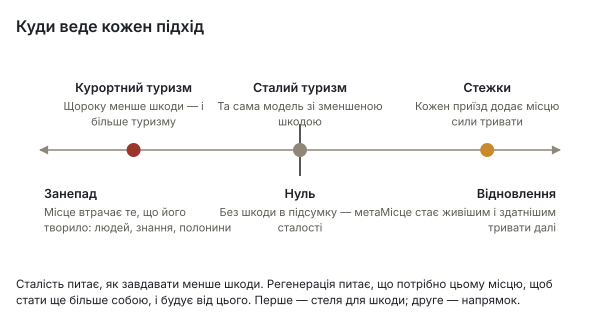
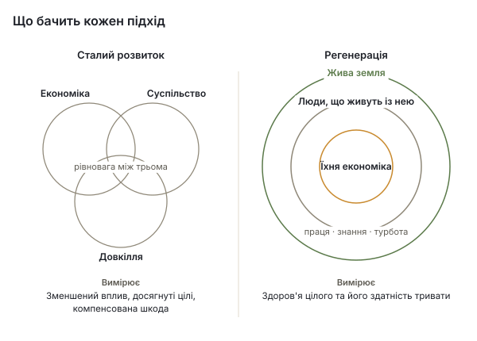
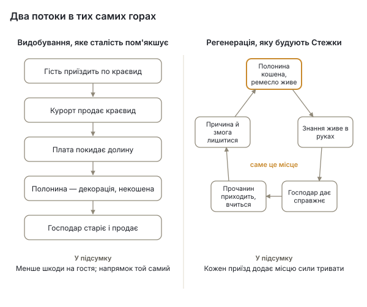

# Транскарпатські стежки

*Жива мережа господарів, стежок і кураторів через усю Карпатську дугу — підстави, свідчення та задум*

Жовтень 2026 · UBEC / Ініціатива Карпатського хабу · Біла книга, проєкт v0.5

## Як читати цю книгу

Транскарпатські стежки мають пропозицію, яка каже, що це таке; стартовий промпт, який фіксує, що вже вирішено; угоду співтворців, яка каже, що обіцяє кожен її учасник; і документ про підстави, який каже, чому. Ця книга зводить їх разом для читачів поза проєктом — донорів, партнерських ініціатив уздовж дуги, гірських громад та їхніх рад, інституцій, які нині планують майбутнє Карпат, — і зіставляє їх зі свідченнями: що відбувається з Карпатами, чого навчилися подібні проєкти в інших місцях, що дозволяє закон і що кажуть дослідження про зустріч, автентичність і догляд за обжитими ландшафтами.

Тут трапляються три види тверджень, і їх розведено. **Рішення** — це рішення проєкту, ухвалені й датовані в його репозиторії; на них так і посилаються. **Свідчення** походять із джерел, пронумерованих у квадратних дужках і перелічених наприкінці; де цифру не вдалося підтвердити з первинного джерела, текст про це каже. **Пропозиції** позначено як пропозиції; ніщо в цій книзі не стає вирішеним від того, що тут написане. Проєкт малий і на ранньому етапі, і ця книга не вдає інакшого: §11 прямо каже, що існує, а що — ні.

## Стисло

Карпати переоцінюють ззовні швидше, ніж зсередини. Курортна нерухомість у Буковелі тепер продається дорожче за квадратний метр, ніж нові квартири в Києві [1]; надходження туристичного збору в Івано-Франківській області за чотири роки зросли в чотири з половиною рази [5]; на високогірних луках, які ніколи не знали промисловості, планують вітрові електростанції та мегакурорт [12][13]; а у вересні 2026 року Україна скликала в Буковелі перший Карпатський саміт, щоб планувати майбутнє регіону поверх кордонів, — з енергетикою й транспортом у заголовках і з задекларованим зобов'язанням щодо «культурних ландшафтів» і «традиційного способу життя гірських громад», яке досі не має жодного інструменту [17][18]. Шлях України до Європейського Союзу з часом відкриє її землю покупцям з усього Союзу; Польща й Румунія показують, що це зробило з цінами на землю та курортну нерухомість [22][23][24]. Тим часом люди, які тримають давній спосіб життя, старіють, поголів'я великої рогатої худоби в області з 2003 року впало приблизно на три чверті [8], і знання, яке створило ці луки, відходить разом із ними.

Та гори й заселяють наново. До березня 2025 року в Косівській, Яремчанській та Ворохтянській громадах було зареєстровано близько сімнадцяти тисяч людей, переміщених війною, — реєстрацій, не мешканців [7]; у Косові живе ремісницька економіка з понад сотні майстерень, а його розписана кераміка внесена до списку нематеріальної спадщини ЮНЕСКО [28][29]; пастухи здобули перші в Україні географічні зазначення для полонинського сиру [31]; родини й самотні люди покидають міста, щоб навчитися гуцульського способу життя і жити ним, а не дивитися на нього. Багато з них — саме ті, чийого голосу не запитали, коли планували майбутнє гір.

Транскарпатські стежки стоять на боці цього другого руху. Це мережа господарів, які пропонують те, що справді мають, — нічліг, їжу, супровід, ремесло — звідти, де живуть; стежка, яка виростає з того, де ці господарі є, а не накреслена над ними; і місцеві Куратори, кожен з яких утримує свою ділянку стежки і підказує — ніколи не продає — подорож кожному прочанинові плаю, як проєкт називає кожного, хто приходить (§4.3). Вона працює на Плаї — мапі всіх Карпат, керованій згодою, яку UBEC уже тримає на власному сервері в Європейському Союзі. Тут немає календаря бронювань; проєкт угоди не додає ні рейтингу, ні комісії; оплату встановлює господар, у формах, які сам обирає, а як вона передається — питання ще відкрите; кожен господар володіє власним записом, а там, де запис за нього вніс Куратор чи доглядач, запис змінюють або відкликають, щойно господар попросить. Перший коридор пролягає від Ворохти через Верховину до Косова у гуцульському високогір'ї Західної України.

Аргумент книги, коротко: карпатська природа і карпатська культура — одна спадщина, створена й збережена людьми, які живуть із землею, і свідчення екології луків однозначні: луки залежать від косіння та випасу, які їх створили [33][34][35][36]. Захищати треба стосунок, а не ландшафт, спорожнілий від людей, які його створили. Подорож, яка платить за те, щоб цей стосунок тривав, — зустріч замість видобутку — єдина форма туризму, що зберігає спосіб життя, а не виставляє його; і працює вона лише тоді, коли зустріч справжня. У цьому різниця між сталістю і регенерацією (§5): сталість просить курорт чинити менше шкоди на кожного відвідувача, і курорт уже має для цього офіс; регенерація запитує, що потрібно місцю, щоб стати більше собою, а в горах, чиї луки занепадають, коли їх покинути, «менше шкоди» — не відповідь. Подібні проєкти показують, що такі мережі живуть або гинуть залежно від бюджетів на утримання, названої відповідальності за кожну ділянку, чесного підрахунку та доглядача, задуманого до того, як прийдуть гроші [37][39][41][45]. Стежки побудовано за цими уроками. З часом місця, якими діляться їхні господарі, окреслять коридори, де культурна, природна й ландшафтна спадщина потребують догляду як єдине ціле — не дика природа і не статус, наданий згори, а мапа, якою громада може скористатися, щоб сказати, чого варта її земля, перш ніж інші вирішать це за неї.

Проєкт просить підтримки насамперед для людей на місці, а вже потім для програмного забезпечення; партнерських ініціатив у кожній країні дуги; і місця в роботі Карпатської вісімки та Карпатської конвенції над підтримкою громад і культурними ландшафтами — як однієї конкретної форми, якої ця підтримка може набути.

## 1. Карпати на зламі

### 1.1 Туризм і нерухомість

Українські Карпати стали єдиним регіоном України, де війна не заморозила ринок нерухомості, а підняла його. Якісні комплекси в Буковелі починаються приблизно від $2 500 за м² з ремонтом, а деякі формати апарт-готелів сягають $6 000 — проти медіани близько $1 400 без ремонту в київських новобудовах у травні 2026 року [1]. Тиск уже не обмежується курортом. Середній будинок у Верховині в жовтні 2025 року виставляли приблизно за 1,8 млн грн, у Косові — за 1,9 млн, проти 7,1 млн у Яблуниці, 8,3 млн у Микуличині та 11,7 млн у Поляниці — громаді, якій належить Буковель [2]. Це перепад шість із половиною до одного від курорту до середнього містечка першого коридору — одночасно й розрив, що робить Верховину привабливою для покупців, і міра того, наскільки їй ще є куди рости. Верховина вже з'являється серед найдорожчих місць для купівлі будинку в Українських Карпатах: між весною й літом 2025 року ціни зросли на 10–15 % [3].

Разом із цим зріс і тиск відвідувачів. Обласний департамент туризму оцінює потік у 2,5 млн відвідувачів на рік із 2023 року, проти 2,0–2,3 млн до повномасштабного вторгнення, а надходження туристичного збору зросли з 10,4 млн грн у 2021 році до 46,2 млн у 2025-му [5]. На Новий рік 2024–25 готелі Буковеля були заповнені на 77–84 %, а кількість відвідувань Яремчанщини зросла на 30–40 % за рік; забудовники мали в планах на 2024–26 роки 45 комплексів готельних апартаментів і 108 котеджних містечок [6]. Курорт — причина того, що Поляницька громада фіксує 2,4 % безробіття і рекордні надходження туристичного збору [4], — і причина того, що гори навколо нього розпарцельовують: у березні 2026 року суд скасував кадастрову реєстрацію двадцяти лісових ділянок столітнього бука і смереки біля Буковеля, захоплених за підробленими державними актами під котеджі й готелі; прокурори посилалися на Карпатську конвенцію [11].

Шкода доходить до високогір'я. У 2026 році позашляховикові колони з тридцяти-п'ятдесяти машин продають двогодинні тури по хребтах за 3 000–4 500 грн; машини заїжджали в озеро Герашаська на Свидовці та в русла потоків, а була й спроба прорвати шлагбаум, що захищає ділянку Петрос–Говерла Карпатського біосферного заповідника; штраф для громадянина — 153–408 грн [10]. На плато Драгобрат понад п'ятдесят котеджів і готелів тісняться на хребті, ділянки взято в оренду всередині біосферного заповідника, а нижче суцільно вирубано близько 190 га [9].

### 1.2 Енергетика і промисловість на високих луках

Два більші проєкти змінили б сам гірський масив. Курорт «Свидовець», який власники Буковеля планують на 1 430 га одного з найкраще збережених масивів Українських Карпат, приніс би 230 км трас, 23 підйомники, 60 готелів, 390 апартаментних будинків і 22 000 гостей на день у ландшафт післяльодовикових озер, пралісу і двох об'єктів Смарагдової мережі [12]. У жовтні 2024 року Верховний Суд підтвердив скасування його детальних планів, а оцінку впливу на довкілля так і не подано; справа залишається відкритою в Постійному комітеті Бернської конвенції [14]. Вітрові електростанції — новіший фронт. На полонині Руна будівництво 30 турбін на 156 МВт почалося до будь-якої оцінки впливу на довкілля; оцінка вийшла позитивною в лютому 2026 року, апеляційний суд у липні 2026 року визнав незаконною вирубку пралісу під під'їзну дорогу, а понад сорок гектарів уже було розчищено під лінію електропередачі [13]. «Вітряні парки України» пропонують близько 1,5 ГВт на хребтах Закарпаття, серед них і Свидовець [13]; той самий 1,5-гігаватний «карпатський вітроенергетичний кластер» презентували на саміті Карпатської вісімки у вересні [19]. Екологічні організації попереджають, що ці плани перетворили б до половини високогірної території Закарпаття на промислову зону і що нагляд за воєнного стану послабшав [15][16].

Ніщо з цього не є аргументом проти енергетики чи проти роботи в горах. Це аргумент про те, що майбутнє гір вирішують люди, які в них не житимуть, зі швидкістю, яка не лишає тим, хто живе, часу сказати, чого вони хочуть, — і що єдине спільне для всіх цих проєктів те, що вони вважають високі луки порожніми.

### 1.3 Дуга як політичний регіон

Карпатська конвенція, ухвалена в Києві 2003 року і чинна з 2006-го, зобов'язує сім країн — Чехію, Угорщину, Польщу, Румунію, Сербію, Словаччину та Україну — спільно охороняти й розвивати гірський масив [25]. Її Протокол про сталий туризм набув чинності 2013 року [26]; протокол про культурну спадщину був підготовлений 2014 року й так і не ухвалений [27]. Восьма Конференція Сторін запланована на кінець 2026 року, після чого Україна на рік очолить головування [25].

18–20 вересня 2026 року в Буковелі Україна започаткувала Карпатську вісімку: Україна, Польща, Румунія, Словаччина, Чехія, Австрія, Угорщина та Сербія разом із Європейським Союзом як цілим. На порядку дня були безпека, енергетика, логістика, прикордонна торгівля та «підтримка наших громад»; підписано п'ятдесят угод на понад мільярд євро, більш ніж половина — щодо сонячної та вітрової енергетики [17][19]. Декларацію підписали шість держав — Австрія, Польща, Румунія, Сербія, Словаччина та Україна [18]. Угорщина, яку Київ зарахував до вісімки, надіслала лише тимчасового повіреного у справах, не підписала і заявляє, що не є членом ініціативи; Чехія взяла участь, але не підписала [20]. Текст декларації важливий для цього проєкту. Вона спирається на Карпатську конвенцію і зобов'язує підписантів до «збереження культурних ландшафтів, традиційного способу життя гірських громад», зокрема нематеріальної спадщини, до «розвитку спільних культурних і туристичних маршрутів», до підтримки місцевих ремесел і до охорони біорізноманіття в рамках Конвенції; вона розглядає макрорегіональну стратегію ЄС для Карпат і щорічні саміти [18]. Офіційний перелік проєктів, утім, налічує 90 проєктів на $10,7 млрд, із яких на енергетику припадає $7,28 млрд, а на транспорт — $1,05 млрд [19]. Культурні ландшафти і традиційний спосіб життя мають одне речення; інструменту вони поки не мають.

Місяцем раніше Президент зустрівся з головами всіх гірських громад чотирьох карпатських областей. На порядку дня були дороги, автобуси для бездоріжжя, лісове господарство і правила туристичного збору, запобігання паводкам і ветерани; депопуляції, землі та спадщини в ньому не було [21].

### 1.4 Земля і Європейський Союз

Україна відкрила ринок сільськогосподарської землі для громадян у липні 2021 року і для компаній з українськими власниками в січні 2024 року; іноземці та компанії з іноземними власниками залишаються виключеними до всенародного референдуму, який за воєнного стану провести не можна [22]. До середини 2025 року власника змінили близько 636 000 га, а ціни зросли з приблизно 45 000 грн за гектар на початку 2024 року до понад 60 000 у червні 2025-го [23]. У межах населених пунктів іноземці вже можуть купувати будинки й несільськогосподарські ділянки; присадибна ділянка сільського будинку — це сільськогосподарська земля і до них перейти не може [56].

Вступ це змінить. Вільний рух капіталу — частина acquis, і кожна з країн, що вступили останнім часом, домовлялася про перехідний період, а не про виняток. Польща просила вісімнадцять років і отримала дванадцять, до 2016 року; за цей час ціни на приватну сільськогосподарську землю зросли приблизно на 690 %, і навіть у гірському Малопольському воєводстві, де зростання було найменшим, вони піднялися на 253 % між 2005 і 2016 роками [24]. У Закопаному, курортному містечку польських Татр, земля дійшла приблизно до 5 000 злотих за м², а туристичні апартаменти — до 20 000, куплені переважно як інвестиції під оренду, проти менш ніж 11 000 за варшавську квартиру [24]. Семирічне обмеження Румунії закінчилося 2014 року; у деяких місцевостях ціни підскочили до подвійного регіонального середнього, а в саксонських селах Трансильванії — де саксонське населення, за підрахунком одного журналіста, скоротилося з майже мільйона до війни до якихось двадцяти тисяч у 2002 році — історичні будинки «модернізували» пластиком і бляхою швидше, ніж можна було домогтися виконання будь-яких норм [22][24]. Кластери вступу України були неформально оголошені відкритими в березні 2026 року, а перший формально відкрито в червні; вето однієї держави-члена все ще блокує два інші [59]. Питання не в тому, чи відкриється земля Карпат, а в тому, скільки років мають гірські громади, щоб вирішити — перш ніж вирішить ринок, — для чого їхня земля.

### 1.5 Люди, які її тримають

В Україні не було перепису з 2001 року, а дані про населення районів не публікують із 2022-го, тож демографія коридору відома лише в загальних рисах [7]. Косівський район скоротився з 86 615 до 83 700 осіб між січнем 2020 і 2022 року, ще до повномасштабної війни; Верховинський район має близько 30 000 людей на 1 254 км² [7]. Дослідження карпатського регіону показують, що багато гірських сіл між 1989 і 2020 роками не знелюдніли так, як рівнини, — їх утримали рекреація, ліс і закон про гірські населені пункти, — але що гірські райони Івано-Франківської та Чернівецької областей втрачають людей на користь міст і що «депопуляція і старіння сільських територій» є головною загрозою регіону [7].

Сама земля записує зміну. Поголів'я худоби в Івано-Франківській області досягло піку в 294 300 голів 2003 року; у приватних господарствах воно впало зі 109 500 у 2021 році до 76 000 у 2024-му, на 15,5 % нижче, ніж роком раніше [8]. Овець і кіз у домогосподарствах України стало менше: з понад двох мільйонів близько 2009 року до менш ніж 1,4 млн у 2019-му; об'єднання вівчарів називають причини: вівця дає молоко 120 днів, а тримати її треба цілий рік, полонинський сир продається по 100–120 грн за кілограм без охоронюваної назви, а робота важка й недооцінена [8]. Вік тих, хто ще тримає овець і косить луки, не записаний ніде, де це дослідження могло знайти; що господарі старіють і їхня земля протягом покоління змінить власника — це власне спостереження проєкту з життя в коридорі, і §12 вносить його до переліку того, що мають з'ясувати перші візити.

## 2. Що таке гори: тяглий ландшафт, а не дика природа

### 2.1 Луки були створені

Полонини — високі пасовища над межею лісу, що є візитівкою Карпат, — не природні. Їх розчистили волоські пастухи, починаючи з чотирнадцятого-п'ятнадцятого століть, «у лісах аж до межі лісу і криволісся» [34]. Їхнє біорізноманіття — продукт їхнього використання. Трансграничне дослідження 48 ділянок у восьми селах Марамуреша і Буковини, по обидва боки українсько-румунського кордону, виявило, що 78 % українських і 83 % румунських ділянок усе ще господарюються традиційно; господарювання пояснювало багатство рослин краще, ніж рельєф чи ґрунт; регулярне косіння підвищувало багатство судинних рослин, а випас — мохоподібних; а депопуляцію і скорочення поголів'я визнано рушіями зміни [33]. На трансильванських субальпійських луках зафіксовано 626 видів на всіх стадіях занедбання: судинні рослини досягали піку на кошених луках, а кожна сукцесійна стадія тримала максимум для якоїсь групи — тож найбагатший ландшафт той, який утримують одразу в кількох стадіях використання [35]. Де припиняється випас, на полонину наступає зелена вільха, і видовий склад, який будували століття використання, починає зникати [34]. Fischer, Hartel і Kuemmerle формулюють висновок для політики прямо: «природоохоронна цінність традиційних сільськогосподарських ландшафтів часто є винятковою», збитковість веде до занедбання з одного боку або до інтенсифікації з іншого, а потрібна стратегія трансформації, яка «прагне підтримати очолювані громадами зусилля створити нові, прямі зв'язки з природою» [36].

Ось чому проєкт відмовляється від слова *дика природа* для карпатських лук і сіл. Ця рамка там емпірично хибна, навіть коли вона правильна для старого букового пралісу. Охоронюваний ландшафт, який забороняє косіння та випас, що його створили, або в якому можуть дозволити собі жити лише заможні, зазнав поразки за власною міркою.

### 2.2 Дві мови, якими світ уже говорить

Бачення має опору в категоріях, які визнають уряди й донори. Категорія V МСОП (IUCN), *охоронюваний ландшафт*, визначена як територія, «де взаємодія людей і природи протягом часу створила територію з виразним характером і значною екологічною, біологічною, культурною та мальовничою цінністю, і де збереження цілісності цієї взаємодії є життєво важливим для захисту й підтримання території» [60]. Вона охоплює понад половину європейського фонду охоронюваних територій; її критики справедливо кажуть, що вона не несе автоматичної цінності для біорізноманіття і що судити про неї слід за результатами, а не за статусом [60] — застереження, яке цей проєкт приймає; умови §9 і ознаки успіху та поразки в §12 кажуть, як його буде дотримано. Рамка Світової спадщини ЮНЕСКО називає *тяглий ландшафт*: такий, що «зберігає активну соціальну роль у сучасному суспільстві, тісно пов'язану з традиційним способом життя, і в якому еволюційний процес усе ще триває» [61]. Гуцульська полонинська економіка — хрестоматійний приклад. За обома стоїть поняття *біокультурного різноманіття*, «різноманіття життя в усіх його проявах — біологічному, культурному та мовному, — які взаємопов'язані в межах складної соціально-екологічної адаптивної системи» [62]. Карпатська конвенція вже розглядає природу і культуру разом у своєму тексті [25]; бракувало інструменту в масштабі села і стежки.

### 2.3 Знання йде, коли припиняється практика

Традиційне екологічне знання — це «накопичений корпус знань, практик і вірувань, що розвивається через адаптивні процеси і передається з покоління в покоління шляхом культурної трансмісії»; воно передається усно і через учнівство й обривається, коли припиняється практика [71]. Ось механізм, що стоїть за твердженням проєкту: зустріч тримає спосіб життя живим там, де музей не може, бо знання про луку, сир чи верстат зберігається лише тоді, коли хтось робить це поруч із тим, хто вміє. Прочанин, який вчиться, — ще один різновид учня. Новоприбулий, який залишається, — той, хто важить найбільше.

## 3. Люди, які тримають гори живими

### 3.1 Ті, хто залишився, і ті, хто прийшов

Гуцульська реміснича економіка жива і зосереджена. У Косові понад сотня приватних майстерень, десять музеїв, Косівський інститут прикладного та декоративного мистецтва і суботній базар — найбільший ремісничий ринок України; радянське художнє підприємство «Гуцульщина» колись давало роботу близько трьом тисячам людей [28]. Традицію косівської мальованої кераміки у грудні 2019 року внесено до Репрезентативного списку нематеріальної культурної спадщини людства ЮНЕСКО [29]. У Яворові родина Кіщуків тримає музей-майстерню ліжникарства і рідкісних довгошерстих овець, які дають для нього вовну [30]. На полонинах об'єднання виробників традиційних високогірних сирів, засноване 2018 року за підтримки Slow Food проти низинних підробок, здобуло перші в Україні географічні зазначення: «Гуцульську коров'ячу бриндзю» зареєстровано у вересні 2020 року, нею опікується Асоціація карпатських ватагів у Верховині, і за перший рік сертифіковано шість полонин — Кринта, Скупова, Луковиця, Бибратківка, Згарда і Щівник [31]. Косівська програма відродження овчарства, оголошена 2022 року з метою 16 000 овець і 500 робочих місць за чотири роки, спирається на спостереження, що п'ятдесят овець дають фермерові змогу залишитися, а не їхати на заробітки за кордон; її результати ще не оприлюднено [8].

Війна принесла не лише тиск, а й людей. На березень 2025 року в Івано-Франківській області було зареєстровано 92 624 внутрішньо переміщені особи (ВПО) проти 3 829 у січні 2021 року; лише в Косівській громаді їх було 5 702, у Яремчанській — 5 605, у Ворохтянській — 5 384, і останнє число на папері приблизно дорівнює власному населенню Ворохтянської громади. Реєстрація перебільшує присутність: в одному містечку зареєстровано 1 474, а знайдено 322 [7]. Дехто залишився працювати: ательє, що 2022 року переїхало з окупованої Каховки до Косова, тепер дає роботу п'ятдесяти жінкам із міста та його сіл, кілька з яких раніше їздили на сезонні заробітки до Польщі [32]. Окрім переміщених, родини й самотні люди залишають міста, щоб навчитися гуцульського способу життя і жити ним, — спостереження, на якому тримається надія проєкту і для якого це дослідження знайшло лише окремі свідчення. Порахувати їх і запитати, чому вони прийшли, — робота для першого коридору.

Література про новоприбулих у горах чітко каже, що саме робить різницю. Дослідження Альп і Піренеїв показують, що «нові горяни» відроджують старі ремесла і відкривають «відповідальний, спільний туризм між господарями та гостями», але й те, що міські покупці піднімають ціни й витісняють молодь, що глибока дружба через межу трапляється рідко («ти завжди іммігрант») і що переселення «має бути організоване, супроводжуване, якщо не заохочуване» [70]. Новоприбулі інтегруються, а не джентрифікують, коли беруться за роботу на землі та спільну працю, коли житло не стає товаром і коли вони входять в інституції, які вже є, — сінокіс, свято, церкву, — замість будувати паралельні. Та сама межа відділяє господаря від виконавця: стосунок до місця.

### 3.2 Хто говорить від імені громади

Коли кажуть, що курорт чи вітропарк має підтримку місцевих, перше питання — хто це сказав і кого не запитали. Звіт 2025 року з громад Ясіня та Усть-Чорної каже, що їхні керівники й мешканці досі сподіваються на курорт на Свидовці заради податкових надходжень, які він принесе, — не кажучи, яких мешканців запитали, — і своєю чергою стверджує, що позивачі проти нього були власниками пилорам, які захищали свої лісозаготівлі [16]. Кожна сторона каже, що голос громади в іншої — прикриття для інтересів. Ця закономірність універсальна. Огляд партисипативного розвитку Світового банку виявив, що участь, запроваджена згори, «часто підпорядкована елітам», якщо немає чутливого центру і довгої відданості [72]; Platteau називає захоплення елітами «серйозною проблемою» для розвитку, керованого громадою, і не знаходить ліку, який не передбачав би поступового виділення ресурсів і перевірки [73]. Партисипативне картування має власну етику: ризик «наразити людей на небезпеку через інформацію, яку вони показують», даних, які сторонні «потім використають», і «вимоги точності там, де доречнішою була б розмитість» [74].

Стежки ставлять це питання в усіх напрямках, зокрема й власним прихильникам. Проєкт не претендує говорити від імені жодного села і побудований так, щоб нікому не доводилося: кожен господар має власний акаунт і власний запис, дає згоду поле за полем і відкликає її, коли захоче, — або, якщо місце за нього вніс Куратор чи доглядач стежки, домагається зміни чи відкликання на першу вимогу; Куратор говорить за те, що оприлюднює; проєкт говорить сам за себе. По всіх Карпатах люди, чий голос обійшли, знаходять одні одних і знаходять ініціативи, які слухатимуть, і напруга між ними та тими, хто говорить їхнім іменем, зростає. Мережа окремих голосів, кожен з яких володіє власними словами, — відповідь проєкту на цю напругу.

## 4. Чому зустріч

### 4.1 Діагноз

Дві проблеми сходяться в Карпатах і мають одну відповідь. Подорож стала видобутком: мандрівники проходять крізь місця, не торкаючись їх, господарі грають гостинність замість ділитися нею, і мандрівник забирає з собою краєвид, а лишається після нього плата — здебільшого комусь, хто там не живе. Гірське життя рідшає: села втрачають людей, знання не передаються, а економіка, що тримала спосіб життя, перебралася деінде. Зустріч відповідає на обидві, бо знання переходить від людини до людини — коли щось робиш поруч із кимось — і бо прочанин, який спить під дахом, їсть за столом і вчиться, як щось роблять, залишає гроші й увагу в руках того, хто тримає знання. Господар, який ділиться тим, що справді має, здобуває причину це берегти — і засоби для цього.

Умова — щоб зустріч була справжньою. Півстоліття тому MacCannell описав туристичні місця як «інсценовану закулісну зону, свого роду живий музей», збудовану тому, що «туристична свідомість рухома бажанням автентичного досвіду» [63]. Щойно господар починає грати, платять за виставу, а спосіб життя однаково втрачається — повільніше і прибутковіше. Розрізнення Wang дає вихід: *екзистенційна* автентичність — властивість дії, а не об'єкта, і її знаходять у спільній праці, ході та їжі, а не у виставках [64]. Мережа, збудована на нічлігах, їжі, супроводі та майстер-класах, які справді в ужитку, без сцени, — спроба лишитися по цей бік межі.

### 4.2 Чого туризм на основі громад навчився важким шляхом

Досвід туризму на основі громад тверезить, і проєкт читає його як перелік для перевірки. Зі 116 ініціатив, які експерти визнали успішними, відповіли 28 зі 133 опитаних, 15 відповідали визначенню, і лише шість були економічно сталими; огляд 200 проєктів туризму на основі громад в обох Америках виявив, що багато помешкань заповнені приблизно на 5 %; дев'ять із п'ятнадцяти досі залежали від донорів, і автори радять переконатися, що мандрівники існують, перш ніж будувати ліжка, а залежність від донорів після п'яти років вважати тривожним знаком [45]. Критика Blackstock називає три хиби: література трактує громаду-господаря «як однорідний блок», підходить до участі «функціонально» і «нехтує структурними обмеженнями місцевого контролю» [65]. Щодо витоку доходів, Overseas Development Institute виявив, що в найкращих випадках до бідних доходить від п'ятої частини до третини туристичного обороту дестинації і що найбільший канал — не ліжко, а ланцюг постачання їжі: близько половини туристичних заробітків бідних у його кейсі Луангпхабангу [46]. Урок для мережі господарів: їжа і майстер-класи важать не менше за нічліг, а проєкт, який не може показати мандрівника, не повинен обіцяти господареві дохід.

Регенеративний туризм, нинішній передній край галузі, вимагає, щоб подорож «давала чистий плюс людям, місцям і природі», визнає, що сертифікація «дає мало», і попереджає, що без згоди та соціальної ліцензії туризм «ризикує стати брудним сектором» [66]. Проєкт читає це так: регенерація — не ярлик, а стосунок, і цей стосунок має бути видимим у самій конструкції: хто володіє даними, хто тримає маршрут, хто бере гроші. §5 протиставляє регенерацію рамці сталого розвитку, яку вона заміняє, і каже, чому Карпатам потрібна сильніша.

### 4.3 Паломництво до чого

Пропозиція називає стежку «інфраструктурою паломництва», і Гуцульщина має справжні місця релігійного паломництва. Слово тут вжито в тому сенсі, якого йому надає антропологія паломництва, — лімінальність, перейдений поріг, *communitas* людей, що йдуть разом, — і з осторогою Turner, що «турист — наполовину паломник, якщо паломник — наполовину турист» [67]. У кінці шляху немає святині. Прочанин входить у стосунок між людьми й землею, що триває століттями, його приймають у нього на ніч чи на місяць, і він іде, взявши в ньому участь, а не подивившись на нього. Паломництво — до самого стосунку. Слово збережено, і воно дає проєктові ім'я для того, хто приходить: **прочанин плаю**, прочанка плаю, англійською *Pilgrim of the Plai* (слово Мішеля, 10 жовтня 2026 року). Плай — гуцульське й румунське слово для давньої стежки через полонини, якою гнали отари в гори й з гір; від нього й назва мапи, на якій працює проєкт (§6.2). *Прочанин* — від *прощі*, паломництва, яке в краї ходять і досі й відрізняють від туризму як внутрішню працю; слово споріднене з *прощати*, тож несе не лише пошук, а й примирення. Проща — до плаю і до людей, які його бережуть, а не до святині. Чи скаже проєкт прямо, що не позичає нічиєї віри, лишається серед відкритих питань у §12.

## 5. Від сталості до регенерації

Досі проєкт говорив про те, від чого він відмовляється і чому. Цей розділ говорить, за що він, — мовою, якою нині послуговується галузь, — і чому він обрав регенерацію замість рамки, що керувала розвитком сорок років.

### 5.1 Що обіцяв сталий розвиток і де він стоїть сьогодні

Сталий розвиток було визначено 1987 року як «розвиток, що задовольняє потреби нинішнього покоління, не ставлячи під загрозу здатність майбутніх поколінь задовольняти свої власні потреби» [82]. Він став рамкою конвенцій Ріо, сімнадцяти Цілей сталого розвитку та їхніх 169 завдань, ухвалених 2015 року, і словника, яким нині користується кожне міністерство, кожний банк і кожний курорт. У туризмі він набув форми, яку надали йому агенції ООН 2005 року: «туризм, що повною мірою враховує свої нинішні та майбутні економічні, соціальні й екологічні впливи, відповідаючи на потреби відвідувачів, галузі, довкілля та громад-господарів» [84].

Дві речі слід помітити в цьому визначенні, перш ніж щось казати проти нього. Це баланс між чотирма претендентами, і галузь — один із них. А його дієслова — враховувати, відповідати на потреби, мінімізувати, підтримувати. Воно запитує, як діяльність може тривати, завдаючи менше шкоди. Воно не запитує, чи ця діяльність — те, чого потребує місце.

Де стоїть ця рамка, зафіксовано документально. Власний звіт Організації Об'єднаних Націй за 2025 рік показує, що лише 35 % завдань Цілей, за якими є дані про динаміку, виконуються за графіком або з помірним поступом, майже половина просуваються надто повільно або ледь помітно, а 18 % відкотилися назад [83]. Стан справ у Карпатах описано в §1, і він має точну місцеву форму. У Буковелі працює Офіс сталого розвитку: безплатні автобуси щогодини, 0,6 мегавата сонячних панелей на дахах готелів, сім зарядних станцій, одинадцять готелів із сертифікатом Green Key, партнерство щодо низьковуглецевого транспорту [85]. Власники того самого курорту планували мегакурорт на Свидовці, а лісові ділянки біля курорту було забрано під котеджі за підробленими актами, доки суд не повернув їх 2026 року [11][12]. Це не звинувачення в нечесності. Це те, що робить рамка: вона просить курорт завдавати менше шкоди на одного відвідувача — і задоволена, коли курорт це робить. Їй нічого сказати про те, чи долина апарт-готелів по $6 000 за м² — це те, чим долина має стати, бо «галузь» — одна зі сторін, чиї потреби ця рамка існує, щоб урівноважувати.

Саме в цьому сенсі сталий розвиток занедбано там, де він мав би кусатися. Його застосовували там, де це було зручно, — енергія, відходи, освітлення, сертифікат, — і відкладали там, де він чогось би коштував: земля, хто вирішує, для чого існує місце, чи триває спосіб життя. І його привласнили: слово, доступне будь-кому з маркетинговим бюджетом, — це слово, яке невдовзі нічого не означає. Критики всередині самої галузі кажуть те саме; власна література регенеративного туризму доходить висновку, що сертифікація сталості «мало що дає» [66].

### 5.2 Чого натомість просить регенерація

Регенеративний дизайн має родовід, старший за Цілі, — *Регенеративний дизайн для сталого розвитку* Lyle 1994 року [86] — і чітке формулювання в аргументі Reed 2007 року: «Сталість, як її нині практикують у збудованому середовищі, — це передусім вправа з ефективності». Він виклав траєкторію підходів, кожен з яких вкладений у більш цілісний: обмежити шкоду; потім *нейтральний*, де розташовані зелений і сталий дизайн, — «узагальнений ідеал не шкодити»; потім відновити здоров'я місцевої живої системи; потім регенерувати — «еволюція цілої системи, частиною якої ми є». Регенерація, писав він, — «єдиний спосіб підтримати сталість». І вона прив'язана до місця: робота «починається зі спроби зрозуміти, як системи життя працюють у кожному неповторному місці», а роль причетних — «створити цілісну систему взаємовигідних стосунків» [87]. Пізніші праці перетворюють це на метод: проєктування від місця, де громада, водозбір чи біорегіон є сферою, в якій люди можуть брати участь [88]; і на дослідницьку програму — регенеративну сталість як «квітучі живі системи, в яких здоров'я і добробут цілого безперервно зростають», з індикаторами, властивими кожному місцю й виробленими через співтворення, і — що незвично для галузі — з інтеграцією духовності, названою серед її умов [89]. У туризмі той самий крок — регенеративний туризм, який вимагає, щоб подорож «давала чистий плюс людям, місцям і природі», а не зменшений мінус [66].

Різниця не в амбіції, а в запитанні, одиниці та мірі.

| | Сталий розвиток | Регенерація |
| --- | --- | --- |
| Запитання | Як ця діяльність може тривати, завдаючи менше шкоди? | Чого потребує це місце, щоб стати більше собою? |
| Одиниця | Три стовпи, які треба врівноважити, — економіка, суспільство, довкілля | Одне живе місце, разом із людьми, вкладене в більше |
| Міра | Зменшений вплив, виконані завдання, компенсована шкода | Здоров'я цілого та його здатність тривати |
| Люди | Група зацікавлених сторін, на чиї потреби відповідають | Учасники життя місця — і ті, хто його знає |
| Місце | Ділянка, де застосовують загальні стандарти | Джерело дизайну, кожне інакше |
| Хто визначає успіх | Стандарт, сертифікатор, глобальна ціль | Місце та його люди, які разом творять індикатори |
| Мета | Нейтраль: жодної чистої шкоди | Чистий плюс: живіше, ніж було |

Регенерація не відкидає підлоги сталості: не шкодити залишається умовою. Вона відмовляється вважати підлогу метою.

### 5.3 Чому регенерація — шлях уперед для Карпат

**Бо нейтралі не досить там, де землю створено працею.** У §2 показано, що карпатські луки залежать від косіння та випасу і деградують, якщо їх залишити самим собі. Рамка, чия мета — нульове втручання і жодної чистої шкоди, не може зберегти ландшафт, якому для існування потрібне втручання. Для тяглого ландшафту підтримувати означає стояти на місці, а стояти на місці означає втрачати. Перша діаграма розставляє три підходи на одній лінії: курортний туризм, який щороку завдає менше шкоди і робить її дедалі більше; сталий туризм — та сама модель із зменшеною шкодою, що прагне до нуля; і Стежки, чия мета — щоб кожен візит додавав місцю здатності тривати.

**Бо сили тиску вже говорять мовою сталості.** Вітровий кластер, запропонований Карпатській вісімці, — це відновлювана енергія. У курорту є офіс сталого розвитку. Вступ — це розвиток. Кожна з сил у §1 може назвати себе сталою, не брешучи, бо рамка врівноважує їхні потреби з потребами гір і називає цей баланс метою. Проєкт, який змагається в тому, щоб завдавати менше шкоди, уже програв цю суперечку: курортам завжди буде що зменшувати. Друга діаграма показує, що бачить кожен підхід: три стовпи, які треба врівноважити один з одним, і земля — один стовп із трьох; або живе місце, в якому земля тримає людей, а люди тримають свою економіку, і те, що рухається між ними, — це праця, знання й турбота.

**Бо люди, які тримають гори живими, уже це роблять.** Одиниця регенерації — живе місце разом із людьми; її метод — співтворення тими, хто знає місце; її індикатори — власні індикатори місця. Це опис другої сили з §3: вівчарі, які сертифікують свої полонини, ткалі, які зберігають довгошерстих овець, новоприбулі, які вчаться косити. Третя діаграма ставить два потоки поруч. Ліворуч — лінія, яку сталість лише пом'якшує: відвідувач приїздить за краєвидом, курорт його продає, плата покидає долину, лука — це декорація і стоїть некошеною, її власник старіє і продає. Праворуч — петля, яку будують Стежки: скошена лука і ремесло в ужитку тримають знання живим через діло; господар пропонує те, що справжнє; прочанин прибуває і вчиться; господар отримує причину і засоби залишитися; луку знову скошено. Чистий підсумок першого, у його найсталішому вигляді, — менше шкоди на одного відвідувача за незмінного тренду. Чистий підсумок другого — кожен візит додає місцю здатності тривати.

**Бо дизайн уже регенеративний у своїх частинах.** Прив'язаний до місця: один коридор за раз, його маршрут виникає з того, де є його господарі, і ніколи — з шаблону. Співтворчий: згода поле за полем, Куратор — людина з цього місця, врядування, яке має перейти до коридору. Міра цілої системи: успіх рахують не в прочанах, а в господарях, які й далі приймають прочан, у молодій людині, яка вчиться роботи на луці, у грошах, що залишаються в селах (§12). Укорінений у стосунках і — словами §9 — у духовності, умові, яку називає Gibbons і якої більшість галузі уникає. Цей розділ додає лише ім'я для цілого — і перевірку, якої від проєкту можна вимагати.

**Два застереження, щоб слово не брали задешево.** Регенерацію можна привласнити так само, як привласнили сталість; у туризмі це вже маркетинговий прикметник, а власні стрес-тести проєкту, зафіксовані в його оглядах, показують, як легко підхопити його мову. Захист — не слово, а міра: місце або живіше й здатніше тривати, ніж до стежки, або ні, і ознаки успіху та невдачі в §12 — це спосіб, яким проєкт дає себе спіймати, якщо ні. І регенерація — це напрямок, а не посвідчення: ніхто її не сертифікує, і в цьому її сила проти захоплення та її слабкість перед донором, який хоче ярлик. Проєкт натомість пропонує міру.

## 6. Модель

### 6.1 Три взаємопов'язані речі

Транскарпатські стежки будують мережу господарів, живу стежку між ними та людей, які її утримують.

**Господарі** — це люди, які вирішують поділитися чимось справжнім із місця, де живуть. Господар пропонує одне чи кілька з переліку — нічліг, їжу, місцевий супровід і майстер-клас — і описує це так, як є: чесна пропозиція. Господарі не є постачальниками послуг. Один господар — одне місце на мапі, з переліком пропозицій і, поруч, відкритими місяцями, місткістю в малих цілих числах, мовами, якими говорить господар, і тим, як дістатися до місця — лише пішки, автомобілем, з дитячим візком, на кріслі колісному (вирішено 7 жовтня 2026 року).

**Стежка** не проєктується зверху. Вона виникає в міру того, як приєднуються господарі: кожен стає точкою, шляхи між ними прокладаються поверх наявної мережі маршрутів, а Куратор коригує результат з огляду на рельєф, сезон, місткість і людську логіку подорожі. Оглядові точки, джерела та інші місця, до яких варто дійти, наносяться на мапу як місця на шляху, а не як пропозиції.

**Куратор** — це пам'ять стежки, зазвичай місцевий фермер, учитель чи піший турист: людина, яка знає ділянку та її господарів, слухає, скільки часу має кожен прочанин, з ким він іде і чого хоче, радить маршрут замість приписувати його і пам'ятає, хто кого може прийняти і коли. Куратор оприлюднює те, що вносять господарі, або утримує це; зберігає знання про безпеку, яке ніколи не оприлюднюється; і, як пропонує проєкт угоди, не бере з господаря нічого за те, що скеровує прочан. Поруч із Куратором стоїть **доглядач стежки** — роль, додана 8 жовтня 2026 року: людина, яка дбає про ділянку стежки, знає її господарів і місця, може внести місце за господаря, який не може зробити це сам, і додавати місця на шляху, а оприлюднення залишає Куратору.

| Роль | Що робить | На Плаї |
| --- | --- | --- |
| Господар | Вносить власне місце або його вносять за його згодою | Обліковий запис автора запису або жодного |
| Доглядач стежки | Дбає про ділянку; вносить за господаря; додає місця на шляху | Обліковий запис доглядача |
| Куратор | Оприлюднює або утримує; радить подорожі; зберігає знання про безпеку; також вносить | Обліковий запис куратора та автора запису |
| Прочанин плаю | Проходить ділянку — пообіддя чи місяць — і приходить як гість | Без облікового запису |

### 6.2 Плай: мапа, яка вже існує

Проєкт не починає з нуля. Плай — це карпатський хаб UBEC Mapservice, картографічного сервісу з відкритим кодом, який UBEC тримає на власному сервері в Німеччині, під юрисдикцією ЄС, на PostgreSQL/PostGIS, MapServer і Mapbender. Уже сьогодні є: базова мапа всього Карпатського пасма з OpenStreetMap — близько 32 млн об'єктів із накладеними пішохідними маршрутами; поверхня внесення, де людина ставить точку саме там, де має на увазі, і описує її; згода, вбудована в базу даних поле за полем, так що куратор вирішує, що оприлюднюється, а відкликані записи зникають з кожної мапи та кожного експорту; одне фото на місце, очищене від даних про місцезнаходження та камеру перед збереженням; поля господаря, описані вище, збудовані й випробувані у браузері 7–8 жовтня 2026 року; позначка на кожному записі, що людина прочитала угоду співтворців і приймає її, із записаними версією та часом; і повний експорт у будь-який момент. Стежки — це подання записів Плаю, а не окрема система (вирішено 7 жовтня 2026 року): одне місце, де господар вносить запис, одна модель згоди, одна черга куратора. Сама назва Плаю несе в собі цю ідею (пропозиція: формулювання проєкту): у мові цих гір *плай* — це гірська стежка, та, що іде хребтом від однієї полонини до іншої. Назва має попередника в історії самих цих гір: українське краєзнавчо-туристичне товариство «Плай», засноване у Львові 1924 року, поєднувало в одній організації вивчення краю, охорону пам'яток природи й археології, знакування стежок і будівництво притулків; воно збудувало те, що описують як перший український гірський притулок для туристів, — на галявині Плісце в Ґорґанах, у 1933–1935 роках [90]. Проєкт бере цю назву в тому самому дусі й не претендує на спадкоємність від товариства.

### 6.3 Від чого проєкт відмовляється

**Без календаря.** Доступність поза сезоном — це розмова з Куратором, а не сітка бронювання, бо календар — перший крок до сервісу бронювання, а сервіс бронювання перетворює господаря на постачальника зі слотами, які треба заповнити.

**Без рейтингів** (проєкт угоди, §3, пропозиція; чекає на слово Мішеля). Господарів не оцінюють балами, не ранжують і не рецензують публічно, бо оцінка вчить господаря грати на оцінку.

**Без комісії** (проєкт угоди, §9, пропозиція). Проєкт, його Куратори та доглядачі не збирають плати за нічліг, їжу, супровід чи майстер-класи і не беруть частки; Куратор не бере з господаря нічого за те, що скеровує прочан. Господар обирає для кожної пропозиції одне з: фіксований внесок, рекомендований внесок, обмін працею, ubec-pay або громадська валюта (вирішено 7 жовтня 2026 року); форма оплати публічна, сума залишається з Куратором. Чи оплата переходить безпосередньо від прочанина до господаря, як каже проєкт угоди, чи через Куратора або громадську платіжну систему — це відкрите грошове питання угоди (A-3); §12 називає ще два.

**Без вистави.** Зустріч або справжня, або її немає. Ніхто не ставить традицію на сцені для відвідувачів.

**Без алгоритму, який вирішує.** Планувальник етапів, якщо його колись збудують, пропонує Куратору денні етапи за часом ходьби та набором висоти; він ніколи не відповідає прочанинові. З п'ятьма господарями Куратор планує на папері.

**Ніхто не говорить від імені громади.** Господар говорить за власне місце, Куратор — за те, що оприлюднює, проєкт — за себе.

**Не дика природа.** Люди і земля — одне й те саме. Те, що потребує захисту, — це зв'язок між ними.

### 6.4 Дані залишаються з людьми

Кожна людина вирішує, що про неї показують, поле за полем; зняття позначки згоди одразу прибирає цю деталь із публічної мапи; відкликання місця прибирає його з кожної мапи та кожного експорту; будь-хто може попросити копію всього, що про нього зберігається, або видалення. Проєкт ніколи не продає і не позичає дані, не показує реклами, не відстежує відвідувачів і не передає дані нікому, включно з органами влади, якщо тільки закон не зобов'язує. За чинною редакцією (відкрите A-2) записи й фото не випускаються під відкритою ліцензією: обґрунтування огляду проєкту таке, що відкриту ліцензію не можна відкликати, тож дім господаря, випущений під нею, можна було б копіювати вічно й після того, як господар його відкликав, — у воєнний час. Автор запису зберігає всі права; UBEC має дозвіл зберігати, показувати в межах згоди, робити резервні копії та повертати, і цей дозвіл закінчується з відкликанням. Це — переклад проєктом принципів CARE для врядування даними — колективна користь, повноваження контролювати, відповідальність, етика, — які «доповнюють наявний підхід, зосереджений на даних», підходом, «орієнтованим на людей і мету» [75], і принципу платформених кооперативів, за яким дані й правила належать людям, яким платформа служить, а не її оператору [76].

## 7. Чого навчилися інші

Ніщо в цьому задумі не є невипробуваним деінде, і досвід порівнянних проєктів — найкорисніший учитель для проєкту. Вісім випадків і урок, який несе кожен.

**Via Transilvanica (Румунія).** Близько 1 400 кілометрів від Путни до Дробети-Турну-Северин, збудовано у 2018–2022 роках однією НУО, Tășuleasa Social, із понад десятьма тисячами волонтерів і тисячею вручну витесаних андезитових кілометрових стовпів; відкрито в жовтні 2022 року; відзнака Europa Nostra за залучення громадян у 2023 році [37]. Будівництво коштувало близько €1,8 млн із пожертв, свідомо без державних грошей; річний операційний бюджет нині перевищує €2,5 млн від близько 1 200 донорів та членської програми, а 300–400 кілометрів маркування потрібно оновлювати щороку [38]. Підрахунки відвідувачів розходяться — близько 30 000 у 2024 році за однією оцінкою, 37 000 за іншою, і 120 000 заявлено за 2025 рік — чотирикратний стрибок, який радше свідчить про зміну методу, ніж мандрівників [38]. Шар господарів лишався неформальним: приватні гостьові будинки на мапі в застосунку, без оприлюдненого відбору чи стандарту, доки у 2026 році асоціація не почала будувати власні модульні міні-будинки на землі обраних родин [38]. Задокументовані результати сильні, але поодинокі: один господар — плюс 600 % гостей, «але цифри все ще малі»; одне село — з 18 до 28 мешканців і перші народини за сорок років [38]. Зростання цін на нерухомість, комодифікація та нерівна користь для сіл на маршруті й поза ним — ризики, які несе будь-яка така стежка, і ця біла книга називає їх для Стежок у §12. *Урок:* єдина віддана організація з членською базою та волонтерами, що опікуються ділянками, може утримувати довгий маршрут без держави — але догляд є постійною витратою, за підрахунок має хтось відповідати, а шар господарів, залишений неформальним, урешті стає ліжками самого оператора.

**Via Dinarica (Динарські Альпи).** Збудована на донорські кошти з 2010 року за підтримки USAID і ПРООН, потім італійської співпраці: понад тисяча кілометрів маркування, десятки відбудованих хат і гостьових будинків, гранти постачальникам, робочі місця переважно сезонні; заявлена мета другої фази — «туристичний продукт, що належить громаді та нею керується» [39]. Після близько $7 млн і дванадцяти років вона й далі залежить від донорського центру підтримки, і сама ПРООН зазначає, що громади «ще не повною мірою скористалися економічними можливостями» [39]. *Урок:* проєктуйте доглядача до гранту, а не після; «власність громади» була метою, а не результатом.

**Туристичні клуби Центральної Європи.** Чеський клуб KČT підтримує маркування близько 43 000 кілометрів через регіональні комісії, у яких кожному волонтерові-маркувальнику призначено ділянку і за недбалість йому роблять зауваження, з невеликою державною субсидією, без якої клуб «не впорався б» [40]. Словацький KST має близько 350 волонтерів-маркувальників і трирічну норму оновлення — близько 5 500 кілометрів на рік; у 2025 році через брак коштів він оновив 1 200, а законопроєкт про врегулювання догляду за стежками відклали [40]. В Україні Закарпатський туристичний шлях — 398 кілометрів, промаркованих у 2010 році за чеськими стандартами швейцарсько-українським лісовим проєктом — не має визначеного органу, який би його підтримував, а Східнокарпатський туристичний шлях у Ґорґанах перемаркував один волонтер — гірський рятувальник [41]. *Урок:* сторічні свідчення того, що іменна відповідальність за кожну ділянку плюс невелика стала субсидія підтримують стежку живою, а там, де бракує одного чи іншого, маркування занепадає за кілька сезонів. Доглядач стежки — це версія опікуна ділянки для проєкту.

**Bergsteigerdörfer (Альпи).** З 2008 року альпійські клуби Австрії, Німеччини, Італії, Словенії та Швейцарії сертифікували 43 «села альпіністів», які втілюють Альпійську конвенцію: жодного села понад 2 500 мешканців, жодної фірми понад п'ятдесят працівників, жодної лижної забудови, що з'єднує долини, з обов'язковими критеріями щодо альпійської компетентності, ландшафту та мобільності, щорічним з'їздом і виключенням села, яке опускається нижче критеріїв [42]. Оцінювання 2012 року не виявило ще вимірного зростання ночівель, зате високу обізнаність серед членів клубів і результати, що залежали від того, хто рухав роботу — муніципалітет чи волонтери [42]. *Урок:* знак вартий довіри лише тоді, коли може виключати; і він здобуває обізнаність задовго до того, як здобуває дохід.

**Fundația ADEPT (Тирнава-Маре, Румунія).** З 2004 року ADEPT працює з близько 1 500 фермерами в саксонських селах; фундація допомогла розробити румунську виплату за луки високої природної цінності, яка принесла близько 1 400 родинам близько €1,5 млн на рік і понад €2 млн на рік у цілу місцевість, із 24 505 гектарами лук під виплатою; її туристична робота — фестивалі, ярмарки, центр дикої природи — описана, але не виміряна [43]. Для порівняння, зіставне дослідження румунських місцевих груп дії LEADER не виявило суттєвої різниці в несільськогосподарському обороті чи зайнятості між комунами-учасницями та неучасницями [44]. *Урок:* тривкі результати дав потік виплат, прив'язаний до практики на землі, а не туристичний маркетинг чи самі лише грантові програми.

**Гостинність донативо на Шляху святого Якова (Camino de Santiago).** Притулки для паломників, що живуть на внесках, а не на ціні, тримаються на трьох речах: волонтерах-госпітальєро, будівлі, що належить парафії чи асоціації, і дарах колишніх паломників. Рекомендована пожертва — €5–12 за ліжко, вечерю та сніданок; «скупі паломники штовхають альберґе в низхідну спіраль», деякі приватні власники називають фіксовані €12 «донативо», а після пандемії притулок, якому колись вистачало дарів двадцяти паломників за ніч, потребує дванадцяти [47]. Мережі гостинності Servas (з 1949 року; господарі ніколи не беруть плати, кандидатів співбесідує національний комітет), Warm Showers і BeWelcome працюють на членстві та волонтерському врядуванні [48]. *Урок:* оплата на основі внеску потребує носія витрат, іншого ніж дар гостя, і визначення різниці між внеском і ціною, яке розпізнають і господар, і прочанин.

**Платформені кооперативи.** Fairbnb, італійська кооперативна альтернатива Airbnb, залучив мільйон євро у 2021 році, тримав комісію 15 %, половина якої йшла на місцеві проєкти, був оцінений дослідженням 2025 року як такий, що ризикує стати «тим самим, лише більше», і пішов на добровільну ліквідацію у 2024 році, перш ніж його бренд купили у 2025-му [49]. Федеративна платформа доставки CoopCycle працювала там, де була місцева довіра, і зазнавала невдачі там, де чужоземна ліцензія спричиняла тертя [49]. Mapeo, інструмент картування з пріоритетом офлайн-роботи, створений з амазонськими громадами, показує, що картографічні дані у власності громади операційно можливі — з телефона на телефон [50]. У Новій Зеландії орган з трудових відносин ухвалив у 2018 році, що «волонтери», які працюють сорок годин на тиждень за стіл і дах та невелику плату, є працівниками, яким належить заробітна плата [51]. *Урок:* кооператив, який наслідує усталеного гравця, успадковує його економіку; дані у власності господарів здійсненні; а працю гостя треба оформлювати як гостинність, ніколи — як працю за стіл і дах.

**Аппалачська стежка (США).** Бентон Маккей запропонував її 1921 року не як пішохідний шлях, а як проєкт регіонального планування: стежку вздовж аппалачського хребта; притулки приблизно за день ходи один від одного; громадські табори поблизу на землі у спільній власності, де не продають ділянок і працюють без прибутку; а згодом — кооперативні фермерські та лісові табори, що їх постачають; шлях назад до землі, до праці й до здоров'я, збудований волонтерами, де кожну ділянку доглядає місцева група під федерацією [91]. Стежку збудували; громадські й фермерські табори — ні. Сьогодні її утримують близько тридцяти волонтерських клубів, кожен — свою ділянку, від 2,2 милі до понад 280, багато з них призначені ще у 1920-х і 1930-х роках; їх координує організація Appalachian Trail Conservancy, загальну відповідальність несе Служба національних парків, і з кожним із чотирнадцяти штатів є меморандум [92]. Щоб захистити стежку, Закон про систему національних стежок 1968 року та поправки 1978 року взялися викупити коридор. Примусовий викуп натрапив на жорсткий опір власників землі; закон 1978 року зробив його крайнім засобом після переговорів і сервітутів, а там, де власник відмовлявся, маршрут переходив до сусіда, який погоджувався [93]. Це також стежка рекреації в дикій природі на переважно державній землі — саме та рамка, яку ця книга відкидає для Карпат; її уроки — в її будові та історії, а не в її образі природи. *Урок:* пішохідна частина задуму знаходить волонтерів і гроші, а жива частина відпадає, якщо її не тримати від початку; федерація доглядачів ділянок може тримати стежку століття; а коридор, викуплений чи нав'язаний згори, обертає проти себе людей усередині лінії — коридор має виростати з їхньої згоди.

| Урок | Звідки | Що роблять Стежки |
| --- | --- | --- |
| Спершу бюджет на догляд | Via Transilvanica | Стежку утримують доглядачі та Куратор; не будується жодна інфраструктура, за яку ніхто не названий відповідальним |
| Назвати людину на кожну ділянку | KČT, KST, Ґорґани | Доглядач стежки |
| Спроєктувати доглядача до гранту | Via Dinarica | Куратор і доглядачі — перша робота пілота; фінансування йде людям раніше, ніж програмному забезпеченню |
| Переконатися, що мандрівники існують, перш ніж будувати ліжка | Goodwin & Santilli | Господарі пропонують те, що вже мають; для прочан нічого не будується |
| Їжа та майстер-класи несуть сільський дохід | ODI | Чотири пропозиції, а не лише нічліг |
| Внесок потребує носія витрат | Донативо на Каміно | Відкрите: що проєкт називає внеском (§12) |
| Знак має вміти виключати | Bergsteigerdörfer | Куратор утримує або відмовляється радити; угода дозволяє закрити обліковий запис за шкоду |
| Рахувати чесно | Via Transilvanica | Перехід 4 фіксує пройдену відстань, час і те, чого бракувало; успіх не вимірюється прочанами (§12) |
| Оформлювати працю гостя як гостинність | NZ ERA 2018 | Обмін працею — форма оплати, яку господар може прийняти; угода має сказати, чим він не є (§10) |
| Не наслідувати усталеного гравця | Fairbnb | Без календаря, без рейтингів, без комісії, без застосунку для прочан |
| Дані у власності господарів здійсненні | Mapeo, CARE | Згода як стовпці, відкликання, експорт; жодної відкритої ліцензії на домівки (за чинною редакцією, A-2) |
| Зберегти живу частину задуму, а не лише стежку | Аппалачська стежка, 1921 | Господарі й луки — це і є проєкт; стежка — те, що їх поєднує (§5, §9) |
| Федерація доглядачів ділянок може тримати стежку століття | Аппалачська стежка | Доглядач на кожну ділянку; співтворці першого коридору вирішують, як ним правити від Фази 2 (угода §4) |
| Коридор, нав'язаний згори, обертає проти себе людей усередині нього | Аппалачська стежка, 1978 | Коридори як розмиті смуги, що виростають зі згоди, ніколи — ділянки (§9) |

## 8. Підвалини

### 8.1 Убунту, чесно

UBEC — це Ubuntu Bioregional Economic Commons. *Убунту* зазвичай передають через формулу Mbiti «Я є, бо ми є; а оскільки ми є, то і я є» [68]: людина стає людиною через інших людей, і, у формулюванні Metz, «дія є правильною настільки, наскільки вона шанує гармонійні стосунки — такі, в яких люди ототожнюють себе одні з одними та виявляють солідарність одні до одних» [68]. Науковці Південної Африки поширили це поняття на більше-ніж-людський світ через шонське поняття *укама*, спорідненість, яке є мостом між «я є, бо ми є» і «люди і земля — одне й те саме» цього проєкту [68]. Проєкт користується цим словом обережно. Його власні прихильники сперечаються про його межі: одні називають його поширення після апартеїду елітним проєктом, метафізичні передумови якого — малі громади на родинних зв'язках — більше не діють; інші застерігають від узагальнення однієї «африканської екологічної етики» на багато мов [68]. Стежки називають убунту названим джерелом натхнення та перекладеним принципом, а не твердженням про тотожність, і ставлять його поруч із власною карпатською мовою сусідства: *толока*, спільна добровільна праця, якою в Україні будували хати і звозили сіно, — це місцевий відповідник того, що ця біла книга називає внеском [69].

### 8.2 Біорегіон

Біорегіон «означає водночас географічну територію і територію свідомості — місце та уявлення, що склалися про те, як жити в цьому місці», а повторне заселення «означає вчитися жити-в-місці на території, яку порушила і поранила минула експлуатація» [77]. Критика також задокументована: біорегіональне письмо дозволяє природі диктувати суспільний лад і забуває, що лінії проводить культура [77]. Стежки уникають детермінізму, визначаючи свій регіон через місця, які люди справді поділяють, — шляхи, полонини, ринки та парафії, — а не лише через водозбір. Карпатська дуга — це один живий регіон через кордони семи чи більше країн, і проєкт є біорегіональним перш ніж національним: він починається з одного коридору в Україні і має перетнути кожен кордон на дузі, з партнерською ініціативою в кожній країні, що відкриває свій коридор під тими самими зобов'язаннями щодо даних, згоди, безпеки та грошей.

### 8.3 Спільне

Вісім принципів Ostrom для тривкого спільного — чітко визначені межі; правила, узгоджені з місцевими умовами; механізми колективного вибору; моніторинг, підзвітний користувачам; поступові санкції; дешеве розв'язання конфліктів; визнане право на самоорганізацію; вкладені одна в одну структури — витримали перевірку на дев'яносто одному випадку [78]. Прочитані крізь мережу гостинності, вони лягають на неї прямо. Межа — це хто вважається господарем, доглядачем, Куратором і що саме є спільним: маршрути, потік гостей, дані, добре ім'я мережі. Моніторинг — це Куратор, який читає кожне місце перед оприлюдненням, і доглядач, який проходить ділянку. Санкції поступові: утримати, не пропонувати, і лише за серйозну шкоду закрити обліковий запис — вислухавши людину. Розв'язання конфліктів іде так: спершу розмова, потім Куратор, потім керівник, потім посередник. Вкладеність — село, коридор, дуга. Колективний вибір — єдиний принцип, який пілот відкладає: у фазі 1 керівник проєкту вирішує перехід за переходом, вислухавши тих, кого це стосується, а угода обіцяє, що перед відкриттям фази 2 господарів, доглядачів і Кураторів першого коридору запитають, як проєкт має врядуватися далі (угода, §4). §12 називає це відкладення напругою.

### 8.4 Гостинність, дар, внесок, ціна

Derrida розрізняв безумовний закон гостинності — вітати, перш ніж запитати ім'я, — та умовні закони, що роблять її здійсненною, і називав гостинність «самою культурою, а не просто однією етикою серед інших» [79]. Mauss знайшов у дарі три обов'язки: дати, прийняти, відплатити; Hyde додає, що «дар мусить завше рухатися» і зв'язує так, як не може жоден товар [80]. Між даром і ціною лежить *внесок*: *донативо* на Каміно, гуцульська *толока*, плата, яка визнає витрати, не встановлюючи вартості гостинного прийому. Чотири форми оплати проєкту живуть на цьому середньому ґрунті, а його єдина відмова — дар, названий у першій чернетці й вилучений, — чекає на свою письмову підставу (§12). Слово Illich для цього цілого — *конвівіальність*: «автономні та творчі взаємини між людьми і взаємини людей зі своїм довкіллям» [81].

## 9. Від місць до коридорів

Кожен господар говорить за своє місце. Поставлені поруч, ці місця і шляхи між ними починають говорити те, чого жодне не скаже саме: де жива культура, ландшафт і його природа ще тримаються разом і де вони під найбільшою загрозою. З часом стежка окреслить коридори — ділянки дуги, де культурна, природна та ландшафтна спадщина потребують догляду як одне ціле, і чутливі території, що потребують його всеосяжно.

Це не дика природа (§2). Догляд, якого вони потребують, укорінений у духовності, у зв'язку та в стосунках людей між собою і з землею, у розумінні, що люди і земля — одне й те саме. Коридор не проводить проєкт. Він виникає з місць, якими люди вирішили поділитися, і говорить лише за них. Там, де він дає громаді змогу сказати, чого варта її земля, перш ніж за неї це вирішать інші — вітрова електростанція, курорт чи ринок землі, розігнаний вступом до ЄС, — він зробив свою роботу.

Три умови додаються, і проєкт називає їх зараз, а не пізніше. Перша — згода: господар погодився бути показаним на мапі, а не стати доказом у справі про охорону; угода каже, що дані зберігаються, щоб поставити мережу на мапу, дати Куратору змогу пропонувати подорожі та дати прочанам змогу знаходити господарів, «і ні для чого іншого», а зміна призначення знову потребує згоди кожної людини (угода, §6, §13). Жоден коридор не спирається на місце господаря, доки угода не скаже цього і господар не погодиться, із правом залишитися на мапі, відмовившись від такого використання. Друга — люди всередині лінії: коридор, окреслений за мережею, перетинає землю, де живуть люди, які ніколи до неї не приєднувалися, і «говорить лише за них» має залишатися правдою, коли коридор кладуть перед міністерством, Карпатською вісімкою чи донором. Третя — охорона як тиск: саме надання статусу може підняти ціни на землю і заборонити косіння та випас, що створили ці луки; охоронюваний ландшафт, у якому можуть дозволити собі жити лише заможні, зазнав невдачі.

Словник уже існує — культурні ландшафти Конвенції, категорія V МСОП (IUCN), тяглий ландшафт ЮНЕСКО, власні слова декларації К8 [18][25][60][61]. Те, що додає коридор, окреслений знизу, — єдине, чого не може дати статус, наданий згори: згода, місце за місцем, людей, чия це земля.

## 10. Робота у воєнний час і в межах закону

Пілот починається в Україні під час війни, і проєкт спроєктований навколо цього факту, а не попри нього. Цей розділ переказує, що кажуть закон і офіційні роз'яснення; це не юридична консультація, і угода вже називає два юридичні прочитання, які мають передувати першому справжньому обліковому запису і першому прочанинові.

### 10.1 В'їзд, рекомендації та страхування

Повітряний простір України закритий; іноземці в'їжджають суходолом. Громадяни ЄС, Великої Британії, США, Канади та інших безвізових держав в'їжджають за паспортом, із підтвердженням коштів за постановою Кабінету Міністрів № 884 [52]. Кожен західний уряд не рекомендує подорожувати: Велика Британія — проти всіх, крім необхідних, поїздок до п'яти західних областей, серед них Івано-Франківської, і проти будь-яких поїздок в інші регіони; США — рівень 4, «не подорожуйте»; Німеччина й Канада — із попередженнями для всієї країни; усі зазначають, що консульська допомога дуже обмежена, а страхування подорожей може втратити силу [53]. Українські джерела описують медичне страхування від страховика, зареєстрованого в Україні, як обов'язкове для тих, хто в'їжджає без візи, і українські страховики продають покриття воєнних ризиків із лімітами близько 100 000 грн, тоді як більшість західних страховиків виключають Україну; первинної правової підстави для вимоги страхування при безвізовому в'їзді не знайдено, і вона значиться як невирішена [52]. Відповідь проєкту — та, яку вже дає угода: прочанин читає рекомендації свого уряду, розуміє, що в Україні діє воєнний стан, має при собі те страхування, яке може дістати, і отримує чесний брифінг від Куратора перед приїздом. Аргументи за те, щоб узагалі запрошувати прочан — солідарність, дохід там, де він потрібен, свідчення, — і аргументи проти — ризик для гостей, тягар для господарів, оселя, що стала видимою, — обидва справжні, і §12 залишає відкритим питання, що проєкт каже прочанинові з-за кордону і хто це каже.

### 10.2 Комендантська година, тривоги та прикордонна смуга

Комендантська година в Івано-Франківській області триває з опівночі до п'ятої ранку за рішенням обласної Ради оборони [54]. Під час повітряної тривоги всі дотримуються офіційного попередження та укриття господаря; подорож зупиняється. Жорстке обмеження для першого коридору — державний кордон. За постановою Кабінету Міністрів № 1147 зі змінами від грудня 2023 року прикордонна смуга — це п'ять кілометрів від лінії кордону; для в'їзду, перебування чи роботи в ній потрібен письмовий дозвіл прикордонного загону, який ухвалюють протягом десяти днів і тепер видають як QR-код; населені пункти та місця масового відпочинку виключено, тож для входу в село дозвіл не потрібен, а для виходу з нього в ліс чи на полонину — потрібен [55]. Верховинський район — контрольований прикордонний район, і наказ № 1663-АГ 31-го (Чернівецького) прикордонного загону від травня 2024 року стосується Зеленської та Білоберізької громад: вхід у п'ятикілометрову смугу з туристичною чи рекреаційною метою без дозволу заборонений, з обмеженнями на зупинку транспорту та скупчення на узбіччі; маршрути на Піп Іван Чорногірський, Пожижевську та озеро Бребенескул закриті або обмежені, а пізніші роз'яснення додають Туркул і полонини; дозволи дійсні рік, і до липня 2024 року їх було видано понад десять тисяч [55]. Національний природний парк «Верховинський» підтверджує, що керівники груп надсилають до загону маршрут, дати й паспортні дані учасників заздалегідь [55]. Як іноземець отримує такий дозвіл на практиці і околиці яких сіл потрапляють у смугу — на це жодне джерело не відповіло; обидва питання має з'ясувати Куратор, перш ніж пропонувати будь-який етап поблизу хребта, а етап, що потребує дозволу, каже про це.

### 10.3 Гостинність із власної хати

Окремого закону про сільський туризм немає; проєкти законів 2021 року і пізніші так і не були ухвалені, і сектор «залишається майже нерегульованим» [57]. Що існує — це Порядок № 297 Кабінету Міністрів 2006 року: власники індивідуальних засобів розміщення до тридцяти місць можуть надавати тимчасовий нічліг без реєстрації підприємницької діяльності, за умови що вони щороку декларують дохід, ведуть книгу обліку гостей, подають статистику місцевій владі та дотримуються санітарних норм; фізична особа сплачує ПДФО за ставкою 18 % плюс військовий збір, нині 5 % [57]. Господар, який воліє зареєструватися як ФОП, може надавати готельні послуги на спрощеній системі оподаткування [57]. Чи мусить домогосподарство, яке годує платних гостей, реєструвати потужність з виробництва харчових продуктів за Законом № 771/97, і як туристичний збір застосовується до незареєстрованого господаря — сірі зони [57]. Від місцевого провідника ліцензії не вимагають; ліцензування стосується лише туроператорів [58]. Проєкт не може перевірити нічого з цього за господаря і не повинен удавати, що може: угода каже, що кожен господар відповідає за своє (§9), а огляд проєкту просить, щоб Куратор казав це прямо під час першого візиту.

### 10.4 Гроші, і чим проєкт не є

Плата за нічліг чи їжу — це дохід від послуг, як би її не називали; справжній дар від особи, що не є родичем, оподатковується в отримувача, за вищою ставкою, коли дарувальник — нерезидент, тож називати внесок даром жодної переваги не дає [58]. Бартер законний, а дохід у натуральній формі оподатковується за справедливою вартістю; громадські валюти не мають правового статусу, бо гривня — єдиний законний платіжний засіб, і саме тому «ubec-pay або громадська валюта» називає форму оплати, яку господар може прийняти, а не платіжну систему, якою керує проєкт [58]. Обмін праці іноземця на харч і дах порушує питання дозволів на роботу та законодавства про волонтерство, які залишаються невирішеними, а новозеландський прецедент у §7 показує, що стається, коли працю в гостях трактують як найману [51][58]. За Законом України «Про туризм» *туристичний продукт* — це попередньо розроблений комплекс двох чи більше послуг, що продається за встановленою ціною, і ліцензують лише туроператорів; організація, яка оприлюднює господарів, не приймає бронювань і грошей, не формує і не продає продукту [58]. Директива ЄС про пакетні подорожі застосовується до торговців і виключає пропозиції, «що пропонуються чи сприяються час від часу, на неприбутковій основі і лише обмеженій групі мандрівників» [58]. Саме тому проєкт угоди каже, що проєкт, його Куратори та доглядачі «не збирають плату за проживання, їжу, супровід чи майстер-класи і не беруть із неї частки», а оплата, як записано в чернетці, переходить безпосередньо від прочанина до господаря (відкрите A-3): це зберігає Стежки такими, якими вони себе називають. Цю конструкцію має підтвердити хтось, хто знає українське туристичне законодавство, до першого прочанина.

### 10.5 Дані, у Німеччині та в Україні

Дані лежать на власному сервері UBEC у Німеччині, під правом ЄС, у власній базі даних Плаю, окремій від усіх інших проєктів. Оприлюднене розташування оселі — це персональні дані і за GDPR, який прямо називає дані про місцезнаходження, і за українським Законом № 2297-VI [56]. Український закон 2010 року залишається чинним із мізерними штрафами; узгоджений з GDPR закон на заміну пройшов перше читання в листопаді 2024 року і в середині 2026 року все ще чекав на друге, а його ухвалення — один з орієнтирів вступного кластера 1, відкритого в червні 2026 року [56]. Рішення ЄС про адекватність щодо України немає; передача даних до Німеччини дозволена за українським законом, бо Німеччина — сторона Конвенції № 108 [56]. Чиста правова підстава — явна згода, надана поле за полем і така, що її можна відкликати, — саме так і робить Плай. Чи підпадає контролер даних, розташований в Україні, який збирає дані прочан з ЄС, під екстратериторіальну дію GDPR і чи потребує він представника в ЄС — це питання для прочитання щодо захисту даних, якого угода вже вимагає перед першим справжнім обліковим записом.

## 11. Де стоїть проєкт

Чесність щодо етапу — частина задуму. На 9 жовтня 2026 року:

**Що є.** Пропозиція англійською та українською; посібник користувача для авторів записів і Кураторів обома мовами, з екранами такими, якими вони є; угода співтворців для кожної ролі — господар, доглядач стежки, Куратор, прочанин, співавтор, партнерська ініціатива, донор, адміністратор — обома мовами, як чернетка із сімома відкритими пунктами; документ про підстави; і, на Плаї, базова мапа Карпат, поверхня внесення зі згодою у вигляді стовпців, поля господаря, господарі, позначені для публіки власним кольором, фотографія, галочка угоди на кожному записі та оприлюднене місце, відкрите у браузері, що несе кожне поле господаря. Переходи 0 і 2 — рішення, поля господаря — закриті датованим записом; Перехід 1, Плай у браузері, фактично пройдено переглядом у браузері 8 жовтня, записаним під Переходом 2, хоча власний рядок промпту досі каже «очікує».

**Чого немає.** Жодного господаря, доглядача чи Куратора на ім'я; жодного справжнього облікового запису. Резервних копій з копією поза хостом — а це власна умова сервісу для першого справжнього облікового запису. Поштового сервісу, тож забутий пароль скидає адміністратор. Юридичної особи: документи називають двох ініціаторів — UBEC і «Живу хату», — але жодне з двох дерев не називає правової форми проєкту, а контролером даних кожного господаря сьогодні особисто є керівник проєкту. Жодної цифри бюджету. Програмне забезпечення випереджає угоди між людьми — правильний порядок для мапи, бо модель згоди треба було довести, перш ніж просити когось їй довіритися, — і Перехід 3, перші господарі, є першим переходом, чия робота — обіцянка, дана людині.

**Ризики, які проєкт назвав сам для себе**, у власному огляді: одна людина тримає все, у воєнний час, а заступник адміністратора з другою копією ключа від резервних копій запропонований і ще не названий; немає юридичної особи; обриси проєкту залежать від того, як проходить оплата; власні зобов'язання господарів за податковим законодавством і воєнним станом; знання воєнного часу, яке тримають Куратори з письмовим обов'язком конфіденційності лише в проєкті угоди; дім у своїй точній точці безпечний лише як свідомий вибір; оплачувані ролі ще без умов; люди на фотографіях і в історіях.

**Переходи попереду.** Перехід 3: три-п'ять господарів у коридорі, внесених із Куратором поруч, один названий Куратор — після резервних копій. Перехід 4: коридор, пройдений від краю до краю, із записом пройденої відстані й часу на кожний етап, того, чого бракувало, і того, що прочанинові було потрібно й чого він не мав. Перехід 5: планувальник етапів — лише якщо Перехід 4 покаже, що він потрібен Кураторові. Перехід відкривається на виконаній роботі, а не на даті.

## 12. Що відкрите

Проєкт тримає свої напруги на видноті, а не розв'язує їх на папері. Документ про підстави викладає дванадцять; біла книга називає ті, про які має знати читач поза проєктом.

- **Мапа проти «без вистави».** Позначка, що каже «майстер-клас», запрошує свого господаря стати тим, що каже позначка. Чесна пропозиція, без календаря, без рейтингів і Куратор, який читає кожне місце перед оприлюдненням, — це запобіжники; хто каже про це, коли господар починає грати виставу, і що тоді стається — відкрите.
- **Оплачено, але не транзакція.** Що відрізняє внесок від ціни — словами, які впізнали б і господар, і прочанин; чому дару не було серед чотирьох форм; і як проходить оплата (A-3).
- **Влада Куратора.** Пам'ять стежки — це також воротар того, хто на ній з'являється. Як обирають Куратора і хто, і що може зробити господар, якого обійшли, — відкрите; шлях розв'язання спорів в угоді — перша відповідь.
- **Органічне зростання, що почалося ззовні.** Мапу збудували до того, як з'явилися господарі, — ініціатива, яку веде одна людина. Що переходить до коридору і коли — наприклад, коли власні Куратори коридору обирають наступний коридор — це питання врядування, на яке має відповісти фаза 2.
- **Досить.** Скількох прочан може прийняти господар чи село, перш ніж зустріч стане потоком; місткість на кожну пропозицію — перший запобіжник, межа для ділянки стежки — відкрите.
- **Мапа як путівник для покупця.** На зростаючому ринку мапа старих хат у їхніх точних точках — це також список для розвідки. Господар може поставити свою точку в сусідньому місці зустрічі й розповісти прочанам решту особисто; чи каже Куратор це кожному господареві саме такими словами — відкрите.
- **Новоприбулі.** Чи приймають прочан ті, хто приїхав жити й учитися, на тих самих умовах, що й ті, хто тут народився, і як проєкт про них говорить.
- **Згода для коридорів, люди всередині лінії, охорона як тиск** (§9).
- **Прочани у воєнний час.** Що проєкт каже прочанинові з-за кордону про урядові рекомендації щодо подорожей, страхування та воєнний стан, і хто це каже (OI-P12).
- **Паломництво.** Слово збережено в імені «прочанин плаю» (§4.3); чи каже проєкт прямо, що не запозичує нічиєї віри, досі відкрито.

**Що ще не відомо** і чого мають навчити перші відвідини: вік землевласників коридору і що станеться з їхньою землею; скільки новоприбулих оселилося в його селах і чому; що вступ до ЄС уже робить із цінами на землю в Українських Карпатах; чи візьметься Карпатська вісімка за спадщину та природу і чи почує громади безпосередньо; і як власні люди коридору називають той догляд, який описує ця біла книга, — своїми словами, з яких має постати український текст.

**Як виглядав би успіх** (пропозиція). Господарі, які після трьох сезонів далі приймають прочан на власних умовах і кажуть, що це було варте того; молода людина, яка вчиться ремесла чи роботи на луці, бо стежка звела їх разом; Куратори й доглядачі, які є людьми коридору й самі обирають наступний коридор; гроші прочан, що залишаються в селах; громада, яка використовує те, що показує стежка, щоб говорити за власну землю в рішенні про неї. **Як виглядала б невдача:** костюми та інсценовані трапези; ціни вздовж стежки, що зростають швидше, ніж довкола, і хати на мапі, куплені людьми, які знайшли їх там; одне село переповнене, тоді як інші не бачать нікого; Куратор, що став агентом; і проєкт, який описують кількістю перевезених прочан. Ні те, ні інше не рахують у прочанах. За обома стоїть одне регенеративне випробування (§5): чи це місце живіше й здатніше тривати далі, ніж було до стежки?

## 13. Що просять

**У донорів.** Підтримка пілота йде насамперед людям на місці й лише потім — програмному забезпеченню, бо мапа вже існує: знайти господарів, відвідати їх і сидіти поруч, поки вони вносять записи; оплачуваний перший Куратор за письмовою домовленістю; пройти коридор і оцінити кожний етап; два юридичні прочитання; переклад; хостинг, резервні копії та запобіжники, що тримають дані господарів приватними. Фінансування не дає голосу щодо того, що оприлюднюється чи які подорожі пропонуються, і не дає доступу до даних господарів чи прочан; що надійшло і на що витрачено, звітується на кожному переході (проєкт угоди, частина донора). Цифри бюджету — перший відкритий пункт, який пілот має закрити, і проєкт не обіцятиме господареві доходу, якого не може показати. Просять фінансування регенерації, а не пом'якшення: не зменшення шкоди від туризму, яке курорти можуть оплатити самі, а здатність кількох місць тривати далі, виміряну за ознаками з §12.

**У партнерських ініціатив уздовж дуги.** Коридор у будь-якій іншій країні дуги — у якій саме, теж відкрите (OI-P11) — відкритий за угодою співтворців або її версією, що зберігає її зобов'язання щодо даних, згоди, безпеки та грошей, із власними господарями, доглядачами та Кураторами своєю мовою, з даними, утримуваними за тією самою згодою і переданими в повному обсязі, якщо коридор піде своїм шляхом.

**У гірських громад та їхніх рад.** Не схвалення, а увага: прочитати цю білу книгу; імена людей, які вже приймають прочан, навчають, пасуть чи косять; і запитання, на які село хотіло б мати відповідь, перш ніж хтось із його людей з'явиться на мапі.

**У Карпатської вісімки та Карпатської конвенції.** Декларація К8 зобов'язує її підписантів щодо культурних ландшафтів, традиційного способу життя гірських громад і спільних культурних шляхів; Конвенція розглядає природу й культуру разом від 2003 року, а Україна головуватиме в ній після COP8. Стежки — одна конкретна форма, якої може набути це зобов'язання, збудована від громад назовні, і вона просить, щоб її почули саме так: як місця названих господарів і шляхи між ними, показані з їхньої згоди і без права говорити за когось іншого — ніколи не як те, чого хоче громада, бо це може сказати лише громада.

**У будь-кого.** Документи проєкту, код і запис кожного рішення відкриті; його угода навмисно написана простими словами; і запропонувати може кожен. Контакт: Мішель Ґаран — stewardship@ubec.network.

## Додаток A — Документи проєкту, переглянуті

Усе в репозиторії `ubeccommon/trans_carpathian_pathways`, документи — за ліцензією CC BY-SA 4.0, код — за AGPL-3.0-or-later. Прочитано для цієї білої книги 9 жовтня 2026 року.

| Документ | Версія | Що містить |
| --- | --- | --- |
| Стартовий промпт | v0.21 | Порядок завантаження, кожне рішення з датою, ролі, перший коридор, переходи, відкриті пункти; джерело істини |
| Пропозиція (EN, UK, PDF) | v0.2 | Зовнішній підсумок: потреба, відповідь, кому служить, коридор, Плай, принципи, безпека, дорожня карта, фінансування, як узяти участь |
| Специфікація полів господаря | v0.5 | Що несе точка господаря на Плаї і як це доводиться |
| Огляд стану Mapservice | v0.1 | Стек, на якому працюють Стежки; читати перед будь-якою зміною |
| Огляд проєкту | v0.1 | Вісім розходжень, одинадцять ризиків, що має врегулювати угода |
| Посібник користувача (EN, UK, PDF) | v0.3 | Внесення місця й кураторство, екран за екраном, із тим, чого стек ще не вміє |
| Угода співтворців (EN, UK, PDF) | v0.2 | Що обіцяє кожна роль; сім пунктів відкриті до підписання |
| Підстави | v0.1 | Чому: коріння, дві сили, коридори, підстава кожного принципу, дванадцять напруг |

**Де документи ще розходяться з рішеннями.** Пропозиція має версію v0.2, і власний огляд проєкту від 8 жовтня зафіксував чотири розходження, які залишаються: доглядач стежки в ній не з'являється; її крок 2 пілота й розділ про безпеку кажуть, що запис вносить господар, тоді як тепер Куратор чи доглядач може внести його за господаря, який не може; її рядок контакту досі каже «буде додано», хоча адреса від серпня — stewardship@ubec.network; і її перелік принципів відрізняється формулюванням і кількістю від переліків стартового промпту й угоди. Документ про підстави пропонує, щоб його власний §6 став єдиним переліком принципів, а наступна версія пропозиції взяла «чому саме тепер» і коридори в короткій формі. Ця біла книга не змінює пропозицію; вона фіксує, що пропозиція v0.3 на часі, обома мовами.

**Що ця біла книга додає з того, чого ще не містив жодний документ.** Тиски в цифрах із джерелами (§1); свідчення про луки для «не дика природа» (§2); аргументи за регенерацію проти сталого розвитку, з діаграмами (§5); порівнянні проєкти та їхні уроки (§7); правова рамка в одному місці (§10); і прохання (§13). Де вона спиралася на власні слова проєкту, вона зберегла їхній зміст; де пропонує — каже про це.

## Джерела

Прочитано 9 жовтня 2026 року. Цифри з вторинних зведень позначено; позиції з позначкою *unverified* не вдалося підтвердити за первинним джерелом.

**Регіон**

1. Ekonomichna Pravda, "Буковель дорожчий за Київ", June 2026 (the cited page could not be re-fetched at checking; the text is confirmed word for word in a copy dated 23 June 2026) — https://epravda.com.ua/biznes/karpati-ta-bukovel-yak-zrostaye-investiciyna-neruhomist-i-pributki-kurortu-822922/
2. Zaxid.net, "Будинок в Карпатах: скільки коштує і від чого залежить ціна", 1 October 2025 (OLX listings) — https://zaxid.net/budinok_v_karpatah_skilki_koshtuye_i_vid_chogo_zalezhit_tsina_n1620372
3. Novyny.LIVE, "Ціни на будинки в горах", August 2025 — https://novyny.live/neruhomist/tsini-na-budinki-v-gorakh-skilki-groshei-treba-viddati-za-pokupku-272912.html
4. Ukrainian News, "Thanks to Bukovel, the Polianytsia community has recorded its highest ever tourist tax revenues", 12 June 2025 — https://ukranews.com/en/amp/news/1087356-thanks-to-bukovel-the-polianytsia-community-has-recorded-its-highest-ever-tourist-tax-revenues
5. Ivano-Frankivsk oblast tourism department, "Туризм Івано-Франківської області 2025" (visitor figures from 2020 are departmental estimates) — https://speakerdeck.com/iftourism/turizm-ivano-frankivskoyi-oblasti2025
6. Ekonomichna Pravda, "Відвідуваність українських курортів зросла до 40% на зимові свята", January 2025 — https://epravda.com.ua/biznes/vidviduvanist-ukrajinskih-kurortiv-zrosla-do-40-na-zimovi-svyata-802063/
7. Suspilne Ivano-Frankivsk, "У яких громадах Івано-Франківщини живуть найбільше переселенців", 21 May 2025 — https://suspilne.media/ivano-frankivsk/977307-u-akih-gromadah-ivano-frankivsini-zivut-najbilse-pereselenciv/; Suspilne, 9 February 2021 — https://suspilne.media/102967-pereselenci-na-prikarpatti-so-kaze-statistika-cerez-7-rokiv-vid-pocatku-vijni/; raion populations: Wikipedia "Kosiv Raion", "Verkhovyna Raion" (compiled from Ukrstat estimates; secondary); Lozynskyy & Zubyk, "Transformation of the Rural Settlement Network in the Carpathian Region of Ukraine (1989–2020)", *European Countryside* 14(2), 2022 — https://doi.org/10.2478/euco-2022-0014; Teslyuk & Rushchyshyn, *Herald of Khmelnytskyi National University* 296(4), 2021 — https://heraldes.khmnu.edu.ua/index.php/heraldes/en/article/view/1607
8. Suspilne Ivano-Frankivsk, "Як на Франківщині зменшується чисельність корів", 13 March 2025 — https://suspilne.media/ivano-frankivsk/968067-ak-na-frankivsini-zmensuetsa-ciselnist-koriv-statistika-z-1991-roku/; ZN.ua, "Біле золото Карпат", 20 September 2019 — https://zn.ua/ukr/business/bile-zoloto-karpat-324136_.html; UkrAgroConsult, "На Прикарпатті відроджуватимуть вівчарство", 5 September 2022 — https://ukragroconsult.com/news/na-prykarpatti-vidrodzhuvatymut-vivcharstvo/
9. Texty.org.ua, "Карпати 3D", c. 2017 — https://texty.org.ua/d/carpathians-3d
10. LB.ua, "Джипер високогір'я", 3 August 2026 — https://lb.ua/society/2026/08/03/756098_dzhiper_visokogiryi_tse_ruskiy.html
11. Vikna.tv, "Держава повернула 20 ділянок лісу біля Буковелю", 6 March 2026 — https://vikna.tv/dlia-tebe/novyny-ukrayiny/derzhava-povernula-20-dilyanok-lisu-bilya-bukovelyu-rishennya-sudu/amp/
12. Bruno Manser Fonds, "The Svydovets Case", June 2019 — https://en.forumcivique.org/kampagnen/forest/report_the_svydovets_case.pdf
13. CEE Bankwatch Network, "Ukraine's Mount Runa at risk", issue paper, 27 August 2026 (updated 25 September 2026) — https://bankwatch.org/wp-content/uploads/2026/08/2026_08_Issue-Paper_Ukraine-s-Mount-Runa-at-risk.pdf
14. Government of Ukraine, report to the Bern Convention Standing Committee, file 2018/5 Skhidnyi Svydovets, 20 January 2025 — https://rm.coe.int/files-2018-5-ukraine-skhidnyi-svydovets-2025-gov-2757-1931-8795-1/1680b4b790
15. Ukrainian Nature Conservation Group, "High-level meeting called to address Carpathian wind farm crisis", 2025 — https://uncg.org.ua/en/high-level-meeting-called-address-carpathian-wind-farm-crisis/; Derevo.ua, "How the War is Changing the Ecological Balance of the Carpathians" — https://derevo.ua/en/publication/vijna-zagostrila-ekologichni-konflikti-v-3801
16. Ukrainian News, "'The Forest Republic': How Logging Interests in Zakarpattia Are Blocking Investment Projects", 2025 — https://ukranews.com/en/amp/news/1076072-the-forest-republic-how-logging-interests-in-zakarpattia-are-blocking-investment-projects-to-keep
17. European Pravda, "Zelenskyy announces new format for cooperation with neighbours: the Carpathian Eight", 18 September 2026 — https://www.eurointegration.com.ua/eng/news/2026/09/18/7245769/
18. President of Ukraine, "Declaration of the Summit of the Carpathian Integration Initiative", 18 September 2026 — https://www.president.gov.ua/en/news/deklaraciya-samitu-karpatskoyi-integracijnoyi-iniciativi-106445
19. Kyiv Post, 18 September 2026 — https://www.kyivpost.com/post/84863 and https://www.kyivpost.com/post/84833; Reuters via Internazionale, 19 September 2026 — https://www.internazionale.it/ultime-notizie-reuters/2026/09/19/zelenskiy-launches-carpathian-eight-initiative-on-trade-security; Ministry of Economy of Ukraine, panel "Єдиний карпатський простір", 22 September 2026 — https://me.gov.ua/News/Print/ec56852e-bdba-46a7-9ab1-30aaaed8fb29?lang=uk-UA
20. AFP via Courthouse News, 22 September 2026 (Hungary's representation and its Foreign Ministry's statement); signatories from the declaration text [18]
21. President of Ukraine, meeting with heads of mountain hromadas, 13 August 2026 — https://www.president.gov.ua/en/news/prezident-obgovoriv-iz-predstavnikami-girskih-gromad-vikliki-105813
22. OSW, "Ukraine: two years of free trading in arable land", 17 July 2023 — https://www.osw.waw.pl/en/publikacje/analyses/2023-07-17/ukraine-two-years-free-trading-arable-land; Mondaq on Romania's Law 17/2014, 28 January 2014 — https://www.mondaq.com/Article/452626
23. Demagog.pl, "Problem własności gruntów rolnych: wnioski dla Ukrainy z polskiej drogi do UE", 8 April 2026 — https://demagog.org.pl/analizy_i_raporty/problem-wlasnosci-gruntow-rolnych-wnioski-dla-ukrainy-z-polskiej-drogi-do-ue/
24. Bórawski et al., *Land Use Policy* 82 (2019) 486–496 — https://doi.org/10.1016/j.landusepol.2018.11.027; Warsaw Business Journal, "Real estate and land prices are breaking new records in Zakopane", 29 December 2021 — https://wbj.pl/real-estate-and-land-prices-are-breaking-new-records-in-zakopane/post/133108; Butnaru, "The impact of liberalization on the Romanian land market", ASE Bucharest, c. 2014 — https://www.cafee.ase.ro/wp-content/uploads/2022/10/THE-IMPACT-OF-LIBERALIZATION-ON-THE-ROMANIAN-LAND-MARKET-SALES.pdf; Osservatorio Balcani e Caucaso, "The Saxons' fragile treasure", 22 September 2009 — https://www.balcanicaucaso.org/en/cp_article/the-saxons-fragile-treasure/
25. Carpathian Convention (FAO/Mountain Partnership summary) — https://fao.org/fileadmin/templates/mountain_partnership/doc/4th_global_meeting_presentations/Carpathian_Convention.pdf; Government of Ukraine on COP8 and the presidency, 10 November 2025 — https://www.kmu.gov.ua/en/news/ukraina-hotuietsia-do-prezydentstva-v-karpatskii-konventsii
26. InforMEA, Protocol on Sustainable Tourism — https://www.informea.org/en/treaties/protocol-sustainable-tourism/decisions
27. InforMEA, decision COP4/7 on cultural heritage and traditional knowledge, 2014 — https://www.informea.org/en/decision/cop47-cultural-heritage-and-traditional-knowledge
28. ReHERIT, heritage profile of Kosiv, 2020 — https://reherit.org.ua/wp-content/uploads/2020/08/Kosiv_profil-spadshhyny_REHERIT.pdf
29. UNESCO, "Tradition of Kosiv painted ceramics", Representative List 2019 — https://ich.unesco.org/en/RL/tradition-of-kosiv-painted-ceramics-01456
30. Discover Ivano-Frankivsk, the Kischuk family lizhnyk museum-workshop, Yavoriv — https://discover.if.ua/en/locations/muzej-majsterna-liznikarstva-rodini-kisukiv-u-avorovi
31. Suspilne, "Гуцульська коров'яча бриндза отримала географічне зазначення", 14 September 2020 — https://suspilne.media/62845-guculska-korovaca-brindza-otrimala-geograficne-zaznacenna/; Slow Food Foundation, "In defense of authentic Hutsul bryndza", 24 April 2018 — https://www.fondazioneslowfood.com/en/in-defense-of-authentic-hutsul-bryndza/
32. Ekonomichna Pravda, "З Каховки до Косова", 2025 — https://epravda.com.ua/biznes/z-kahovki-do-kosova-809595/

**Ландшафт**

33. Janišová et al., "Agricultural legacy shapes plant diversity patterns in mountain grasslands of Maramureș and Bukovina", *People and Nature* 6(6), 2024 — https://doaj.org/article/9caebdd433aa40af98967f90d8c0b455
34. Kricsfalusy, "Mountain grasslands of high conservation value in the Eastern Carpathians", *Thaiszia* 23(1), 2013 — https://www.upjs.sk/public/media/9724/067-112-kricsfalusy-upr.pdf
35. Baur et al., "Effects of abandonment of subalpine hay meadows on plant and invertebrate diversity in Transylvania, Romania", *Biological Conservation* 132(2), 2006 — https://edoc.unibas.ch/12896
36. Fischer, Hartel & Kuemmerle, "Conservation policy in traditional farming landscapes", *Conservation Letters* 5, 2012.

**Порівнянні ініціативи**

37. Via Transilvanica — Wikipedia (secondary) — https://en.wikipedia.org/wiki/Via_Transilvanica; Romania Insider, 10 September 2025 — https://www.romania-insider.com/via-transilvanica-norway-grants-pislaru-sept-2025
38. Ziarul Financiar, 1 August 2025 — https://www.zf.ro/via-transilvanica/via-transilvanica-mult-traseu-turistic-ajuta-dezvoltarea-zonelor-22867654; ZF, 22 September 2025 — https://www.zf.ro/via-transilvanica/via-transilvanica-drumul-uneste-comunitati-businessuri-cristina-toma-22908279; Agerpres, 14 May 2026 — https://agerpres.ro/2026/05/14/reportaj-mures-primul-modul-de-cazare-pentru-drumetii-de-pe-via-transilvanica---inaugurat-la-saparto--1556156; Economedia on The Guardian — https://economedia.ro/?p=231748; Tălpău et al., Mendel University Press, c. 2025 — https://doi.mendelu.cz/pdfs/doi/9900/08/3500.pdf
39. UNDP Bosnia and Herzegovina, Via Dinarica project pages — https://global-prod.acquia.undp.org/node/91131 and https://www.undp.org/node/442241; AICS Tirana project sheet, January 2026 — https://tirana.aics.gov.it/wp-content/uploads/2026/01/Sustainable-Tourism-for-Green-Growth-Along-the-Via-Dinarica-Trails-in-Bosnia-and-Herzegovina.pdf
40. ČT24, 17 January 2019 — https://ct24.ceskatelevize.cz/domaci/2708774-pred-130-lety-byla-v-cesku-namalovana-prvni-turisticka-znacka-sit-znacenych-tras-meri; TASR, 17 May 2026 — https://www.teraz.sk/slovensko/klub-turistov-priblizne-350-znackaro/963427-clanok.html; Noviny.sk, 13 June 2025 — https://www.noviny.sk/slovensko/1072270-hory-su-plne-turistov-znacenie-tras-je-v-rukach-dobrovolnikov-zakon-ktory-mal-upratat-chaos-sa-odklada
41. Ukrinform, 14 May 2021 — https://www.ukrinform.ua/rubric-tourism/3244990-na-zakarpatti-turistiv-zaprosuut-projti-najdovsij-marsrut-karpatami.html; Suspilne, 2 June 2021 — https://suspilne.media/135818-u-gorganah-vidnovluut-markuvanna-na-shidno-karpatskomu-turisticnomu-slahu/
42. Bergsteigerdörfer, criteria 2017 (EN) — https://www.bergsteigerdoerfer.org/files/criteria_for_mountaineering_villages_2017.pdf; criteria 2025 (DE) — https://alpenverein.it/wp-content/uploads/2026/01/Kriterien-der-Bergsteigerdoerfer-Fassung-2025.pdf; Czaja, mid-term evaluation, 2012 — https://trustsoft.uni-oldenburg.de/f/5/inst/biologie/ag/geoumwelt/zenario/Abschlussarbeiten/Masterarbeit_Iris_Czaja.pdf
43. Fundația ADEPT, Darwin Initiative final report EIDPO037, 20 May 2013 — https://www.darwininitiative.org.uk/documents/EIDPO037/23507/EIDPO037%20FR%20-%20Edited.pdf; Sigrid Rausing Trust, 2021 — https://www.sigrid-rausing-trust.org/story/biodiversity-and-environmentally-friendly-farming-in-romania/
44. Pocol et al., *AgroLife Scientific Journal* 6(1), 2017 — https://expertise.unimi.it/resource/item/563408
45. Goodwin & Santilli, "Community-Based Tourism: a success?", ICRT Occasional Paper 11, 2009 — https://www.andamandiscoveries.com/press/press-harold-goodwin.pdf
46. Mitchell & Ashley, ODI Briefing Paper 22, June 2007 — https://cdn.odi.org/media/documents/110_yFKzu3c.pdf
47. Camino de Santiago forum, "Donativos: time for a gentle reminder" — https://caminodesantiago.me/community/threads/donativos-time-for-a-gentle-reminder.66075; Gronze, 8 May 2021 — https://www.gronze.com/articulos/camino-post-covid-albergues-mas-pequenos-mejores-servicios-y-mayor-precio-22087
48. Servas International — https://en.wikipedia.org/wiki/Servas_International (secondary); BeVolunteer statutes — https://www.bevolunteer.org/about-bevolunteer/statutes/
49. Co-op News, 16 November 2021 — https://www.thenews.coop/fundraising-year-nets-e1m-for-platform-co-op-fairbnb/; Co-op News, 7 April 2025 — https://www.thenews.coop/co-op-solutions-to-the-problems-caused-by-short-term-rentals/; TU Dresden, *Current Issues in Tourism*, 2025 — https://fis.tu-dresden.de/portal/en/publications/a-fair-airbnb-selfperceptions-in-the-fairbnb-cooperative-that-aims-to-revolutionise-the-short-term-rental-market(f6590dee-6140-4d3f-bcb4-bed375e7e532).html; Gualavisí & Vizuete-Sandoval, *Internet Policy Review* 15(1), 2026 — https://policyreview.info/articles/analysis/solidarity-coopcycle-latin-america
50. Awana Digital, Mapeo — https://awana.digital/archived-case-studies/mapeo
51. 1News, "ERA rules that Christchurch farm exploited volunteer workers", 11 January 2018 — https://www.1news.co.nz/2018/01/10/era-rules-that-christchurch-farm-exploited-volunteer-workers-fed-them-spoiled-meat

**Правова рамка**

52. Pravdop, "Правила въезда в Украину для иностранцев в 2026 году", January 2026 — https://pravdop.com/en/publications/kommentarii-zakonodatelstva/pravila-vezda-v-ukrainu-dlya-inostrancev-v-2026-godu-kak-izbezhat-otkazov-i-proyti-granicu-bez-riskov-01-2026-137/; Minfin, 12 January 2026 — https://minfin.com.ua/ua/amp/2026/01/12/166090510/ (insurance requirement for visa-free entry: *unsettled*)
53. UK FCDO travel advice, 14 August 2026 — https://www.gov.uk/foreign-travel-advice/ukraine; US Department of State, 3 September 2026 — https://travel.state.gov/en/international-travel/travel-advisories/ukraine.html; Auswärtiges Amt, 9 October 2026 — https://www.auswaertiges-amt.de/de/reiseundsicherheit/ukrainesicherheit-201946; Government of Canada — https://travel.gc.ca/destinations/ukraine
54. Visnyk NANU, "Комендантська година Івано-Франківськ: актуальні правила 2026", 18 August 2026 (secondary; to be confirmed against the oblast order) — https://visnyk-nanu.org.ua/komendantska-godyna-ivano-frankivsk-aktualni-pravyla-2026/
55. Suspilne, "У ДПСУ розповіли деталі у змінах щодо прикордонного режиму", 16 December 2023 — https://suspilne.media/640822-u-dpsu-rozpovili-detali-u-zminah-sodo-prikordonnogo-rezimu/; Focus, 16 July 2024 — https://focus.ua/uk/eksklyuzivy/657923-zaborona-na-karpati-kogo-ne-pustyat-u-gori; TSN, 19 October 2025 — https://tsn.ua/tourism/iaki-dokumenty-potribno-maty-dlia-toho-shchob-pity-v-hory-poblyzu-kordonu-perelik-2937875.html; Verkhovynskyi National Nature Park — https://verkhovynskyi-park.in.ua/en/activity/
56. RecordingLaw, Ukraine data privacy laws, 2026 — https://www.recordinglaw.com/world-laws/world-data-privacy-laws/ukraine-data-privacy-laws/; DSLUA digest, June 2026 — https://dslua.org/wp-content/uploads/2026/07/media_jun26.pdf; EDPB Guidelines 3/2018 on territorial scope — https://edpb.europa.eu/sites/edpb/files/files/file1/edpb_guidelines_3_2018_territorial_scope_en.pdf; LegalAid.ua on property purchase by foreigners, 7 January 2025 — https://legalaid.ua/ua/kupivlya-neruhomosti-inozemczem-v-ukrayini-osnovni-aspekty/
57. DTKT consulting, "Зелений туризм: чи є податкові пільги?", 23 May 2023 — https://consulting.dtkt.ua/taxation/other/19536-zelenii-turizm-ci-je-podatkovi-pilgi; Verkhovna Rada, 29 April 2021 — https://www.rada.gov.ua/news/Povidomlennya/207789.html; Suspilne, 29 April 2021 — https://suspilne.media/126865-rada-poperedno-pidtrimala-zmini-do-zakonu-pro-turizm-so-voni-peredbacaut/; Derzhprodspozhyvsluzhba Ternopil, 25 April 2023 — https://dpss-te.gov.ua/news/shcho-potribno-ekspluatatsiinyi-dozvil-chy-derzhavna-reiestratsiia-potuzhnostei-operatora-rynku
58. Law of Ukraine "On Tourism", art. 1 and 17 — https://protocol.ua/ua/pro_turizm_stattya_1/ and https://protocol.ua/ua/pro_turizm_stattya_17/; Jurliga on gift taxation, 20 September 2021 — https://jurliga.ligazakon.net/news/206312_otrimano-podarunok-podatkvts-poyasnili-shcho-neobkhdno-znati; DTKT on barter, 12 March 2025 — https://news.dtkt.ua/accounting/automation/96844-ci-moze-fizosoba-zagalnik-zaimatisia-barterom; Directive (EU) 2015/2302, art. 2(2) — https://www.legislation.gov.uk/eudr/2015/2302/article/2/2020-12-31/data.htm
59. Euronews, 17 March 2026 — https://www.euronews.com/my-europe/2026/03/17/; European Pravda, 16 June 2026 — https://www.eurointegration.com.ua/eng/news/2026/06/16/7239763/; European Pravda, 29 September 2026 — https://www.eurointegration.com.ua/eng/news/2026/09/29/7246508/

**Теорія та рамки**

60. Dudley (ed.), *Guidelines for Applying Protected Area Management Categories*, IUCN 2008; Dudley, Phillips, Amend, Brown & Stolton, "Evidence for Biodiversity Conservation in Protected Landscapes", *Land* 5(4):38, 2016 — https://www.mdpi.com/2073-445x/5/4/38; Locke & Dearden, *Environmental Conservation* 32(1), 2005
61. UNESCO, Report of the Expert Group on Cultural Landscapes, La Petite Pierre, 1992, ¶38–40 — https://whc.unesco.org/archive/pierre92.htm; *Operational Guidelines*, Annex 3
62. Maffi, "Linguistic, Cultural, and Biological Diversity", *Annual Review of Anthropology* 34, 2005, p. 601 — https://www.cbd.int/financial/doc/maffi_linguistic_cultural_biological_diversity.pdf
63. MacCannell, "Staged Authenticity", *American Journal of Sociology* 79(3), 1973, pp. 596–597
64. Wang, "Rethinking authenticity in tourism experience", *Annals of Tourism Research* 26(2), 1999
65. Blackstock, "A critical look at community based tourism", *Community Development Journal* 40(1), 2005
66. Dredge, "Regenerative tourism: transforming mindsets, systems and practices", *Journal of Tourism Futures* 8(3), 2022 — https://www.emerald.com/jtf/article-pdf/8/3/269/1662658/jtf-01-2022-0015.pdf
67. Turner & Turner, *Image and Pilgrimage in Christian Culture*, Columbia University Press 1978, p. 20
68. Mbiti, *African Religions and Philosophy*, Heinemann 1969; Metz, "Toward an African Moral Theory", *Journal of Political Philosophy* 15(3), 2007 — https://philarchive.org/rec/METTAA; Le Grange, "Ubuntu, Ukama and the Healing of Nature, Self and Society", *Educational Philosophy and Theory* 44(S2), 2012; Matolino & Kwindingwi, "The end of ubuntu", *South African Journal of Philosophy* 32(2), 2013; Gwaravanda in Chemhuru (ed.), *African Environmental Ethics*, Springer 2019
69. *Toloka*: the pan-Ukrainian custom of collective voluntary labour, documented in Ukrainian ethnography; no English-language study of Hutsul guest customs specifically was found — the primary ethnographies are Shukhevych, *Hutsulshchyna* (1899–1908) and Kaindl, *Die Huzulen* (1894)
70. Corrado, Dematteis & Di Gioia (eds.), *Nuovi montanari: Abitare le Alpi nel XXI secolo*, FrancoAngeli 2014; Solana-Solana, "Rural gentrification in Catalonia, Spain", *Geoforum* 41(3), 2010; Solé, Solana & Mendizabal, "Integration and international migration in a mountain area: the Catalan Pyrenees", *Journal of Alpine Research* 102-3, 2014; Moss (ed.), *The Amenity Migrants*, CABI 2006
71. Berkes, Colding & Folke, "Rediscovery of traditional ecological knowledge as adaptive management", *Ecological Applications* 10(5), 2000, p. 1252
72. Mansuri & Rao, *Localizing Development: Does Participation Work?*, World Bank 2013 — https://www.worldbank.org/en/research/publication/localizing-development-does-participation-work
73. Platteau, "Monitoring Elite Capture in Community-Driven Development", *Development and Change* 35(2), 2004
74. Rambaldi, Chambers, McCall & Fox, "Practical ethics for PGIS practitioners, facilitators, technology intermediaries and researchers", *PLA* 54, IIED 2006 — https://www.iied.org/g02957
75. Carroll et al., "The CARE Principles for Indigenous Data Governance", *Data Science Journal* 19(1):43, 2020 — https://doi.org/10.5334/dsj-2020-043
76. Scholz, *Platform Cooperativism: Challenging the Corporate Sharing Economy*, Rosa Luxemburg Stiftung 2016 — https://resources.uwcc.wisc.edu/Platform/platformcoop.pdf
77. Berg & Dasmann, "Reinhabiting California", *The Ecologist* 7(10), 1977 — https://planetdrum.org/reinhabiting-california/; Alexander, "Bioregionalism: Science or Sensibility?", *Environmental Ethics* 12(2), 1990
78. Ostrom, *Governing the Commons*, Cambridge University Press 1990; Cox, Arnold & Villamayor-Tomás, *Ecology and Society* 15(4):38, 2010
79. Derrida, *Of Hospitality*, Stanford 2000; *On Cosmopolitanism and Forgiveness*, Routledge 2001, p. 16
80. Mauss, *The Gift*, 1925; Hyde, *The Gift*, 1983, ch. 1
81. Illich, *Tools for Conviviality*, 1973 (standard citation p. 11; checked only in a secondary source)

**Сталість і регенерація**

82. World Commission on Environment and Development, *Our Common Future* (the Brundtland Report), Oxford University Press 1987, ch. 2 ¶1
83. United Nations, *The Sustainable Development Goals Report 2025*, key findings — https://unstats.un.org/sdgs/files/report/2025/SDGs_Report_Key_Findings_2025.pdf
84. UNEP and UNWTO, *Making Tourism More Sustainable: A Guide for Policy Makers*, 2005, pp. 11–12
85. Interfax-Ukraine, "Буковель" on its Sustainable Development Office (Bohdan Krasavtsev), 19 May 2025 — https://interfax.com.ua/news/economic/1072976.html
86. Lyle, *Regenerative Design for Sustainable Development*, Wiley 1994
87. Reed, "Shifting from 'sustainability' to regeneration", *Building Research & Information* 35(6):674–680, 2007 — https://doi.org/10.1080/09613210701475753
88. Mang & Reed, "Designing from place: a regenerative framework and methodology", *Building Research & Information* 40(1):23–38, 2012
89. Gibbons, "Regenerative—The New Sustainable?", *Sustainability* 12(13):5483, 2020 — https://doi.org/10.3390/su12135483; Wahl, *Designing Regenerative Cultures*, Triarchy Press 2016

**Історія**

90. Стежки та мапи, «Товариство Плай», без дати, прочитано 9 жовтня 2026 року — https://stezhky.org/stezhky/istoriya-fundacziyi-ks/prytulky/prytulok-pliscze/tovarystvo-plaj/

**Аппалачська стежка**

91. MacKaye, "An Appalachian Trail: A Project in Regional Planning", *Journal of the American Institute of Architects*, жовтень 1921 — https://www.hudsonrivervalley.org/documents/d/guest/mackaye1921
92. Appalachian Trail Conservancy, "A Cooperative Approach to Managing the Appalachian Trail", без дати (після 2016; 31 клуб) — https://appalachiantrail.org/wp-content/uploads/2020/04/cooperative-management.pdf; ATC, "Clubs & Partners" (перелічено 30 клубів), прочитано 9 жовтня 2026 року — https://appalachiantrail.org/protect/trail-management/clubs-partners/
93. Appalachian Trail Histories, "Eminent domain" — https://appalachiantrailhistory.org/exhibits/show/federal-land-acquisition--the-/eminent-domain; Appalachian Trail Conservancy, "The Appalachian Trail Bill of 1978" — https://appalachiantrail.org/news-stories/at-bill-of-1978/

*Це живий документ. Він змінюватиметься в міру зростання мережі, і кожну зміну буде записано.*
